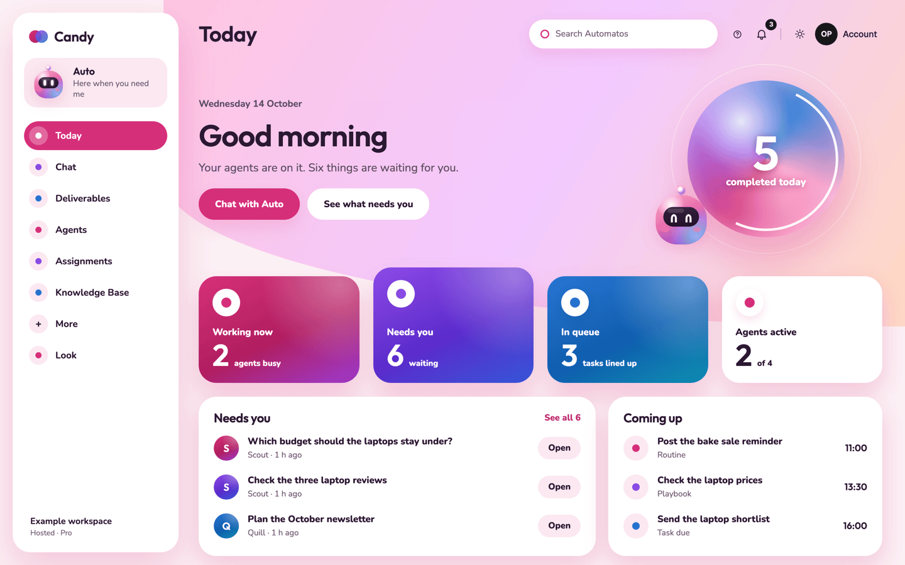
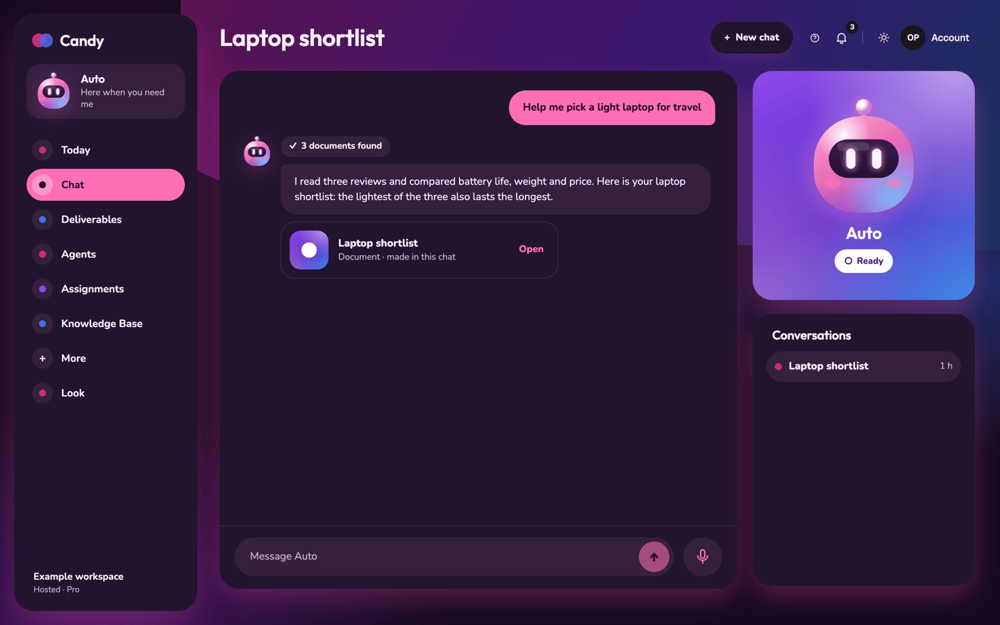
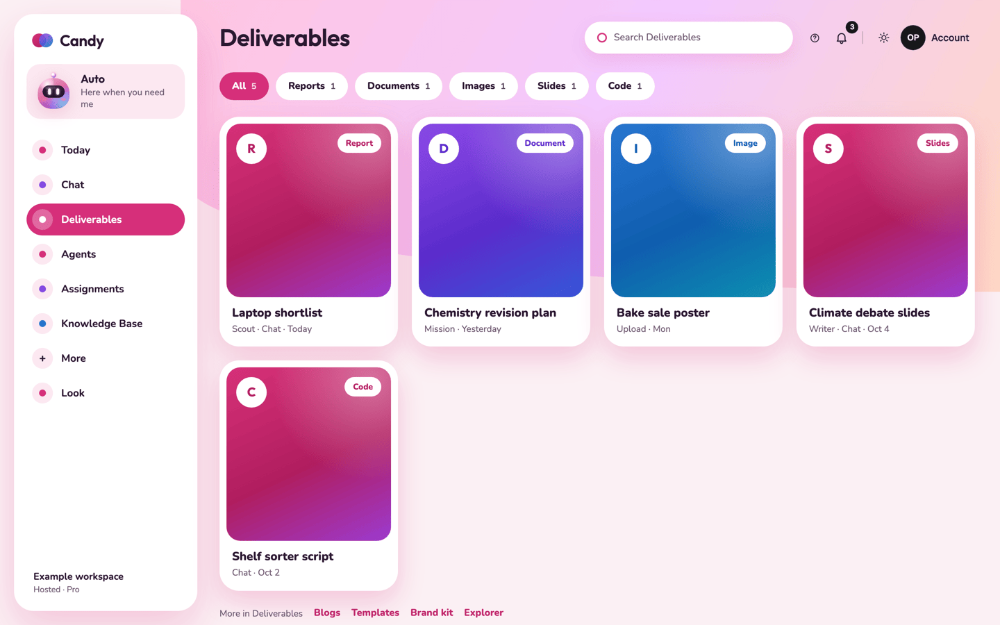

# Candy

Relevant source files

Candy is built in the Automatos Design Kit and in Automatos Go, not in this repository. This page was written from:

- [Design Kit: themes/candy](https://github.com/AutomatosAI/automatos-design-kit/tree/main/themes/candy) (`theme.json`, `looks/`, `src/`)
- [Design Kit: docs/themes/candy.md](https://github.com/AutomatosAI/automatos-design-kit/blob/main/docs/themes/candy.md) (the technical page)
- [Design Kit: guides/phone-layouts.md, "Candy"](https://github.com/AutomatosAI/automatos-design-kit/blob/main/guides/phone-layouts.md#candy) (the phone layout)
- [Automatos Go: src/styles/candy](https://github.com/AutomatosAI/automatos-go/tree/main/src/styles/candy) and [src/styles/sync/look-themes.ts](https://github.com/AutomatosAI/automatos-go/blob/main/src/styles/sync/look-themes.ts)

Candy (`automatos/candy`) is one of Automatos's own themes: bright, soft and glossy. Every card is its own gradient in
pink, violet or blue, corners are big and round, every icon sits in a circle, today's numbers sit in a candy orb, and
Auto is a glossy little robot. Version 1.0.1.

<table>
  <tr>
    <td></td>
    <td></td>
  </tr>
  <tr>
    <td><strong>Today</strong> in Blush, the default look.</td>
    <td><strong>The chat</strong> in Night bloom, the dark palette.</td>
  </tr>
</table>

To add Candy to a workspace, see
[Get Play, HUD, Arcade or Candy](installing-and-choosing.md#get-play-hud-arcade-or-candy).

---

## Its pages

A sidebar runs down the left: Candy's mark, Auto's card, the menu (Today, Chat, Deliverables, Agents, Assignments,
Knowledge Base, **More** for every other page, and Look), then **Pause** and your workspace. The app's header buttons
(search, help, notifications, Appearance, your account) sit at the top right.

| Page | What it shows |
|---|---|
| **Today** (`/x/today`) | A greeting, the orb with what was completed today, four stat cards (Working now, Needs you, In queue, Agents active), **Needs you** (the newest three things waiting for you) and **Coming up** (the next three on the schedule). **Chat with Auto** and **See what needs you** take you there. |
| **Chat** (`/chat`) | Auto on his violet stage with his state (Ready, Listening, Thinking and so on) and **Pause**; the thread, with a chip over each reply for what it did and a row for each Deliverable it made; the app's approval, Mission and ticket cards; your conversations; the message box with the voice button beside it. |
| **Deliverables** (`/deliverables`) | A shelf: a search, a pill per kind with its count, and a gradient tile per Deliverable, newest first. A tile opens the Deliverable in a sheet, with **Download**. |
| **Your team** (`/x/agents`) | A card per agent (its round avatar, name, job and status), a search, the **All**, **Active** and **Inactive** filters, and a link to the app's own Agents page. |
| **Your look** (`/looks`) and **Style sheet** (`/looks/style`) | Candy's look editor (below) and its colours, type and Auto's twelve states. |

Every other page (the Command Center, Assignments, Settings and the rest) is the app's own, inside Candy's sidebar,
in Candy's colours. While the server isn't answering, the page gives way to Auto asleep, what is going on, and
**Check again**. A page that doesn't exist shows Auto lost, with the ways back to Today and the chat.

**In a narrower window** (360 to 1023 pixels, such as a phone's browser) Candy trades the sidebar for a top bar with a
menu, puts each page in one column, and floats a tab bar at the foot: Today, Chat, Shelf and Team, with the voice
button raised in the middle. The chat leaves the tab bar off, since it has its own message box and voice button.

**What Candy leaves out.** Today greets you with "Good morning", "Good afternoon" or "Good evening" but not your name,
because a theme is told your workspace's name, not yours. A kind pill on the shelf counts what has loaded so far and
says "24+" until every page is in.

---

## Its looks

Open **Look** in the sidebar (or **Appearance › Customise look…**). Pick one of three presets and tune it:

| Setting | Choices |
|---|---|
| **Palette** | **Blush** (pink on white, the default), **Lilac** (violet into blue, light) or **Night bloom** (neon pinks after dark, the one dark palette). The palette sets light or dark. |
| **Card colours** | **Mixed** (the cards take pink, violet and blue in turn) or **One colour**. |
| **Gradient** | **Soft**, **Rich** or **Vivid**. Vivid adds a soft glow behind the page. |
| **Roundness** | A slider from 16 to 40: how round the cards and windows are. |
| **Glow** | 0 to 10: how strong the tinted shadows are. |
| **Motion** | **On** (Auto floats and blinks, the orb's ring turns) or **Paused**. |

**Save look** keeps your settings as a look of your own; **Reset** goes back to the preset. See [Looks](looks.md) for
saving, sharing and deleting looks.

**Pause** in the sidebar (and on Auto's stage in the chat) stills everything at once, and Candy remembers it for your
account. Nothing moves when your device asks for reduced motion.

---

## In Automatos Go

Automatos Go has a Candy style of its own, built into the app (added on 31 October 2026). To use it, pick
**Candy** under **Settings › Style and look**, or leave **Same as Studio** on while Candy is your theme on the web.

| Screen | What it shows |
|---|---|
| **Today** | A greeting, "{n} things need you", the orb with how many things need you, the stat cards (Working now, Needs you, In queue) and the first two things that need you. **Ideas · N** opens Auto's suggestions where your server offers them. |
| **Chat** | Auto on his violet stage with his state and **Pause**, the thread (with the day's brief, where your server offers it), the newest open suggestion above the box, and **Message Auto** with the voice button beside it. While an approval is waiting, "◆ WAITING FOR YOU · OPEN" sits under his state. |
| **Shelf** | Your Deliverables as gradient tiles under type chips (All, Reports, Documents, Images, Spreadsheets, Slides), with a link to all of them in the Command Centre. |
| **Team** | "Your team", how many agents are active, and each agent with its status: ● Needs you, ● Working or ○ Ready. |

A floating tab bar switches Today, Shelf and Team, with hold to talk raised in its middle; the chat has its own box
and voice button. The menu circle opens the menu every style has (New chat, Chats, the Command Centre and Settings).

**Make it sweet**, under **Settings › Style and look**, is Candy's look page on the phone: the same three presets and
six settings as the web, a live preview, **Save look** and **Reset**. Touch and hold a look of your own to rename or
delete it. While Candy is installed in the workspace, your looks stay in step with the web; where it isn't, the page
says "Candy isn't installed in this workspace, so your looks stay on this phone."

On an app version from before the Candy style, the phone draws its Studio layout in Candy's colours, with Candy's
fonts and Auto's pictures. See [On your phone](on-your-phone.md).
