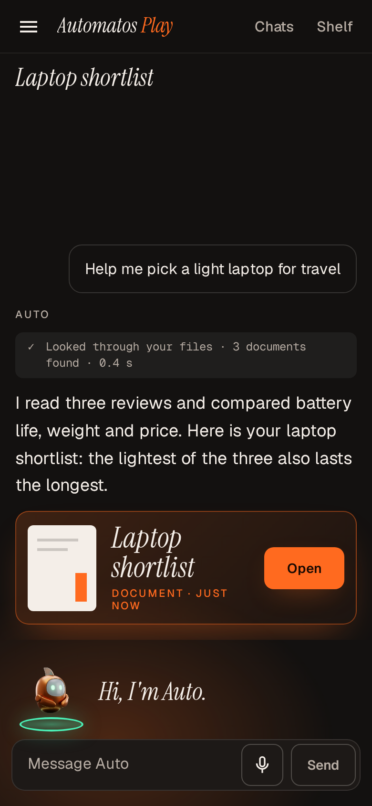
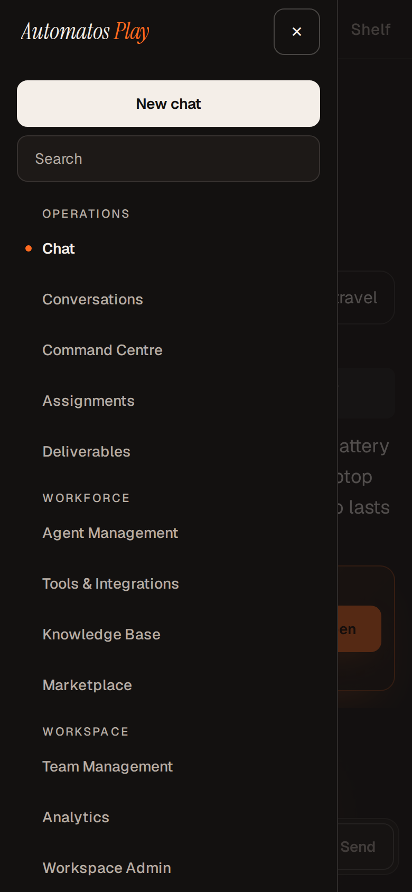
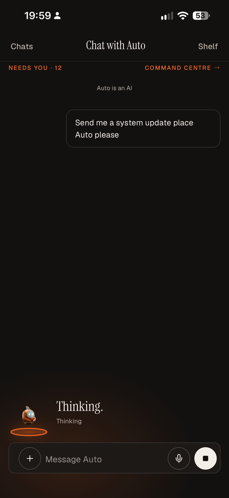
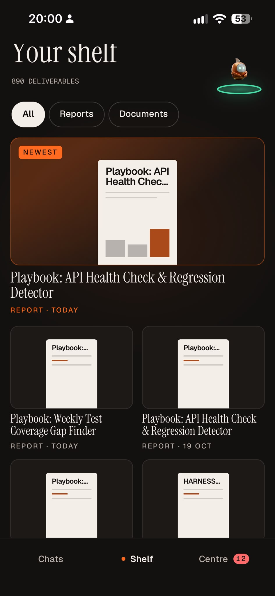

# On your phone

Relevant source files

The following files were used as context for generating this page:

- [orchestrator/api/themes_mobile.py](../../orchestrator/api/themes_mobile.py)
- [orchestrator/services/themes/mobile.py](../../orchestrator/services/themes/mobile.py)
- [orchestrator/services/themes/mobile_manifest.py](../../orchestrator/services/themes/mobile_manifest.py)
- [orchestrator/services/themes/mobile_tokens.py](../../orchestrator/services/themes/mobile_tokens.py)
- [orchestrator/services/themes/membership.py](../../orchestrator/services/themes/membership.py)
- [orchestrator/services/themes/serve.py](../../orchestrator/services/themes/serve.py)
- [orchestrator/services/themes/defaults.py](../../orchestrator/services/themes/defaults.py)
- [orchestrator/services/themes/looks.py](../../orchestrator/services/themes/looks.py)
- [orchestrator/services/themes/contract.py](../../orchestrator/services/themes/contract.py)
- [frontend/components/settings/SettingsPanel.tsx](../../frontend/components/settings/SettingsPanel.tsx)
- [orchestrator/api/themes_install.py](../../orchestrator/api/themes_install.py)
- [orchestrator/api/themes_looks.py](../../orchestrator/api/themes_looks.py)
- [orchestrator/tests/test_prd266_device_theme_routes.py](../../orchestrator/tests/test_prd266_device_theme_routes.py)
- [orchestrator/services/mobile/discovery.py](../../orchestrator/services/mobile/discovery.py)
- [frontend/lib/theme-host/installed-entry.ts](../../frontend/lib/theme-host/installed-entry.ts)
- [docs/theme-host/mobile.md](../theme-host/mobile.md)

A theme reaches your phone in two ways:

- **In the phone's browser.** A theme draws from the narrowest window its `theme.json` names (`minWidth`). Play (from
  1.2.0) and HUD (from 1.0.1) name 360 pixels and bring layouts of their own for a phone's width, so Automatos in a
  phone's browser shows them as below. A theme that names a wider window shows Studio's layout on a phone.
- **In Automatos Go**, the phone app ([AutomatosAI/automatos-go](https://github.com/AutomatosAI/automatos-go)). The
  app draws its own screens and paints a theme's **phone skin** onto them: colours, font files and mascot images. A
  theme never sends code to a phone.

<table>
  <tr>
    <td></td>
    <td></td>
    <td></td>
  </tr>
  <tr>
    <td>Play's phone layout.</td>
    <td>Play's phone menu.</td>
    <td>HUD's phone layout.</td>
  </tr>
</table>

---

## In Automatos Go

Automatos Go has three styles of its own: Studio, Play and HUD. In the app, **Settings › Style and look** chooses
how it looks: one of those styles, a theme installed in your workspace, or **Same as Studio**, the default, which
follows the theme you use on the web. The app reads your theme when it opens and each time it comes back to the
front, and paints the theme's phone skin (below). If that theme is uninstalled, the app goes back to Studio and says
so once.

Your looks for Play and HUD stay in step with the web while the theme is installed in the workspace.

<table>
  <tr>
    <td></td>
    <td></td>
  </tr>
  <tr>
    <td>Chat with Auto in Play.</td>
    <td>The shelf of Deliverables.</td>
  </tr>
</table>

The app reads two routes: `GET /api/themes/active` (your theme, as a browser gets it) and
`GET /api/themes/mobile/{install_id}` (a theme's phone skin), which the server lists as the `mobile_theme`
capability. See [The phone's theme: the `mobile` block](../theme-host/mobile.md) (technical).

---

## What the server keeps for a phone

- **Your choice.** The server keeps one theme choice per member per workspace. A phone gets the same answer a browser
  gets: your choice, else the workspace default, else Studio.
- **Your looks.** Looks are kept on the server per member, per workspace and per theme, for a theme installed in the
  workspace. A phone reads the same records as the web. See [Looks](looks.md#where-your-looks-are-kept).
- **The phone skin.** A theme can carry a phone block (`mobile` in its `theme.json`). The server turns it into data for
  a phone: colours, the addresses of font files and the addresses of the mascot's clips or still images. It never gives
  a phone the address of a JavaScript or CSS file.

---

## The phone skin

| Part | What it is |
|---|---|
| **Colours** | Either the theme's own light and (optionally) dark colours, or your active look for that theme painted into colours (the theme's default look when you have saved none). |
| **Light or dark** | With the theme's own colours, the server leaves light or dark to the phone's own setting. With colours from your look, the tone comes from the theme and your look: the theme's fixed tone, the tone your look sets, or else light or dark by how dark your look's ground is. |
| **Fonts** | Up to three: a sans, a serif and a mono face, as `.ttf` or `.otf` files. |
| **Mascot** | Video clips with still images, still images only, or none, one per mascot state. |

When the colours come from your look, a phone gets the look you last saved on the server, not one still being edited
in a browser tab.

The scan report measures the contrast of every theme with a phone block: each text colour on its own fill (eight pairs)
at 4.5:1, and the primary and focus-ring colours on the ground at 3:1. A pair under its minimum is an **Error**, so that
version can't be listed in the Marketplace; a private upload still installs. See the **Contrast (AA)** row of the
[scan report](installing-and-choosing.md#the-checks).

---

## When a phone gets no skin

| Case | Why |
|---|---|
| The theme isn't installed in the workspace the phone uses | A phone paired to a server belongs to exactly the workspace it was paired in. A phone signed in as you can use any workspace you belong to. |
| A private theme you haven't opted in to | A phone gets no skin for a private version until you opt in to that version in **Settings › Appearance › Themes**. |
| The theme has no phone block | A theme without one gives a phone nothing. |
| The version is withdrawn | A withdrawn version gives a phone nothing. |

To pair a phone, use **Settings › Phones & devices**.

For the exact answer a phone reads, and the routes it may call, see
[The phone's theme: the `mobile` block](../theme-host/mobile.md) (technical). To add a phone block to your own theme,
see the Design Kit's [contract guide](https://github.com/AutomatosAI/automatos-design-kit/blob/main/guides/contract.md).
