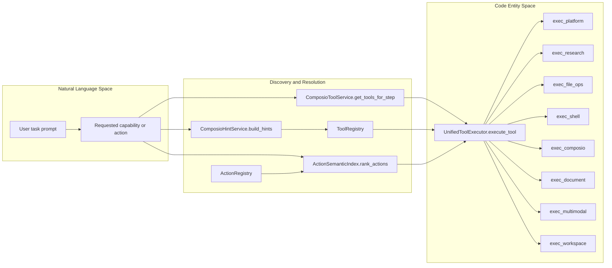
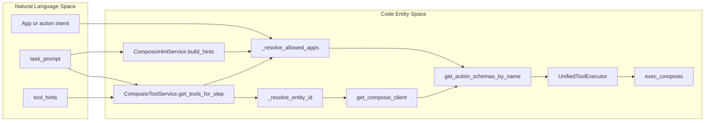

# Tools & Integrations

Relevant source files

The following files were used as context for generating this wiki page:

- [orchestrator/consumers/chatbot/tool_router.py](orchestrator/consumers/chatbot/tool_router.py)
- [orchestrator/core/composio/lookup_cache.py](orchestrator/core/composio/lookup_cache.py)
- [orchestrator/core/composio/off_loop.py](orchestrator/core/composio/off_loop.py)
- [orchestrator/modules/context/sections/planning_knowledge.py](orchestrator/modules/context/sections/planning_knowledge.py)
- [orchestrator/modules/memory/agent_sources.py](orchestrator/modules/memory/agent_sources.py)
- [orchestrator/modules/tools/__init__.py](orchestrator/modules/tools/__init__.py)
- [orchestrator/modules/tools/execution/exec_platform.py](orchestrator/modules/tools/execution/exec_platform.py)
- [orchestrator/modules/tools/execution/turn_owner_words.py](orchestrator/modules/tools/execution/turn_owner_words.py)
- [orchestrator/modules/tools/execution/unified_executor.py](orchestrator/modules/tools/execution/unified_executor.py)
- [orchestrator/modules/tools/registry/tool_registry.py](orchestrator/modules/tools/registry/tool_registry.py)
- [orchestrator/modules/tools/services/composio_hint_service.py](orchestrator/modules/tools/services/composio_hint_service.py)
- [orchestrator/modules/tools/services/composio_tool_service.py](orchestrator/modules/tools/services/composio_tool_service.py)
- [orchestrator/services/agents_writing.py](orchestrator/services/agents_writing.py)
- [orchestrator/services/draft_guides.py](orchestrator/services/draft_guides.py)
- [orchestrator/services/orchestrator_answers.py](orchestrator/services/orchestrator_answers.py)
- [orchestrator/tests/test_f088_document_search_finds_what_is_stored.py](orchestrator/tests/test_f088_document_search_finds_what_is_stored.py)
- [orchestrator/tests/test_f105_a_composio_lookup_gives_up_in_time.py](orchestrator/tests/test_f105_a_composio_lookup_gives_up_in_time.py)
- [orchestrator/tests/test_f105_a_composio_lookup_never_freezes_the_loop.py](orchestrator/tests/test_f105_a_composio_lookup_never_freezes_the_loop.py)
- [orchestrator/tests/test_f105_a_composio_lookups_are_kept_between_turns.py](orchestrator/tests/test_f105_a_composio_lookups_are_kept_between_turns.py)
- [orchestrator/tests/test_f155_a_widget_born_task_is_offered_only_its_keys_tools.py](orchestrator/tests/test_f155_a_widget_born_task_is_offered_only_its_keys_tools.py)
- [orchestrator/tests/test_f201_a_customer_drafts_follow_the_guides.py](orchestrator/tests/test_f201_a_customer_drafts_follow_the_guides.py)
- [orchestrator/tests/test_f269_b_f287_a_agent_writing_is_never_the_owners_facts.py](orchestrator/tests/test_f269_b_f287_a_agent_writing_is_never_the_owners_facts.py)
- [orchestrator/tests/test_f302_c_the_owners_words_reach_platform_query_data.py](orchestrator/tests/test_f302_c_the_owners_words_reach_platform_query_data.py)
- [orchestrator/tests/test_f325_a_auto_never_cites_an_agents_report_from_memory.py](orchestrator/tests/test_f325_a_auto_never_cites_an_agents_report_from_memory.py)
- [orchestrator/tests/test_prd184_us004_tools_concurrency_deleted.py](orchestrator/tests/test_prd184_us004_tools_concurrency_deleted.py)

## Purpose and Scope

This page introduces the tools system: how natural-language requests are connected to discoverable tools and routed to execution paths. The architecture includes a central `ToolRegistry`, Composio action discovery, and a `UnifiedToolExecutor` that dispatches calls to specialized executors. [orchestrator/modules/tools/registry/tool_registry.py:7-21](), [orchestrator/modules/tools/execution/unified_executor.py:5-15]()

This is a parent page. It summarizes the system and links to child pages for implementation details.

Sources: [orchestrator/modules/tools/registry/tool_registry.py:7-21](), [orchestrator/modules/tools/execution/unified_executor.py:5-15]()

## System Architecture

`ToolRegistry` provides a shared tool-management interface, with tools described by metadata such as category, parameters, security level, and execution information. `ComposioHintService` and `ComposioToolService` help connect a task prompt to candidate external actions; `UnifiedToolExecutor` dispatches recognized calls to platform, research, file, shell, Composio, document, multimodal, or workspace execution modules. [orchestrator/modules/tools/registry/tool_registry.py:109-127](), [orchestrator/modules/tools/services/composio_hint_service.py:124-159](), [orchestrator/modules/tools/services/composio_tool_service.py:64-71](), [orchestrator/modules/tools/execution/unified_executor.py:24-40]()

**Diagram: Natural-language tool request mapped to code entities**

Sources: [orchestrator/modules/tools/services/composio_hint_service.py:124-159](), [orchestrator/modules/tools/services/composio_tool_service.py:64-71](), [orchestrator/modules/tools/registry/tool_registry.py:109-127](), [orchestrator/modules/tools/execution/unified_executor.py:24-40](), [orchestrator/modules/tools/registry/tool_registry.py:1-170](), [orchestrator/modules/tools/execution/unified_executor.py:1-142]()

**Diagram: Composio intent discovery mapped to action execution entities**

Sources: [orchestrator/modules/tools/services/composio_hint_service.py:138-170](), [orchestrator/modules/tools/services/composio_tool_service.py:98-150](), [orchestrator/modules/tools/execution/unified_executor.py:28-40](), [orchestrator/modules/tools/services/composio_tool_service.py:1-167](), [orchestrator/modules/tools/execution/unified_executor.py:1-142]()

## Subsystem Overviews

### 8.1 Composio Integration

Composio actions are exposed as individual function-calling tools. `ComposioToolService` resolves allowed apps and a workspace entity, then can use explicit action names, prompt hints, or SDK search to find action schemas. [orchestrator/modules/tools/services/composio_tool_service.py:64-71](), [orchestrator/modules/tools/services/composio_tool_service.py:98-150]()

For details, see [Composio Integration](#8.1).

Sources: [orchestrator/modules/tools/services/composio_tool_service.py:64-71](), [orchestrator/modules/tools/services/composio_tool_service.py:98-150]()

### 8.2 Tool Discovery & Resolution

`ToolRegistry` is the shared catalog for tool definitions and supports discovery by category, task type, or name. `ActionRegistry` manages platform actions. Composio resolution adds app assignments, action schemas, and prompt-based matching to that broader tool system. `ActionSemanticIndex` provides semantic search capabilities for platform actions. [orchestrator/modules/tools/registry/tool_registry.py:7-21](), [orchestrator/modules/tools/services/composio_tool_service.py:98-114]()

For details, see [Tool Discovery & Resolution](#8.2).

Sources: [orchestrator/modules/tools/registry/tool_registry.py:7-21](), [orchestrator/modules/tools/services/composio_tool_service.py:98-114]()

### 8.3 Tool Router & Execution

`UnifiedToolExecutor` is the execution entry point described in this code: it imports specialized `exec_*` modules and includes capability-based validation for Composio actions. Platform actions are delegated through `PlatformActionExecutor`; research tools use `AgentPlatformTools`. [orchestrator/modules/tools/execution/unified_executor.py:5-15](), [orchestrator/modules/tools/execution/unified_executor.py:24-40](), [orchestrator/modules/tools/execution/exec_platform.py:18-37](), [orchestrator/modules/tools/execution/exec_platform.py:47-108]()

The `UnifiedToolExecutor` also handles tool aliases, such as mapping `"search_documents"` to `"platform_search_documents"`, to ensure that models can correctly invoke tools even if they use an older or slightly different name. [orchestrator/modules/tools/execution/unified_executor.py:48-53]() It also includes logic for parameter aliasing to fill missing required parameters from obvious synonyms, and unwraps common JSON wrappers like `{"report": {...}}`. [orchestrator/modules/tools/execution/unified_executor.py:60-86](), [orchestrator/modules/tools/execution/unified_executor.py:92-119]()

For details, see [Tool Router & Execution](#8.3).

Sources: [orchestrator/modules/tools/execution/unified_executor.py:5-15](), [orchestrator/modules/tools/execution/unified_executor.py:24-40](), [orchestrator/modules/tools/execution/exec_platform.py:18-37](), [orchestrator/modules/tools/execution/exec_platform.py:47-108](), [orchestrator/modules/tools/execution/unified_executor.py:48-53](), [orchestrator/modules/tools/execution/unified_executor.py:60-86](), [orchestrator/modules/tools/execution/unified_executor.py:92-119]()

### 8.4 Connecting Apps

App connection and OAuth user flows are covered by the child page. At the tool-system level, Composio services resolve the apps assigned to an agent and the entity associated with a workspace before looking up action schemas. [orchestrator/modules/tools/services/composio_tool_service.py:117-137]()

For details, see [Connecting Apps](#8.4).

Sources: [orchestrator/modules/tools/services/composio_tool_service.py:117-137]()

### 8.5 Permission & Validation System

Tool definitions include security levels and permission metadata. The executor’s documented design also includes capability-based validation for Composio actions at execution time; platform-action execution requires a workspace ID and passes caller context to `PlatformActionExecutor`. [orchestrator/modules/tools/registry/tool_registry.py:72-77](), [orchestrator/modules/tools/registry/tool_registry.py:109-127](), [orchestrator/modules/tools/execution/unified_executor.py:10-12](), [orchestrator/modules/tools/execution/exec_platform.py:47-74]()

A critical aspect of the permission system for platform actions is the injection of the `_agent_id` and `_agent_name` into parameters by the `execute_platform_action` function. This ensures that the actor's identity is derived from the trusted runtime `agent_id` and prevents impersonation attempts by stripping any `_agent_id` or `_agent_name` supplied by the LLM. [orchestrator/modules/tools/execution/exec_platform.py:77-101]()

For details, see [Permission & Validation System](#8.5).

Sources: [orchestrator/modules/tools/registry/tool_registry.py:72-77](), [orchestrator/modules/tools/registry/tool_registry.py:109-127](), [orchestrator/modules/tools/execution/unified_executor.py:10-12](), [orchestrator/modules/tools/execution/exec_platform.py:47-74](), [orchestrator/modules/tools/execution/exec_platform.py:77-101]()

### 8.6 Tool Hints & Intent Graph Routing

`ComposioHintService` analyzes prompts and resolves candidate action hints through capability-based, token-filtered, and fallback strategies. `ComposioToolService` separately resolves action schemas for a step, including prompt hints that can scope SDK search to relevant apps. The `PlatformActionsSection` uses `ActionSemanticIndex` for semantic routing of platform actions, falling back to a full catalog if semantic routing fails. [orchestrator/modules/tools/services/composio_hint_service.py:12-21](), [orchestrator/modules/tools/services/composio_hint_service.py:138-170](), [orchestrator/modules/tools/services/composio_tool_service.py:79-96](), [orchestrator/modules/tools/services/composio_tool_service.py:98-114]()

For details, see [Tool Hints & Intent Graph Routing](#8.6).

Sources: [orchestrator/modules/tools/services/composio_hint_service.py:12-21](), [orchestrator/modules/tools/services/composio_hint_service.py:138-170](), [orchestrator/modules/tools/services/composio_tool_service.py:79-96](), [orchestrator/modules/tools/services/composio_tool_service.py:98-114]()

### 8.7 Web Access & Research Tools

The executor separates research tools from other execution categories through modules such as `exec_research` and `exec_platform`. The platform research path delegates to `AgentPlatformTools`; document-search results are further scoped through owner-document handling. [orchestrator/modules/tools/execution/unified_executor.py:28-40](), [orchestrator/modules/tools/execution/exec_platform.py:18-44]()

Specifically, `search_knowledge` and `semantic_search` tools are designed to return only the owner's documents, never an agent's, unless explicitly scoped to "past_work". [orchestrator/modules/tools/execution/exec_platform.py:24-44](), [services/draft_guides.py:121-132](), [services/agents_writing.py:77-83]() This prevents agents from citing their own drafts or reports as factual sources. [orchestrator/tests/test_f269_b_f287_a_agent_writing_is_never_the_owners_facts.py:1-10]() The `owners_search` function in `services/agents_writing.py` is responsible for filtering out agent-written documents from search results. [services/agents_writing.py:77-83]()

For details about native web access and research tools, see [Web Access & Research Tools](#8.7).

Sources: [orchestrator/modules/tools/execution/unified_executor.py:28-40](), [orchestrator/modules/tools/execution/exec_platform.py:18-44](), [orchestrator/modules/tools/execution/exec_platform.py:12-15](), [services/draft_guides.py:121-132](), [services/agents_writing.py:77-83](), [orchestrator/tests/test_f269_b_f287_a_agent_writing_is_never_the_owners_facts.py:1-10]()

### 8.8 Tools API Reference

This parent page does not enumerate endpoint behavior. The API reference child page covers the tools marketplace, connected apps, analytics, and workspace tool management.

For details, see [Tools API Reference](#8.8).

Sources: [orchestrator/modules/tools/__init__.py:25-41]()

---