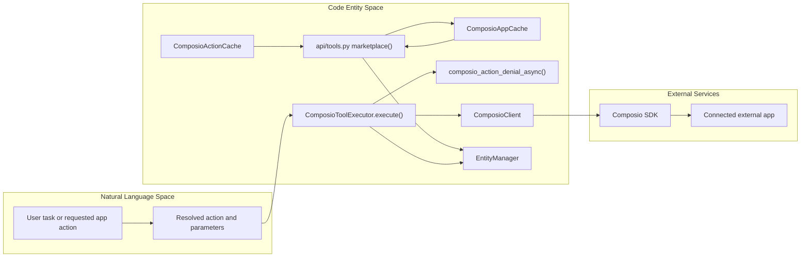
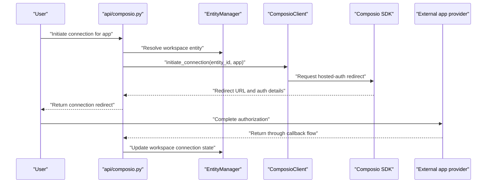
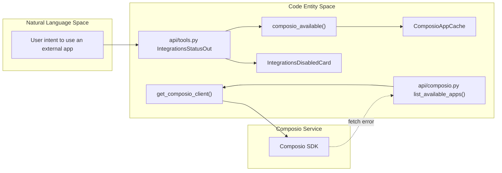

# Composio Integration

Relevant source files

The following files were used as context for generating this wiki page:

- [frontend/components/workflows/execution-kitchen.tsx](frontend/components/workflows/execution-kitchen.tsx)
- [orchestrator/alembic/versions/dedupe_skills_unique_workspace_name.py](orchestrator/alembic/versions/dedupe_skills_unique_workspace_name.py)
- [orchestrator/api/composio.py](orchestrator/api/composio.py)
- [orchestrator/api/patterns.py](orchestrator/api/patterns.py)
- [orchestrator/api/recipe_executor.py](orchestrator/api/recipe_executor.py)
- [orchestrator/api/skills.py](orchestrator/api/skills.py)
- [orchestrator/api/socials_media_tools.py](orchestrator/api/socials_media_tools.py)
- [orchestrator/api/socials_publish.py](orchestrator/api/socials_publish.py)
- [orchestrator/api/templates.py](orchestrator/api/templates.py)
- [orchestrator/api/tools.py](orchestrator/api/tools.py)
- [orchestrator/api/webhooks.py](orchestrator/api/webhooks.py)
- [orchestrator/api/workflow_recipes.py](orchestrator/api/workflow_recipes.py)
- [orchestrator/core/boot/reaper.py](orchestrator/core/boot/reaper.py)
- [orchestrator/core/composio/client.py](orchestrator/core/composio/client.py)
- [orchestrator/core/composio/linkedin_image_workaround.py](orchestrator/core/composio/linkedin_image_workaround.py)
- [orchestrator/core/composio/tool_executor.py](orchestrator/core/composio/tool_executor.py)
- [orchestrator/core/composio/upload_spec.py](orchestrator/core/composio/upload_spec.py)
- [orchestrator/core/credentials/tester.py](orchestrator/core/credentials/tester.py)
- [orchestrator/core/credentials/types.py](orchestrator/core/credentials/types.py)
- [orchestrator/core/database/credential_types_seed.json](orchestrator/core/database/credential_types_seed.json)
- [orchestrator/core/routing/ingestors/webhook.py](orchestrator/core/routing/ingestors/webhook.py)
- [orchestrator/core/services/skill_materializer.py](orchestrator/core/services/skill_materializer.py)
- [orchestrator/modules/agents/services/skill_loader.py](orchestrator/modules/agents/services/skill_loader.py)
- [orchestrator/modules/socials/ai_options.py](orchestrator/modules/socials/ai_options.py)
- [orchestrator/modules/socials/media_tools.py](orchestrator/modules/socials/media_tools.py)
- [orchestrator/modules/socials/notify.py](orchestrator/modules/socials/notify.py)
- [orchestrator/modules/socials/plan_visuals.py](orchestrator/modules/socials/plan_visuals.py)
- [orchestrator/modules/socials/publish_lifecycle.py](orchestrator/modules/socials/publish_lifecycle.py)
- [orchestrator/modules/socials/publish_records.py](orchestrator/modules/socials/publish_records.py)
- [orchestrator/modules/socials/publisher.py](orchestrator/modules/socials/publisher.py)
- [orchestrator/modules/socials/publishing.py](orchestrator/modules/socials/publishing.py)
- [orchestrator/modules/socials/schedule_jobs.py](orchestrator/modules/socials/schedule_jobs.py)
- [orchestrator/services/metadata_sync_service.py](orchestrator/services/metadata_sync_service.py)
- [orchestrator/services/webhook_dedup.py](orchestrator/services/webhook_dedup.py)
- [orchestrator/tests/test_a_restart_orphan_is_failed_not_done.py](orchestrator/tests/test_a_restart_orphan_is_failed_not_done.py)
- [orchestrator/tests/test_composio_upload_takes_the_canonical_tool_slug.py](orchestrator/tests/test_composio_upload_takes_the_canonical_tool_slug.py)
- [orchestrator/tests/test_p2w2_webhook_dedup.py](orchestrator/tests/test_p2w2_webhook_dedup.py)
- [orchestrator/tests/test_p2w2_webhook_signature_reject.py](orchestrator/tests/test_p2w2_webhook_signature_reject.py)
- [orchestrator/tests/test_playbook_restart_durability.py](orchestrator/tests/test_playbook_restart_durability.py)
- [orchestrator/tests/test_prd251_linkedin_scope.py](orchestrator/tests/test_prd251_linkedin_scope.py)
- [orchestrator/tests/test_prd251_service.py](orchestrator/tests/test_prd251_service.py)
- [orchestrator/tests/test_prd251bw3_brand_style.py](orchestrator/tests/test_prd251bw3_brand_style.py)
- [orchestrator/tests/test_prd251bw3_media_tools.py](orchestrator/tests/test_prd251bw3_media_tools.py)
- [orchestrator/tests/test_prd251w2_approval_notify.py](orchestrator/tests/test_prd251w2_approval_notify.py)
- [orchestrator/tests/test_prd251w3_publisher.py](orchestrator/tests/test_prd251w3_publisher.py)
- [orchestrator/tests/test_prd251w3_recovery.py](orchestrator/tests/test_prd251w3_recovery.py)
- [orchestrator/tests/test_prd251w3_schedule.py](orchestrator/tests/test_prd251w3_schedule.py)
- [orchestrator/tests/test_prd251w3_send_once.py](orchestrator/tests/test_prd251w3_send_once.py)
- [orchestrator/tests/test_w1s6_boot_reaper.py](orchestrator/tests/test_w1s6_boot_reaper.py)
- [orchestrator/tests/test_w2s6_restart_recovery_realdb.py](orchestrator/tests/test_w2s6_restart_recovery_realdb.py)

**Purpose and scope.** This page documents Automatos AI’s Composio integration: the SDK wrapper, cached marketplace metadata, workspace-to-Composio entity mapping, hosted authentication, action execution, degradation behavior, and platform-wide action-denial checks. [orchestrator/core/composio/client.py:1-12]()

Sources: [orchestrator/core/composio/client.py:1-12]()

## Overview

Composio provides external app and action integration through `ComposioClient`, which wraps the SDK and supports app discovery, hosted authentication, Tool Router sessions, and trigger subscriptions. The SDK is imported lazily, so environments without the optional Composio packages can still import the wrapper module; attempting to use a missing SDK raises an `ImportError`. [orchestrator/core/composio/client.py:30-63]()

The integration has two complementary API surfaces. `/api/composio` exposes direct Composio-backed discovery and connection operations, while `/api/tools` serves marketplace metadata from local cache tables and reads workspace connection state from the database. [orchestrator/api/composio.py:43-43](), [orchestrator/api/tools.py:1-8](), [orchestrator/api/tools.py:159-180]()

`ComposioToolExecutor` is the execution boundary for actions. Its module describes the executor’s responsibilities as validating access, resolving the workspace entity, executing through the SDK, and formatting the result for the unified executor. It also imports synchronous and asynchronous deny-list checks. [orchestrator/core/composio/tool_executor.py:1-12](), [orchestrator/core/composio/tool_executor.py:25-34]()

Sources: [orchestrator/core/composio/client.py:30-63](), [orchestrator/api/composio.py:43-43](), [orchestrator/api/tools.py:1-8](), [orchestrator/api/tools.py:159-180](), [orchestrator/core/composio/tool_executor.py:1-34]()

## System Architecture

The diagram maps user-facing intent and marketplace behavior to named implementation entities. The code excerpts show the API and execution boundaries; they do not specify the internal LLM tool-call producer, so that part is represented as an external input to the executor. [orchestrator/api/tools.py:159-180](), [orchestrator/core/composio/tool_executor.py:1-12]()

### Tool discovery and execution: natural-language and code entities

Sources: [orchestrator/api/tools.py:25-30](), [orchestrator/api/tools.py:159-180](), [orchestrator/core/composio/tool_executor.py:1-12](), [orchestrator/core/composio/tool_executor.py:25-34](), [orchestrator/core/composio/client.py:5-12]()

### Hosted connection: workspace entity to Composio

`workflow_recipes.py` also uses the entity mapping when registering a Composio trigger: it obtains a client and `EntityManager`, retrieves or creates the workspace entity, then subscribes to the trigger using that entity’s Composio ID. [orchestrator/api/workflow_recipes.py:104-159]()

Sources: [orchestrator/api/composio.py:28-32](), [orchestrator/core/composio/client.py:66-93](), [orchestrator/api/workflow_recipes.py:144-159]()

## SDK Wrapper and Caching

### `ComposioClient`

`ComposioClient` is the SDK wrapper. It takes an explicit API key or falls back to `config.COMPOSIO_API_KEY`; when neither is available, it logs a warning. The SDK and OpenAI provider are loaded lazily by `_get_composio()` and `_get_composio_openai_provider()`, respectively. [orchestrator/core/composio/client.py:40-63](), [orchestrator/core/composio/client.py:66-105]()

SDK handles are initialized under `_sdk_init_lock`. The normal `composio` property creates the SDK client with toolkit versions configured for the default toolkit and Shopify. A separate `_send_once_handle()` exists for publisher calls, whose documentation explains that retries could otherwise duplicate an external publish after a timeout or server error. [orchestrator/core/composio/client.py:34-38](), [orchestrator/core/composio/client.py:127-161]()

The client maintains in-memory caches for action counts, authentication-configuration resolution, and per-app action schemas. The code documents time-to-live settings for these caches, including a shorter lifetime for authentication-configuration misses so a cached miss does not outlive a newly created configuration. [orchestrator/core/composio/client.py:107-125]()

### Local metadata cache

`api/tools.py` imports `ComposioAppCache`, `ComposioActionCache`, `ComposioStatsCache`, and `ComposioSyncJob`, and constructs `MetadataSyncService`. Its marketplace endpoint is explicitly described as serving cached metadata for fast loads. [orchestrator/api/tools.py:1-8](), [orchestrator/api/tools.py:25-31]()

The marketplace endpoint reads active workspace connections through `EntityManager` and uses those database records to populate connection status; its comments specify that the endpoint does not make Composio API calls to synchronize pending connections during page loads. [orchestrator/api/tools.py:159-180]()

| Cache or state entity | Role in this integration |
|---|---|
| `ComposioAppCache` | App metadata cache imported by the tools API. [orchestrator/api/tools.py:29-30]() |
| `ComposioActionCache` | Action metadata cache imported by the tools API. [orchestrator/api/tools.py:29-30]() |
| `ComposioStatsCache` | Marketplace statistics cache imported by the tools API. [orchestrator/api/tools.py:29-30]() |
| `ComposioSyncJob` | Sync-job state imported by the tools API. [orchestrator/api/tools.py:29-30]() |
| `ComposioClient._schema_cache` | In-memory per-app action-schema cache, with a one-hour TTL. [orchestrator/core/composio/client.py:121-125]() |
| `ComposioClient._auth_config_cache` | In-memory authentication-configuration lookup cache, with distinct hit and miss TTLs. [orchestrator/core/composio/client.py:112-120]() |

Sources: [orchestrator/core/composio/client.py:40-63](), [orchestrator/core/composio/client.py:66-125](), [orchestrator/core/composio/client.py:127-161](), [orchestrator/api/tools.py:25-31](), [orchestrator/api/tools.py:159-180]()

## Metadata Synchronization

`api/tools.py` creates a `MetadataSyncService` and uses the Composio cache models as its local marketplace data layer. The frontend marketplace fetches `/api/tools/marketplace`, transforms each returned app into its `ComposioApp`-shaped state, and separately fetches `/api/tools/connected` for workspace tools. [orchestrator/api/tools.py:25-31](), [frontend/components/workflows/execution-kitchen.tsx:28-29]()

The direct `/api/composio/apps` endpoint follows a different path: it obtains a client, fetches available apps from Composio, looks up the current workspace entity, and derives `is_connected` from active connections. It applies category filtering after fetching apps and does not fetch each app’s actions in the listing endpoint. [orchestrator/api/composio.py:130-180]()

The distinction is operationally important: the cached marketplace is designed for fast listing, while the direct Composio endpoint performs live app discovery. The tools API comments also state that pending-connection synchronization is handled after the OAuth callback or through a manual refresh rather than on every marketplace page load. [orchestrator/api/tools.py:168-173]()

Sources: [orchestrator/api/tools.py:25-31](), [orchestrator/api/tools.py:159-180](), [orchestrator/api/composio.py:130-180](), [frontend/components/workflows/execution-kitchen.tsx:28-29]()

## Workspace Entity Management

Workspace connection state is resolved through `EntityManager`. The direct app-list endpoint looks up the entity for `ctx.workspace_id`, then reads its connections and marks an app connected when the connection status is active. [orchestrator/api/composio.py:149-159](), [orchestrator/api/composio.py:165-178]()

The recipe-trigger registration path uses `EntityManager.get_or_create_entity(workspace_id)` and passes the resulting `composio_entity_id` to `client.subscribe_to_trigger`. This establishes the workspace entity as the scope for trigger subscriptions in that flow. [orchestrator/api/workflow_recipes.py:144-159]()

Sources: [orchestrator/api/composio.py:149-159](), [orchestrator/api/composio.py:165-178](), [orchestrator/api/workflow_recipes.py:144-159]()

## OAuth and Connection Flow

The Composio API defines request and response models for hosted-auth initiation. The request can include a callback URL, an authentication scheme, and an authentication configuration ID; the response includes the redirect URL, app name, and the selected authentication configuration and scheme. [orchestrator/api/composio.py:82-98]()

The `ComposioClient` documentation identifies hosted authentication as a client capability and notes that the selected authentication configuration and scheme should be persisted for reuse on reconnects. The available excerpt does not show the implementation body of `initiate_connection` or the callback handler, so their internal steps are not specified here. [orchestrator/core/composio/client.py:66-93]()

The workflow-recipe API has a separate hosted-auth-adjacent use of Composio: trigger registration. For a Composio-sourced trigger, it resolves the trigger name, reuses an active subscription if present, otherwise resolves the workspace entity and calls `subscribe_to_trigger` with a callback URL. [orchestrator/api/workflow_recipes.py:104-159]()

Sources: [orchestrator/api/composio.py:82-98](), [orchestrator/core/composio/client.py:66-93](), [orchestrator/api/workflow_recipes.py:104-159]()

## Platform-Wide Composio Deny List (`composio.denied_actions`)

`ComposioClient` imports `composio_action_denial` and `denied_result`; `ComposioToolExecutor` imports `composio_action_denial_async` and `denied_result`. These imports establish deny-list checks at both the SDK-wrapper and executor layers. [orchestrator/core/composio/client.py:22-27](), [orchestrator/core/composio/tool_executor.py:25-34]()

The provided code excerpt does not include the implementation of `core/composio/deny_list.py` or the call sites of the imported functions. Therefore, details such as the setting’s storage format, cache policy, failure semantics, denied-action examples, and whether every execution path is checked cannot be verified from the supplied source excerpts. The system-setting name `composio.denied_actions` is the identifier used for this deny-list topic; consult the deny-list implementation and its tests before relying on operational details not shown here. [orchestrator/core/composio/client.py:22-27](), [orchestrator/core/composio/tool_executor.py:25-34]()

Sources: [orchestrator/core/composio/client.py:22-27](), [orchestrator/core/composio/tool_executor.py:25-34]()

## Degradation Handling

`composio_available` and `composio_unavailable_reason` are imported into `api/tools.py`, and `IntegrationsStatusOut` represents availability, a reason, whether a key is configured, cached app count, last sync, and sync-job status. The frontend imports `useIntegrationsStatus` and `IntegrationsDisabledCard` for the marketplace experience. [orchestrator/api/tools.py:25-30](), [orchestrator/api/tools.py:138-147](), [frontend/components/workflows/execution-kitchen.tsx:28-29]()

The SDK wrapper logs when the API key is missing, and its lazy import helpers raise explicit errors if the required SDK packages are unavailable. These are distinct conditions from the marketplace status representation; the available excerpts do not show the full availability predicate or every caller’s behavior when Composio is unavailable. [orchestrator/core/composio/client.py:40-63](), [orchestrator/core/composio/client.py:96-105]()

In the direct `/api/composio/apps` endpoint, an exception while fetching app metadata is logged and returned as HTTP 503 with a “Composio service unavailable” detail. [orchestrator/api/composio.py:141-147]()

### Degradation path: natural-language intent to implementation

Sources: [orchestrator/api/tools.py:25-30](), [orchestrator/api/tools.py:138-147](), [orchestrator/api/composio.py:130-147](), [frontend/components/workflows/execution-kitchen.tsx:28-29]()

## Tool Execution and File Resolution

`ComposioToolExecutor` documents its role as validating access, resolving the entity from the workspace, executing through the SDK, and formatting the response for the unified executor. Its module imports the synchronous and asynchronous deny-list checks and a post-action refusal helper. [orchestrator/core/composio/tool_executor.py:1-12](), [orchestrator/core/composio/tool_executor.py:25-34]()

For a defined set of upload actions, `resolve_file_uploads()` can convert URL or workspace-file references into Composio `FileUploadable` objects. It returns the parameters unchanged for actions outside `UPLOAD_ACTIONS`; for matching actions it uses the Composio client’s HTTP client and constructs action and app slugs. [orchestrator/core/composio/tool_executor.py:38-51](), [orchestrator/core/composio/tool_executor.py:71-80](), [orchestrator/core/composio/tool_executor.py:126-155]()

The shared resolver can download workspace files through `WorkspaceClient`, write them to temporary files, and create uploadable objects from those paths. [orchestrator/core/composio/tool_executor.py:100-123]()

A LinkedIn workaround intercepts image-post cases because the module describes Composio image uploads as unsupported for that flow. It uses workspace-scoped credentials and direct LinkedIn API calls for image posts; the module states that text-only posts continue through Composio. The executor’s upload pass is decorated so that image references intended for the direct API are left intact. [orchestrator/core/composio/linkedin_image_workaround.py:1-44](), [orchestrator/core/composio/linkedin_image_workaround.py:80-95](), [orchestrator/core/composio/tool_executor.py:126-136]()

Publisher calls use the dedicated send-once SDK handle to avoid duplicate external posts caused by automatic retries. The client describes the purpose of `_send_once_handle()`; the publisher-call context and SDK setup are not fully shown in the supplied excerpts. [orchestrator/core/composio/client.py:127-161]()

Sources: [orchestrator/core/composio/tool_executor.py:1-12](), [orchestrator/core/composio/tool_executor.py:25-51](), [orchestrator/core/composio/tool_executor.py:71-80](), [orchestrator/core/composio/tool_executor.py:100-155](), [orchestrator/core/composio/linkedin_image_workaround.py:1-44](), [orchestrator/core/composio/linkedin_image_workaround.py:80-95](), [orchestrator/core/composio/client.py:127-161]()

## API Reference

### Backend endpoints

| Endpoint | Behavior |
|---|---|
| `GET /api/tools/marketplace` | Serves marketplace data from the local cache-backed tools API. [orchestrator/api/tools.py:1-8](), [orchestrator/api/tools.py:159-180]() |
| `GET /api/composio/apps` | Fetches available apps through `ComposioClient`, adds workspace connection status, and optionally filters by category. [orchestrator/api/composio.py:130-180]() |
| `GET /api/composio/apps/{app_name}/actions` | Fetches actions for an app through `client.get_app_actions()` and returns action response objects. [orchestrator/api/composio.py:183-202]() |
| `POST /api/composio/...` | The router is mounted under `/api/composio`; the supplied excerpt defines connection, feature-toggle, trigger-subscription, and webhook request models. Verify route definitions in the full module for exact paths and behavior. [orchestrator/api/composio.py:43-43](), [orchestrator/api/composio.py:82-124]() |

Sources: [orchestrator/api/tools.py:1-8](), [orchestrator/api/tools.py:159-180](), [orchestrator/api/composio.py:43-43](), [orchestrator/api/composio.py:82-124](), [orchestrator/api/composio.py:130-202]()

### Core classes and services

| Code entity | Responsibility evidenced in the supplied files |
|---|---|
| `ComposioClient` | SDK wrapper for entity management, hosted auth, Tool Router sessions, app/action discovery, and trigger subscriptions. [orchestrator/core/composio/client.py:66-93]() |
| `ComposioToolExecutor` | Action execution boundary for access validation, entity resolution, SDK execution, and response formatting. [orchestrator/core/composio/tool_executor.py:1-12]() |
| `EntityManager` | Used by API routes to look up workspace entities and connections, and by trigger registration to get or create an entity. [orchestrator/api/composio.py:149-159](), [orchestrator/api/workflow_recipes.py:144-159]() |
| `MetadataSyncService` | Constructed by the tools API for marketplace metadata synchronization. [orchestrator/api/tools.py:25-31]() |
| `resolve_file_uploads()` | Resolves supported action file references into Composio uploadable inputs. [orchestrator/core/composio/tool_executor.py:126-155]() |
| `SkillLoader` | The `SkillLoader` service, specifically `get_skill_loader()`, is responsible for loading skills, which can include Composio actions. [orchestrator/modules/agents/services/skill_loader.py:216-218]() |
| `ComposioHintService` | Generates Composio action hints for LLM system messages using a three-tier resolution strategy (capability-based, token-filtered, top-N fallback). [orchestrator/api/recipe_executor.py:10-10]() |

Sources: [orchestrator/core/composio/client.py:66-93](), [orchestrator/core/composio/tool_executor.py:1-12](), [orchestrator/core/composio/tool_executor.py:126-155](), [orchestrator/api/composio.py:149-159](), [orchestrator/api/workflow_recipes.py:144-159](), [orchestrator/api/tools.py:25-31](), [orchestrator/modules/agents/services/skill_loader.py:216-218](), [orchestrator/api/recipe_executor.py:10-10]()

---