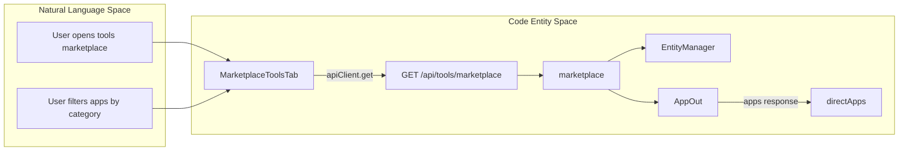
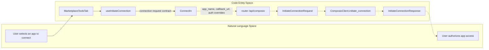
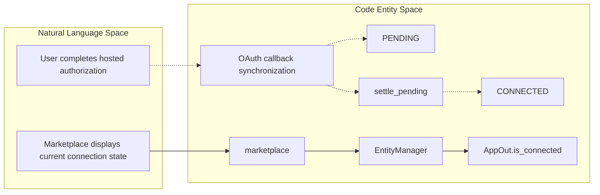

# Connecting Apps

Relevant source files

The following files were used as context for generating this wiki page:

- [docs/PRDS/42-PLUGIN-SKILLS-MARKETPLACE.md](docs/PRDS/42-PLUGIN-SKILLS-MARKETPLACE.md)
- [frontend/components/agents/agent-plugins-tab.tsx](frontend/components/agents/agent-plugins-tab.tsx)
- [frontend/components/marketplace/__tests__/marketplace-item-modal.type.test.tsx](frontend/components/marketplace/__tests__/marketplace-item-modal.type.test.tsx)
- [frontend/components/marketplace/featured-showcase-card.tsx](frontend/components/marketplace/featured-showcase-card.tsx)
- [frontend/components/marketplace/github-import-modal.tsx](frontend/components/marketplace/github-import-modal.tsx)
- [frontend/components/marketplace/marketplace-agent-cards.tsx](frontend/components/marketplace/marketplace-agent-cards.tsx)
- [frontend/components/marketplace/marketplace-agents-tab.tsx](frontend/components/marketplace/marketplace-agents-tab.tsx)
- [frontend/components/marketplace/marketplace-card.tsx](frontend/components/marketplace/marketplace-card.tsx)
- [frontend/components/marketplace/marketplace-grid.tsx](frontend/components/marketplace/marketplace-grid.tsx)
- [frontend/components/marketplace/marketplace-homepage.tsx](frontend/components/marketplace/marketplace-homepage.tsx)
- [frontend/components/marketplace/marketplace-item-modal.tsx](frontend/components/marketplace/marketplace-item-modal.tsx)
- [frontend/components/marketplace/marketplace-item-ref.ts](frontend/components/marketplace/marketplace-item-ref.ts)
- [frontend/components/marketplace/marketplace-item-sections.tsx](frontend/components/marketplace/marketplace-item-sections.tsx)
- [frontend/components/marketplace/marketplace-playbooks-tab.tsx](frontend/components/marketplace/marketplace-playbooks-tab.tsx)
- [frontend/components/marketplace/marketplace-plugin-detail-modal.tsx](frontend/components/marketplace/marketplace-plugin-detail-modal.tsx)
- [frontend/components/marketplace/marketplace-plugins-tab.tsx](frontend/components/marketplace/marketplace-plugins-tab.tsx)
- [frontend/components/marketplace/marketplace-skills-tab.tsx](frontend/components/marketplace/marketplace-skills-tab.tsx)
- [frontend/components/marketplace/marketplace-tools-tab.tsx](frontend/components/marketplace/marketplace-tools-tab.tsx)
- [frontend/components/workflows/execution-kitchen.tsx](frontend/components/workflows/execution-kitchen.tsx)
- [orchestrator/alembic/versions/dedupe_skills_unique_workspace_name.py](orchestrator/alembic/versions/dedupe_skills_unique_workspace_name.py)
- [orchestrator/api/composio.py](orchestrator/api/composio.py)
- [orchestrator/api/marketplace_plugins.py](orchestrator/api/marketplace_plugins.py)
- [orchestrator/api/patterns.py](orchestrator/api/patterns.py)
- [orchestrator/api/recipe_executor.py](orchestrator/api/recipe_executor.py)
- [orchestrator/api/skills.py](orchestrator/api/skills.py)
- [orchestrator/api/templates.py](orchestrator/api/templates.py)
- [orchestrator/api/tools.py](orchestrator/api/tools.py)
- [orchestrator/api/webhooks.py](orchestrator/api/webhooks.py)
- [orchestrator/api/workflow_recipes.py](orchestrator/api/workflow_recipes.py)
- [orchestrator/core/composio/client.py](orchestrator/core/composio/client.py)
- [orchestrator/core/composio/linkedin_image_workaround.py](orchestrator/core/composio/linkedin_image_workaround.py)
- [orchestrator/core/credentials/tester.py](orchestrator/core/credentials/tester.py)
- [orchestrator/core/credentials/types.py](orchestrator/core/credentials/types.py)
- [orchestrator/core/database/credential_types_seed.json](orchestrator/core/database/credential_types_seed.json)
- [orchestrator/core/routing/ingestors/webhook.py](orchestrator/core/routing/ingestors/webhook.py)
- [orchestrator/core/services/skill_materializer.py](orchestrator/core/services/skill_materializer.py)
- [orchestrator/modules/agents/services/skill_loader.py](orchestrator/modules/agents/services/skill_loader.py)
- [orchestrator/services/metadata_sync_service.py](orchestrator/services/metadata_sync_service.py)
- [orchestrator/services/webhook_dedup.py](orchestrator/services/webhook_dedup.py)
- [orchestrator/tests/test_p2w2_webhook_dedup.py](orchestrator/tests/test_p2w2_webhook_dedup.py)
- [orchestrator/tests/test_p2w2_webhook_signature_reject.py](orchestrator/tests/test_p2w2_webhook_signature_reject.py)
- [orchestrator/tests/test_prd251_linkedin_scope.py](orchestrator/tests/test_prd251_linkedin_scope.py)

## Purpose and Scope

This page describes how users discover apps in the tools marketplace and how the frontend and backend represent connection requests. The frontend includes a tools dashboard and a marketplace tools tab; the backend exposes tools and Composio API routers, with `ComposioClient` wrapping the Composio SDK. [frontend/components/marketplace/marketplace-tools-tab.tsx:1-6]() [orchestrator/api/tools.py:35-35]() [orchestrator/api/composio.py:43-43]() [orchestrator/core/composio/client.py:66-75]()

The provided code excerpts establish the marketplace listing and connection-request interfaces, but do not include the frontend connection handler, OAuth callback route implementation, or the backend’s full connection-initiation endpoint. Accordingly, this page documents the visible contracts and data flow without assuming unshown popup or callback behavior. [frontend/components/marketplace/marketplace-tools-tab.tsx:103-139]() [orchestrator/api/composio.py:82-98]() [orchestrator/api/tools.py:149-156]()

Sources: [frontend/components/marketplace/marketplace-tools-tab.tsx:1-6]() [frontend/components/marketplace/marketplace-tools-tab.tsx:103-139]() [orchestrator/api/tools.py:35-35]() [orchestrator/api/tools.py:149-156]() [orchestrator/api/composio.py:43-43]() [orchestrator/api/composio.py:82-98]() [orchestrator/core/composio/client.py:66-75]()

---

## Connection Architecture & Data Flow

The marketplace tab loads app metadata from `/api/tools/marketplace` and workspace connection data from `/api/tools/connected`. The marketplace response is transformed into the frontend’s `ComposioApp`-shaped records, while the connected-app response is used separately as workspace tool data. [frontend/components/marketplace/marketplace-tools-tab.tsx:103-139]() [frontend/components/marketplace/marketplace-tools-tab.tsx:154-164]()

The backend marketplace endpoint reads active connections for the current workspace through `EntityManager`; its comments specify that this page-load path reads connection state from the database rather than synchronizing pending connections with Composio. The separate `/api/composio/apps` endpoint obtains app metadata through `ComposioClient` and also derives workspace connection status through `EntityManager`. [orchestrator/api/tools.py:159-183]() [orchestrator/api/composio.py:130-180]()

### Diagram: Natural Language to Code Entity Space — Discovering Apps

Sources: [frontend/components/marketplace/marketplace-tools-tab.tsx:67-80]() [frontend/components/marketplace/marketplace-tools-tab.tsx:103-139]() [orchestrator/api/tools.py:107-120]() [orchestrator/api/tools.py:159-183]()

### Diagram: Natural Language to Code Entity Space — Requesting a Connection

Dotted edges indicate the connection between interface elements, not a verified call chain in the shown excerpts: the hook is imported by the tab and the request/response models are defined by the API, but their implementation is not included. [frontend/components/marketplace/marketplace-tools-tab.tsx:35-40]() [frontend/components/marketplace/marketplace-tools-tab.tsx:166-168]() [orchestrator/api/composio.py:82-98]() [orchestrator/core/composio/client.py:66-95]()

Sources: [frontend/components/marketplace/marketplace-tools-tab.tsx:35-40]() [frontend/components/marketplace/marketplace-tools-tab.tsx:166-168]() [orchestrator/api/composio.py:43-43]() [orchestrator/api/composio.py:82-98]() [orchestrator/core/composio/client.py:66-95]()

---

## The Connection Lifecycle

The marketplace representation includes `is_connected`, and its backend derives that value by matching app names against active workspace connections. The Composio app-list response also exposes `is_connected`, with connection data obtained from the workspace’s `ComposioEntity` through `EntityManager`. [orchestrator/api/tools.py:107-120]() [orchestrator/api/tools.py:168-183]() [orchestrator/api/composio.py:50-62]() [orchestrator/api/composio.py:149-179]()

The API defines a connection response with `app_name`, `status`, optional `connected_at`, and optional `connection_id`. The visible model does not define a closed set of status values, so the table below describes the fields and values that can be verified from the provided excerpts rather than asserting a complete state machine. [orchestrator/api/composio.py:74-80]()

| API field or value | Meaning established by the code |
|---|---|
| `app_name` | Identifies the app associated with the connection response. [orchestrator/api/composio.py:74-80]() |
| `status` | Reports a connection status; the response model does not constrain its possible values. [orchestrator/api/composio.py:74-80]() |
| `connected_at` | Optional connection timestamp. [orchestrator/api/composio.py:74-80]() |
| `connection_id` | Optional identifier for the connection. [orchestrator/api/composio.py:74-80]() |
| `active` | The marketplace endpoint treats connections with this status as connected. [orchestrator/api/tools.py:174-183]() |

### Workspace-scoped connection lookup

The tools marketplace endpoint constructs an `EntityManager` using the request database session, looks up the entity for `ctx.workspace_id`, and builds a set from that entity’s active connections. The Composio app-list endpoint follows the same workspace-oriented pattern: it gets the entity for the workspace and reads its connections to determine the connected-app set. [orchestrator/api/tools.py:165-183]() [orchestrator/api/composio.py:149-159]()

The marketplace listing intentionally avoids making Composio API calls to synchronize pending connections during normal page loads. Its comments identify post-OAuth callback handling and a manual refresh endpoint as the synchronization paths; the callback implementation itself is not in the supplied excerpt. [orchestrator/api/tools.py:168-173]()

Sources: [orchestrator/api/tools.py:107-120]() [orchestrator/api/tools.py:159-183]() [orchestrator/api/composio.py:50-62]() [orchestrator/api/composio.py:74-80]() [orchestrator/api/composio.py:149-179]()

---

## Connection Methods & Authentication Flows

### Hosted-auth connection contract

The Composio API defines `InitiateConnectionRequest`, which accepts an optional `callback_url`, `auth_scheme`, and `auth_config_id`. The comments describe the latter two as per-workspace overrides for hosted-auth scheme selection, including an `API_KEY` option and an explicit Composio configuration pin. [orchestrator/api/composio.py:82-90]()

The corresponding `InitiateConnectionResponse` contains a `redirect_url`, `app_name`, and optional selected `auth_config_id` and `auth_scheme`. `ComposioClient` documents `initiate_connection` as returning a redirect URL and the auth configuration actually used, and says that the auth configuration should be persisted against the workspace’s connection row for reconnects. [orchestrator/api/composio.py:92-98]() [orchestrator/core/composio/client.py:80-88]()

The frontend marketplace tab imports `useInitiateConnection` and creates the mutation, but the supplied lines do not show how the mutation is invoked, whether it opens a popup, or how it handles a callback. Those details should not be inferred from the hook import alone. [frontend/components/marketplace/marketplace-tools-tab.tsx:35-40]() [frontend/components/marketplace/marketplace-tools-tab.tsx:166-168]()

### NO_AUTH and instant activation

The provided excerpts do not show a `NO_AUTH` branch, the backend endpoint that activates such an app, or the persistence operation that would implement instant activation. The marketplace app models expose `auth_schemes`, and the connection-request models expose auth overrides, but those fields alone do not establish the activation behavior. [frontend/components/marketplace/marketplace-tools-tab.tsx:120-131]() [orchestrator/api/tools.py:107-120]() [orchestrator/api/tools.py:149-156]() [orchestrator/api/composio.py:82-98]()

### Authentication flow boundaries

The available code establishes the hosted-auth request/response shape and that the Composio client supports hosted OAuth authentication. It does not show the route body that invokes `ComposioClient.initiate_connection`, the callback URL handler, popup messaging, or the post-callback refresh sequence. The API comments do establish that pending-connection synchronization occurs after the OAuth callback or through manual refresh, rather than on marketplace page loads. [orchestrator/core/composio/client.py:66-75]() [orchestrator/api/composio.py:82-98]() [orchestrator/api/tools.py:168-173]()

Sources: [frontend/components/marketplace/marketplace-tools-tab.tsx:35-40]() [frontend/components/marketplace/marketplace-tools-tab.tsx:120-131]() [frontend/components/marketplace/marketplace-tools-tab.tsx:166-168]() [orchestrator/api/tools.py:107-120]() [orchestrator/api/tools.py:149-156]() [orchestrator/api/tools.py:168-173]() [orchestrator/api/composio.py:82-98]() [orchestrator/core/composio/client.py:66-88]()

---

## UI Components

### ToolsDashboard and MarketplaceToolsTab

`MarketplaceToolsTab` is the marketplace-facing component in the provided frontend excerpt. It tracks the selected category, current app being connected, details-modal state, selected app, and a local list of apps fetched for display. [frontend/components/marketplace/marketplace-tools-tab.tsx:63-80]()

The component requests marketplace data from `/api/tools/marketplace`, passes `limit=1000` and an optional category filter, and maps each returned app into fields including `name`, `display_name`, `categories`, `is_connected`, `auth_schemes`, and `triggers`. It also loads workspace tools from `/api/tools/connected` using a React Query query. [frontend/components/marketplace/marketplace-tools-tab.tsx:103-139]() [frontend/components/marketplace/marketplace-tools-tab.tsx:154-164]()

The tab imports the connection and disconnect hooks, but the available excerpt does not show the action handlers or establish which UI control invokes either mutation. It also imports `useAvailableApps`, while this excerpt uses `directApps`—the state populated from the database-cached marketplace endpoint—as its `apps` value. [frontend/components/marketplace/marketplace-tools-tab.tsx:35-40]() [frontend/components/marketplace/marketplace-tools-tab.tsx:103-144]() [frontend/components/marketplace/marketplace-tools-tab.tsx:166-171]()

The `ToolsDashboard` implementation is not included in the supplied file contents. Its file is listed among additional files, and the existing page identifies it as a dashboard entry point, but this page does not attribute further behavior to it without the implementation.

Sources: [frontend/components/marketplace/marketplace-tools-tab.tsx:35-40]() [frontend/components/marketplace/marketplace-tools-tab.tsx:63-80]() [frontend/components/marketplace/marketplace-tools-tab.tsx:103-144]() [frontend/components/marketplace/marketplace-tools-tab.tsx:154-171]()

---

## Technical Data Flow: Connection Finalization

The backend comments identify the OAuth callback as one point where pending connections are synchronized. The marketplace endpoint then reads active workspace connections from the database to compute each app’s `is_connected` value. The supplied excerpts do not show the callback route’s code or prove which frontend refresh mechanism runs after authorization. [orchestrator/api/tools.py:168-183]()

### Diagram: Natural Language to Code Entity Space — Finalization Boundary

The named `PENDING`, `CONNECTED`, `settle_pending`, and `is_pending` symbols are imported by `orchestrator/api/tools.py`; the excerpt does not show their use in the callback implementation. The solid marketplace lookup edges reflect the visible endpoint behavior; dotted callback edges represent the callback synchronization boundary described in comments, not a complete verified call chain. [orchestrator/api/tools.py:25-30]() [orchestrator/api/tools.py:168-183]()

Sources: [orchestrator/api/tools.py:25-30]() [orchestrator/api/tools.py:168-183]() [orchestrator/api/composio.py:30-32]()

---