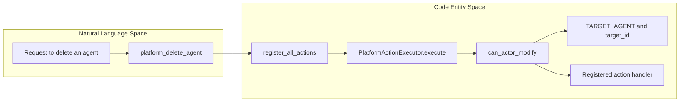
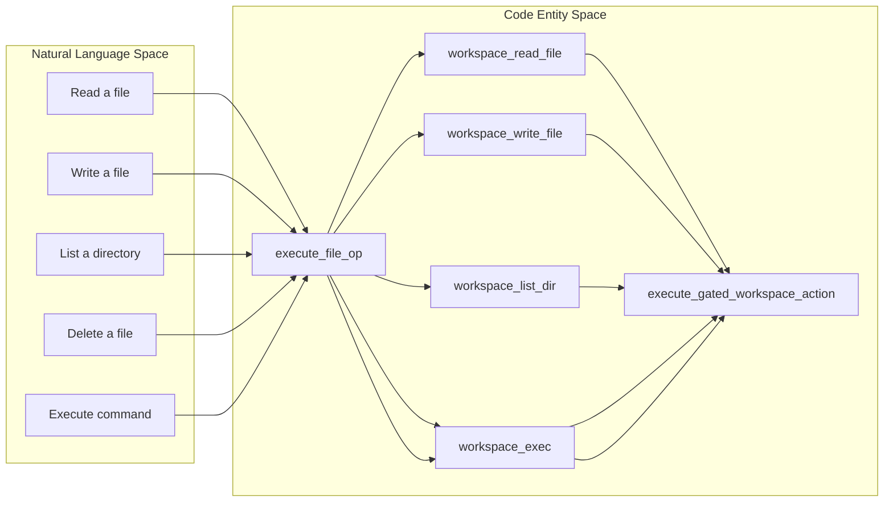
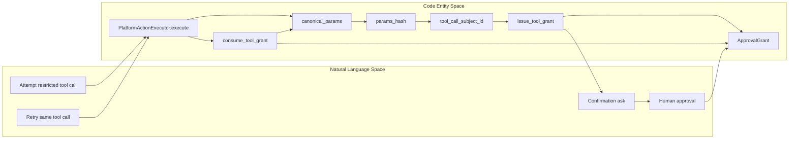
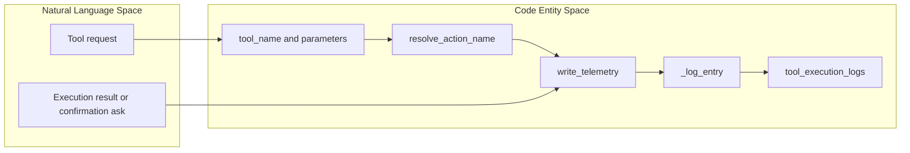

# Permission & Validation System

Relevant source files

The following files were used as context for generating this wiki page:

- [docs/PRDS/136-LLM-CONTEXT-BUDGET-SETTINGS.md](docs/PRDS/136-LLM-CONTEXT-BUDGET-SETTINGS.md)
- [frontend/components/settings/ApiKeyManager.tsx](frontend/components/settings/ApiKeyManager.tsx)
- [frontend/components/settings/LLMModelsSettingsTab.tsx](frontend/components/settings/LLMModelsSettingsTab.tsx)
- [frontend/components/settings/LLMTierCard.tsx](frontend/components/settings/LLMTierCard.tsx)
- [frontend/components/widgets/CodeWidget/index.tsx](frontend/components/widgets/CodeWidget/index.tsx)
- [frontend/components/widgets/DataWidget/index.tsx](frontend/components/widgets/DataWidget/index.tsx)
- [frontend/components/widgets/ImageWidget/index.tsx](frontend/components/widgets/ImageWidget/index.tsx)
- [frontend/components/widgets/WidgetBase.tsx](frontend/components/widgets/WidgetBase.tsx)
- [frontend/components/widgets/WidgetWrapper.tsx](frontend/components/widgets/WidgetWrapper.tsx)
- [frontend/components/widgets/__tests__/registration-manifest.test.ts](frontend/components/widgets/__tests__/registration-manifest.test.ts)
- [frontend/components/widgets/registry.ts](frontend/components/widgets/registry.ts)
- [frontend/stores/index.ts](frontend/stores/index.ts)
- [frontend/stores/workspace-store.ts](frontend/stores/workspace-store.ts)
- [orchestrator/alembic/versions/f156_harness_task_ledger.py](orchestrator/alembic/versions/f156_harness_task_ledger.py)
- [orchestrator/alembic/versions/prd136_collapse_llm_tiers.py](orchestrator/alembic/versions/prd136_collapse_llm_tiers.py)
- [orchestrator/alembic/versions/prd181_s2_approval_grants.py](orchestrator/alembic/versions/prd181_s2_approval_grants.py)
- [orchestrator/alembic/versions/prd185_s1b_toollog_user_nullable.py](orchestrator/alembic/versions/prd185_s1b_toollog_user_nullable.py)
- [orchestrator/api/approval_grants.py](orchestrator/api/approval_grants.py)
- [orchestrator/core/models/approval_grants.py](orchestrator/core/models/approval_grants.py)
- [orchestrator/core/models/workspaces.py](orchestrator/core/models/workspaces.py)
- [orchestrator/core/seeds/utterances/notifications.yaml](orchestrator/core/seeds/utterances/notifications.yaml)
- [orchestrator/core/services/approval_grants.py](orchestrator/core/services/approval_grants.py)
- [orchestrator/modules/tools/discovery/workspace_actions.py](orchestrator/modules/tools/discovery/workspace_actions.py)
- [orchestrator/modules/tools/execution/exec_file_ops.py](orchestrator/modules/tools/execution/exec_file_ops.py)
- [orchestrator/modules/tools/execution/exec_workspace.py](orchestrator/modules/tools/execution/exec_workspace.py)
- [orchestrator/modules/tools/execution/telemetry.py](orchestrator/modules/tools/execution/telemetry.py)
- [orchestrator/modules/tools/execution/tool_grants.py](orchestrator/modules/tools/execution/tool_grants.py)
- [orchestrator/services/board_approval.py](orchestrator/services/board_approval.py)
- [orchestrator/services/budget_ceiling.py](orchestrator/services/budget_ceiling.py)
- [orchestrator/tests/test_board_run_file_is_its_cards_deliverable.py](orchestrator/tests/test_board_run_file_is_its_cards_deliverable.py)
- [orchestrator/tests/test_f179a_only_an_image_is_made_public.py](orchestrator/tests/test_f179a_only_an_image_is_made_public.py)
- [orchestrator/tests/test_f179b_one_approval_is_one_publish.py](orchestrator/tests/test_f179b_one_approval_is_one_publish.py)
- [orchestrator/tests/test_f179b_publishing_an_image_asks_first.py](orchestrator/tests/test_f179b_publishing_an_image_asks_first.py)
- [orchestrator/tests/test_f193_a_destructive_yes_that_did_nothing_is_given_back.py](orchestrator/tests/test_f193_a_destructive_yes_that_did_nothing_is_given_back.py)
- [orchestrator/tests/test_f193_two_approvals_at_once_resume_once.py](orchestrator/tests/test_f193_two_approvals_at_once_resume_once.py)
- [orchestrator/tests/test_grant_approve_commit_ordering.py](orchestrator/tests/test_grant_approve_commit_ordering.py)
- [orchestrator/tests/test_human_directed_gate.py](orchestrator/tests/test_human_directed_gate.py)
- [orchestrator/tests/test_p2w0_telemetry_user_id.py](orchestrator/tests/test_p2w0_telemetry_user_id.py)
- [orchestrator/tests/test_p2w2_grant_mutation_admin_gate.py](orchestrator/tests/test_p2w2_grant_mutation_admin_gate.py)
- [orchestrator/tests/test_p2w2_grant_resume.py](orchestrator/tests/test_p2w2_grant_resume.py)
- [orchestrator/tests/test_p2w2_tool_grant_consume.py](orchestrator/tests/test_p2w2_tool_grant_consume.py)
- [orchestrator/tests/test_p2w2_tool_grant_issue.py](orchestrator/tests/test_p2w2_tool_grant_issue.py)
- [orchestrator/tests/test_prd139_telemetry.py](orchestrator/tests/test_prd139_telemetry.py)
- [orchestrator/tests/test_prd143_full_surface_positive.py](orchestrator/tests/test_prd143_full_surface_positive.py)
- [orchestrator/tests/test_prd143_selection_metric.py](orchestrator/tests/test_prd143_selection_metric.py)
- [orchestrator/tests/test_prd177_composio_telemetry.py](orchestrator/tests/test_prd177_composio_telemetry.py)
- [orchestrator/tests/test_telemetry_session_ownership.py](orchestrator/tests/test_telemetry_session_ownership.py)

## Purpose & Scope

This page describes the permission and validation mechanisms evidenced in the supplied code: hierarchy checks at the platform-action boundary, permission levels on registered workspace tools, durable approval grants for tool calls, workspace approval review, and best-effort tool-execution telemetry. The supplied excerpts do not include the full hierarchy implementation or a policy-plane mode implementation, so those internals are not inferred here. [orchestrator/tests/test_prd143_full_surface_positive.py:126-161](), [orchestrator/modules/tools/discovery/workspace_actions.py:15-45](), [orchestrator/modules/tools/execution/tool_grants.py:1-29](), [orchestrator/api/approval_grants.py:1-15]()

Sources: [orchestrator/tests/test_prd143_full_surface_positive.py:126-161](), [orchestrator/modules/tools/discovery/workspace_actions.py:15-45](), [orchestrator/modules/tools/execution/tool_grants.py:1-29](), [orchestrator/api/approval_grants.py:1-15]()

---

## 1. Hierarchy Permissions

The available positive-path test shows `PlatformActionExecutor.execute` consulting `can_actor_modify` for a destructive `platform_delete_agent` action. The test supplies an actor agent ID, `TARGET_AGENT`, the target agent ID, `change_type="delete"`, and `source="platform_tool"`; it verifies that the hierarchy gate is called even when full autonomy allows the action to proceed. [orchestrator/tests/test_prd143_full_surface_positive.py:126-161]()

The supplied test also documents the intended distinction between autonomy and authorization: the full-autonomy case still consults the hierarchy gate, while the same destructive action is expected to require confirmation at standard autonomy. The provided excerpt does not include the implementation of `can_actor_modify`, so it does not establish the complete hierarchy algorithm or its denial cases. [orchestrator/tests/test_prd143_full_surface_positive.py:1-16](), [orchestrator/tests/test_prd143_full_surface_positive.py:126-161]()

Sources: [orchestrator/tests/test_prd143_full_surface_positive.py:1-16](), [orchestrator/tests/test_prd143_full_surface_positive.py:126-161]()

### Natural-language request to hierarchy gate

A request to delete an agent becomes a registered platform action, then reaches `PlatformActionExecutor.execute`; the tested call consults `can_actor_modify` with the actor and target information before the handler executes. [orchestrator/tests/test_prd143_full_surface_positive.py:68-76](), [orchestrator/tests/test_prd143_full_surface_positive.py:126-161]()

**Diagram: `platform_delete_agent` request through the hierarchy gate**

Sources: [orchestrator/tests/test_prd143_full_surface_positive.py:68-76](), [orchestrator/tests/test_prd143_full_surface_positive.py:126-161]()

---

## 2. Capability Filters & Action Execution

Workspace capabilities are registered as `ActionDefinition` objects through `register_workspace_actions`. The shown definitions assign `permission_level="read"` to `workspace_read_file`, `workspace_list_dir`, and `workspace_grep`, and `permission_level="write"` to `workspace_write_file`. These definitions also include schemas, descriptions, tags, examples, and promotion metadata. [orchestrator/modules/tools/discovery/workspace_actions.py:15-161]()

| Action | Declared permission level | Parameters shown |
|---|---|---|
| `workspace_read_file` | `read` | `path` |
| `workspace_write_file` | `write` | `path`, `content` |
| `workspace_list_dir` | `read` | Optional `path` |
| `workspace_grep` | `read` | `pattern`, optional `path`, `include`, and `max_results` |
| `workspace_exec` | `destructive` | `command`, optional `path`, `timeout_seconds`, `env` |

Sources: [orchestrator/modules/tools/discovery/workspace_actions.py:15-161](), [orchestrator/modules/tools/discovery/workspace_actions.py:163-175]()

`exec_file_ops.execute_file_op` maps legacy file-operation names to registered `workspace_*` actions and delegates each operation to `exec_workspace.execute_gated_workspace_action`. It resolves the workspace ID from the argument or executor state, forwards the caller context and trace ID, and returns an error for unknown operations. [orchestrator/modules/tools/execution/exec_file_ops.py:34-50](), [orchestrator/modules/tools/execution/exec_file_ops.py:58-124]()

The workspace action registry excerpt does not show all registered actions or the complete gating implementation. The separate publishing test states that `workspace_get_public_url` is a write requiring confirmation and that the hierarchy audit counts workspace tools; those statements are test assertions, not a complete description of the gate implementation. [orchestrator/tests/test_f179b_publishing_an_image_asks_first.py:30-50]()

Sources: [orchestrator/modules/tools/execution/exec_file_ops.py:34-50](), [orchestrator/modules/tools/execution/exec_file_ops.py:58-124](), [orchestrator/tests/test_f179b_publishing_an_image_asks_first.py:30-50]()

### Workspace action mapping: natural language to code entities

**Diagram: file-operation names mapped to workspace action executors**

Sources: [orchestrator/modules/tools/execution/exec_file_ops.py:34-46](), [orchestrator/modules/tools/execution/exec_file_ops.py:58-118]()

---

## 3. Tool Call Approval Grants

`tool_grants.py` provides a shared seam between a confirmation request and the approval-grant system. Its documented contract is to issue or reuse a pending grant for the call, attach grant and risk information to the ask response, and resolve an authorizing grant before allowing a retried call to pass the confirmation gate. The module is fail-safe: errors on the issue or consult side preserve the ask rather than raising into the executor or allowing execution. [orchestrator/modules/tools/execution/tool_grants.py:1-29]()

### Canonical parameters and deterministic subjects

`canonical_params` accepts dictionaries and removes keys whose names begin with `_`, excluding server-injected plumbing from the call identity. `params_hash` serializes the canonical parameters with sorted JSON keys and hashes the result with SHA-256. `tool_call_subject_id` combines the workspace ID, action name, and parameter hash into a deterministic subject ID with an action-name prefix. [orchestrator/modules/tools/execution/tool_grants.py:66-100]()

| Function | Role |
|---|---|
| `canonical_params` | Removes underscore-prefixed keys from dictionary parameters. |
| `params_hash` | Produces a stable SHA-256 hash of canonical parameters. |
| `tool_call_subject_id` | Derives the subject key from workspace, action, and parameter hash. |
| `_risk_class_for` | Calls `classify_action`; on classifier failure, falls back to `destructive` for destructive permission levels and otherwise `internal_write`. |
| `_lane_for` | Labels calls as `chat`, `board`, or `agent` from caller context. |

Sources: [orchestrator/modules/tools/execution/tool_grants.py:66-125]()

`issue_tool_grant` creates or reuses a pending `tool_call` grant for an exact call. It receives workspace, action, parameters, permission level, caller context, and presentation details; its documented contract is to return the grant or `None` on failure, without raising. [orchestrator/modules/tools/execution/tool_grants.py:132-151]()

The module documents the consumption rule: a grant must be `GRANTED`, unexpired, and match the parameters hash. Destructive grants are single-use and retired on use; write-class grants use a TTL window. The implementation details of `consume_tool_grant` are not included in the supplied excerpt. [orchestrator/modules/tools/execution/tool_grants.py:14-19]()

The grant service stages grants as `PENDING`, assigns an expiry, adds the grant to the caller-owned database session, and flushes without committing. `find_active_grant` searches for granted rows scoped by workspace, subject type, and subject ID, then checks whether a grant is authorizing at read time. [orchestrator/core/services/approval_grants.py:43-99](), [orchestrator/core/services/approval_grants.py:134-165]()

**Diagram: deterministic tool-call approval flow**

Sources: [orchestrator/modules/tools/execution/tool_grants.py:1-29](), [orchestrator/modules/tools/execution/tool_grants.py:66-100](), [orchestrator/modules/tools/execution/tool_grants.py:132-151](), [orchestrator/core/services/approval_grants.py:43-99]()

---

## 4. Policy Plane Modes & Approval Grants API

The supplied code shows a risk-classification seam: `_risk_class_for` delegates to `modules.policy.policy_document.classify_action` and applies a conservative fallback if classification fails. The excerpts do not provide the policy-plane mode definitions or their mode-specific decision logic, so this section does not characterize those modes. [orchestrator/modules/tools/execution/tool_grants.py:102-110]()

### Grant lifecycle

The approval-grant service documents the authorization semantics: a grant authorizes its subject only while its status is `GRANTED` and its `expires_at` has not passed. A `PENDING` grant blocks; `REVOKED`, `EXPIRED`, and `DENIED` grants do not authorize. Expiry is evaluated when reading the grant, so authorization does not depend on a background expiry sweep. [orchestrator/core/services/approval_grants.py:7-11]()

`create_grant` stages a pending row with workspace, subject type and ID, optional tool and risk information, request and expiry timestamps, and optional details. The service leaves transaction ownership with its caller. [orchestrator/core/services/approval_grants.py:43-99]()

### Workspace review API

The approval-grant router is mounted at `/api/v1/approval-grants`. Its list route requires `require_workspace_answerer`, scopes results to `ctx.workspace_id`, optionally filters by status and kind, orders newest first, and limits the result set to 200. The list response enriches grants with oversight information and owner data; question-kind grants can include cascade details for board-task subjects. [orchestrator/api/approval_grants.py:42-56](), [orchestrator/api/approval_grants.py:59-73](), [orchestrator/api/approval_grants.py:108-131]()

The API module’s documentation distinguishes answering from revoking: workspace owners, admins, and editors may answer, while only owners and admins may revoke a live grant. It also states that state changes are audited as governance actions with the human approver as actor. [orchestrator/api/approval_grants.py:8-14]()

`grant_with_oversight` attaches the risk-based oversight mapping to the grant payload using `oversight_for_risk`. This keeps the rationale in the server response rather than requiring the client to invent it. [orchestrator/api/approval_grants.py:45-56]()

Sources: [orchestrator/modules/tools/execution/tool_grants.py:102-110](), [orchestrator/core/services/approval_grants.py:7-11](), [orchestrator/core/services/approval_grants.py:43-99](), [orchestrator/api/approval_grants.py:8-14](), [orchestrator/api/approval_grants.py:42-56](), [orchestrator/api/approval_grants.py:59-73](), [orchestrator/api/approval_grants.py:108-131]()

---

## 5. Bypass, Approval, and Audit Boundaries

The supplied tests distinguish an approval ask from a denial. A confirmation-required action can create a pending `ApprovalGrant` scoped to `tool_call`; the returned ask carries grant and risk/oversight fields. The tests also state that a failure to create the grant must still return the ask, and that a denial is not itself an ask and must not create a grant. [orchestrator/tests/test_p2w2_tool_grant_issue.py:1-20]()

The hierarchy positive-path test demonstrates that full autonomy is not equivalent to skipping the hierarchy check: the tested destructive action executes while `can_actor_modify` is still consulted. The test also identifies an autonomy change as affecting the next call, rather than relying on a cached decision. [orchestrator/tests/test_prd143_full_surface_positive.py:1-18](), [orchestrator/tests/test_prd143_full_surface_positive.py:126-161]()

The `_human_directed_admin` function in `platform_executor.py` determines if a tool call should bypass confirmation. This occurs if the call is from an interactive chat lane (indicated by `conversation_id`) and the driving user is an owner or admin of the workspace. Agent-lane calls (heartbeat, cadence, board, mission) never skip confirmation via this mechanism. Errors in role resolution or missing/invalid principals also cause a fail-closed behavior, meaning the ask stands. [orchestrator/tests/test_human_directed_gate.py:53-89]()

For approval mutations, `_audit` records a governance action through `AuditService`, including workspace, actor, action, resource type and ID, subject metadata, status, and actor reference. Audit exceptions are caught and logged as warnings. [orchestrator/api/approval_grants.py:76-105]()

Sources: [orchestrator/tests/test_p2w2_tool_grant_issue.py:1-20](), [orchestrator/tests/test_prd143_full_surface_positive.py:1-18](), [orchestrator/tests/test_prd143_full_surface_positive.py:126-161](), [orchestrator/api/approval_grants.py:76-105](), [orchestrator/tests/test_human_directed_gate.py:53-89]()

---

## 6. Universal Tool Execution Telemetry

`write_telemetry` is the telemetry writer for tool calls. Its module documentation says it records executions from platform, workspace, Composio, and MCP dispatch paths to `tool_execution_logs`, and that telemetry failure must not fail the tool call. [orchestrator/modules/tools/execution/telemetry.py:1-7]()

### Action naming and privacy

`resolve_action_name` preserves ordinary tool names. For `composio_execute`, it reads the action identifier from `parameters["action"]` or `parameters["action_name"]`, then normalizes it to uppercase. The function documents that it reads the action identifier, not secret parameter values. [orchestrator/modules/tools/execution/telemetry.py:22-47]()

### Isolated, best-effort writes

`write_telemetry` is designed for fire-and-forget use and runs through `awaitable_off_loop`. It opens and owns its database session, adds a log entry, commits on success, catches failures and rolls back, and closes the session. This prevents the telemetry writer from managing a caller’s live transaction. [orchestrator/modules/tools/execution/telemetry.py:104-167]()

The telemetry status vocabulary includes `success`, `error`, and `asked`; `asked` represents a call that requested owner confirmation but did not execute or fail. The writer also resolves string caller user IDs to the integer ID expected by the log column, using a bounded cache for Clerk IDs. [orchestrator/modules/tools/execution/telemetry.py:49-76](), [orchestrator/modules/tools/execution/telemetry.py:54-65]()

Sources: [orchestrator/modules/tools/execution/telemetry.py:1-7](), [orchestrator/modules/tools/execution/telemetry.py:22-47](), [orchestrator/modules/tools/execution/telemetry.py:49-76](), [orchestrator/modules/tools/execution/telemetry.py:104-167]()

### Tool execution to telemetry entities

**Diagram: action resolution and best-effort telemetry write**

Sources: [orchestrator/modules/tools/execution/telemetry.py:22-47](), [orchestrator/modules/tools/execution/telemetry.py:104-151]()

---