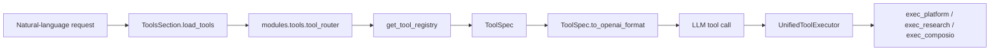
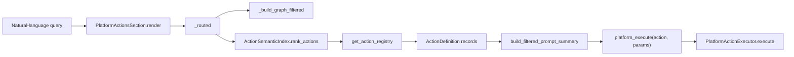
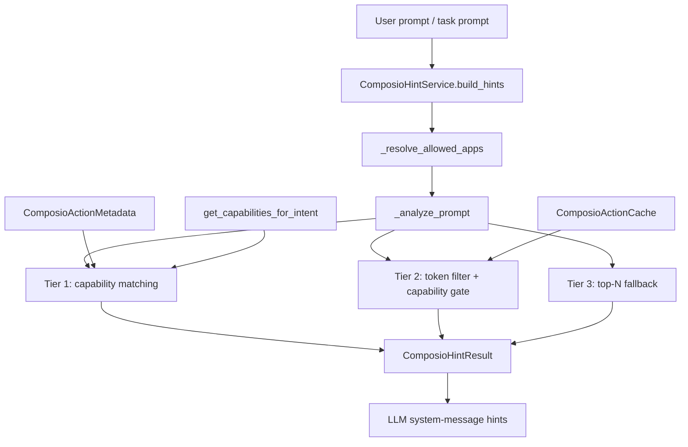
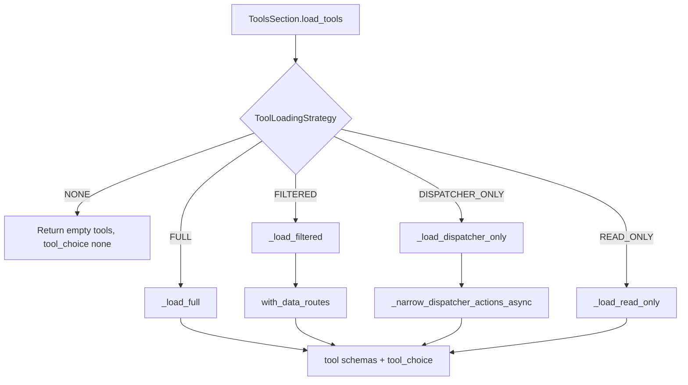
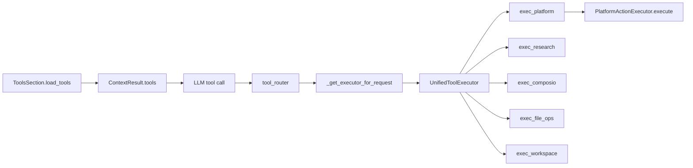

# Tool Discovery & Resolution

Relevant source files

The following files were used as context for generating this wiki page:

- [orchestrator/modules/context/sections/platform_actions.py](orchestrator/modules/context/sections/platform_actions.py)
- [orchestrator/modules/context/sections/tools.py](orchestrator/modules/context/sections/tools.py)
- [orchestrator/modules/tools/discovery/action_registry.py](orchestrator/modules/tools/discovery/action_registry.py)
- [orchestrator/modules/tools/discovery/action_semantic_index.py](orchestrator/modules/tools/discovery/action_semantic_index.py)
- [orchestrator/modules/tools/discovery/handlers_capabilities.py](orchestrator/modules/tools/discovery/handlers_capabilities.py)
- [orchestrator/modules/tools/tool_router.py](orchestrator/modules/tools/tool_router.py)
- [orchestrator/tests/test_action_registry_filtered.py](orchestrator/tests/test_action_registry_filtered.py)
- [orchestrator/tests/test_action_semantic_index.py](orchestrator/tests/test_action_semantic_index.py)
- [orchestrator/tests/test_identity_section.py](orchestrator/tests/test_identity_section.py)
- [orchestrator/tests/test_platform_actions_section.py](orchestrator/tests/test_platform_actions_section.py)
- [orchestrator/tests/test_platform_actions_section_graph.py](orchestrator/tests/test_platform_actions_section_graph.py)
- [orchestrator/tests/test_prd232_us014_promotion_prior.py](orchestrator/tests/test_prd232_us014_promotion_prior.py)
- [orchestrator/tests/test_skills_section.py](orchestrator/tests/test_skills_section.py)
- [orchestrator/tests/test_tool_router_semantic.py](orchestrator/tests/test_tool_router_semantic.py)
- [orchestrator/tests/test_tool_surface_prb.py](orchestrator/tests/test_tool_surface_prb.py)

## Purpose and Scope

This page describes how Automatos AI represents, selects, and presents tools and platform actions to an agent. It covers the general-purpose `ToolRegistry`, platform-action `ActionRegistry`, semantic action ranking, Composio app/action resolution, tool-loading strategies, and the handoff to execution. The available source excerpts identify `AgentAppAssignment` as a Composio assignment model; they do not include its model definition or the implementation of `SkillLoader`, so this page does not infer their internal behavior. [orchestrator/modules/tools/registry/tool_registry.py:7-21](), [orchestrator/modules/tools/discovery/action_registry.py:56-79](), [orchestrator/modules/tools/discovery/action_semantic_index.py:1-7](), [orchestrator/modules/tools/services/composio_tool_service.py:31-37]()

Sources: [orchestrator/modules/tools/registry/tool_registry.py:7-21](), [orchestrator/modules/tools/discovery/action_registry.py:56-79](), [orchestrator/modules/tools/discovery/action_semantic_index.py:1-7](), [orchestrator/modules/tools/services/composio_tool_service.py:31-37]()

---

## Core Registries & Semantic Index

### ToolRegistry and ActionRegistry

`ToolRegistry` is the general-purpose registry for platform tools. Its `ToolSpec` records a tool’s name, category, description, executor class and method, parameters, security level, permissions, examples, metadata, and active status. `ToolSpec.to_openai_format()` converts its parameter definitions into a function-call schema; `ToolParameter.to_openai_format()` handles parameter properties such as enums, defaults, and array items. [orchestrator/modules/tools/registry/tool_registry.py:57-69](), [orchestrator/modules/tools/registry/tool_registry.py:80-106](), [orchestrator/modules/tools/registry/tool_registry.py:109-148]()

`ActionRegistry` is a distinct registry for platform actions, such as operations exposed through `platform_execute`. An `ActionDefinition` includes a name, description, category, parameter schema, permission level, confirmation requirement, workspace scope, and administrative restrictions. Its `to_openai_schema()` converts the definition into a function schema. The registry lazily initializes platform and workspace actions through `register_all_actions`, then provides name, category, and tag lookups. [orchestrator/modules/tools/discovery/action_registry.py:56-79](), [orchestrator/modules/tools/discovery/action_registry.py:100-109](), [orchestrator/modules/tools/discovery/action_registry.py:119-164]()

The `ActionDefinition` class enforces that `permission_level` is always stated, raising a `TypeError` if it's missing during construction. This ensures actions are explicitly marked as "read", "write", or "destructive". [orchestrator/modules/tools/discovery/action_registry.py:96-107]() Actions can also define an `available` callable to check if they can run on the current server configuration, preventing unavailable actions from being offered. [orchestrator/modules/tools/discovery/action_registry.py:80-84](), [orchestrator/modules/tools/discovery/action_registry.py:110-117]()

The registries serve different purposes: `ToolRegistry` represents callable tools with executor routing metadata, while `ActionRegistry` represents the action catalog dispatched through platform-action execution. In the shared tool router, a singleton `ToolRegistry` is obtained and passed to a per-request `UnifiedToolExecutor`; platform action execution is separately delegated to `PlatformActionExecutor`. [orchestrator/modules/tools/tool_router.py:57-65](), [orchestrator/modules/tools/execution/exec_platform.py:47-55](), [orchestrator/modules/tools/execution/exec_platform.py:102-108]()

#### Natural-language and code-entity bridge: general tools

The following diagram connects a user’s language-facing tool request to registry entities and execution code. The names shown are code symbols that can be searched directly. [orchestrator/modules/tools/registry/tool_registry.py:80-148](), [orchestrator/modules/tools/tool_router.py:57-65](), [orchestrator/modules/tools/execution/unified_executor.py:24-37]()

**Diagram: User request to registered tool and executor**

Sources: [orchestrator/modules/tools/registry/tool_registry.py:80-148](), [orchestrator/modules/tools/tool_router.py:57-65](), [orchestrator/modules/tools/execution/unified_executor.py:24-37](), [orchestrator/modules/context/sections/tools.py:61-89]()

### ActionSemanticIndex

`ActionSemanticIndex` is a per-process semantic index over `ActionDefinition` records. It creates an embedding manager and cache service, obtains the action registry, and maintains an in-memory mapping of action names to embeddings. Its documented ranking approach embeds action definitions and compares them with a query using cosine similarity. [orchestrator/modules/tools/discovery/action_semantic_index.py:1-7](), [orchestrator/modules/tools/discovery/action_semantic_index.py:113-136]()

The index has request-scoped memoization support. `rank_actions_scope()` installs a fresh context-local dictionary and restores the previous value on exit, allowing ranking work in one request to be reused within that scope without retaining the completed ranking across turns. The index also exposes configuration-backed relevance-floor and promotion-boost helpers; the boost is described as a ranking prior rather than an override. [orchestrator/modules/tools/discovery/action_semantic_index.py:26-54](), [orchestrator/modules/tools/discovery/action_semantic_index.py:57-83]()

The embedding text can incorporate parameter enum values, including values nested in array-item enums. This makes vocabulary present in action schemas available to semantic matching as well as action names and descriptions. [orchestrator/modules/tools/discovery/action_semantic_index.py:143-161]()

`PlatformActionsSection.render()` supplies a query to semantic routing when one is present and semantic routing is enabled. The section tries graph routing first when that feature is enabled, then uses embedding filtering; if routing does not produce a catalog, it applies the configured fallback or builds the wider action catalog. Errors in section rendering are caught so action-catalog assembly does not fail the rest of prompt construction. [orchestrator/modules/context/sections/platform_actions.py:78-130](), [orchestrator/modules/context/sections/platform_actions.py:138-153]()

#### Natural-language and code-entity bridge: platform actions

This diagram maps the user’s request to the action catalog that is narrowed and rendered for the model. `platform_execute` is the dispatcher described by the platform-action section’s preamble; the `ActionDefinition` entries are the selectable action entities. [orchestrator/modules/context/sections/platform_actions.py:78-117](), [orchestrator/modules/context/sections/platform_actions.py:155-159](), [orchestrator/modules/tools/discovery/action_registry.py:56-79](), [orchestrator/modules/tools/discovery/action_semantic_index.py:113-136]()

**Diagram: Query to semantically narrowed platform-action catalog**

Sources: [orchestrator/modules/context/sections/platform_actions.py:78-117](), [orchestrator/modules/context/sections/platform_actions.py:138-153](), [orchestrator/modules/context/sections/platform_actions.py:155-159](), [orchestrator/modules/tools/discovery/action_registry.py:56-79](), [orchestrator/modules/tools/discovery/action_semantic_index.py:113-136](), [orchestrator/modules/tools/execution/exec_platform.py:102-108]()

---

## Caching, Assignments & Skill Loading

### Composio action resolution and hints

`ComposioToolService` resolves Composio actions into per-action function schemas. Its documented resolution order starts with explicit action names found in the prompt, then uses SDK semantic search; if that search returns no results, it loads actions from the SDK cache, sorts them by relevance, and caps the result. The service’s result object carries the resolved schemas, action names, entity ID, allowed app names, selected strategy, and search duration. [orchestrator/modules/tools/services/composio_tool_service.py:1-22](), [orchestrator/modules/tools/services/composio_tool_service.py:41-57]()

`get_tools_for_step()` first resolves the apps allowed for the agent and workspace, then resolves the workspace’s Composio entity. It returns an empty result if there are no allowed apps or no entity ID. For explicit action names it requests schemas with the resolved entity and app scope, records the actions found, and reports `exact_lookup` when schemas are returned. The service defines a maximum result size of 30 tools. [orchestrator/modules/tools/services/composio_tool_service.py:41-42](), [orchestrator/modules/tools/services/composio_tool_service.py:98-137](), [orchestrator/modules/tools/services/composio_tool_service.py:142-167]()

The service imports `AgentAppAssignment` and `Agent`, and its resolution path calls `_resolve_allowed_apps(agent_id, workspace_id)`. The excerpts identify the assignment model and the method boundary but do not include the model definition or the method’s query implementation; therefore, the precise persistence rules for assignments are not specified here. [orchestrator/modules/tools/services/composio_tool_service.py:31-37](), [orchestrator/modules/tools/services/composio_tool_service.py:98-125]()

`ComposioHintService` builds prompt hints from an agent’s allowed apps and the current prompt. It analyzes the prompt and returns a `ComposioHintResult` containing hint lines, allowed apps, matched actions, parameter-hint count, and the strategy used. Its declared tiers are capability-based matching, token-filtered matching with a mandatory capability gate, and a top-N fallback. [orchestrator/modules/tools/services/composio_hint_service.py:12-20](), [orchestrator/modules/tools/services/composio_hint_service.py:67-84](), [orchestrator/modules/tools/services/composio_hint_service.py:138-171]()

The capability gate is intended to require at least one matching capability term for Tier 2 rather than merely boost a score. For example, the service documentation distinguishes a message-sending action from an unrelated channel-creation action for messaging intents. The service also defines limits for query tokens, app searches, database rows per app, actions per app, and parameter hints. [orchestrator/modules/tools/services/composio_hint_service.py:17-20](), [orchestrator/modules/tools/services/composio_hint_service.py:44-61]()

#### Composio hint resolution flow

The diagram shows the named resolution stages and result entities. The implementation details of the cache model itself are not included in the provided excerpts; `ComposioActionCache` is cited where the hint service imports and describes its use. [orchestrator/modules/tools/services/composio_hint_service.py:12-20](), [orchestrator/modules/tools/services/composio_hint_service.py:29-37](), [orchestrator/modules/tools/services/composio_hint_service.py:138-171]()

**Diagram: Composio prompt hints and cached action candidates**

Sources: [orchestrator/modules/tools/services/composio_hint_service.py:12-20](), [orchestrator/modules/tools/services/composio_hint_service.py:29-37](), [orchestrator/modules/tools/services/composio_hint_service.py:67-84](), [orchestrator/modules/tools/services/composio_hint_service.py:138-171]()

### ComposioCache and `AgentAppAssignment`

`ComposioToolService` imports `AgentAppAssignment`; `ComposioHintService` imports both `AgentAppAssignment` and `ComposioActionCache`. These model names mark the assignment and cached-action persistence boundaries used by Composio discovery. The provided excerpts do not contain their model declarations, table fields, cache invalidation policy, or write paths, so those details are not asserted here. [orchestrator/modules/tools/services/composio_tool_service.py:31-37](), [orchestrator/modules/tools/services/composio_hint_service.py:29-37]()

The concrete resolution contract visible in `ComposioToolService` is workspace- and agent-aware: it resolves allowed app names for `(agent_id, workspace_id)`, resolves the entity for `workspace_id`, then scopes explicit schema lookup to that entity and those app names. [orchestrator/modules/tools/services/composio_tool_service.py:98-137](), [orchestrator/modules/tools/services/composio_tool_service.py:142-151]()

### SkillLoader

`SkillLoader` is in scope for the broader discovery and resolution topic, but its implementation is not present in the supplied file contents. The available skill-related source is a test filename (`test_skills_section.py`), which is insufficient to establish loader APIs, materialization behavior, caching, or how skills are connected to tool schemas. Those implementation details are therefore not described here. [orchestrator/tests/test_skills_section.py]()

Sources: [orchestrator/modules/tools/services/composio_tool_service.py:31-37](), [orchestrator/modules/tools/services/composio_tool_service.py:98-151](), [orchestrator/modules/tools/services/composio_hint_service.py:29-37](), [orchestrator/tests/test_skills_section.py]()

---

## Tiered Tool Resolution Strategy

Tool loading is performed by `ToolsSection`, which provides `load_tools()` to populate tool schemas and a `tool_choice` value. Tool schemas are not rendered as system-prompt text by `ToolsSection.render()`; they are returned separately for the context result. [orchestrator/modules/context/sections/tools.py:1-18](), [orchestrator/modules/context/sections/tools.py:41-55](), [orchestrator/modules/context/sections/tools.py:61-85]()

### Tool loading strategies

| Strategy | Resolution behavior |
|---|---|
| `FULL` | Loads the full tool surface through `_load_full()`, with the agent, workspace, database session, query, and optional prebuilt tools. The section treats non-empty `prebuilt_tools` as authoritative. [orchestrator/modules/context/sections/tools.py:75-82](), [orchestrator/modules/context/sections/tools.py:94-102]() |
| `FILTERED` | Calls `_load_filtered()` with intent, hints, query, conversation context, and optional prebuilt tools. It then applies `with_data_routes()` to the resulting schemas. [orchestrator/modules/context/sections/tools.py:103-118]() |
| `DISPATCHER_ONLY` | Returns the `platform_execute` dispatcher schema. When a query and semantic routing are available, the dispatcher’s action enum can be narrowed to relevant actions; the documented behavior falls back to the full enum on errors. [orchestrator/modules/context/sections/tools.py:134-145]() |
| `READ_ONLY` | Loads tools specifically for the check-in lane, including read-permission platform actions and `platform_suggest_next_step` as first-class tools. [orchestrator/modules/context/sections/tools.py:98-99]() |
| `NONE` | Returns an empty tool list and `tool_choice="none"`. [orchestrator/modules/context/sections/tools.py:87-89]() |

For `FILTERED` loading, the tool section passes the intent result, hints, query, conversation context, and prebuilt tools into `_load_filtered()`. It then adds data routes to the filtered result. If loading raises an exception, it logs the failure and returns an empty tool list with `tool_choice="auto"`. [orchestrator/modules/context/sections/tools.py:103-128]()

For `DISPATCHER_ONLY`, the section reads workspace-hidden action categories and invokes `_narrow_dispatcher_actions_async()` with workspace and exclusion arguments. This keeps workspace-hidden categories out of the narrowed dispatcher surface. [orchestrator/modules/context/sections/tools.py:134-164]()

`PlatformActionsSection` and `ToolsSection` provide complementary surfaces: the former renders a text catalog of platform actions for the prompt, while the latter loads the callable schemas and tool-choice mode. The action section applies context-mode exclusions and workspace-hidden categories before building its catalog. [orchestrator/modules/context/sections/platform_actions.py:60-76](), [orchestrator/modules/context/sections/platform_actions.py:89-127](), [orchestrator/modules/context/sections/tools.py:41-55](), [orchestrator/modules/context/sections/tools.py:61-85]()

**Diagram: Context tool-loading strategy selection**

Sources: [orchestrator/modules/context/sections/tools.py:32-38](), [orchestrator/modules/context/sections/tools.py:61-128](), [orchestrator/modules/context/sections/tools.py:134-164]()

---

## Unified Tool Execution & Routing

Tool discovery and loading determine which schemas are offered to the model; execution is a separate stage. The shared `tool_router` creates a `UnifiedToolExecutor` per request while reusing the registry singleton. This avoids mutating a global executor’s database session across requests. [orchestrator/modules/tools/tool_router.py:57-65]()

`UnifiedToolExecutor` imports separate execution modules, including `exec_platform`, `exec_research`, `exec_file_ops`, `exec_shell`, `exec_composio`, `exec_document`, `exec_multimodal`, and `exec_workspace`. The executor module describes itself as the single entry point for tool execution and notes that executor methods are extracted into these modules. [orchestrator/modules/tools/execution/unified_executor.py:5-15](), [orchestrator/modules/tools/execution/unified_executor.py:24-40]()

The executor also defines name aliases such as `search_documents` → `platform_search_documents` and `search_code` → `search_codebase`, along with parameter aliases used when required parameter names are missing. These are resolution and compatibility mechanisms at the execution boundary, not alternative registry definitions. [orchestrator/modules/tools/execution/unified_executor.py:47-53](), [orchestrator/modules/tools/execution/unified_executor.py:73-100](), [orchestrator/modules/tools/execution/unified_executor.py:106-133]()

Platform research tools are handled through `AgentPlatformTools.execute_tool()`. Platform actions are routed to `PlatformActionExecutor.execute()` with a workspace ID; the executor builds trusted actor metadata from the runtime agent identity rather than accepting `_agent_id` or `_agent_name` from tool parameters. [orchestrator/modules/tools/execution/exec_platform.py:18-44](), [orchestrator/modules/tools/execution/exec_platform.py:47-108]()

The `tool_router` also handles Composio degradation. If Composio is unavailable (e.g., no API key configured), Composio tools are excluded from discovery and execution attempts are refused with an explicit error, preventing silent failures or rerouting to other tools. [orchestrator/modules/tools/tool_router.py:122-132](), [orchestrator/modules/tools/tool_router.py:164-165]() Similarly, certain unroutable tools (like per-source NL2SQL tools from `DatabaseToolIntegration`) are excluded from being offered if the executor has no route to them, preventing "Unknown tool" errors. [orchestrator/modules/tools/tool_router.py:149-162]()

**Diagram: Tool schema selection to execution dispatch**

Sources: [orchestrator/modules/context/sections/tools.py:61-85](), [orchestrator/modules/tools/tool_router.py:57-65](), [orchestrator/modules/tools/execution/unified_executor.py:24-40](), [orchestrator/modules/tools/execution/exec_platform.py:18-55](), [orchestrator/modules/tools/execution/exec_platform.py:77-108](), [orchestrator/modules/tools/tool_router.py:122-132](), [orchestrator/modules/tools/tool_router.py:149-162]()

---