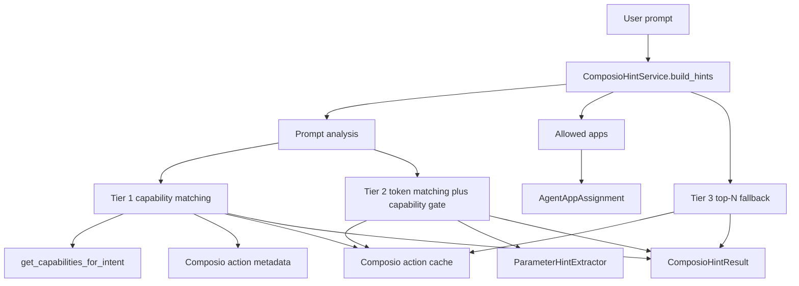
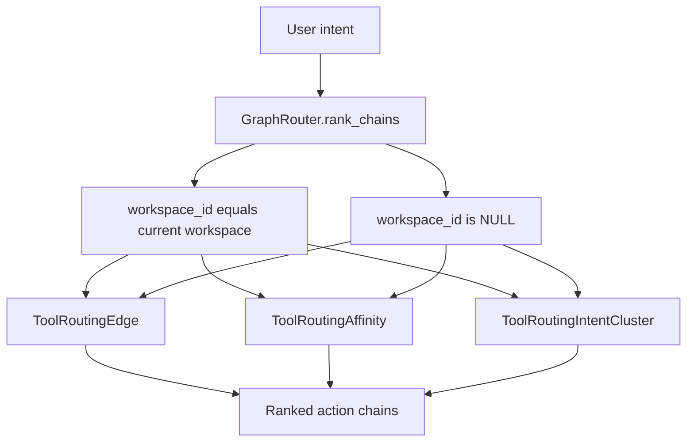
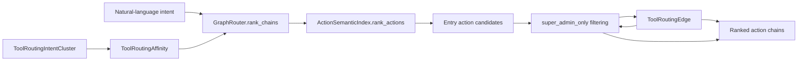
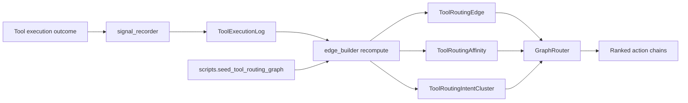
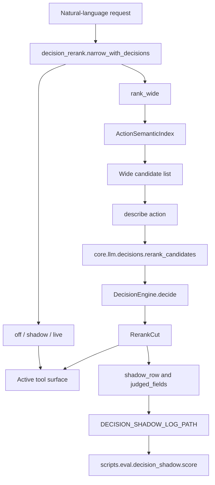

# Tool Hints & Intent Graph Routing

Relevant source files

The following files were used as context for generating this wiki page:

- [docs/PRDS/PRD-143-AUTO-FULL-PLATFORM-OPERATOR.md](docs/PRDS/PRD-143-AUTO-FULL-PLATFORM-OPERATOR.md)
- [docs/PRDS/PRD-248-DECISION-ENGINE-SEAM.md](docs/PRDS/PRD-248-DECISION-ENGINE-SEAM.md)
- [docs/universal-router/tier-2-rule-based-routing.md](docs/universal-router/tier-2-rule-based-routing.md)
- [orchestrator/core/llm/decisions/__init__.py](orchestrator/core/llm/decisions/__init__.py)
- [orchestrator/core/llm/decisions/engine.py](orchestrator/core/llm/decisions/engine.py)
- [orchestrator/core/llm/decisions/llm_adapter.py](orchestrator/core/llm/decisions/llm_adapter.py)
- [orchestrator/core/llm/decisions/questions.py](orchestrator/core/llm/decisions/questions.py)
- [orchestrator/core/llm/decisions/rerank.py](orchestrator/core/llm/decisions/rerank.py)
- [orchestrator/core/llm/decisions/typesafe_client.py](orchestrator/core/llm/decisions/typesafe_client.py)
- [orchestrator/evals/__init__.py](orchestrator/evals/__init__.py)
- [orchestrator/evals/operating_graph_uplift.py](orchestrator/evals/operating_graph_uplift.py)
- [orchestrator/modules/tools/discovery/decision_rerank.py](orchestrator/modules/tools/discovery/decision_rerank.py)
- [orchestrator/modules/tools/discovery/metadata_graph_seed.py](orchestrator/modules/tools/discovery/metadata_graph_seed.py)
- [orchestrator/scripts/eval/decision_shadow/score.py](orchestrator/scripts/eval/decision_shadow/score.py)
- [orchestrator/scripts/seed_tool_routing_graph.py](orchestrator/scripts/seed_tool_routing_graph.py)
- [orchestrator/tests/test_config.py](orchestrator/tests/test_config.py)
- [orchestrator/tests/test_prd143_boundary_sweep.py](orchestrator/tests/test_prd143_boundary_sweep.py)
- [orchestrator/tests/test_prd143_graph_seed.py](orchestrator/tests/test_prd143_graph_seed.py)
- [orchestrator/tests/test_prd143_selection_at_scale.py](orchestrator/tests/test_prd143_selection_at_scale.py)
- [orchestrator/tests/test_prd143_su_executor_gate.py](orchestrator/tests/test_prd143_su_executor_gate.py)
- [orchestrator/tests/test_prd143_su_surface.py](orchestrator/tests/test_prd143_su_surface.py)
- [orchestrator/tests/test_prd164_agent_match.py](orchestrator/tests/test_prd164_agent_match.py)
- [orchestrator/tests/test_prd164_dispatch_digest.py](orchestrator/tests/test_prd164_dispatch_digest.py)
- [orchestrator/tests/test_prd164_match_reasons_surface.py](orchestrator/tests/test_prd164_match_reasons_surface.py)
- [orchestrator/tests/test_prd164_progress_ledger.py](orchestrator/tests/test_prd164_progress_ledger.py)
- [orchestrator/tests/test_prd177_uplift_eval.py](orchestrator/tests/test_prd177_uplift_eval.py)
- [orchestrator/tests/test_prd232_us006_corpus_embeddings.py](orchestrator/tests/test_prd232_us006_corpus_embeddings.py)
- [orchestrator/tests/test_prd248_decision_seam.py](orchestrator/tests/test_prd248_decision_seam.py)
- [orchestrator/tests/test_prd248_s4_tool_rerank.py](orchestrator/tests/test_prd248_s4_tool_rerank.py)
- [orchestrator/tests/test_prd248_seam_tuning_a_version_stamp.py](orchestrator/tests/test_prd248_seam_tuning_a_version_stamp.py)
- [orchestrator/tests/test_prd248_seam_tuning_e_tool_rerank_scores.py](orchestrator/tests/test_prd248_seam_tuning_e_tool_rerank_scores.py)
- [scripts/ralph/customer-night/nights/auto-brain-jev.SUPERVISOR.md](scripts/ralph/customer-night/nights/auto-brain-jev.SUPERVISOR.md)
- [scripts/ralph/customer-night/nights/auto-brain-jev.md](scripts/ralph/customer-night/nights/auto-brain-jev.md)
- [scripts/ralph/customer-night/nights/auto-brain.md](scripts/ralph/customer-night/nights/auto-brain.md)

## Purpose and Scope

This page describes how tool hints, learned tool-routing graphs, execution signals, and the decision-engine rerank seam relate user intent to code entities that can be selected for a turn. It covers `ComposioHintService`, `GraphRouter`, `edge_builder`, `signal_recorder`, routing telemetry, intent clustering, and PRD-248 reranking. [orchestrator/modules/tools/services/composio_hint_service.py:1-21](), [orchestrator/modules/tools/discovery/graph_router.py:1-27](), [orchestrator/modules/tools/discovery/signal_recorder.py:1-19](), [orchestrator/modules/tools/discovery/decision_rerank.py:1-39]()

For tool execution and routing gates, see [Tool Router & Execution](8.3) and [Permission & Validation System](8.5). For Composio app and action integration, see [Composio Integration](8.1). [orchestrator/modules/tools/discovery/decision_rerank.py:1-19]()

Sources: [orchestrator/modules/tools/services/composio_hint_service.py:1-21](), [orchestrator/modules/tools/discovery/graph_router.py:1-27](), [orchestrator/modules/tools/discovery/signal_recorder.py:1-19](), [orchestrator/modules/tools/discovery/decision_rerank.py:1-39]()

---

## Tool Hint Service (`ComposioHintService`)

`ComposioHintService` centralizes construction of Composio action hints for LLM system messages, avoiding divergent hint-building paths across consumers. [orchestrator/modules/tools/services/composio_hint_service.py:6-11](), [orchestrator/modules/tools/services/composio_hint_service.py:89-92]()

### Three-Tier Resolution Strategy

`build_hints` analyzes the prompt, resolves the apps available to the agent, and applies the hint-resolution tiers. Capability terms act as a relevance gate, including when token matching is used. [orchestrator/modules/tools/services/composio_hint_service.py:18-21](), [orchestrator/modules/tools/services/composio_hint_service.py:125-171]()

| Tier | Selection basis | Role |
|---|---|---|
| 1 | Capability-based matching | Uses intent capabilities and action metadata to find relevant actions. [orchestrator/modules/tools/services/composio_hint_service.py:163-165]() |
| 2 | Prompt-token matching with capability gate | Uses prompt-token matching as a fallback while retaining the capability constraint. [orchestrator/modules/tools/services/composio_hint_service.py:166-168]() |
| 3 | Bounded top-N fallback | Supplies a limited fallback set of safe actions per app when more targeted matching does not produce enough results. [orchestrator/modules/tools/services/composio_hint_service.py:169-171]() |

The service’s collaborators include `AgentAppAssignment`, cached Composio action metadata, capability lookup, and parameter-hint extraction. These connect natural-language requests to action schemas and the agent’s configured app access. [orchestrator/modules/tools/services/composio_hint_service.py:1-171]()

**Diagram: Composio Hints from Request to Action Metadata**

Sources: [orchestrator/modules/tools/services/composio_hint_service.py:1-171]()

---

## Tool Execution Telemetry & Parameter Aliasing

Tool execution telemetry supplies historical signals used by routing-graph construction. The graph-seed tests use `ToolExecutionLog` rows as the input to `edge_builder` recomputation, then verify that resulting graph records can be read by `GraphRouter`. [orchestrator/tests/test_prd143_graph_seed.py:1-18](), [orchestrator/tests/test_prd143_graph_seed.py:49-56]()

The existing page describes action-name resolution, user-ID coercion, and parameter aliasing in `tool_router.py`. Those details are separate from the routing-graph learning flow and are not needed to understand `edge_builder` or `signal_recorder`. For dispatch and execution details, see [Tool Router & Execution](8.3). [orchestrator/modules/tools/tool_router.py:34-37]()

Sources: [orchestrator/tests/test_prd143_graph_seed.py:1-18](), [orchestrator/tests/test_prd143_graph_seed.py:49-56](), [orchestrator/modules/tools/tool_router.py:34-37]()

---

## Two-Layer Routing Graph Architecture

The routing graph supports workspace-scoped data and a text-free global prior. The graph-seed test describes the read policy as a two-layer lookup: rows for the current `workspace_id` or rows where `workspace_id IS NULL`. [orchestrator/tests/test_prd143_graph_seed.py:92-106]()

Graph records include `ToolRoutingEdge`, `ToolRoutingAffinity`, and `ToolRoutingIntentCluster`. Edges represent action-to-action relationships; affinities associate an action with an intent cluster. The seed path recomputes those records from historical `ToolExecutionLog` data rather than duplicating edge mathematics in the seed script. [orchestrator/tests/test_prd143_graph_seed.py:5-16](), [orchestrator/tests/test_prd143_graph_seed.py:49-56]()

**Diagram: Workspace and Global Graph Records**

Sources: [orchestrator/tests/test_prd143_graph_seed.py:49-56](), [orchestrator/tests/test_prd143_graph_seed.py:92-106](), [orchestrator/tests/test_prd143_su_surface.py:14-16]()

---

## Graph Router (`GraphRouter`)

`GraphRouter` combines semantic entry-node selection with graph expansion to rank action chains. In the routing-surface tests, `GraphRouter.rank_chains` is expected to exclude `super_admin_only` actions both from entry nodes and from edge-expansion targets. That second check matters because a learned edge can point to a restricted action even if its source action is permitted. [orchestrator/tests/test_prd143_su_surface.py:14-16]()

The graph seed tests exercise the data flow end-to-end: `edge_builder` recomputes records from historical logs; `GraphRouter` reads the seeded records; a seeded intent can use graph edges, while an unseeded intent falls back to semantic ranking. [orchestrator/tests/test_prd143_graph_seed.py:5-16]()

The diagram below maps intent text to named code entities. `ActionSemanticIndex.rank_actions` provides semantic candidates; `ToolRoutingEdge`, `ToolRoutingAffinity`, and `ToolRoutingIntentCluster` are the graph entities used to extend or associate those candidates. [orchestrator/tests/test_prd143_su_surface.py:14-16](), [orchestrator/tests/test_prd143_graph_seed.py:49-56]()

**Diagram: Natural-Language Intent to Graph-Ranked Actions**

Sources: [orchestrator/tests/test_prd143_su_surface.py:14-16](), [orchestrator/tests/test_prd143_graph_seed.py:49-56]()

### Access-Surface Constraints

Tool selection is not an authorization boundary. The tests require restricted actions to be excluded from the operator-facing tool surface, semantic ranking, and graph ranking; they also require the action executor to refuse restricted actions when invoked by an operator. [orchestrator/tests/test_prd143_boundary_sweep.py:12-18](), [orchestrator/tests/test_prd143_su_surface.py:3-18]()

In particular, `get_tools_for_agent` carries the caller’s `is_super_admin` value through the tool-surface construction and semantic-narrowing path, defaulting to false. Full autonomy or workspace-owner status may affect other admin flags but must not elevate the super-admin-only surface. [orchestrator/tests/test_prd143_su_surface.py:3-18]()

Sources: [orchestrator/tests/test_prd143_boundary_sweep.py:12-18](), [orchestrator/tests/test_prd143_su_surface.py:3-18]()

---

## Edge Builder & Signal Recorder

### Edge Builder

`edge_builder` is the recomputation path for routing-graph records derived from `ToolExecutionLog`. The seed script delegates to this shared implementation rather than reimplementing edge calculations. The tests verify idempotent convergence using the unique-key semantics for `ToolRoutingEdge` and `ToolRoutingAffinity`. [orchestrator/tests/test_prd143_graph_seed.py:5-10]()

The graph entities used by the seed path are:

- `ToolRoutingEdge`, keyed in the test fake store by `from_action`, `to_action`, `edge_type`, `workspace_id`, and `agent_id`. [orchestrator/tests/test_prd143_graph_seed.py:113-114]()
- `ToolRoutingAffinity`, keyed by `action_name`, `affinity_type`, `workspace_id`, `agent_id`, and `intent_cluster_id`. [orchestrator/tests/test_prd143_graph_seed.py:113-114]()
- `ToolRoutingIntentCluster`, read and rebuilt as part of the seed and graph-routing tests. [orchestrator/tests/test_prd143_graph_seed.py:49-56](), [orchestrator/tests/test_prd143_graph_seed.py:141-150]()

### Signal Recorder (`ToolSignalRecorder`)

`signal_recorder` is the tool-routing signal recording component. It is part of the signal-to-graph pipeline: execution outcomes are recorded as inputs, and `edge_builder` later recomputes graph records from execution logs. [orchestrator/modules/tools/discovery/signal_recorder.py:1-19](), [orchestrator/tests/test_prd143_graph_seed.py:5-10]()

### Seed and Read Flow

The seed script writes graph data using the shared builder path. The tests point the router’s lazy database import at the same fake store, demonstrating that graph records produced by seeding are consumable by `GraphRouter`. [orchestrator/tests/test_prd143_graph_seed.py:5-18]()

**Diagram: Execution Signals to Graph Routing**

Sources: [orchestrator/modules/tools/discovery/signal_recorder.py:1-19](), [orchestrator/tests/test_prd143_graph_seed.py:5-18](), [orchestrator/tests/test_prd143_graph_seed.py:49-56]()

---

## Decision Engine Rerank Seam (PRD-248 S4)

The rerank seam adds a typed decision-engine judgment after the embedding index has produced a candidate surface. `modules.tools.discovery.decision_rerank.narrow_with_decisions` receives the candidate-ranking and description functions, a decision callback, and a shadow writer as injected dependencies. The pure cut logic is in `core.llm.decisions.rerank`. [orchestrator/modules/tools/discovery/decision_rerank.py:1-39](), [orchestrator/tests/test_prd248_s4_tool_rerank.py:24-35]()

### Modes and Fallback Behavior

| Mode | Effect on the tool surface |
|---|---|
| `off` | Returns the embedding allow-list unchanged and does not call the decision function. [orchestrator/modules/tools/discovery/decision_rerank.py:3-6](), [orchestrator/tests/test_prd248_s4_tool_rerank.py:169-178]() |
| `shadow` | Runs the wider-candidate judgment asynchronously and records the comparison; the active surface remains unchanged. [orchestrator/modules/tools/discovery/decision_rerank.py:7-10](), [orchestrator/modules/tools/discovery/decision_rerank.py:143-189]() |
| `live` | Replaces the embedding top-K with the reranked cut when the decision succeeds; on a miss, the embedding cut is retained. [orchestrator/modules/tools/discovery/decision_rerank.py:10-11](), [orchestrator/tests/test_prd248_s4_tool_rerank.py:3-8]() |
| `union` | An experiment selected by `TOOL_SHORTLIST_JEV_UNION`, not a `tool_rerank_mode` dial value. [orchestrator/modules/tools/discovery/decision_rerank.py:12-15](), [orchestrator/modules/tools/discovery/decision_rerank.py:45-49]() |

The production runner requests a wider list, labels its source as `embedding`, `lexical`, or `none`, and sends action names and descriptions to `rerank_candidates`. When no candidates exist, the decision engine is not called. [orchestrator/modules/tools/discovery/decision_rerank.py:59-90]()

The cut applies a probability floor, orders candidates by score, caps output at `top_k`, and can top up to `min_keep` when too few candidates clear the floor. If too few answers are returned to make a valid cut, the operation is a miss rather than an unsafe narrowing. [orchestrator/tests/test_prd248_s4_tool_rerank.py:62-84]()

### Shadow Telemetry and Evaluation

A shadow row records the purpose, workspace, query digest and short preview, and the current `embedding_top`. The judged fields add the wider list, candidate source, result metadata, cut, and comparison; misses identify conditions such as `no_candidates`, `no_result`, or `too_few_answers`. [orchestrator/modules/tools/discovery/decision_rerank.py:93-132]()

The shadow scorer reports rerank coverage, errors, latency, surface sizes, overlap, same-top rate, and candidate additions or removals. Its `--purpose tool_rerank` option can isolate rerank rows from the broader decision log. [orchestrator/scripts/eval/decision_shadow/score.py:1-16](), [orchestrator/scripts/eval/decision_shadow/score.py:103-135]()

The operating-graph uplift harness can score a decision-engine rerank challenger beside BM25, embedding, and learned-edge rankers. The challenger is reported separately and does not alter the learned-edge gate. [orchestrator/evals/operating_graph_uplift.py:10-21](), [orchestrator/evals/operating_graph_uplift.py:78-95]()

**Diagram: Embedding Candidates, Decision Rerank, and Shadow Evidence**

Sources: [orchestrator/modules/tools/discovery/decision_rerank.py:1-39](), [orchestrator/modules/tools/discovery/decision_rerank.py:59-90](), [orchestrator/modules/tools/discovery/decision_rerank.py:93-159](), [orchestrator/core/llm/decisions/engine.py:1-14](), [orchestrator/scripts/eval/decision_shadow/score.py:103-135]()

### Decision Engine Dials

`DecisionEngine` reads the `decision_engine` settings category and caches its dials for 30 seconds. `Dials` includes `tool_rerank_mode`, candidate-list width, minimum probability, and minimum kept count; the rerank mode defaults to `off`. [orchestrator/core/llm/decisions/engine.py:40-56](), [orchestrator/core/llm/decisions/engine.py:61-95]()

Settings reads fail soft, and the engine contract returns a `DecisionResult` or `None` rather than allowing a provider or settings failure to break a turn. [orchestrator/core/llm/decisions/engine.py:1-10](), [orchestrator/core/llm/decisions/engine.py:185-193]()

Sources: [orchestrator/core/llm/decisions/engine.py:1-14](), [orchestrator/core/llm/decisions/engine.py:40-95](), [orchestrator/core/llm/decisions/engine.py:185-193](), [orchestrator/modules/tools/discovery/decision_rerank.py:1-39]()

---

## Configuration and Operational Boundaries

`SEMANTIC_TOOL_ROUTING_TOP_K` is the configured bound for semantic tool selection and defaults to 15; the configuration test verifies that an environment override is honored. [orchestrator/tests/test_config.py:5-7](), [orchestrator/tests/test_config.py:63-78]()

Selection robustness tests exercise a synthetic 200-action catalogue and assert that selected sets remain bounded by the configured top-K and that the dispatcher enum matches the ranked set. These tests also verify that super-admin-only actions are excluded for operator principals. [orchestrator/tests/test_prd143_selection_at_scale.py:1-16]()

The graph uplift evaluation is an offline gate: it compares BM25, embedding, and learned-edge ranking over held-out queries. Its optional challenger ranker is measured beside the gate rather than being folded into the learned-edge decision. [orchestrator/evals/operating_graph_uplift.py:8-28](), [orchestrator/evals/operating_graph_uplift.py:78-95]()

Sources: [orchestrator/tests/test_config.py:5-7](), [orchestrator/tests/test_config.py:63-78](), [orchestrator/tests/test_prd143_selection_at_scale.py:1-16](), [orchestrator/evals/operating_graph_uplift.py:8-28](), [orchestrator/evals/operating_graph_uplift.py:78-95]()

---