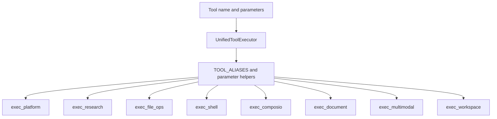
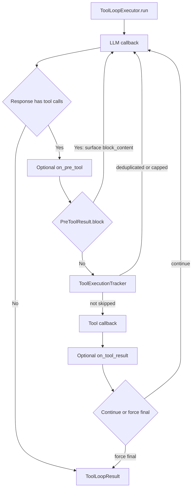
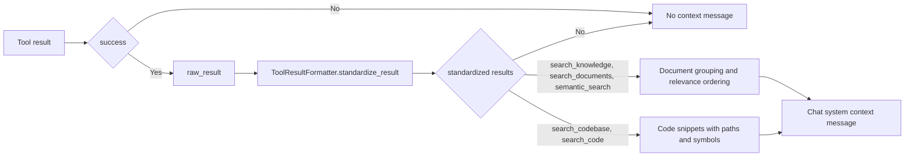

# Tool Router & Execution

Relevant source files

The following files were used as context for generating this wiki page:

- [orchestrator/consumers/chatbot/narration.py](orchestrator/consumers/chatbot/narration.py)
- [orchestrator/consumers/chatbot/tool_router.py](orchestrator/consumers/chatbot/tool_router.py)
- [orchestrator/core/composio/lookup_cache.py](orchestrator/core/composio/lookup_cache.py)
- [orchestrator/core/composio/off_loop.py](orchestrator/core/composio/off_loop.py)
- [orchestrator/modules/context/sections/planning_knowledge.py](orchestrator/modules/context/sections/planning_knowledge.py)
- [orchestrator/modules/memory/agent_sources.py](orchestrator/modules/memory/agent_sources.py)
- [orchestrator/modules/tools/__init__.py](orchestrator/modules/tools/__init__.py)
- [orchestrator/modules/tools/execution/cap_answer.py](orchestrator/modules/tools/execution/cap_answer.py)
- [orchestrator/modules/tools/execution/exec_platform.py](orchestrator/modules/tools/execution/exec_platform.py)
- [orchestrator/modules/tools/execution/nudges.py](orchestrator/modules/tools/execution/nudges.py)
- [orchestrator/modules/tools/execution/tool_loop.py](orchestrator/modules/tools/execution/tool_loop.py)
- [orchestrator/modules/tools/execution/turn_owner_words.py](orchestrator/modules/tools/execution/turn_owner_words.py)
- [orchestrator/modules/tools/execution/unified_executor.py](orchestrator/modules/tools/execution/unified_executor.py)
- [orchestrator/modules/tools/registry/tool_registry.py](orchestrator/modules/tools/registry/tool_registry.py)
- [orchestrator/modules/tools/services/composio_hint_service.py](orchestrator/modules/tools/services/composio_hint_service.py)
- [orchestrator/modules/tools/services/composio_tool_service.py](orchestrator/modules/tools/services/composio_tool_service.py)
- [orchestrator/services/agents_writing.py](orchestrator/services/agents_writing.py)
- [orchestrator/services/draft_guides.py](orchestrator/services/draft_guides.py)
- [orchestrator/services/orchestrator_answers.py](orchestrator/services/orchestrator_answers.py)
- [orchestrator/tests/test_f088_document_search_finds_what_is_stored.py](orchestrator/tests/test_f088_document_search_finds_what_is_stored.py)
- [orchestrator/tests/test_f099_a_cited_source_that_did_not_run.py](orchestrator/tests/test_f099_a_cited_source_that_did_not_run.py)
- [orchestrator/tests/test_f105_a_composio_lookup_gives_up_in_time.py](orchestrator/tests/test_f105_a_composio_lookup_gives_up_in_time.py)
- [orchestrator/tests/test_f105_a_composio_lookup_never_freezes_the_loop.py](orchestrator/tests/test_f105_a_composio_lookup_never_freezes_the_loop.py)
- [orchestrator/tests/test_f105_a_composio_lookups_are_kept_between_turns.py](orchestrator/tests/test_f105_a_composio_lookups_are_kept_between_turns.py)
- [orchestrator/tests/test_f108_b_a_claimed_action_is_nudged_once.py](orchestrator/tests/test_f108_b_a_claimed_action_is_nudged_once.py)
- [orchestrator/tests/test_f108_claimed_actions_need_a_result.py](orchestrator/tests/test_f108_claimed_actions_need_a_result.py)
- [orchestrator/tests/test_f155_a_widget_born_task_is_offered_only_its_keys_tools.py](orchestrator/tests/test_f155_a_widget_born_task_is_offered_only_its_keys_tools.py)
- [orchestrator/tests/test_f186_a_the_reply_is_the_answer.py](orchestrator/tests/test_f186_a_the_reply_is_the_answer.py)
- [orchestrator/tests/test_f187_b_a_claim_needs_the_action_that_does_it.py](orchestrator/tests/test_f187_b_a_claim_needs_the_action_that_does_it.py)
- [orchestrator/tests/test_f201_a_customer_drafts_follow_the_guides.py](orchestrator/tests/test_f201_a_customer_drafts_follow_the_guides.py)
- [orchestrator/tests/test_f269_b_f287_a_agent_writing_is_never_the_owners_facts.py](orchestrator/tests/test_f269_b_f287_a_agent_writing_is_never_the_owners_facts.py)
- [orchestrator/tests/test_f295_a_a_nudge_is_the_users_turn_so_the_retry_answers_it.py](orchestrator/tests/test_f295_a_a_nudge_is_the_users_turn_so_the_retry_answers_it.py)
- [orchestrator/tests/test_f295_b_an_empty_retry_keeps_the_reply_it_was_about.py](orchestrator/tests/test_f295_b_an_empty_retry_keeps_the_reply_it_was_about.py)
- [orchestrator/tests/test_f295_d_a_nudge_says_it_is_the_platform_and_no_apology_is_kept.py](orchestrator/tests/test_f295_d_a_nudge_says_it_is_the_platform_and_no_apology_is_kept.py)
- [orchestrator/tests/test_f297_b_a_run_that_wrote_no_answer_says_so_plainly.py](orchestrator/tests/test_f297_b_a_run_that_wrote_no_answer_says_so_plainly.py)
- [orchestrator/tests/test_f297_c_a_mission_step_with_no_answer_is_a_failed_attempt.py](orchestrator/tests/test_f297_c_a_mission_step_with_no_answer_is_a_failed_attempt.py)
- [orchestrator/tests/test_f297_d_an_empty_reply_after_tool_calls_is_asked_for_its_answer.py](orchestrator/tests/test_f297_d_an_empty_reply_after_tool_calls_is_asked_for_its_answer.py)
- [orchestrator/tests/test_f302_c_the_owners_words_reach_platform_query_data.py](orchestrator/tests/test_f302_c_the_owners_words_reach_platform_query_data.py)
- [orchestrator/tests/test_f325_a_auto_never_cites_an_agents_report_from_memory.py](orchestrator/tests/test_f325_a_auto_never_cites_an_agents_report_from_memory.py)
- [orchestrator/tests/test_f328_a_a_run_stopped_by_its_round_cap_ends_on_its_answer.py](orchestrator/tests/test_f328_a_a_run_stopped_by_its_round_cap_ends_on_its_answer.py)
- [orchestrator/tests/test_prd184_us004_tools_concurrency_deleted.py](orchestrator/tests/test_prd184_us004_tools_concurrency_deleted.py)
- [orchestrator/tests/test_tool_loop_narrated_actions.py](orchestrator/tests/test_tool_loop_narrated_actions.py)

This is section 8.3 of Tools & Integrations. It describes the path from a model-generated tool call to a workspace-scoped executor, including normalization, platform-action dispatch, modular `exec_*` handlers, the shared tool loop, result presentation, and checks that keep responses aligned with what actually ran. [orchestrator/modules/tools/execution/unified_executor.py:1-15]()

Sources: [orchestrator/modules/tools/execution/unified_executor.py:1-15]()

---

## 1. Architecture Overview & Intent Routing

Tool execution connects model-selected tool names and arguments to execution code. `ToolRegistry` provides a unified representation of tools and can express each `ToolSpec` in OpenAI function-calling format. At execution time, `UnifiedToolExecutor` is the entry point that dispatches work to the relevant executor modules. [orchestrator/modules/tools/registry/tool_registry.py:7-22](), [orchestrator/modules/tools/registry/tool_registry.py:109-148](), [orchestrator/modules/tools/execution/unified_executor.py:1-15]()

The available source excerpts establish this registry-to-executor relationship, but do not show the full intent-classification or `ActionRegistry` routing path. The diagram therefore focuses on the code entities shown here. [orchestrator/modules/tools/registry/tool_registry.py:7-22](), [orchestrator/modules/tools/execution/unified_executor.py:24-38]()

### Natural Language Space to Code Entity Space

The example utterance is illustrative; the code entities and their roles are grounded in the cited files.

```mermaid
flowchart LR
    Request["User asks to find relevant documents"]
    Spec["ToolSpec"]
    Schema["ToolSpec.to_openai_format"]
    Entry["UnifiedToolExecutor"]
    Alias["TOOL_ALIASES"]
    Platform["exec_platform.execute_platform_tool"]
    Search["AgentPlatformTools.execute_tool"]
    Request -->|"represented as a tool request"| Spec
    Spec --> Schema
    Schema -->|"tool name and parameters"| Entry
    Entry --> Alias
    Alias -->|"research tool dispatch"| Platform
    Platform --> Search
```

Sources: [orchestrator/modules/tools/registry/tool_registry.py:109-148](), [orchestrator/modules/tools/execution/unified_executor.py:24-38](), [orchestrator/modules/tools/execution/unified_executor.py:47-53](), [orchestrator/modules/tools/execution/exec_platform.py:18-44]()

### Natural Language Space to Code Entity Space: Connected Apps

For a request involving an external app, `ComposioHintService.build_hints` can produce action hints for the model. `ComposioToolService.get_tools_for_step` resolves Composio action schemas, including exact lookup when explicit action names are present. The excerpts show tool discovery and schema resolution; they do not expose the complete execution path from a resolved schema into the Composio executor. [orchestrator/modules/tools/services/composio_hint_service.py:124-159](), [orchestrator/modules/tools/services/composio_tool_service.py:64-71](), [orchestrator/modules/tools/services/composio_tool_service.py:98-114]()

```mermaid
flowchart LR
    Request["User asks to act in a connected app"]
    Hints["ComposioHintService.build_hints"]
    Actions["Composio action names and parameter hints"]
    Schemas["ComposioToolService.get_tools_for_step"]
    Result["ComposioToolResult"]
    Entry["UnifiedToolExecutor"]
    Composio["exec_composio"]
    Request --> Hints
    Hints -->|"hint_lines"| Actions
    Request --> Schemas
    Actions -->|"explicit action name or prompt"| Schemas
    Schemas --> Result
    Result -.->|"resolved tool schemas"| Entry
    Entry --> Composio
```

Sources: [orchestrator/modules/tools/services/composio_hint_service.py:86-118](), [orchestrator/modules/tools/services/composio_hint_service.py:124-171](), [orchestrator/modules/tools/services/composio_tool_service.py:49-57](), [orchestrator/modules/tools/services/composio_tool_service.py:98-167](), [orchestrator/modules/tools/execution/unified_executor.py:28-38]()

---

## 2. Unified Tool Executor & Parameter Normalization

`UnifiedToolExecutor` is documented as the single entry point for tool execution. Its module imports specialized handlers for platform, research, file operations, shell, Composio, documents, multimodal inputs, and workspace operations. The executor also imports telemetry, parameter-text decoding, direct-call contract checks, refusal interpretation, owner-send checks, outcome capture, tracing, and database-session recovery helpers. [orchestrator/modules/tools/execution/unified_executor.py:1-15](), [orchestrator/modules/tools/execution/unified_executor.py:24-45]()

### Tool Aliases and Parameter Rectification

Before routing a tool call, the executor defines aliases for names models may use instead of canonical tool names. For example, `search_documents` maps to `platform_search_documents`, and `search_code` maps to `search_codebase`. [orchestrator/modules/tools/execution/unified_executor.py:47-53]()

When required parameters are missing, `_fill_required_from_aliases` returns a new dictionary with suitable values copied from known synonyms. It first checks wrapper keys such as `report`, `task`, and `payload`; a wrapper can contain either an object or JSON text. Alias values are considered only for missing or empty required parameters, so an already-supplied required value is not overwritten by an alias. [_fill_required_from_aliases also relies on `_as_object` and `_names_it` for wrapper handling.] [orchestrator/modules/tools/execution/unified_executor.py:73-103](), [orchestrator/modules/tools/execution/unified_executor.py:106-147]()

Examples of defined parameter aliases include `objective` for `goal`, `cron` or `cron_schedule` for `cron_expression`, `prompt` for `prompt_template`, and `recipe_id` for `playbook_id`. The full mapping is maintained in `_PARAM_ALIASES`. [orchestrator/modules/tools/execution/unified_executor.py:73-100]()

### Execution Routing Map

The imports identify the executor modules available to the unified executor. The diagram groups them by module name; exact per-tool dispatch branches are not shown in the supplied excerpt, so the arrows indicate the executor’s documented routing responsibility rather than a line-by-line dispatch map. [orchestrator/modules/tools/execution/unified_executor.py:1-15](), [orchestrator/modules/tools/execution/unified_executor.py:28-38]()

Sources: [orchestrator/modules/tools/execution/unified_executor.py:1-15](), [orchestrator/modules/tools/execution/unified_executor.py:28-38](), [orchestrator/modules/tools/execution/unified_executor.py:47-53](), [orchestrator/modules/tools/execution/unified_executor.py:73-147]()

---

## 3. Modular Execution Subsystems (`exec_*`)

The executor imports specialized modules under `modules/tools/execution/`; this keeps execution concerns separated from the unified entry point. The supplied excerpts provide implementation details for platform dispatch and import/lazy-loading details for the other modules. [orchestrator/modules/tools/execution/unified_executor.py:13-15](), [orchestrator/modules/tools/execution/unified_executor.py:28-38]()

- **`exec_platform.py`** provides `execute_platform_tool` for research tools and `execute_platform_action` for platform actions. [orchestrator/modules/tools/execution/exec_platform.py:18-56]()
- **`exec_research.py`** is imported as a research executor module. The supplied excerpt does not show its function implementation. [orchestrator/modules/tools/execution/unified_executor.py:28-33]()
- **`exec_file_ops.py`** is imported for file-operation execution. [orchestrator/modules/tools/execution/unified_executor.py:28-33]()
- **`exec_shell.py`** is imported for shell-command execution. [orchestrator/modules/tools/execution/unified_executor.py:28-33]()
- **`exec_composio.py`** is imported for Composio execution. `_get_composio_executor` separately provides lazy loading of `ComposioToolExecutor`, returning `None` if the import is unavailable. [orchestrator/modules/tools/execution/unified_executor.py:33-34](), [orchestrator/modules/tools/execution/unified_executor.py:55-68]()
- **`exec_document.py`** and **`exec_multimodal.py`** are imported as separate executor modules. [orchestrator/modules/tools/execution/unified_executor.py:35-36]()
- **`exec_workspace.py`** is imported for workspace execution. The supplied excerpt does not show its handler implementation. [orchestrator/modules/tools/execution/unified_executor.py:37]()

### Research Dispatch and Document Search

`execute_platform_tool` routes `search_knowledge` requests marked as past-work searches to `past_work_for_agent`. Other requests are sent to `executor.platform_tools.execute_tool`. For document-search tools (`search_knowledge` and `semantic_search`), the result is subsequently passed through `owners_search` and `dated_for_agent`. [orchestrator/modules/tools/execution/exec_platform.py:12-16](), [orchestrator/modules/tools/execution/exec_platform.py:18-44]()

The `owners_search` function, used for document searches, filters out documents written by an agent (`source_type` 'agent_output') to ensure that only the owner's facts are presented. This prevents agents from citing their own drafts or reports as authoritative sources. [orchestrator/services/draft_guides.py:121-132](), [orchestrator/tests/test_f269_b_f287_a_agent_writing_is_never_the_owners_facts.py:68-83]() Similarly, `PlanningKnowledgeSection` uses `owners_own_chunks` to filter out agent-written documents from planning knowledge. [orchestrator/modules/context/sections/planning_knowledge.py:63-78]()

### Platform Action Dispatch

`execute_platform_action` requires a `workspace_id`; without one it returns a failure result. It removes `_agent_id` and `_agent_name` from incoming parameters, then injects trusted runtime agent identity when `agent_id` is known. The agent-name lookup is constrained to that workspace. [orchestrator/modules/tools/execution/exec_platform.py:47-101]()

The function constructs `PlatformActionExecutor` with the executor’s database session and workspace ID, then calls `execute` with the tool name, normalized parameters, and optional `caller_context`. Exceptions are caught and returned as a failure result. [orchestrator/modules/tools/execution/exec_platform.py:102-116]()

| Concern | Implementation |
|---|---|
| Workspace requirement | Returns `{"success": False, ...}` when `workspace_id` is absent. [orchestrator/modules/tools/execution/exec_platform.py:70-75]() |
| Actor identity | Strips model-supplied `_agent_id` and `_agent_name`; injects the trusted `agent_id` and, when found, the agent’s name. [orchestrator/modules/tools/execution/exec_platform.py:77-101]() |
| Caller context | Passes `caller_context` into `PlatformActionExecutor.execute`. The function’s documentation describes context fields including user identity, system role, and conversation ID. [orchestrator/modules/tools/execution/exec_platform.py:58-68](), [orchestrator/modules/tools/execution/exec_platform.py:102-108]() |
| Failure handling | Logs and returns exceptions as `{"success": False, "error": ..., "tool": ...}`. [orchestrator/modules/tools/execution/exec_platform.py:114-116]() |

Sources: [orchestrator/modules/tools/execution/unified_executor.py:13-15](), [orchestrator/modules/tools/execution/unified_executor.py:28-38](), [orchestrator/modules/tools/execution/unified_executor.py:55-68](), [orchestrator/modules/tools/execution/exec_platform.py:12-16](), [orchestrator/modules/tools/execution/exec_platform.py:18-44](), [orchestrator/modules/tools/execution/exec_platform.py:47-116](), [orchestrator/services/draft_guides.py:121-132](), [orchestrator/tests/test_f269_b_f287_a_agent_writing_is_never_the_owners_facts.py:68-83](), [orchestrator/modules/context/sections/planning_knowledge.py:63-78]()

---

## 4. Tool Definitions, Platform Actions & Policy Gates

`ToolRegistry` describes itself as a centralized source of truth for platform tools, with tools discoverable by category, task type, or name. `ToolSpec` is the registry’s atomic tool description: it includes a name, category, description, executor class and method, parameters, security level, permissions metadata, and active status. `to_openai_format` serializes a `ToolSpec` into a function-calling schema with parameter properties and required fields. [orchestrator/modules/tools/registry/tool_registry.py:7-22](), [orchestrator/modules/tools/registry/tool_registry.py:57-78](), [orchestrator/modules/tools/registry/tool_registry.py:109-148]()

The registry defines security levels `SAFE`, `CAUTIOUS`, `DANGEROUS`, and `CRITICAL`; the supplied excerpt defines these values but does not show how each level changes execution behavior. [orchestrator/modules/tools/registry/tool_registry.py:72-78]()

### Execution-Time Capability Validation

The unified executor’s module documentation states that it performs capability-based validation for Composio actions at execution time as a defense-in-depth check. The supplied excerpt does not include the validation function or its exact policy rules, so this page does not infer the specific checks or their outcomes. [orchestrator/modules/tools/execution/unified_executor.py:10-14]()

### Loop-Level Pre-Tool Policy Seam

`ToolLoopExecutor` defines an optional `on_pre_tool` hook. A hook can return `PreToolResult` to block a tool call and supply content for the model, or to provide replacement input arguments. The result type’s documentation describes blocked calls as errors-as-data so the model can read a deny/ask outcome and adapt. The excerpt establishes the loop-level hook contract, but does not identify which policy-plane implementation supplies it. [orchestrator/modules/tools/execution/tool_loop.py:113-137]()

Sources: [orchestrator/modules/tools/registry/tool_registry.py:7-22](), [orchestrator/modules/tools/registry/tool_registry.py:57-78](), [orchestrator/modules/tools/registry/tool_registry.py:109-148](), [orchestrator/modules/tools/execution/unified_executor.py:10-14](), [orchestrator/modules/tools/execution/tool_loop.py:113-137]()

---

## 5. Tool Loop, Deduplication & Claim Verification

`ToolLoopExecutor` is the shared tool-loop implementation for the chat surface and the agent `execute_with_prompt` inner loop. Its documented responsibilities include iteration limits, deduplication, recovery when the LLM finishes with `finish_reason == "length"`, workspace-ID forwarding to tool callbacks, optional event streaming, and a post-tool hook. [orchestrator/modules/tools/execution/tool_loop.py:1-22]()

### Converged Tool Loop

The loop’s public data types include `ToolPostResult`, `PreToolResult`, and `ToolLoopResult`. `ToolPostResult` supports forcing a final response, adding messages before a subsequent LLM call, or overriding tool content sent back to the LLM. `ToolLoopResult` carries the final response, iteration count, and flags for forced finalization and reaching the iteration limit. [orchestrator/modules/tools/execution/tool_loop.py:86-150]()

Sources: [orchestrator/modules/tools/execution/tool_loop.py:1-22](), [orchestrator/modules/tools/execution/tool_loop.py:86-150](), [orchestrator/modules/tools/execution/tool_execution_tracker.py:69-101]()

### `ToolExecutionTracker`

`ToolExecutionTracker` records executions within a conversation turn. Its documented protections include exact-call deduplication, similar-query deduplication for search tools, per-tool retry limits, and prefix-aware defaults. [orchestrator/modules/tools/execution/tool_execution_tracker.py:69-101]()

Search-query similarity is determined by lowercasing and removing punctuation, normalizing whitespace, and comparing normalized strings with `SequenceMatcher`; the default threshold is `0.75`. The tracker’s search-tool set includes `search_knowledge`, `semantic_search`, and `search_codebase`, among other database and multimodal search tools. [orchestrator/modules/tools/execution/tool_execution_tracker.py:42-58](), [orchestrator/modules/tools/execution/tool_execution_tracker.py:78-82]()

The tracker records succeeded and failed action names separately, retains ordered outcomes, and tracks refused, waiting, and skipped calls. These fields make a distinction between an action that succeeded, one that failed, one awaiting an owner’s action, and one not executed because it was skipped. [orchestrator/modules/tools/execution/tool_execution_tracker.py:103-129]()

### Claim and Source Verification

The tracker’s `succeeded` set is documented as the actions that did their work during the turn; a result reporting failure does not count. Its `outcomes` list retains each call’s action, parameters, and result. These records provide evidence for checking whether a final response is supported by a successful action. [orchestrator/modules/tools/execution/tool_execution_tracker.py:103-114]()

The supplied tests verify two distinct response-integrity cases:

- A claim such as “I've approved the mission” is not backed by a read-only call or a failed approval call; a successful matching action is required. [orchestrator/tests/test_f108_claimed_actions_need_a_result.py:31-47](), [orchestrator/tests/test_f108_claimed_actions_need_a_result.py:62-70]()
- A reply that cites an offered tool as its source can be flagged when that tool did not run; a mention of a tool as a proposed future action is not treated as a source citation. [orchestrator/tests/test_f099_a_cited_source_that_did_not_run.py:28-41]()

The loop tests show `ToolLoopExecutor` recording successful actions in `tracker.succeeded` and retaining outcomes used by the claim-checking test helper. The tests also establish that a failed action does not substantiate a completion claim. [orchestrator/tests/test_f108_claimed_actions_need_a_result.py:91-110]()

Sources: [orchestrator/modules/tools/execution/tool_loop.py:1-22](), [orchestrator/modules/tools/execution/tool_loop.py:86-150](), [orchestrator/modules/tools/execution/tool_execution_tracker.py:42-58](), [orchestrator/modules/tools/execution/tool_execution_tracker.py:69-129](), [orchestrator/tests/test_f108_claimed_actions_need_a_result.py:31-47](), [orchestrator/tests/test_f108_claimed_actions_need_a_result.py:62-70](), [orchestrator/tests/test_f108_claimed_actions_need_a_result.py:91-110](), [orchestrator/tests/test_f099_a_cited_source_that_did_not_run.py:28-41]()

---

## 6. Tool Result Formatting

The chatbot-specific router imports the shared `ToolRouter` and `ToolResultFormatter`. Its `build_tool_context_message` function is presentation logic for turning successful tool results into messages for model context. It returns `None` for unsuccessful results or results without standardized items. [orchestrator/consumers/chatbot/tool_router.py:15-25](), [orchestrator/consumers/chatbot/tool_router.py:47-68]()

For document-search results (`search_knowledge`, `search_documents`, and `semantic_search`), the formatter groups chunks by source, accumulates chunk IDs, tracks the maximum similarity per document, and orders the grouped documents by relevance. It includes document links when a `document_id` is available, then appends the full content of the selected documents to the system message. [orchestrator/consumers/chatbot/tool_router.py:70-110](), [orchestrator/consumers/chatbot/tool_router.py:112-155]()

For code-search results (`search_codebase` and `search_code`), it includes up to five results, each with a symbol name, file path, and code excerpt capped at 800 characters. [orchestrator/consumers/chatbot/tool_router.py:158-170]()

### Formatting Pipeline

Sources: [orchestrator/consumers/chatbot/tool_router.py:47-68](), [orchestrator/consumers/chatbot/tool_router.py:70-110](), [orchestrator/consumers/chatbot/tool_router.py:112-155](), [orchestrator/consumers/chatbot/tool_router.py:158-170]()

### Formatting Boundaries

`build_tool_context_message` is explicitly chatbot-specific: the module describes its presentation choices as including emojis, download links, and critical instructions, while other consumers can format results differently. The shared router’s generic tool logic is imported from `modules.tools.tool_router`. [orchestrator/consumers/chatbot/tool_router.py:1-8](), [orchestrator/consumers/chatbot/tool_router.py:15-25](), [orchestrator/consumers/chatbot/tool_router.py:47-58]()

Sources: [orchestrator/consumers/chatbot/tool_router.py:1-8](), [orchestrator/consumers/chatbot/tool_router.py:15-25](), [orchestrator/consumers/chatbot/tool_router.py:47-58]()

---