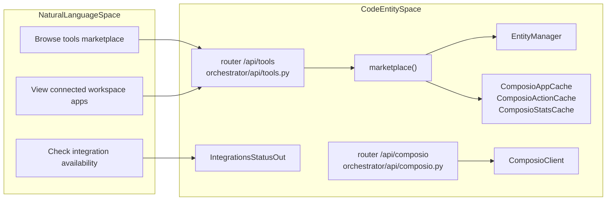
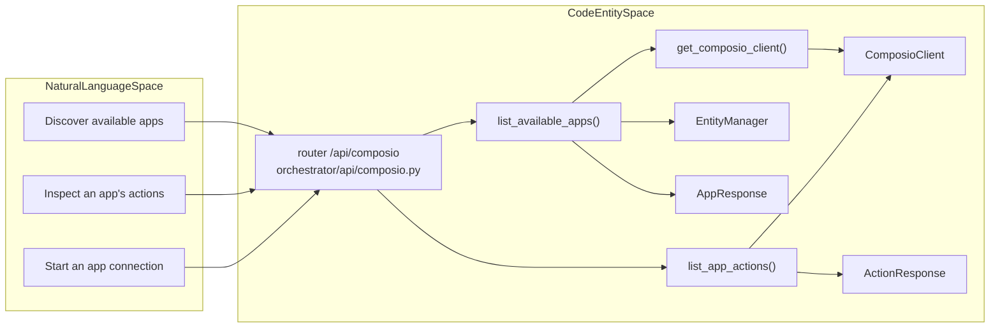

# Tools API Reference

<details>
<summary>Relevant source files</summary>

The following files were used as context for generating this wiki page:

- [frontend/components/workflows/execution-kitchen.tsx](frontend/components/workflows/execution-kitchen.tsx)
- [orchestrator/alembic/versions/dedupe_skills_unique_workspace_name.py](orchestrator/alembic/versions/dedupe_skills_unique_workspace_name.py)
- [orchestrator/api/composio.py](orchestrator/api/composio.py)
- [orchestrator/api/patterns.py](orchestrator/api/patterns.py)
- [orchestrator/api/recipe_executor.py](orchestrator/api/recipe_executor.py)
- [orchestrator/api/skills.py](orchestrator/api/skills.py)
- [orchestrator/api/templates.py](orchestrator/api/templates.py)
- [orchestrator/api/tools.py](orchestrator/api/tools.py)
- [orchestrator/api/webhooks.py](orchestrator/api/webhooks.py)
- [orchestrator/api/workflow_recipes.py](orchestrator/api/workflow_recipes.py)
- [orchestrator/core/composio/client.py](orchestrator/core/composio/client.py)
- [orchestrator/core/composio/linkedin_image_workaround.py](orchestrator/core/composio/linkedin_image_workaround.py)
- [orchestrator/core/credentials/tester.py](orchestrator/core/credentials/tester.py)
- [orchestrator/core/credentials/types.py](orchestrator/core/credentials/types.py)
- [orchestrator/core/database/credential_types_seed.json](orchestrator/core/database/credential_types_seed.json)
- [orchestrator/core/routing/ingestors/webhook.py](orchestrator/core/routing/ingestors/webhook.py)
- [orchestrator/core/services/skill_materializer.py](orchestrator/core/services/skill_materializer.py)
- [orchestrator/modules/agents/services/skill_loader.py](orchestrator/modules/agents/services/skill_loader.py)
- [orchestrator/services/metadata_sync_service.py](orchestrator/services/metadata_sync_service.py)
- [orchestrator/services/webhook_dedup.py](orchestrator/services/webhook_dedup.py)
- [orchestrator/tests/test_p2w2_webhook_dedup.py](orchestrator/tests/test_p2w2_webhook_dedup.py)
- [orchestrator/tests/test_p2w2_webhook_signature_reject.py](orchestrator/tests/test_p2w2_webhook_signature_reject.py)
- [orchestrator/tests/test_prd251_linkedin_scope.py](orchestrator/tests/test_prd251_linkedin_scope.py)

</details>


## Purpose and scope

This page describes the Tools API surface for browsing the tools marketplace, checking integration status, managing workspace app connections, and accessing Composio app and action discovery. It focuses on the FastAPI routers in `orchestrator/api/tools.py` and `orchestrator/api/composio.py`, their cache and client dependencies, and the frontend calls visible in the provided code. [orchestrator/api/tools.py:3-35]() [orchestrator/api/composio.py:1-43]()

Sources: `[orchestrator/api/tools.py:3-35]()` `[orchestrator/api/composio.py:1-43]()`

---

## 1. Overview & Architecture

The Tools API is implemented by FastAPI routers mounted at `/api/tools` and `/api/composio`. The Tools router is described as the source of truth for the Tools page and serves marketplace metadata from local cache tables; the Composio router exposes app discovery, connection management, action listing, and trigger-related routes. [orchestrator/api/tools.py:3-8]() [orchestrator/api/tools.py:33-35]() [orchestrator/api/composio.py:1-10]() [orchestrator/api/composio.py:41-44]()

The main marketplace path is cache-first: `marketplace()` reads workspace connections through `EntityManager` and constructs its response from cached marketplace metadata rather than synchronizing pending connections during each page load. The route’s comments identify OAuth callback handling and a manual refresh endpoint as the points where pending connections are synchronized. [orchestrator/api/tools.py:159-181]()

Title: "ToolsMarketplaceCodePath"



Sources: `[orchestrator/api/tools.py:25-35]()` `[orchestrator/api/tools.py:138-181]()` `[orchestrator/api/composio.py:24-44]()` `[orchestrator/core/composio/client.py:66-94]()`

---

## 2. Marketplace & System Status Endpoints

The `/api/tools` router defines response models for marketplace metadata, aggregate statistics, and integration status. The marketplace response includes app records, total app and action counts, category data, and a last-sync timestamp. `StatsOut` represents app, action, and connected-app totals plus category and sync metadata. `IntegrationsStatusOut` reports Composio availability, a reason when unavailable, key configuration state, cached app count, last sync time, and the latest sync-job status. [orchestrator/api/tools.py:107-147]()

### GET `/api/tools/marketplace`

`marketplace()` accepts optional `category` and `search` filters, plus `limit` and `offset`. The limit is constrained to the range 1–1000. It obtains the workspace’s entity and active connections through `EntityManager`, then forms a set of connected app names from database records; the route comments explicitly state that listing does not make Composio API calls to synchronize pending connections. [orchestrator/api/tools.py:159-181]()

The frontend marketplace tab requests this endpoint with `limit=1000` and, when selected, a category query parameter. It maps the returned app records into the frontend `ComposioApp` shape. [frontend/components/marketplace/marketplace-tools-tab.tsx:103-139]()

| Parameter | Meaning |
|---|---|
| `category` | Optional category filter. [orchestrator/api/tools.py:159-163]() |
| `search` | Optional search filter. [orchestrator/api/tools.py:159-163]() |
| `limit` | Page size; defaults to 100 and is bounded from 1 to 1000. [orchestrator/api/tools.py:159-164]() |
| `offset` | Pagination offset; defaults to 0 and cannot be negative. [orchestrator/api/tools.py:159-164]() |

`INTERNAL_APP_NAMES` identifies `RAG`, `MEMORY`, `NL2SQL`, and `CODEGRAPH` as internal app names. The provided excerpt defines this set but does not show the marketplace filtering implementation that may use it. [orchestrator/api/tools.py:104-104]()

### Statistics and integration status

`StatsOut` and `IntegrationsStatusOut` define the data shapes for statistics and integration health, including connected app totals, cache size, key configuration, and sync status. The provided excerpt does not include the route decorators or handler implementations for these models, so exact paths and aggregation behavior are not specified here. [orchestrator/api/tools.py:130-147]()

Sources: `[orchestrator/api/tools.py:104-147]()` `[orchestrator/api/tools.py:159-181]()` `[frontend/components/marketplace/marketplace-tools-tab.tsx:103-139]()`

---

## 3. Connected Apps & Workspace Management Endpoints

Workspace app state is associated with a Composio entity. In the marketplace handler, `EntityManager.get_entity_by_workspace()` resolves the entity for `ctx.workspace_id`; `get_entity_connections()` returns its connections; and only records whose status is `active` contribute to the connected-app set. [orchestrator/api/tools.py:168-181]()

The frontend separately fetches `/api/tools/connected` for workspace tools and reads the response’s `apps` field. It also initializes connection and disconnection mutations through `useInitiateConnection()` and `useDisconnectApp()`. [frontend/components/marketplace/marketplace-tools-tab.tsx:154-171]()

### Workspace administration guard

`_assert_workspace_admin()` checks the database membership role first, using `workspace_members` joined to `users` and requiring an active membership. It allows `admin` and `owner` roles; if that database check does not grant access, it checks the user’s role and system role claims for admin, owner, or super-admin access. Otherwise it raises HTTP 403. [orchestrator/api/tools.py:73-102]()

### Connection request shape

`ConnectIn` defines the request data used for connection initiation: `app_name`, optional `callback_url`, and optional `auth_scheme` and `auth_config_id` overrides. The comments identify `API_KEY` as an option for Shopify cases where the managed-install flow does not work, and `auth_config_id` as a way to pin a specific Composio configuration. [orchestrator/api/tools.py:149-157]()

The Composio API defines corresponding hosted-auth request and response models. `InitiateConnectionRequest` accepts a callback URL and optional auth overrides; `InitiateConnectionResponse` returns a redirect URL, app name, and the selected auth configuration and scheme. [orchestrator/api/composio.py:82-98]()

The provided `tools.py` excerpt shows the request model but not the connection route handler; accordingly, this page does not infer the exact `/api/tools` connection route or its persistence steps. [orchestrator/api/tools.py:149-157]()

Sources: `[orchestrator/api/tools.py:73-102]()` `[orchestrator/api/tools.py:149-181]()` `[orchestrator/api/composio.py:82-98]()` `[frontend/components/marketplace/marketplace-tools-tab.tsx:154-171]()`

---

## 4. Composio App Discovery & Analytics Endpoints

The Composio router is mounted at `/api/composio`. Its module description identifies app discovery and listing, OAuth connection management, action listing, and webhook handling as its API areas. [orchestrator/api/composio.py:1-10]() [orchestrator/api/composio.py:41-44]()

`AppResponse` describes app metadata including its name, display name, description, logo, categories, connection status, action count, authentication schemes, and trigger metadata. `ActionResponse` describes action metadata and parameter schemas. `ConnectionResponse` represents an app’s connection state and optional connection identifier and timestamp. [orchestrator/api/composio.py:50-80]()

Title: "ComposioDiscoveryCodePath"



Sources: `[orchestrator/api/composio.py:24-44]()` `[orchestrator/api/composio.py:50-98]()` `[orchestrator/api/composio.py:130-203]()` `[orchestrator/core/composio/client.py:66-94]()`

### GET `/api/composio/apps`

`list_available_apps()` accepts an optional category filter and uses the hybrid request context and database session. It obtains app metadata through `get_composio_client().get_available_apps()`. A Composio lookup failure is logged and returned as HTTP 503 with the detail `Composio service unavailable`. [orchestrator/api/composio.py:130-147]()

The handler then resolves the workspace’s Composio entity and its connections through `EntityManager`. It filters the app list by category when requested and returns `AppResponse` records, marking an app connected when its name matches an active workspace connection. The list endpoint intentionally does not fetch actions per app. [orchestrator/api/composio.py:149-180]()

### GET `/api/composio/apps/{app_name}/actions`

`list_app_actions()` fetches action metadata for the named app, passing the uppercased app name to `client.get_app_actions()`. A lookup failure is logged and returned as HTTP 503. The excerpt begins the response construction after this lookup; further response and enabled-state logic is not included in the provided lines. [orchestrator/api/composio.py:183-203]()

### Composio client behavior

`ComposioClient` wraps the Composio SDK and provides app and action discovery, entity-related functionality, hosted OAuth initiation, Tool Router sessions, and trigger subscriptions. SDK imports are lazy: `_get_composio()` and `_get_composio_openai_provider()` import their respective SDK components only when needed and raise an `ImportError` if unavailable. [orchestrator/core/composio/client.py:30-63]() [orchestrator/core/composio/client.py:66-94]()

The client reads its API key from the explicit constructor argument or `config.COMPOSIO_API_KEY`. Its `composio` property initializes the SDK handle lazily under `_sdk_init_lock`; the configuration pins the default toolkit version to `latest` and Shopify to a tested version. [orchestrator/core/composio/client.py:96-125]() [orchestrator/core/composio/client.py:127-151]()

Sources: `[orchestrator/api/composio.py:24-44]()` `[orchestrator/api/composio.py:50-98]()` `[orchestrator/api/composio.py:130-203]()` `[orchestrator/core/composio/client.py:30-63]()` `[orchestrator/core/composio/client.py:66-151]()`

---

## 5. Tool Execution, File Upload Resolution & Deny-List Enforcement

`ComposioToolExecutor` is the Composio execution component identified in the provided code. Its module documentation describes permission validation, workspace entity resolution, SDK action execution, and response formatting. The executor imports the Composio client, deny-list checks, post-action refusal logic, upload specifications, and the LinkedIn image workaround. [orchestrator/core/composio/tool_executor.py:1-35]()

### File upload seam: `resolve_file_uploads`

`resolve_file_uploads()` is a shared asynchronous helper for Composio action parameters. It only processes actions listed in `UPLOAD_ACTIONS`; other actions return their parameters unchanged. For upload actions, the helper identifies file references, obtains the Composio HTTP client, and resolves URLs or workspace paths into `FileUploadable` values. [orchestrator/core/composio/tool_executor.py:41-68]() [orchestrator/core/composio/tool_executor.py:71-123]() [orchestrator/core/composio/tool_executor.py:126-155]()

For workspace paths, `_resolve_single_file_standalone()` downloads through `WorkspaceClient`, writes the content to a temporary file, and creates a `FileUploadable` from that file. The helper’s documentation states that it is shared by `ComposioToolExecutor.execute()` and `recipe_executor`, so both execution paths use the same file handling seam. [orchestrator/core/composio/tool_executor.py:71-123]() [orchestrator/core/composio/tool_executor.py:126-136]()

### LinkedIn image workaround

`linkedin_image_workaround.py` documents a direct LinkedIn Community Management API path for image posts that Composio cannot handle. It is intended for image posts; text-only posts continue through Composio. The module states that the hook in `ComposioToolExecutor.execute()` intercepts image-bearing LinkedIn post calls. [orchestrator/core/composio/linkedin_image_workaround.py:1-5]() [orchestrator/core/composio/linkedin_image_workaround.py:37-50]()

The workaround loads credentials for the calling workspace from the platform credential store, keeps credential and token caches workspace-scoped, and does not fall back to another workspace’s credential. When it fetches an image URL, it uses the platform’s outbound URL safety decision and does not follow redirects. [orchestrator/core/composio/linkedin_image_workaround.py:8-35]()

The `LinkedInCredentialError` is raised when a workspace has no usable LinkedIn credential. [orchestrator/core/composio/linkedin_image_workaround.py:98-101]() The `_load_linkedin_credentials` function is responsible for loading the workspace's LinkedIn credential, ensuring it is active and belongs to the calling workspace. It also handles caching of credentials and tokens, invalidating the cache if the credential changes. [orchestrator/core/composio/linkedin_image_workaround.py:133-154]()

### Deny-list enforcement

The provided executor excerpt imports `composio_action_denial_async` and `denied_result`, and the LinkedIn workaround identifies the deny list as a gate for its image-post action. The implementation of the deny-list module itself was not included in the provided file contents, so the storage format and configuration details are not documented here. [orchestrator/core/composio/tool_executor.py:25-35]() [orchestrator/core/composio/linkedin_image_workaround.py:80-82]()

Sources: `[orchestrator/core/composio/tool_executor.py:1-35]()` `[orchestrator/core/composio/tool_executor.py:41-68]()` `[orchestrator/core/composio/tool_executor.py:71-155]()` `[orchestrator/core/composio/linkedin_image_workaround.py:1-50]()` `[orchestrator/core/composio/linkedin_image_workaround.py:80-82]()` `[orchestrator/core/composio/linkedin_image_workaround.py:98-101]()` `[orchestrator/core/composio/linkedin_image_workaround.py:133-154]()`

---

## 6. Database Models & Caching Layer

`tools.py` imports `ComposioAppCache`, `ComposioActionCache`, `ComposioStatsCache`, and `ComposioSyncJob` from `core.models.composio_cache`. It also imports `MetadataSyncService`, indicating the API’s cache and metadata synchronization boundary. The provided excerpt does not include the model definitions or the synchronization service implementation, so field-level behavior is not specified here. [orchestrator/api/tools.py:25-31]()

| Model or component | Role visible in the provided code |
|---|---|
| `ComposioAppCache` | Imported by the Tools API as marketplace app-cache data. [orchestrator/api/tools.py:29-30]() |
| `ComposioActionCache` | Imported by the Tools API as action-cache data. [orchestrator/api/tools.py:29-30]() |
| `ComposioStatsCache` | Imported by the Tools API as cached statistics data. [orchestrator/api/tools.py:29-30]() |
| `ComposioSyncJob` | Imported by the Tools API; `IntegrationsStatusOut` exposes the latest sync status as `running`, `completed`, `failed`, or `None`. [orchestrator/api/tools.py:29-30]() [orchestrator/api/tools.py:138-147]() |
| `EntityManager` | Resolves a workspace’s Composio entity and reads its connections for marketplace connection state. [orchestrator/api/tools.py:25-27]() [orchestrator/api/tools.py:168-181]() |
| `MetadataSyncService` | Imported by the Tools API as its metadata synchronization service. [orchestrator/api/tools.py:29-31]() |

Sources: `[orchestrator/api/tools.py:25-31]()` `[orchestrator/api/tools.py:138-181]()`

---

## 7. Trigger Subscriptions and Webhook Handling

The Composio API includes endpoints for managing trigger subscriptions and handling incoming webhooks. These functionalities are crucial for enabling real-time integrations where external services can notify Automatos AI about events.

### Trigger Subscription Endpoints

The `TriggerSubscriptionRequest` model defines the payload for subscribing to a trigger, including the `trigger_name` and optional `agent_id` or `workflow_id` to associate the trigger with. [orchestrator/api/composio.py:111-116]()

The `workflow_recipes.py` router includes logic for automatically registering triggers. The `_auto_register_trigger` function checks if a recipe's `schedule_config` is of type `trigger` and sourced from `composio`. If so, it attempts to subscribe to the trigger via the Composio API. It first checks for existing active subscriptions to prevent duplicates. [orchestrator/api/workflow_recipes.py:104-143]()

The subscription process involves:
1. Retrieving a `ComposioClient` and `EntityManager`. [orchestrator/api/workflow_recipes.py:145-148]()
2. Getting or creating a Composio entity for the workspace. [orchestrator/api/workflow_recipes.py:149-150]()
3. Constructing a `callback_url` pointing to `/api/composio/webhook`. [orchestrator/api/workflow_recipes.py:152-153]()
4. Calling `client.subscribe_to_trigger` with the entity ID, trigger name, and callback URL. [orchestrator/api/workflow_recipes.py:155-158]()
5. Storing the `composio_subscription_id` in the `TriggerSubscription` model. [orchestrator/api/workflow_recipes.py:160-160]()

Sources: `[orchestrator/api/composio.py:111-116]()`, `[orchestrator/api/workflow_recipes.py:104-160]()`

### Webhook Handling

The `WebhookPayload` model defines the structure of incoming webhook data from Composio, including `trigger_name`, `entity_id`, `app_name`, and `event_data`. [orchestrator/api/composio.py:119-124]()

The `/api/composio/webhook` endpoint is designed to receive these payloads. It performs signature verification using `X-Composio-Signature` to ensure the authenticity of the webhook. [orchestrator/api/composio.py:700-700]()

Upon receiving a valid webhook, the system:
1. Resolves the workspace ID from the `entity_id`. [orchestrator/api/composio.py:715-715]()
2. Fetches active `TriggerSubscription` records for the given `trigger_name` and `workspace_id`. [orchestrator/api/composio.py:720-725]()
3. For each matching subscription, it creates an `UnroutedEvent` and dispatches it through the `UniversalRouter`. This allows the system to route the event to the appropriate agent or workflow based on routing rules. [orchestrator/api/composio.py:730-750]()
4. The `webhook_dedup` service is used to prevent processing duplicate webhook events. [orchestrator/api/composio.py:708-708]()

The general webhook router at `/api/webhooks/ws/{workspace_key}` also handles incoming requests, routing them through `UniversalRouter`. It supports HMAC-SHA256 signature verification using headers like `X-Hub-Signature-256`, `X-Composio-Signature`, or `X-Webhook-Signature`. [orchestrator/api/webhooks.py:6-10]() [orchestrator/api/webhooks.py:50-73]()

Title: "WebhookProcessingFlow"
```mermaid
graph TD
    A[External Service] -->|Webhook Payload| B{POST /api/composio/webhook};
    B --> C{Verify X-Composio-Signature};
    C -- Invalid Signature --> D[Reject 401];
    C -- Valid Signature --> E{Resolve Workspace ID from entity_id};
    E --> F{Fetch Active TriggerSubscriptions};
    F --> G{For each Subscription};
    G --> H[Create UnroutedEvent];
    H --> I[UniversalRouter.route(UnroutedEvent)];
    I --> J[Agent/Workflow Execution];
    B --> K[webhook_dedup service];
```

Sources: `[orchestrator/api/composio.py:119-124]()`, `[orchestrator/api/composio.py:700-750]()`, `[orchestrator/api/webhooks.py:6-10]()`, `[orchestrator/api/webhooks.py:50-73]()`

---