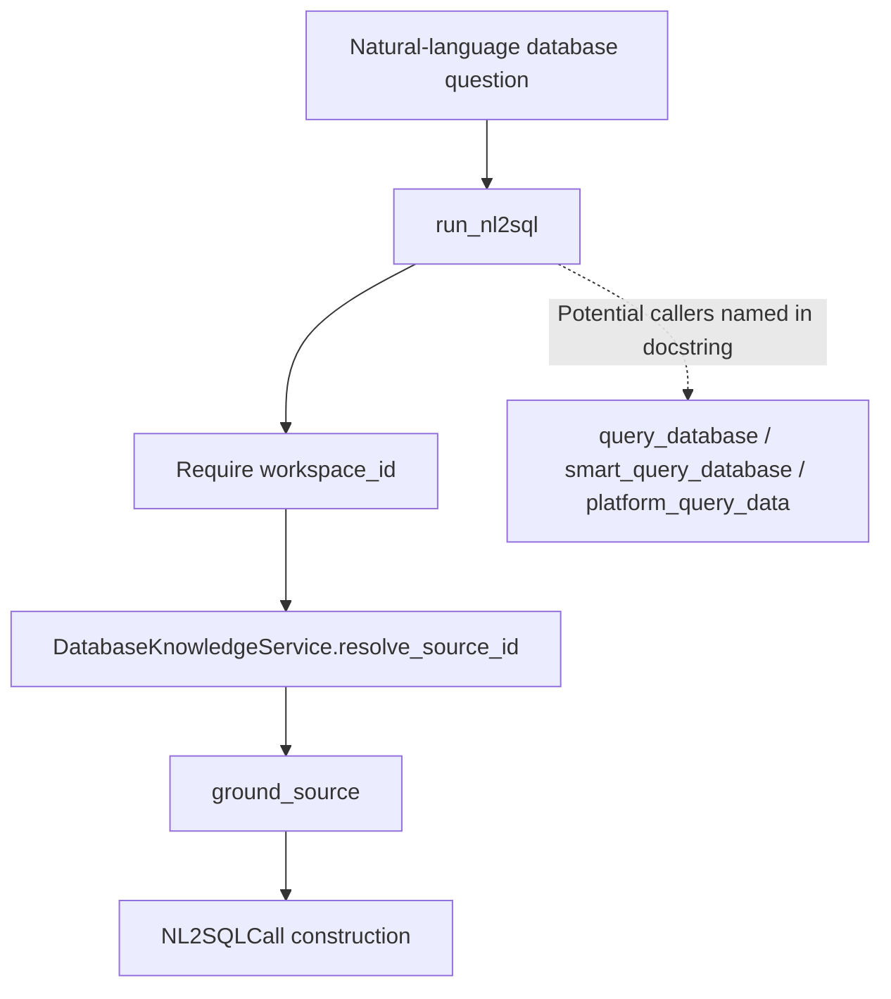

# Web Access & Research Tools

<details>
<summary>Relevant source files</summary>

The following files were used as context for generating this wiki page:

- [orchestrator/modules/nl2sql/agent_answer.py](orchestrator/modules/nl2sql/agent_answer.py)
- [orchestrator/modules/nl2sql/not_recorded.py](orchestrator/modules/nl2sql/not_recorded.py)
- [orchestrator/modules/nl2sql/schema/grounding.py](orchestrator/modules/nl2sql/schema/grounding.py)
- [orchestrator/modules/nl2sql/schema/live_rows.py](orchestrator/modules/nl2sql/schema/live_rows.py)
- [orchestrator/modules/tools/discovery/actions_scheduling.py](orchestrator/modules/tools/discovery/actions_scheduling.py)
- [orchestrator/modules/tools/discovery/handlers_scheduling.py](orchestrator/modules/tools/discovery/handlers_scheduling.py)
- [orchestrator/modules/tools/execution/exec_research.py](orchestrator/modules/tools/execution/exec_research.py)
- [orchestrator/modules/tools/execution/nl2sql_card_words.py](orchestrator/modules/tools/execution/nl2sql_card_words.py)
- [orchestrator/tests/helpers_shop_database.py](orchestrator/tests/helpers_shop_database.py)
- [orchestrator/tests/test_f180_a_ticket_filed_for_review_waits_for_it.py](orchestrator/tests/test_f180_a_ticket_filed_for_review_waits_for_it.py)
- [orchestrator/tests/test_f299_a_a_board_agent_reads_money_kilos_and_dates.py](orchestrator/tests/test_f299_a_a_board_agent_reads_money_kilos_and_dates.py)
- [orchestrator/tests/test_f300_a_every_database_answer_lists_the_tables_columns_and_values.py](orchestrator/tests/test_f300_a_every_database_answer_lists_the_tables_columns_and_values.py)
- [orchestrator/tests/test_f300_b_a_failed_query_names_the_real_columns.py](orchestrator/tests/test_f300_b_a_failed_query_names_the_real_columns.py)
- [orchestrator/tests/test_f301_a_a_date_past_the_recorded_data_is_called_out.py](orchestrator/tests/test_f301_a_a_date_past_the_recorded_data_is_called_out.py)
- [orchestrator/tests/test_f301_b_the_owners_card_reaches_the_sql_writer.py](orchestrator/tests/test_f301_b_the_owners_card_reaches_the_sql_writer.py)
- [orchestrator/tests/test_f301_c_a_top_group_count_is_not_the_total.py](orchestrator/tests/test_f301_c_a_top_group_count_is_not_the_total.py)
- [orchestrator/tests/test_f301_d_a_date_past_the_data_never_answers_zero.py](orchestrator/tests/test_f301_d_a_date_past_the_data_never_answers_zero.py)
- [orchestrator/tests/test_f323_a_closed_accounts_are_left_out_unless_asked_for.py](orchestrator/tests/test_f323_a_closed_accounts_are_left_out_unless_asked_for.py)
- [orchestrator/tests/test_f330_c_a_database_question_holds_none_of_the_callers_connection.py](orchestrator/tests/test_f330_c_a_database_question_holds_none_of_the_callers_connection.py)
- [orchestrator/tests/test_schedule_endpoint.py](orchestrator/tests/test_schedule_endpoint.py)

</details>


## Purpose and Scope

This page covers the available implementation evidence for web access and research tools. The supplied code shows `exec_research.run_nl2sql` and supporting NL2SQL answer-grounding utilities, including workspace checks, source resolution, and caller-connection handling. It does **not** include the PRD-240 web-action registration, fetch/search handlers, URL validators, denylist implementation, backend-resolution code, or web-access configuration. Consequently, those web-specific implementation details cannot be verified from the supplied files. [orchestrator/modules/tools/execution/exec_research.py:1-20]()

Sources: `orchestrator/modules/tools/execution/exec_research.py:1-20`()

---

## 1. Core Architecture & Tool Registration

The provided code establishes a shared, in-process NL2SQL entry point named `run_nl2sql`. Its docstring identifies `query_database`, `smart_query_database`, and `platform_query_data` as callers intended to share this service path and source resolver. The supplied excerpt does not show the tool registry or the call sites that connect those names to `run_nl2sql`. [orchestrator/modules/tools/execution/exec_research.py:96-112]()

The file describes the execution path as workspace-scoped and explicitly rejects a call without `workspace_id`. It resolves a source using the workspace ID and optional `database_name`, then obtains the source schema for answer grounding. [orchestrator/modules/tools/execution/exec_research.py:120-151]()

### Natural Language Space to Code Entity Space: Database Research

This diagram maps a natural-language database question to the concrete functions visible in the supplied code. It does not imply details about downstream query execution beyond the excerpt.



Sources: `orchestrator/modules/tools/execution/exec_research.py:96-112`(), `orchestrator/modules/tools/execution/exec_research.py:120-153`()

### Natural Language Space to Code Entity Space: Caller Connection Handling

`_holds_no_caller_connection` wraps `run_nl2sql`. When a request session is supplied, the wrapper attempts to release it if it is read-only; it passes no session to the wrapped function when that release succeeds. If the request has written, the wrapper retains and passes the session onward. [orchestrator/modules/tools/execution/exec_research.py:63-93]()

```mermaid
flowchart TD
    Caller["Tool caller"] --> Wrapper["_holds_no_caller_connection"]
    Wrapper --> Session["Optional db_session"]
    Session --> Release["release_if_read_only"]
    Release -->| "Released or absent" | NoSession["Call wrapped function with db_session=None"]
    Release -->| "Not released" | KeepSession["Call wrapped function with caller db_session"]
    NoSession --> NL2SQL["run_nl2sql"]
    KeepSession --> NL2SQL
```

Sources: `orchestrator/modules/tools/execution/exec_research.py:63-93`()

---

## 2. URL Safety Validation and Denylists

The supplied files do not include URL validation, outbound-request handling, or web-access denylist code. Therefore, this page cannot document the validators, blocked address ranges, redirect policy, DNS behavior, or denylist matching rules for `platform_web_fetch` or `platform_web_search`.

The available security behavior is for database research: `run_nl2sql` fails closed when `workspace_id` is absent, and source resolution is performed using the caller’s workspace ID. The excerpt’s docstring says that the downstream source lookup fails closed on a cross-workspace source. [orchestrator/modules/tools/execution/exec_research.py:13-19]()

Sources: `orchestrator/modules/tools/execution/exec_research.py:13-19`(), `orchestrator/modules/tools/execution/exec_research.py:120-147`()

---

## 3. `platform_web_fetch` Implementation & Content Processing

The supplied code does not include a `platform_web_fetch` action, its handler, HTTP client usage, content extraction, response limits, or HTML sanitization. Those implementation details cannot be established from this file set.

The web-fetch behavior should therefore be documented from the corresponding web-action and handler sources when available, rather than inferred from the NL2SQL research executor.

Sources: `orchestrator/modules/tools/execution/exec_research.py:1-20`()

---

## 4. `platform_web_search` & Backend Resolution

The supplied files do not show `platform_web_search`, nor any resolution among OpenRouter, Composio, or SearXNG. They do not establish provider precedence, credential checks, request formats, or fallback behavior. No backend-resolution claims can be verified from this cluster.

Sources: `orchestrator/modules/tools/execution/exec_research.py:1-20`()

---

## 5. Database Research Tools & `exec_research`

`exec_research.py` provides a shared NL2SQL execution path. `run_nl2sql` accepts a method name, tool parameters, agent ID, workspace ID, caller context, and an optional database session. Its docstring describes `method` as either `"smart_query"` or `"query_database"`, and says `database_name` may identify a source by name or ID. [orchestrator/modules/tools/execution/exec_research.py:96-118]()

### Input checks and source resolution

The executor rejects missing workspace scope and an empty natural-language `query`, returning a structured error response with empty `data` and `columns` and `row_count: 0`. [orchestrator/modules/tools/execution/exec_research.py:49-60](), [orchestrator/modules/tools/execution/exec_research.py:120-138]()

For an accepted request, it obtains `DatabaseKnowledgeService` through `get_database_knowledge_service()` and calls `resolve_source_id` with the stringified workspace ID, optional `database_name`, and optional request session. If resolution returns no source ID, execution delegates to `_no_source`; that helper’s implementation is outside the supplied excerpt. [orchestrator/modules/tools/execution/exec_research.py:136-147]()

The visible excerpt then imports `ground_source` and `shape_answer`, grounds the resolved source schema, and begins constructing an `NL2SQLCall`. The remainder of the function—including the actual query invocation and answer shaping—is not included in the supplied content, so it is not described here. [orchestrator/modules/tools/execution/exec_research.py:149-153]()

### Caller connection handling

The `_holds_no_caller_connection` decorator calls `release_if_read_only` when a caller session exists. It runs the wrapped function with `db_session=None` if the session was released or was absent; otherwise it passes the original session. The file documents this as a way to avoid holding a read-only caller connection during longer model calls and service-owned database work. [orchestrator/modules/tools/execution/exec_research.py:63-93]()

### Answer grounding utilities

`grounding.py` reads limited facts about source columns: date-column ranges and complete value sets for small categorical columns. It bounds probing by column count and elapsed time, applies per-statement timeouts, and caches facts by source ID for 300 seconds. [orchestrator/modules/nl2sql/schema/grounding.py:33-41](), [orchestrator/modules/nl2sql/schema/grounding.py:65-114](), [orchestrator/modules/nl2sql/schema/grounding.py:117-143]()

`agent_answer.py` contains answer-formatting and schema-description helpers. `json_safe` converts values through JSON serialization with `default=str`, while `schema_digest` formats tables, columns, and relationships and bounds the schema text. [orchestrator/modules/nl2sql/agent_answer.py:61-64](), [orchestrator/modules/nl2sql/agent_answer.py:83-109]()

The schema grounding utilities also identify live-versus-ended row rules. `live_rules` derives such rules from categorical values or recognized column names, while `writer_rule` and `agent_line` expose the derived rules in different text forms. [orchestrator/modules/nl2sql/schema/live_rows.py:98-132]()

### Data flow summary

| Stage | Code entity | Responsibility |
|---|---|---|
| Entry point | `run_nl2sql` | Validates workspace scope and query text; begins source resolution. [orchestrator/modules/tools/execution/exec_research.py:96-147]() |
| Session boundary | `_holds_no_caller_connection` | Releases a read-only caller session before invoking the wrapped function when possible. [orchestrator/modules/tools/execution/exec_research.py:63-93]() |
| Source lookup | `DatabaseKnowledgeService.resolve_source_id` | Resolves a source using workspace ID and optional database name. [orchestrator/modules/tools/execution/exec_research.py:139-147]() |
| Schema grounding | `ground_source` | Called for the resolved source and workspace; implementation is not included in the excerpt. [orchestrator/modules/tools/execution/exec_research.py:149-152]() |
| Column facts | `probe_facts`, `read_facts` | Reads bounded categorical values and date ranges for schema grounding. [orchestrator/modules/nl2sql/schema/grounding.py:65-114](), [orchestrator/modules/nl2sql/schema/grounding.py:130-143]() |
| Answer utilities | `json_safe`, `schema_digest` | Normalize values for JSON and construct a bounded schema summary. [orchestrator/modules/nl2sql/agent_answer.py:61-64](), [orchestrator/modules/nl2sql/agent_answer.py:91-109]()

Sources: `orchestrator/modules/tools/execution/exec_research.py:49-60`(), `orchestrator/modules/tools/execution/exec_research.py:63-153`(), `orchestrator/modules/nl2sql/schema/grounding.py:33-41`(), `orchestrator/modules/nl2sql/schema/grounding.py:65-143`(), `orchestrator/modules/nl2sql/agent_answer.py:61-109`(), `orchestrator/modules/nl2sql/schema/live_rows.py:98-132`()

---

## 6. Configuration and Verification Boundaries

The supplied content does not include environment defaults or configuration code for web access, provider selection, SearXNG, or host denylists. No configuration table is included because its values cannot be verified from the provided files.

The included tests exercise NL2SQL behavior rather than native web capabilities. For example, the F299 tests verify that database results containing `Decimal`, date/time, and UUID values can be serialized as plain JSON; the F330 tests exercise caller-session handling with constrained connection pools. These tests do not establish web-fetch or web-search behavior. [orchestrator/tests/test_f299_a_a_board_agent_reads_money_kilos_and_dates.py:45-74](), [orchestrator/tests/test_f330_c_a_database_question_holds_none_of_the_callers_connection.py:79-99]()

Sources: `orchestrator/tests/test_f299_a_a_board_agent_reads_money_kilos_and_dates.py:45-74`(), `orchestrator/tests/test_f330_c_a_database_question_holds_none_of_the_callers_connection.py:79-99`()

---