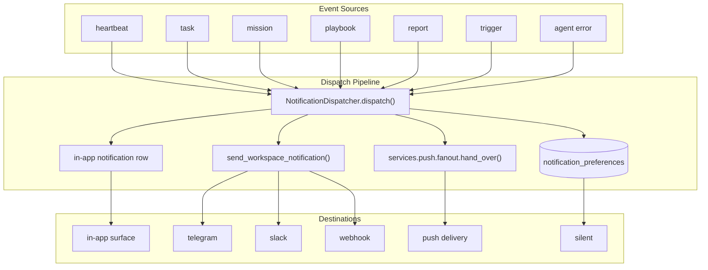
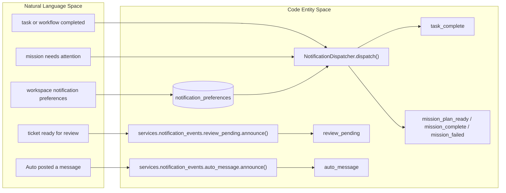
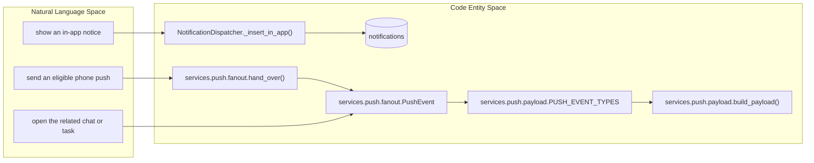

# Unified Notification System

Relevant source files

The following files were used as context for generating this wiki page:

- [orchestrator/core/services/notification_columns.py](orchestrator/core/services/notification_columns.py)
- [orchestrator/core/services/notification_dispatcher.py](orchestrator/core/services/notification_dispatcher.py)
- [orchestrator/services/mobile/digest.py](orchestrator/services/mobile/digest.py)
- [orchestrator/services/notification_events/auto_message.py](orchestrator/services/notification_events/auto_message.py)
- [orchestrator/services/notification_events/review_pending.py](orchestrator/services/notification_events/review_pending.py)
- [orchestrator/services/push/fanout.py](orchestrator/services/push/fanout.py)
- [orchestrator/services/push/payload.py](orchestrator/services/push/payload.py)
- [orchestrator/tests/fixtures/prd266_push_signature_vectors.json](orchestrator/tests/fixtures/prd266_push_signature_vectors.json)
- [orchestrator/tests/test_prd128_a_notice_never_aborts_the_work_it_reports.py](orchestrator/tests/test_prd128_a_notice_never_aborts_the_work_it_reports.py)
- [orchestrator/tests/test_prd266_auto_message.py](orchestrator/tests/test_prd266_auto_message.py)
- [orchestrator/tests/test_prd266_push_payload.py](orchestrator/tests/test_prd266_push_payload.py)
- [orchestrator/tests/test_prd268w2_brief_claim.py](orchestrator/tests/test_prd268w2_brief_claim.py)
- [orchestrator/tests/test_prd268w2_brief_push_message_id.py](orchestrator/tests/test_prd268w2_brief_push_message_id.py)

## Purpose and Scope

The Unified Notification System (PRD-128) is the platform’s centralized path for raising completion and attention events, resolving notification preferences, and delivering notifications to enabled destinations. The `NotificationDispatcher` is documented as the shared entry point for events from sources including heartbeats, tasks, missions, playbooks, reports, triggers, and agent errors. [orchestrator/core/services/notification_dispatcher.py:1-7]()

This parent page outlines how event producers, routing preferences, and notification surfaces fit together. It links to child pages for dispatcher behavior, API and settings details, and the notification UI. [orchestrator/core/services/notification_dispatcher.py:1-39]()

Sources: [orchestrator/core/services/notification_dispatcher.py:1-39]()

## System Architecture

The high-level flow is: an event producer calls the dispatcher; the dispatcher resolves workspace and user preferences; and enabled destinations receive the event. In-app writes use the caller’s database session, while external delivery is delegated to `send_workspace_notification`. The dispatcher does not commit or abort the caller’s work. [orchestrator/core/services/notification_dispatcher.py:3-20] [orchestrator/core/services/notification_dispatcher.py:32-39]()

Push is handled separately from the dispatcher’s preference destinations: the dispatcher hands eligible push events to `services.push.fanout.hand_over`, which is responsible for delivery. [orchestrator/core/services/notification_dispatcher.py:35-38] [orchestrator/services/push/fanout.py:1-10]()

Sources: [orchestrator/core/services/notification_dispatcher.py:3-20] [orchestrator/core/services/notification_dispatcher.py:32-39] [orchestrator/services/push/fanout.py:1-10]()

### Notification Flow

Sources: [orchestrator/core/services/notification_dispatcher.py:1-7] [orchestrator/core/services/notification_dispatcher.py:21-39] [orchestrator/services/push/fanout.py:1-10]()

### Natural Language to Code Entity Mapping: Events and Routing

This mapping connects platform concepts to the named dispatcher entities and event types. `VALID_EVENT_TYPES` includes completion, failure, approval, mission, playbook, trigger, report, review, and suggestion events. [orchestrator/core/services/notification_dispatcher.py:58-125]()

Sources: [orchestrator/core/services/notification_dispatcher.py:58-125] [orchestrator/services/notification_events/review_pending.py:28-44] [orchestrator/services/notification_events/auto_message.py:46-55]()

### Natural Language to Code Entity Mapping: In-App and Push

An in-app notification is inserted into the `notifications` table. For push-eligible events, the dispatcher passes a `PushEvent` to `hand_over`; `PUSH_EVENT_TYPES` defines which event types map to push types. [orchestrator/core/services/notification_dispatcher.py:35-38] [orchestrator/core/services/notification_dispatcher.py:146-151] [orchestrator/services/push/fanout.py:114-131] [orchestrator/services/push/payload.py:45-60]()

Sources: [orchestrator/core/services/notification_dispatcher.py:35-38] [orchestrator/core/services/notification_dispatcher.py:146-151] [orchestrator/services/push/fanout.py:114-131] [orchestrator/services/push/payload.py:45-60]()

Sources: [orchestrator/core/services/notification_dispatcher.py:35-38] [orchestrator/core/services/notification_dispatcher.py:146-151] [orchestrator/services/push/fanout.py:114-131] [orchestrator/services/push/payload.py:45-60]()

## Core Sub-Topics

### 23.1 NotificationDispatcher

`NotificationDispatcher` is the common event dispatch entry point. It reads `notification_preferences`, supports multiple enabled destination rows for an event, and falls back to an in-app notification when the workspace has no preferences for that event type. Push is handed off separately from the preference destinations. [orchestrator/core/services/notification_dispatcher.py:3-7] [orchestrator/core/services/notification_dispatcher.py:21-39]()

For details on `dispatch()`, preference resolution, destination fan-out, and default preference seeding, see [NotificationDispatcher](#23.1).

Sources: [orchestrator/core/services/notification_dispatcher.py:3-7] [orchestrator/core/services/notification_dispatcher.py:21-39]()

### 23.2 Notification API & Settings

The dispatcher’s routing model is scoped by workspace and can incorporate user-specific preferences. The supported event types are centralized in `VALID_EVENT_TYPES`; individual producers raise events through the dispatcher rather than defining separate delivery paths. [orchestrator/core/services/notification_dispatcher.py:3-7] [orchestrator/core/services/notification_dispatcher.py:25-31] [orchestrator/core/services/notification_dispatcher.py:58-125]()

For details on `/api/notifications`, `/api/notification-preferences`, event types, scoping, auto-reporting hooks, and KPI digests, see [Notification API & Settings](#23.2).

Sources: [orchestrator/core/services/notification_dispatcher.py:3-7] [orchestrator/core/services/notification_dispatcher.py:25-31] [orchestrator/core/services/notification_dispatcher.py:58-125]()

### 23.3 Notification Bell UI

In-app delivery creates notification rows, providing the persisted input for the user-facing notification surface. The event may carry link metadata, and push delivery can use related identifiers to direct a phone to the associated resource. [orchestrator/core/services/notification_dispatcher.py:146-151] [orchestrator/services/push/fanout.py:114-131]()

For details on `NotificationBell`, polling, popover behavior, link routing, read and dismiss actions, `NotificationsSettingsTab`, and the needs-you widget, see [Notification Bell UI](#23.3).

Sources: [orchestrator/core/services/notification_dispatcher.py:146-151] [orchestrator/services/push/fanout.py:114-131]()

---