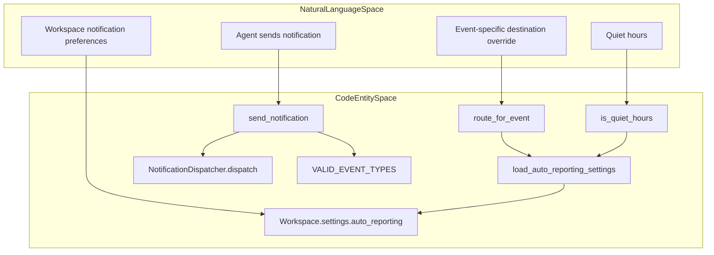
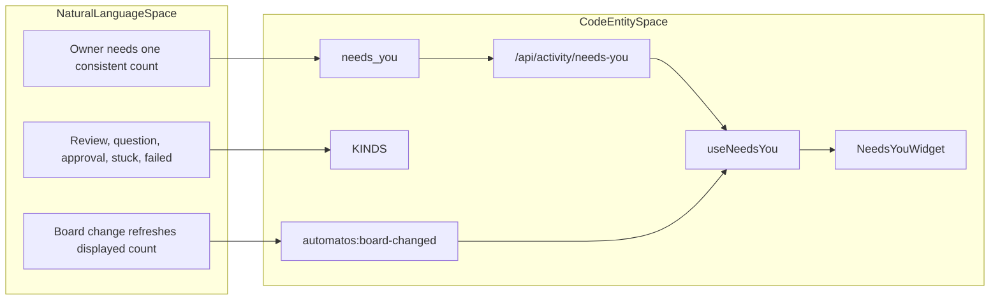
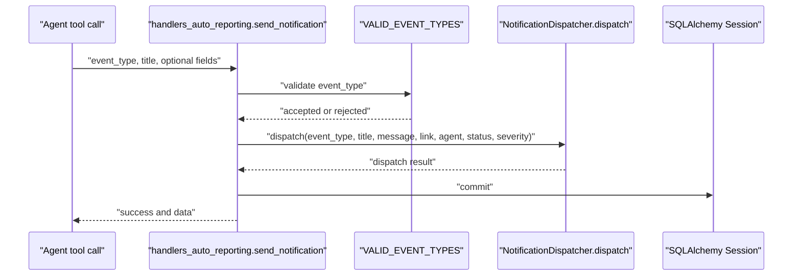
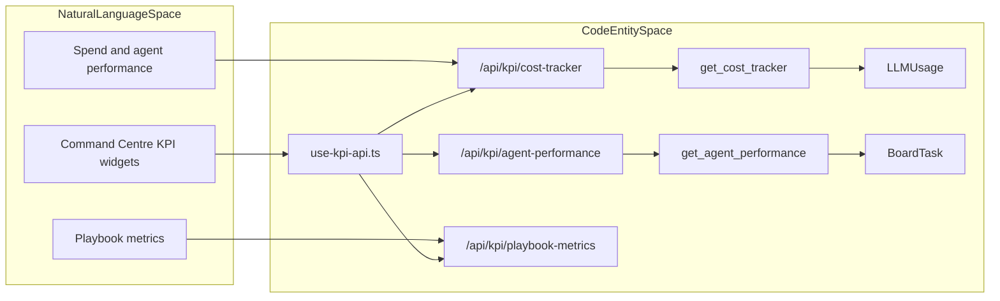

# Notification API & Settings

Relevant source files

The following files were used as context for generating this wiki page:

- [frontend/components/activity/command-center-history.tsx](frontend/components/activity/command-center-history.tsx)
- [frontend/components/activity/widgets/__tests__/needs-you-widget.test.tsx](frontend/components/activity/widgets/__tests__/needs-you-widget.test.tsx)
- [frontend/components/activity/widgets/activity-widget.tsx](frontend/components/activity/widgets/activity-widget.tsx)
- [frontend/components/activity/widgets/needs-you-widget.tsx](frontend/components/activity/widgets/needs-you-widget.tsx)
- [frontend/components/activity/widgets/playbook-metrics-widget.tsx](frontend/components/activity/widgets/playbook-metrics-widget.tsx)
- [frontend/components/chatbot/__tests__/auto-now-rail.test.tsx](frontend/components/chatbot/__tests__/auto-now-rail.test.tsx)
- [frontend/components/command-center/__tests__/needs-you-counters.test.tsx](frontend/components/command-center/__tests__/needs-you-counters.test.tsx)
- [frontend/hooks/use-auto-now.ts](frontend/hooks/use-auto-now.ts)
- [frontend/hooks/use-kpi-api.ts](frontend/hooks/use-kpi-api.ts)
- [frontend/hooks/use-needs-you.ts](frontend/hooks/use-needs-you.ts)
- [frontend/lib/needs-you-breakdown.ts](frontend/lib/needs-you-breakdown.ts)
- [orchestrator/alembic/versions/llm_usage_agent_name.py](orchestrator/alembic/versions/llm_usage_agent_name.py)
- [orchestrator/api/kpi_api.py](orchestrator/api/kpi_api.py)
- [orchestrator/core/playbook_schedule.py](orchestrator/core/playbook_schedule.py)
- [orchestrator/core/services/auto_reporting.py](orchestrator/core/services/auto_reporting.py)
- [orchestrator/modules/tools/discovery/handlers_auto_reporting.py](orchestrator/modules/tools/discovery/handlers_auto_reporting.py)
- [orchestrator/services/needs_you.py](orchestrator/services/needs_you.py)
- [orchestrator/tests/test_f049_deleted_agent_spend_keeps_its_name.py](orchestrator/tests/test_f049_deleted_agent_spend_keeps_its_name.py)
- [orchestrator/tests/test_f207_decisions_needed_are_never_silently_empty.py](orchestrator/tests/test_f207_decisions_needed_are_never_silently_empty.py)
- [orchestrator/tests/test_f246_needs_you_counts_what_waits.py](orchestrator/tests/test_f246_needs_you_counts_what_waits.py)
- [orchestrator/tests/test_f271_schedule_type_none_is_refused_and_says_how_to_stop_a_timer.py](orchestrator/tests/test_f271_schedule_type_none_is_refused_and_says_how_to_stop_a_timer.py)
- [orchestrator/tests/test_f274_needs_you_rows_name_their_ticket_and_mission.py](orchestrator/tests/test_f274_needs_you_rows_name_their_ticket_and_mission.py)
- [orchestrator/tests/test_prd252_needs_you.py](orchestrator/tests/test_prd252_needs_you.py)

## Purpose and Scope

This page describes the notification-related API and settings surfaces evidenced by the supplied code: workspace-level auto-reporting preferences, notification dispatch through an agent tool handler, the activity “Needs you” endpoint and its frontend consumer, and Command Centre KPI endpoints. The supplied files do **not** include the implementations of `/api/notifications` or `/api/notification-preferences`, nor the `NotificationDispatcher` definition or its event-type catalog. Those endpoint details and the complete event taxonomy therefore cannot be verified here.

Sources: [orchestrator/core/services/auto_reporting.py:1-27](), [orchestrator/modules/tools/discovery/handlers_auto_reporting.py:14-108](), [orchestrator/services/needs_you.py:1-16](), [orchestrator/api/kpi_api.py:1-7]()

---

## 1. System Architecture & Data Flow

The available implementation shows two related but distinct flows:

- **Auto-reporting settings** are stored under `Workspace.settings.auto_reporting`. The settings service merges stored overrides with defaults; the tool handlers expose settings reads and updates and can submit a notification through `NotificationDispatcher.dispatch()`. [orchestrator/core/services/auto_reporting.py:58-96](), [orchestrator/modules/tools/discovery/handlers_auto_reporting.py:14-48](), [orchestrator/modules/tools/discovery/handlers_auto_reporting.py:57-108]()
- **Needs you** is an activity summary, not evidence of the `/api/notifications` inbox API. Its service counts workspace-scoped review items, questions, approvals, stuck tickets, and failures; the frontend hook requests `/api/activity/needs-you`. [orchestrator/services/needs_you.py:81-99](), [frontend/hooks/use-needs-you.ts:81-99]()

### Auto-reporting flow: natural-language concepts to code entities

Sources: [orchestrator/core/services/auto_reporting.py:6-23](), [orchestrator/core/services/auto_reporting.py:58-70](), [orchestrator/core/services/auto_reporting.py:99-154](), [orchestrator/modules/tools/discovery/handlers_auto_reporting.py:57-104]()

### Needs-you flow: owner actions to code entities

Sources: [orchestrator/services/needs_you.py:46-49](), [orchestrator/services/needs_you.py:59-79](), [frontend/hooks/use-needs-you.ts:81-109](), [frontend/components/activity/widgets/needs-you-widget.tsx:3-27]()

---

## 2. Event Types & Routing Settings

### Auto-reporting settings shape

The canonical auto-reporting settings live at `workspace.settings.auto_reporting`. The documented shape includes enablement, primary and fallback channels, quiet-hours configuration, digest frequency and time, and event-type routes. Defaults are conservative and preserve fallback to the existing notification-preferences mechanism when a setting is absent. [orchestrator/core/services/auto_reporting.py:1-27]()

| Setting | Meaning and supported values |
|---|---|
| `enabled` | Whether auto-reporting is enabled; default is `true`. [orchestrator/core/services/auto_reporting.py:41-55]() |
| `primary_channel` | Primary channel; defaults to `in_app`. Valid configured channels are `telegram`, `slack`, `in_app`, and `webhook`. [orchestrator/core/services/auto_reporting.py:41-55](), [orchestrator/core/services/auto_reporting.py:160-166]() |
| `fallback_channel` | Fallback channel; defaults to `in_app`. The valid configured channel set is the same as for `primary_channel`. [orchestrator/core/services/auto_reporting.py:41-55](), [orchestrator/core/services/auto_reporting.py:160-166]() |
| `quiet_hours` | `enabled`, `start`, `end`, and `timezone`; defaults are disabled, `22:00`–`08:00`, and `UTC`. [orchestrator/core/services/auto_reporting.py:46-51]() |
| `digest_frequency` | Digest frequency; defaults to `immediate`. The documented shape allows `immediate`, `daily`, and `weekly`. [orchestrator/core/services/auto_reporting.py:18-19](), [orchestrator/core/services/auto_reporting.py:52-54]() |
| `digest_time` | Digest time; defaults to `09:00`. [orchestrator/core/services/auto_reporting.py:19-19](), [orchestrator/core/services/auto_reporting.py:52-54]() |
| `routes` | Event-type or severity routing overrides. The documented shape maps route keys to destinations. [orchestrator/core/services/auto_reporting.py:20-23]() |

The code explicitly recognizes destinations `in_app`, `telegram`, `slack`, `webhook`, `silent`, and `push`; `push` is not a primary or fallback channel. Aliases `primary` and `fallback` resolve to configured channels. Invalid destinations resolve to `None`, allowing the caller to fall back to notification preferences rather than accepting an arbitrary channel name. [orchestrator/core/services/auto_reporting.py:160-186]()

### Event types: verified boundary

The supplied handler imports `VALID_EVENT_TYPES` from `NotificationDispatcher` and rejects a `send_notification` request whose `event_type` is not in that set. The definition and members of `VALID_EVENT_TYPES` are not included in the supplied code, so this page cannot provide a verified full event-type catalog. [orchestrator/modules/tools/discovery/handlers_auto_reporting.py:57-74]()

The handler also validates optional `severity` against `info`, `task`, `approval`, `urgent`, and `security`, and `status` against `ok`, `warning`, `error`, and `info`. These are handler input values, not a substitute for the unavailable notification event-type catalog. [orchestrator/modules/tools/discovery/handlers_auto_reporting.py:51-55](), [orchestrator/modules/tools/discovery/handlers_auto_reporting.py:76-88]()

Sources: [orchestrator/core/services/auto_reporting.py:1-27](), [orchestrator/core/services/auto_reporting.py:41-55](), [orchestrator/core/services/auto_reporting.py:127-186](), [orchestrator/modules/tools/discovery/handlers_auto_reporting.py:51-88]()

---

## 3. Notification API & Settings Endpoints

### Auto-reporting settings handlers

The available code exposes auto-reporting reads and updates through tool handlers. It does not show HTTP route declarations for `/api/notifications` or `/api/notification-preferences`; those endpoints’ request schemas, authentication dependencies, response shapes, and persistence behavior cannot be documented from the supplied files.

| Handler | Behavior |
|---|---|
| `get_auto_reporting_prefs` | Loads effective settings for the provided workspace ID and returns them under `data`; exceptions are returned as an error result. [orchestrator/modules/tools/discovery/handlers_auto_reporting.py:14-25]() |
| `update_auto_reporting_prefs` | Removes underscore-prefixed bookkeeping parameters, rejects an empty update, merges the remaining settings, commits on success, and rolls back on an unexpected exception. [orchestrator/modules/tools/discovery/handlers_auto_reporting.py:28-48]() |
| `send_notification` | Requires `event_type` and `title`, validates event type, severity, and status, calls `NotificationDispatcher.dispatch()`, then commits; on exception it rolls back and returns an error result. [orchestrator/modules/tools/discovery/handlers_auto_reporting.py:57-108]() |

### Workspace scoping and user scoping

Auto-reporting settings are loaded and updated by `workspace_id`: the service queries `Workspace.id` and reads or writes the `settings.auto_reporting` value. The supplied implementation therefore establishes workspace-level settings storage. [orchestrator/core/services/auto_reporting.py:58-70](), [orchestrator/core/services/auto_reporting.py:73-96]()

The supplied files do not establish user-specific notification preference behavior or the workspace/user scoping rules of `/api/notifications` and `/api/notification-preferences`. Do not infer those rules from the workspace-scoped auto-reporting settings or from the separate activity Needs-you endpoint.

### Auto-reporting API/tool flow: natural-language concepts to code entities

Sources: [orchestrator/modules/tools/discovery/handlers_auto_reporting.py:57-104]()

Sources: [orchestrator/core/services/auto_reporting.py:58-96](), [orchestrator/modules/tools/discovery/handlers_auto_reporting.py:14-48](), [orchestrator/modules/tools/discovery/handlers_auto_reporting.py:57-108]()

---

## 4. KPI Digests & Dashboard Widgets

The supplied KPI router provides pre-aggregated Command Centre metrics. It is mounted at `/api/kpi`, applies `require_super_admin` as a router-wide dependency, and each shown handler also obtains a hybrid `RequestContext` and filters queried records by `ctx.workspace_id`. The supplied excerpt shows cost-tracker and agent-performance implementations; it does not include the full playbook-metrics handler. [orchestrator/api/kpi_api.py:1-7](), [orchestrator/api/kpi_api.py:17-35](), [orchestrator/api/kpi_api.py:45-50](), [orchestrator/api/kpi_api.py:147-152]()

| Endpoint | Data returned / calculation |
|---|---|
| `GET /api/kpi/cost-tracker` | Period spend, daily spend trend, top three agents by cost, and percentage change versus the preceding period. Supported periods are `1d`, `7d`, `30d`, and `90d`; default is `30d`. [orchestrator/api/kpi_api.py:35-40](), [orchestrator/api/kpi_api.py:45-137]() |
| `GET /api/kpi/agent-performance` | Per-agent task totals, completed-task success rate, and average completion time for done tasks. Results are filtered by workspace and selected period. [orchestrator/api/kpi_api.py:147-197]() |
| `GET /api/kpi/playbook-metrics` | A frontend hook requests this endpoint and expects playbook run counts, success percentages, and average durations. The backend implementation is not present in the supplied excerpt. [frontend/hooks/use-kpi-api.ts:32-42](), [frontend/hooks/use-kpi-api.ts:73-80]() |

The frontend’s `useCostTracker`, `useAgentPerformance`, and `usePlaybookMetrics` hooks use React Query. Each requests its corresponding `/api/kpi` path with a period, uses a 30-second `staleTime`, and refetches every 60 seconds. [frontend/hooks/use-kpi-api.ts:44-51](), [frontend/hooks/use-kpi-api.ts:55-80]()

### KPI data flow: natural-language concepts to code entities

Sources: [orchestrator/api/kpi_api.py:28-35](), [orchestrator/api/kpi_api.py:45-79](), [orchestrator/api/kpi_api.py:147-184](), [frontend/hooks/use-kpi-api.ts:1-5](), [frontend/hooks/use-kpi-api.ts:44-80]()

### Needs-you counts are not KPI digests

`needs_you` produces a separate workspace-scoped activity count and its corresponding rows. Its five families are `review`, `question`, `approval`, `stuck`, and `failed`; the service documents the principle that the count and rows are served together so displayed counts correspond to listed items. [orchestrator/services/needs_you.py:46-49](), [orchestrator/services/needs_you.py:59-79]()

The `useNeedsYou` hook requests `/api/activity/needs-you`, polls every 60 seconds, and listens for `automatos:board-changed` to invalidate the shared query. This is distinct from the `/api/kpi/*` hooks and is not evidence of a notification digest endpoint. [frontend/hooks/use-needs-you.ts:81-109]()

Sources: [orchestrator/services/needs_you.py:46-79](), [frontend/hooks/use-needs-you.ts:81-109]()

---

## 5. Implementation Details & Data Flow

### Auto-reporting settings lifecycle

`load_auto_reporting_settings` looks up a workspace and returns defaults when the workspace is missing; otherwise it merges the stored `settings.auto_reporting` override onto `DEFAULTS`. `update_auto_reporting_settings` merges a partial update into the existing workspace settings, assigns the updated JSON value, flushes the session, and returns the effective merged settings. The function does not commit; its caller owns the transaction. [orchestrator/core/services/auto_reporting.py:58-96]()

The tool-handler update path strips executor bookkeeping fields beginning with `_`, rejects updates with no remaining settings, delegates to the service, and commits on success. A `ValueError` is returned as a failure; other exceptions cause rollback. [orchestrator/modules/tools/discovery/handlers_auto_reporting.py:28-48]()

### Quiet-hours evaluation and route resolution

`is_quiet_hours` returns `false` when quiet hours are disabled. When enabled, it resolves the configured timezone, falls back to UTC if the timezone cannot be loaded, parses start and end times, and handles both ordinary intervals and intervals crossing midnight. Equal start and end times are treated as no quiet window. [orchestrator/core/services/auto_reporting.py:99-125]()

`route_for_event` searches overrides in this order: `event_type:severity`, `event_type`, then `severity`. It returns `None` when no matching route exists. A matched value is passed through destination/alias validation; invalid destinations also resolve to `None`. [orchestrator/core/services/auto_reporting.py:127-154](), [orchestrator/core/services/auto_reporting.py:160-186]()

The available code defines these settings helpers, but does not show the `NotificationDispatcher` implementation or prove how it invokes the helpers. The dispatcher’s internal fan-out, preference precedence, quiet-hours policy for specific severities, and commit behavior must be verified in the dispatcher and API route source before being specified.

### Needs-you service and frontend behavior

The Needs-you service defines five row families and workspace-scoped SQL for review, mission approval, and failed counts. Its documentation states that a viewer’s number is the number of rows they can open and that the count and rows are served together. [orchestrator/services/needs_you.py:46-49](), [orchestrator/services/needs_you.py:59-79]()

On the frontend, `useNeedsYou` queries `/api/activity/needs-you`, caches the result under `['activity', 'needs-you']`, polls every 60 seconds, and invalidates the query in response to `automatos:board-changed`. [frontend/hooks/use-needs-you.ts:81-109]() The widget uses that hook and represents review, question, approval, stuck, and failed families; its row-link helpers direct ticket and mission decisions to their respective destinations. [frontend/components/activity/widgets/needs-you-widget.tsx:32-64](), [frontend/components/activity/widgets/needs-you-widget.tsx:94-135]()

### KPI aggregation and frontend refresh

The KPI router’s cost endpoint filters `LLMUsage` rows by `ctx.workspace_id` and time period, aggregates daily costs, and calculates top agents. The agent-performance endpoint aggregates `BoardTask` rows by assigned agent, also filtering by workspace and period. [orchestrator/api/kpi_api.py:45-79](), [orchestrator/api/kpi_api.py:87-107](), [orchestrator/api/kpi_api.py:147-184]()

The React Query hooks request KPI data through `apiClient.request` and refresh on a 60-second interval. [frontend/hooks/use-kpi-api.ts:55-80]()

Sources: [orchestrator/core/services/auto_reporting.py:58-96](), [orchestrator/core/services/auto_reporting.py:99-186](), [orchestrator/modules/tools/discovery/handlers_auto_reporting.py:28-108](), [orchestrator/services/needs_you.py:46-99](), [frontend/hooks/use-needs-you.ts:81-109](), [frontend/components/activity/widgets/needs-you-widget.tsx:32-64](), [orchestrator/api/kpi_api.py:45-184](), [frontend/hooks/use-kpi-api.ts:55-80]()

---