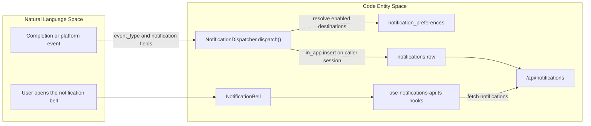
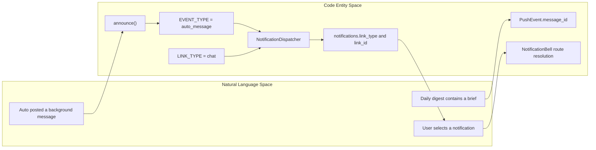
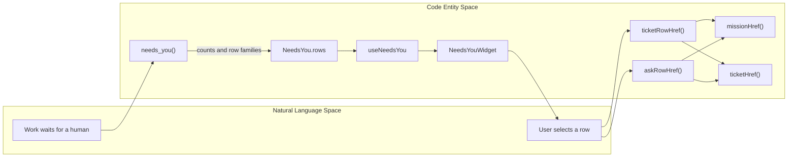

# Notification Bell UI

Relevant source files

The following files were used as context for generating this wiki page:

- [frontend/components/activity/command-center-history.tsx](frontend/components/activity/command-center-history.tsx)
- [frontend/components/activity/widgets/__tests__/needs-you-widget.test.tsx](frontend/components/activity/widgets/__tests__/needs-you-widget.test.tsx)
- [frontend/components/activity/widgets/activity-widget.tsx](frontend/components/activity/widgets/activity-widget.tsx)
- [frontend/components/activity/widgets/needs-you-widget.tsx](frontend/components/activity/widgets/needs-you-widget.tsx)
- [frontend/components/activity/widgets/playbook-metrics-widget.tsx](frontend/components/activity/widgets/playbook-metrics-widget.tsx)
- [frontend/components/chatbot/__tests__/auto-now-rail.test.tsx](frontend/components/chatbot/__tests__/auto-now-rail.test.tsx)
- [frontend/components/command-center/__tests__/needs-you-counters.test.tsx](frontend/components/command-center/__tests__/needs-you-counters.test.tsx)
- [frontend/hooks/use-auto-now.ts](frontend/hooks/use-auto-now.ts)
- [frontend/hooks/use-kpi-api.ts](frontend/hooks/use-kpi-api.ts)
- [frontend/hooks/use-needs-you.ts](frontend/hooks/use-needs-you.ts)
- [frontend/lib/needs-you-breakdown.ts](frontend/lib/needs-you-breakdown.ts)
- [orchestrator/alembic/versions/llm_usage_agent_name.py](orchestrator/alembic/versions/llm_usage_agent_name.py)
- [orchestrator/api/kpi_api.py](orchestrator/api/kpi_api.py)
- [orchestrator/core/playbook_schedule.py](orchestrator/core/playbook_schedule.py)
- [orchestrator/core/services/auto_reporting.py](orchestrator/core/services/auto_reporting.py)
- [orchestrator/core/services/notification_columns.py](orchestrator/core/services/notification_columns.py)
- [orchestrator/core/services/notification_dispatcher.py](orchestrator/core/services/notification_dispatcher.py)
- [orchestrator/modules/tools/discovery/handlers_auto_reporting.py](orchestrator/modules/tools/discovery/handlers_auto_reporting.py)
- [orchestrator/services/mobile/digest.py](orchestrator/services/mobile/digest.py)
- [orchestrator/services/needs_you.py](orchestrator/services/needs_you.py)
- [orchestrator/services/notification_events/auto_message.py](orchestrator/services/notification_events/auto_message.py)
- [orchestrator/services/notification_events/review_pending.py](orchestrator/services/notification_events/review_pending.py)
- [orchestrator/services/push/fanout.py](orchestrator/services/push/fanout.py)
- [orchestrator/services/push/payload.py](orchestrator/services/push/payload.py)
- [orchestrator/tests/fixtures/prd266_push_signature_vectors.json](orchestrator/tests/fixtures/prd266_push_signature_vectors.json)
- [orchestrator/tests/test_f049_deleted_agent_spend_keeps_its_name.py](orchestrator/tests/test_f049_deleted_agent_spend_keeps_its_name.py)
- [orchestrator/tests/test_f207_decisions_needed_are_never_silently_empty.py](orchestrator/tests/test_f207_decisions_needed_are_never_silently_empty.py)
- [orchestrator/tests/test_f246_needs_you_counts_what_waits.py](orchestrator/tests/test_f246_needs_you_counts_what_waits.py)
- [orchestrator/tests/test_f271_schedule_type_none_is_refused_and_says_how_to_stop_a_timer.py](orchestrator/tests/test_f271_schedule_type_none_is_refused_and_says_how_to_stop_a_timer.py)
- [orchestrator/tests/test_f274_needs_you_rows_name_their_ticket_and_mission.py](orchestrator/tests/test_f274_needs_you_rows_name_their_ticket_and_mission.py)
- [orchestrator/tests/test_prd128_a_notice_never_aborts_the_work_it_reports.py](orchestrator/tests/test_prd128_a_notice_never_aborts_the_work_it_reports.py)
- [orchestrator/tests/test_prd252_needs_you.py](orchestrator/tests/test_prd252_needs_you.py)
- [orchestrator/tests/test_prd266_auto_message.py](orchestrator/tests/test_prd266_auto_message.py)
- [orchestrator/tests/test_prd266_push_payload.py](orchestrator/tests/test_prd266_push_payload.py)
- [orchestrator/tests/test_prd268w2_brief_claim.py](orchestrator/tests/test_prd268w2_brief_claim.py)
- [orchestrator/tests/test_prd268w2_brief_push_message_id.py](orchestrator/tests/test_prd268w2_brief_push_message_id.py)

## Purpose and scope

This page covers the in-app notification bell, notification preference settings, and the Command Center’s **Needs You** widget. The bell presents notification rows written by the unified notification pipeline; the **Needs You** widget is a separate, consolidated view of items awaiting human action. [orchestrator/core/services/notification_dispatcher.py:1-7](), [frontend/components/activity/widgets/needs-you-widget.tsx:4-27]()

Sources: [orchestrator/core/services/notification_dispatcher.py:1-7](), [frontend/components/activity/widgets/needs-you-widget.tsx:4-27]()

## Architecture & Data Flow

The notification dispatcher is the backend event-to-notification path: it resolves workspace and user preferences, writes in-app rows using the caller’s database session, and delegates enabled external destinations to the notification service. The caller owns the transaction; the dispatcher does not commit, and notification failures are isolated with savepoints so they do not abort the main work. If an event has no preference rows, the dispatcher defaults to one in-app notification. [orchestrator/core/services/notification_dispatcher.py:1-34]()

The bell UI consumes notification data through frontend hooks and API routes. The dispatcher is not itself the bell’s API handler: it produces notification records that the notification API can expose. The frontend hook and endpoint details below follow the existing page’s references; their implementations were not included in the supplied file excerpts. [frontend/components/layout/header.tsx:95-95](), [frontend/hooks/use-notifications-api.ts:1-1](), [orchestrator/core/services/notification_dispatcher.py:1-7]()

**Diagram: Notification event path from producer to bell UI**

Sources: [orchestrator/core/services/notification_dispatcher.py:1-34](), [frontend/components/layout/header.tsx:95-95](), [frontend/hooks/use-notifications-api.ts:1-1]()

## React Query Hooks & API Integration

The existing page identifies `frontend/hooks/use-notifications-api.ts` as the React Query integration used by the bell. It describes hooks for unread counts, notification lists, preference reads, and notification mutations. The hook implementation was not included in the supplied excerpts, so specific query keys, cache invalidation behavior, polling intervals, pagination defaults, and request methods cannot be verified here. [frontend/hooks/use-notifications-api.ts:1-1]()

The existing page records the following interface-level responsibilities:

| Hook or operation | Role described by the existing page |
|---|---|
| `useUnreadNotificationCount()` | Fetches the unread count used for the bell badge. |
| `useNotifications(options)` | Fetches a notification list with list/filter options. |
| `useNotificationPreferences(enabled)` | Reads notification preferences. |
| `useMarkNotificationRead()` | Marks an individual notification as read. |
| `useMarkAllNotificationsRead()` | Marks notifications as read in bulk. |
| `useDismissNotification()` | Dismisses an individual notification. |
| `useUpdateNotificationPreferences()` | Updates notification preferences. |

[frontend/hooks/use-notifications-api.ts:1-1]()

At the persistence layer, notification rows include workspace and user scope, event type, title and message, optional link and agent metadata, status, read and dismissed timestamps, and creation time. The dispatcher’s in-app insert uses bound parameters and fits values to the destination columns before insertion. [orchestrator/tests/test_prd266_auto_message.py:34-45](), [orchestrator/core/services/notification_dispatcher.py:146-151]()

Sources: [frontend/hooks/use-notifications-api.ts:1-1](), [orchestrator/tests/test_prd266_auto_message.py:34-45](), [orchestrator/core/services/notification_dispatcher.py:146-151]()

## NotificationBell: polling, list, and actions

`NotificationBell` is mounted in the global header. The existing page describes it as displaying an unread badge and a popover list, with read and dismiss actions. The component and hook source contents were not included in the supplied excerpts, so exact polling intervals, popover limits, button behavior, and mutation sequencing are not independently verifiable here. [frontend/components/layout/header.tsx:95-95](), [frontend/hooks/use-notifications-api.ts:1-1]()

The backend supports the notification lifecycle represented by the UI: notification rows have `read_at` and `dismissed_at` fields, and the event dispatcher creates in-app rows with a default status. These fields distinguish a row’s read and dismissed state from its event type and message content. [orchestrator/tests/test_prd266_auto_message.py:34-45](), [orchestrator/core/services/notification_dispatcher.py:146-151]()

Sources: [frontend/components/layout/header.tsx:95-95](), [frontend/hooks/use-notifications-api.ts:1-1](), [orchestrator/tests/test_prd266_auto_message.py:34-45](), [orchestrator/core/services/notification_dispatcher.py:146-151]()

## Link Routing & Navigation

Notification rows can carry `link_type` and `link_id` metadata. The dispatcher writes these values into the notification record, allowing the client to associate an event with a relevant entity. The supplied excerpts do not include the bell’s route-resolution implementation, so specific mappings from link types to application routes cannot be confirmed. [orchestrator/core/services/notification_dispatcher.py:146-151](), [orchestrator/tests/test_prd266_auto_message.py:34-45]()

One concrete link pattern is the `auto_message` event: it is linked to a chat. For a daily digest containing a brief, the push event can additionally carry the posted message’s ID so the phone can open the relevant location in the chat. This describes the event and push path; it does not establish the bell’s client-side routing behavior. [orchestrator/services/notification_events/auto_message.py:46-60](), [orchestrator/services/notification_events/auto_message.py:123-129](), [orchestrator/services/push/fanout.py:114-131]()

**Diagram: Event metadata and code entities**

Sources: [orchestrator/services/notification_events/auto_message.py:46-60](), [orchestrator/services/notification_events/auto_message.py:86-98](), [orchestrator/services/notification_events/auto_message.py:123-129](), [orchestrator/core/services/notification_dispatcher.py:146-151](), [orchestrator/services/push/fanout.py:114-131](), [frontend/components/layout/header.tsx:95-95]()

## NotificationsSettingsTab

The existing page identifies `NotificationsSettingsTab` as the settings UI for notification preferences and describes it as using the notification preference hooks. The component source was not included in the supplied excerpts, so its exact controls and save behavior cannot be confirmed here. [frontend/hooks/use-notifications-api.ts:1-1]()

The dispatcher’s preference model supports workspace defaults and user-specific overrides. For a destination present at both levels, the user-specific row takes precedence; destinations mentioned only in workspace defaults are still honored. Multiple enabled destination rows can apply to an event, while `silent` rows are skipped. If the workspace has no preference rows for an event type, dispatch falls back to in-app delivery. [orchestrator/core/services/notification_dispatcher.py:21-34]()

The dispatcher recognizes destinations for in-app, Telegram, Slack, webhook, and silent handling. Push is separate from those preference destinations: the dispatcher’s documentation says push preferences act as per-person switches read during fan-out rather than as a notification delivery destination. [orchestrator/core/services/notification_dispatcher.py:21-38](), [orchestrator/core/services/notification_dispatcher.py:137-144]()

| Preference concept | Dispatcher behavior |
|---|---|
| Workspace default | Applies when no user-specific row overrides the same destination. |
| User-specific preference | Wins for the same destination while other workspace-default destinations remain in effect. |
| Multiple enabled destinations | Each enabled destination row can be dispatched. |
| `silent` | Skipped as a delivery destination. |
| No event preferences | Produces an in-app notification by default. |
| `push` | Read as a per-person switch by push fan-out, not treated as a normal destination. |

[orchestrator/core/services/notification_dispatcher.py:21-38](), [orchestrator/core/services/notification_dispatcher.py:137-144]()

Sources: [frontend/hooks/use-notifications-api.ts:1-1](), [orchestrator/core/services/notification_dispatcher.py:21-38](), [orchestrator/core/services/notification_dispatcher.py:137-144]()

## "Needs You" Widget

`NeedsYouWidget` is a Command Center activity widget for items that require a human decision or intervention. Its families are review, question, approval, stuck, and failed. It obtains data through `useNeedsYou`; the backend `needs_you` service supplies the counts and rows. The service’s contract is that the total and the listed rows share one definition, so the displayed number corresponds to the items the widget lists. [frontend/components/activity/widgets/needs-you-widget.tsx:4-27](), [frontend/hooks/use-needs-you.ts:59-77](), [orchestrator/services/needs_you.py:46-50]()

The service treats different kinds of work according to who must act. It includes tickets awaiting the owner’s review, open questions, still-actionable approvals, stuck tickets, and failed tickets. Mission steps whose decision belongs to their mission are represented at the mission level rather than counted as separate owner decisions. [orchestrator/services/needs_you.py:8-17](), [orchestrator/services/needs_you.py:75-79]()

### Row construction and routing

The widget maps ticket rows through `ticketRows()` and uses `ticketRowHref()` to choose whether a row opens a ticket or its mission. Question and approval rows use `askRowHref()`: a mission approval opens the mission; a grant associated with a ticket opens that ticket with the relevant grant identifier; and an item without a ticket falls back to the questions view. [frontend/components/activity/widgets/needs-you-widget.tsx:52-64](), [frontend/components/activity/widgets/needs-you-widget.tsx:85-92](), [frontend/components/activity/widgets/needs-you-widget.tsx:137-143]()

For stuck tickets, `STUCK_WHY` maps service reason codes to human-readable explanations. When a mission ended with multiple open steps, `endedMissionSteps()` groups the steps and `missionStepsRow()` produces one mission-level row naming the steps. [frontend/components/activity/widgets/needs-you-widget.tsx:94-125](), [frontend/components/activity/widgets/needs-you-widget.tsx:128-135]()

**Diagram: Needs You data path and UI routing**

Sources: [orchestrator/services/needs_you.py:46-50](), [frontend/hooks/use-needs-you.ts:59-77](), [frontend/components/activity/widgets/needs-you-widget.tsx:52-64](), [frontend/components/activity/widgets/needs-you-widget.tsx:85-92](), [frontend/components/activity/widgets/needs-you-widget.tsx:137-143]()

The widget has an explicit error state rather than representing a failed request as an empty workload. It also displays an empty-state message when the loaded result contains no waiting items. [frontend/components/activity/widgets/needs-you-widget.tsx:66-67](), [frontend/components/activity/widgets/__tests__/needs-you-widget.test.tsx:37-43]()

The tests exercise row-to-destination behavior for review tickets, questions, approvals, missions, and failed mission cards. They also assert that the widget’s displayed count matches the listed rows in the tested result. [frontend/components/activity/widgets/__tests__/needs-you-widget.test.tsx:45-85]()

Sources: [frontend/components/activity/widgets/needs-you-widget.tsx:66-67](), [frontend/components/activity/widgets/__tests__/needs-you-widget.test.tsx:37-43](), [frontend/components/activity/widgets/__tests__/needs-you-widget.test.tsx:45-85]()

## Event and notification persistence notes

The dispatcher’s `VALID_EVENT_TYPES` includes events from tasks, missions, playbooks, approvals, agents, billing, watches, content reports, reviews, Auto messages, and proactive suggestions. New event types therefore enter the same notification dispatch path when producers call the dispatcher with a supported event. [orchestrator/core/services/notification_dispatcher.py:58-125]()

`auto_message` demonstrates a producer-specific path. `announce()` ignores unsaved messages and origins that are not in `ANNOUNCED_ORIGINS`, then schedules `dispatch_auto_message()` through `send_soon`. The event is best-effort and is not intended to make the message post fail. [orchestrator/services/notification_events/auto_message.py:86-98](), [orchestrator/services/notification_events/auto_message.py:100-120]()

The dispatcher’s transaction behavior is significant for UI-visible records: the in-app insert participates in the caller’s transaction, but dispatcher statements after preference lookup use savepoints so an individual notification failure does not abort the caller’s work. [orchestrator/core/services/notification_dispatcher.py:9-20]()

Sources: [orchestrator/core/services/notification_dispatcher.py:9-20](), [orchestrator/core/services/notification_dispatcher.py:58-125](), [orchestrator/services/notification_events/auto_message.py:86-120]()

## Technical Summary Table

| Feature | Implementation or code entity | Source |
|---|---|---|
| Header integration | `NotificationBell` in the global header | [frontend/components/layout/header.tsx:95-95]() |
| Bell data hooks | `frontend/hooks/use-notifications-api.ts` | [frontend/hooks/use-notifications-api.ts:1-1]() |
| Event dispatch and preference resolution | `NotificationDispatcher` | [orchestrator/core/services/notification_dispatcher.py:1-38]() |
| Supported event types | `VALID_EVENT_TYPES` | [orchestrator/core/services/notification_dispatcher.py:58-125]() |
| Notification row fields | `notifications` persistence shape | [orchestrator/tests/test_prd266_auto_message.py:34-45]() |
| Needs You UI | `NeedsYouWidget` | [frontend/components/activity/widgets/needs-you-widget.tsx:4-27]() |
| Needs You data hook | `useNeedsYou` | [frontend/hooks/use-needs-you.ts:59-77]() |
| Needs You aggregation | `needs_you()` | [orchestrator/services/needs_you.py:46-50]() |
| Needs You row links | `ticketRowHref()`, `askRowHref()` | [frontend/components/activity/widgets/needs-you-widget.tsx:52-64]() |

Sources: [frontend/components/layout/header.tsx:95-95](), [frontend/hooks/use-notifications-api.ts:1-1](), [orchestrator/core/services/notification_dispatcher.py:1-38](), [orchestrator/core/services/notification_dispatcher.py:58-125](), [orchestrator/tests/test_prd266_auto_message.py:34-45](), [frontend/components/activity/widgets/needs-you-widget.tsx:4-27](), [frontend/hooks/use-needs-you.ts:59-77](), [orchestrator/services/needs_you.py:46-50](), [frontend/components/activity/widgets/needs-you-widget.tsx:52-64]()

---