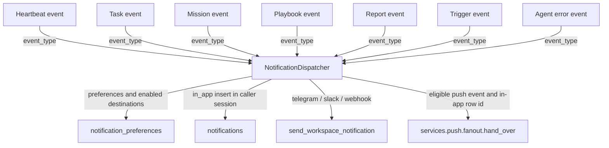
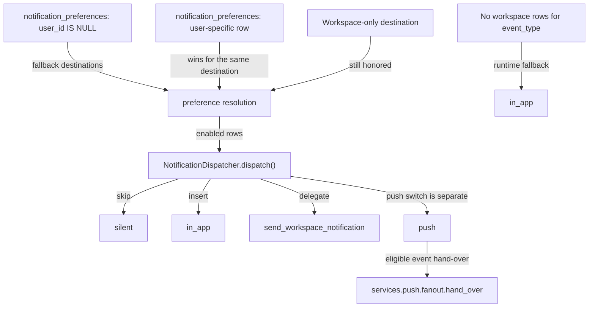
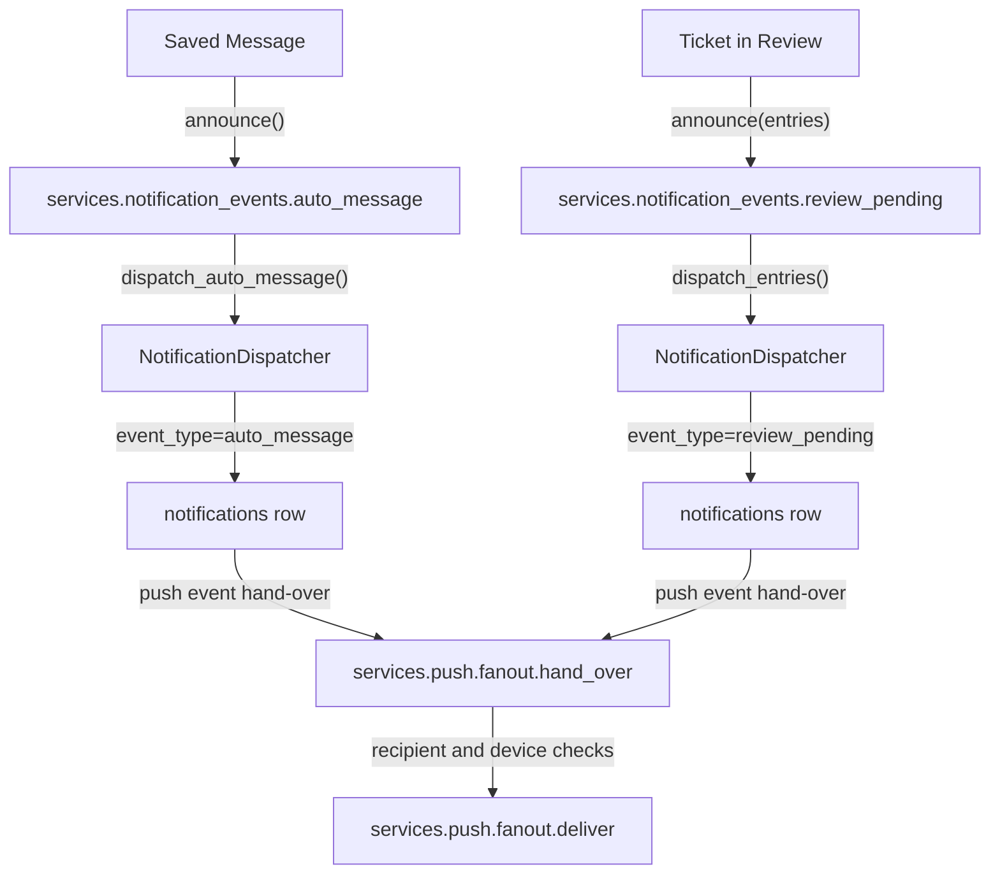

# NotificationDispatcher

Relevant source files

The following files were used as context for generating this wiki page:

- [orchestrator/core/services/notification_columns.py](orchestrator/core/services/notification_columns.py)
- [orchestrator/core/services/notification_dispatcher.py](orchestrator/core/services/notification_dispatcher.py)
- [orchestrator/services/mobile/digest.py](orchestrator/services/mobile/digest.py)
- [orchestrator/services/notification_events/auto_message.py](orchestrator/services/notification_events/auto_message.py)
- [orchestrator/services/notification_events/review_pending.py](orchestrator/services/notification_events/review_pending.py)
- [orchestrator/services/push/fanout.py](orchestrator/services/push/fanout.py)
- [orchestrator/services/push/payload.py](orchestrator/services/push/payload.py)
- [orchestrator/tests/fixtures/prd266_push_signature_vectors.json](orchestrator/tests/fixtures/prd266_push_signature_vectors.json)
- [orchestrator/tests/test_prd128_a_notice_never_aborts_the_work_it_reports.py](orchestrator/tests/test_prd128_a_notice_never_aborts_the_work_it_reports.py)
- [orchestrator/tests/test_prd266_auto_message.py](orchestrator/tests/test_prd266_auto_message.py)
- [orchestrator/tests/test_prd266_push_payload.py](orchestrator/tests/test_prd266_push_payload.py)
- [orchestrator/tests/test_prd268w2_brief_claim.py](orchestrator/tests/test_prd268w2_brief_claim.py)
- [orchestrator/tests/test_prd268w2_brief_push_message_id.py](orchestrator/tests/test_prd268w2_brief_push_message_id.py)

## Purpose and scope

`NotificationDispatcher` is the centralized entry point for platform events raised by producers such as heartbeat, task, mission, playbook, report, trigger, and agent-error flows. It resolves notification preferences for a workspace and optional user, fans events out to enabled destinations, and returns a dispatch summary. Its documented scope includes in-app notifications and external delivery through Telegram, Slack, and webhooks; push is handled separately from preference destinations. [orchestrator/core/services/notification_dispatcher.py:1-7]()

This page covers dispatch behavior, preference resolution, destination fan-out, persistence boundaries, and the distinction between runtime fallback and default-preference seeding. The provided source excerpt documents the dispatcher’s design and constants, but does not include the complete `dispatch()` implementation or a preference-seeding implementation. [orchestrator/core/services/notification_dispatcher.py:1-39]()

Sources: [orchestrator/core/services/notification_dispatcher.py:1-39]()

---

## Architecture & Dispatch Flow

The dispatcher is designed not to commit or abort the caller’s work. It inserts in-app rows on the caller’s database session, leaving transaction ownership with the caller. Its design notes specify that the in-app insert and a channel lookup run inside `_savepoint` savepoints, so a failed statement rolls back only its own savepoint and is logged rather than aborting the caller’s transaction. Before an in-app insert, bounded column values are fitted using `core.services.notification_columns.fit_columns()`. [orchestrator/core/services/notification_dispatcher.py:11-20]()

External delivery is delegated to `core.services.notification_service.send_workspace_notification`. The dispatcher’s design notes also describe a separate push hand-over: after destination processing, supported push events are passed to `services.push.fanout.hand_over` with the in-app row’s ID. Push is not itself a preference destination; a `push` preference row acts as a per-person switch read by the push fan-out. [orchestrator/core/services/notification_dispatcher.py:32-38]()

### Dispatch execution flow

The documented flow is: resolve preferences for the workspace and user, use a single `in_app` destination when the workspace has no preference rows for the event type, dispatch each enabled configured destination except `silent`, and hand eligible push events to the push fan-out. In-app writes and channel lookups are isolated with savepoints, while the caller retains responsibility for committing or rolling back its transaction. [orchestrator/core/services/notification_dispatcher.py:11-18] [orchestrator/core/services/notification_dispatcher.py:21-38]()

**Diagram: Platform event to dispatcher entities**

Sources: [orchestrator/core/services/notification_dispatcher.py:1-7] [orchestrator/core/services/notification_dispatcher.py:11-20] [orchestrator/core/services/notification_dispatcher.py:32-38] [orchestrator/services/push/fanout.py:1-7]()

### Persistence and failure boundaries

| Operation | Documented behavior |
|---|---|
| In-app insert | Runs on the caller’s session; the caller owns the transaction. The dispatcher does not commit. [orchestrator/core/services/notification_dispatcher.py:11-13]() |
| In-app insert and channel lookup | Each runs in a savepoint; a failed statement rolls back only its own savepoint and is logged. [orchestrator/core/services/notification_dispatcher.py:14-18]() |
| Bounded notification fields | Fitted before insert to avoid `VARCHAR` overflow. The bounded fields are `event_type`, `title`, `link_type`, `agent_name`, and `status`; cuts end with an ellipsis. [orchestrator/core/services/notification_columns.py:1-8] [orchestrator/core/services/notification_columns.py:20-28] [orchestrator/core/services/notification_columns.py:31-46]() |
| External channel delivery | Delegated to `send_workspace_notification`. [orchestrator/core/services/notification_dispatcher.py:32-34]() |
| Push delivery | Handed to `services.push.fanout.hand_over`; it is not a preference destination. [orchestrator/core/services/notification_dispatcher.py:35-38]() |

Sources: [orchestrator/core/services/notification_dispatcher.py:11-20] [orchestrator/core/services/notification_dispatcher.py:32-38] [orchestrator/core/services/notification_columns.py:1-8] [orchestrator/core/services/notification_columns.py:20-46]()

---

## Preference Resolution & Fan-Out Rules

Preference rows are resolved for the current workspace and user. Multiple rows for the same workspace, user, and event type are permitted, allowing a single event to use more than one destination. Every enabled destination row fires, except `silent`, which is skipped. [orchestrator/core/services/notification_dispatcher.py:21-24]()

When a user-specific row and a workspace-default row (`user_id IS NULL`) both exist for the same destination, the user-specific row wins. This override is destination-specific: destinations mentioned only by the workspace default remain honored. If the workspace has no rows for an event type, the dispatcher uses one `in_app` notification as a safety-net default. [orchestrator/core/services/notification_dispatcher.py:25-31]()

### Destination behavior

| Destination | Dispatcher behavior |
|---|---|
| `in_app` | Inserts a notification row on the caller’s session; the caller controls the transaction. [orchestrator/core/services/notification_dispatcher.py:11-13]() |
| `telegram` | External delivery is delegated to `send_workspace_notification`. [orchestrator/core/services/notification_dispatcher.py:32-34]() |
| `slack` | External delivery is delegated to `send_workspace_notification`. [orchestrator/core/services/notification_dispatcher.py:32-34]() |
| `webhook` | External delivery is delegated to `send_workspace_notification`. [orchestrator/core/services/notification_dispatcher.py:32-34]() |
| `silent` | Skipped during fan-out. [orchestrator/core/services/notification_dispatcher.py:21-24]() |
| `push` | Not a preference destination. A push row is a per-person switch read by push fan-out; qualifying events are handed over after destination processing. [orchestrator/core/services/notification_dispatcher.py:35-38]() |

**Diagram: Preference semantics mapped to dispatcher entities**

Sources: [orchestrator/core/services/notification_dispatcher.py:21-38] [orchestrator/services/push/fanout.py:1-7]()

### Runtime fallback versus default-preference seeding

The dispatcher’s documented no-preference behavior is a **runtime fallback**: if the workspace has no preference rows for an event type, it dispatches one `in_app` notification. This is not evidence that preference rows are inserted or seeded. The supplied excerpts do not show a default-preference seeding function, migration seed data, or workspace-creation hook; therefore, seeding behavior cannot be specified from these sources. [orchestrator/core/services/notification_dispatcher.py:29-31]()

The mobile digest code illustrates a separate default for the `push` switch: when neither person-specific nor workspace-level `daily_digest` preference rows provide a value, its schedule query defaults that switch to on. That query is part of digest eligibility, not a dispatcher preference-seeding operation. [orchestrator/services/mobile/digest.py:101-119]()

Sources: [orchestrator/core/services/notification_dispatcher.py:29-31] [orchestrator/services/mobile/digest.py:101-119]()

---

## Supported Event Vocabulary

`VALID_EVENT_TYPES` is the dispatcher’s declared set of valid notification event names. The entries cover lifecycle events from heartbeat, tasks, missions, playbooks, social publishing, watches, triggers, reports, governance, review, chat, digests, proactive suggestions, billing, and agent errors. [orchestrator/core/services/notification_dispatcher.py:58-126]()

| Event type(s) | Area |
|---|---|
| `heartbeat_complete` | Heartbeat completion. [orchestrator/core/services/notification_dispatcher.py:58-61]() |
| `task_complete`, `task_failed`, `task_sla_breach` | Task outcomes and SLA breach. [orchestrator/core/services/notification_dispatcher.py:61-63]() |
| `approval_pending`, `question_pending` | Approval and agent question events. [orchestrator/core/services/notification_dispatcher.py:64-72]() |
| `social_post_published`, `social_post_failed`, `social_post_missed` | Social post publishing outcomes. [orchestrator/core/services/notification_dispatcher.py:65-68]() |
| `mission_plan_ready`, `mission_step_complete`, `mission_complete`, `mission_failed`, `mission_budget_paused` | Mission plan and run events. [orchestrator/core/services/notification_dispatcher.py:73-79]() |
| `playbook_step_complete`, `playbook_complete`, `playbook_failed`, `playbook_benched`, `playbook_schedule_skipped` | Playbook execution and scheduling events. [orchestrator/core/services/notification_dispatcher.py:80-88]() |
| `credit_restored`, `credits_low`, `credits_exhausted`, `billing_payment_failed`, `billing_subscription_ended`, `billing_business_offered` | Provider-credit and billing events. [orchestrator/core/services/notification_dispatcher.py:89-98]() |
| `watch_verdict`, `watch_action`, `watch_escalation` | Watcher-plane events. [orchestrator/core/services/notification_dispatcher.py:99-103]() |
| `trigger_fired`, `report_submitted` | Trigger and report events. [orchestrator/core/services/notification_dispatcher.py:104-105]() |
| `content_reported` | Content-report event. [orchestrator/core/services/notification_dispatcher.py:106-108]() |
| `review_pending` | Ticket entered Review. [orchestrator/core/services/notification_dispatcher.py:109-111]() |
| `auto_message` | Auto posted in a person’s chat unprompted. [orchestrator/core/services/notification_dispatcher.py:112-115]() |
| `daily_digest` | Daily-digest switch event; the comment specifies that the digest itself is posted as Auto’s message and pushed as `auto_message`. [orchestrator/core/services/notification_dispatcher.py:116-119]() |
| `suggestion_ready` | Proactive suggestion event. [orchestrator/core/services/notification_dispatcher.py:120-123]() |
| `agent_error` | Agent error event. [orchestrator/core/services/notification_dispatcher.py:124-125]() |

Sources: [orchestrator/core/services/notification_dispatcher.py:58-126]()

---

## Background Event Handlers & Push Integration

### Auto-message announcements

`services.notification_events.auto_message.announce()` filters for saved messages with an announced origin, then schedules `dispatch_auto_message` through `send_soon`. The event module constructs a `NotificationDispatcher` for the message’s workspace and dispatches `auto_message`; its module documentation describes the notification as in-app by default and linked to the chat. [orchestrator/services/notification_events/auto_message.py:1-16] [orchestrator/services/notification_events/auto_message.py:86-98] [orchestrator/services/notification_events/auto_message.py:147-154]()

### Review-pending announcements

`services.notification_events.review_pending.announce()` passes ticket entries to `send_soon`. Its dispatch path re-reads each ticket in its workspace, checks that it remains in Review and is not a Mission’s own card, then calls the dispatcher with a `review_pending` event. [orchestrator/services/notification_events/review_pending.py:1-13] [orchestrator/services/notification_events/review_pending.py:39-45] [orchestrator/services/notification_events/review_pending.py:77-99]()

### Push hand-over

The dispatcher hands supported push events to `services.push.fanout.hand_over` with the in-app row’s ID. The fan-out checks whether the workspace has a phone push could reach, then delegates delivery off the event loop when applicable. Its delivery path separately reads recipients, devices, and push preferences; a `push` preference is a per-person event switch, with the user’s row taking precedence over the workspace row and no row meaning on. [orchestrator/core/services/notification_dispatcher.py:35-38] [orchestrator/services/push/fanout.py:1-7] [orchestrator/services/push/fanout.py:11-22]()

**Diagram: Event handlers and mobile push entities**

Sources: [orchestrator/services/notification_events/auto_message.py:86-98] [orchestrator/services/notification_events/auto_message.py:147-154] [orchestrator/services/notification_events/review_pending.py:39-45] [orchestrator/services/notification_events/review_pending.py:59-74] [orchestrator/core/services/notification_dispatcher.py:35-38] [orchestrator/services/push/fanout.py:1-22]()

---