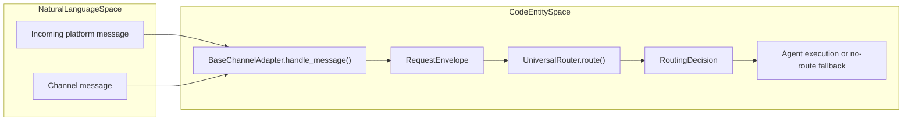
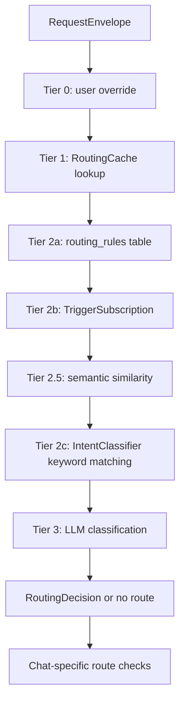
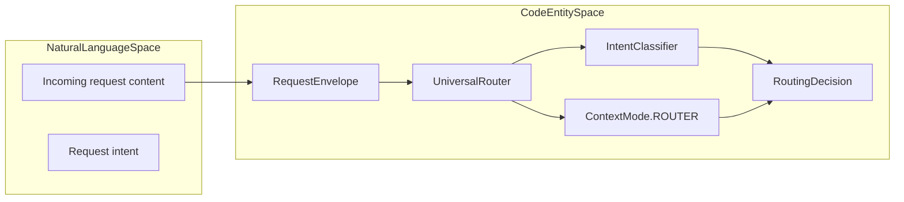

# Universal Router

Relevant source files

The following files were used as context for generating this wiki page:

- [orchestrator/api/routing.py](orchestrator/api/routing.py)
- [orchestrator/channels/base.py](orchestrator/channels/base.py)
- [orchestrator/channels/primitive_heartbeat.py](orchestrator/channels/primitive_heartbeat.py)
- [orchestrator/core/routing/engine.py](orchestrator/core/routing/engine.py)
- [orchestrator/core/security/workspace_scope.py](orchestrator/core/security/workspace_scope.py)
- [orchestrator/scripts/setup_jira_trigger.py](orchestrator/scripts/setup_jira_trigger.py)
- [orchestrator/tests/test_channel_adapter_contract.py](orchestrator/tests/test_channel_adapter_contract.py)
- [orchestrator/tests/test_f149_a_message_runs_only_its_own_workspaces_agents.py](orchestrator/tests/test_f149_a_message_runs_only_its_own_workspaces_agents.py)

The Universal Router selects a destination for an incoming request using a tiered strategy: explicit overrides and deterministic matches are considered before semantic and LLM classification. Its public entry point is `UniversalRouter.route()`, which returns a `RoutingDecision` or no decision when routing cannot resolve the request [orchestrator/core/routing/engine.py:4-15]()[orchestrator/core/routing/engine.py:59-95](). Workspace boundary security (`F149`) is strictly enforced so that a message only executes agents and playbooks within its own workspace [orchestrator/core/security/workspace_scope.py:1-11](). This page summarizes how routing fits together; implementation details are covered in the child pages.

Sources: [orchestrator/core/routing/engine.py:4-15](), [orchestrator/core/routing/engine.py:59-95](), [orchestrator/core/security/workspace_scope.py:1-11]()

## 10.1 Routing Architecture

A request enters routing as a `RequestEnvelope`. Channel adapters translate platform messages into envelopes, call `UniversalRouter.route()`, and use the resulting decision to proceed with execution or return a no-route fallback [orchestrator/channels/base.py:114-123]()[orchestrator/channels/base.py:135-170](). The routing API exposes recent decisions and correction status for inspection [orchestrator/api/routing.py:64-79]()[orchestrator/api/routing.py:107-155]().

**Diagram: From incoming message to routing decision**

Sources: [orchestrator/channels/base.py:114-123](), [orchestrator/channels/base.py:135-170](), [orchestrator/core/routing/engine.py:59-95]()

For details on envelope fields, ingestors, decision records, and logging, see [Routing Architecture](#10.1).

## 10.2 Overrides, Cache & Rules

The engine documents a progression from Tier 0 user overrides and Tier 1 cache lookup through source-pattern rules, trigger subscriptions, semantic similarity, intent matching, and LLM classification [orchestrator/core/routing/engine.py:4-15](). `UniversalRouter` accepts an optional `RoutingCache`; its final route also applies safety checks such as `_chat_never_routes_to_a_session` and `_chat_never_routes_to_a_refused_model` [orchestrator/core/routing/engine.py:59-74]()[orchestrator/core/routing/engine.py:87-133]().

**Diagram: Tiered routing path**

Sources: [orchestrator/core/routing/engine.py:4-15](), [orchestrator/core/routing/engine.py:59-95]()

For details on overrides, cache behavior, source-pattern rules, and trigger subscriptions, see [Overrides, Cache & Rules](#10.2).

## 10.3 Semantic & LLM Classification

When earlier tiers do not resolve a request, the documented strategy includes semantic similarity on agent embeddings and LLM classification, with semantic candidates available to the latter [orchestrator/core/routing/engine.py:9-15](). The router initializes an `IntentClassifier` and imports `ContextMode` and `ContextService`, connecting routing to intent matching and context construction [orchestrator/core/routing/engine.py:31-46]()[orchestrator/core/routing/engine.py:71-75]().

**Diagram: Natural-language request and classification code entities**

Sources: [orchestrator/core/routing/engine.py:31-46](), [orchestrator/core/routing/engine.py:59-95]()

For details on semantic candidates, classification prompts, and orchestrate mode, see [Semantic & LLM Classification](#10.3).

## 10.4 Intent Classification & Smart Tool Router

The router includes `IntentClassifier` as part of its routing machinery, and the tier plan places intent keyword matching after semantic similarity and before LLM classification [orchestrator/core/routing/engine.py:4-15]()[orchestrator/core/routing/engine.py:71-75](). This parent page treats chatbot intent classification and smart tool selection as related but distinct routing concerns; their integration and delegation behavior are documented in the child page.

Sources: [orchestrator/core/routing/engine.py:4-15](), [orchestrator/core/routing/engine.py:71-75]()

For details on chatbot intent classification, smart tool routing, personality, registry filtering, and delegation, see [Intent Classification & Smart Tool Router](#10.4).

## 10.5 Routing Corrections & Learning

The routing API defines a correction request containing a `request_id` and `correct_agent_id`, and its module describes endpoints for recording corrections and inspecting routing decisions [orchestrator/api/routing.py:1-6]()[orchestrator/api/routing.py:82-85](). Decision responses include correction status and the corrected agent identifier, providing an observable link between a routing outcome and feedback [orchestrator/api/routing.py:64-79]().

Sources: [orchestrator/api/routing.py:1-6](), [orchestrator/api/routing.py:64-85]()

For details on user corrections, cache updates, semantic reindexing, and the improvement loop, see [Routing Corrections & Learning](#10.5).

---