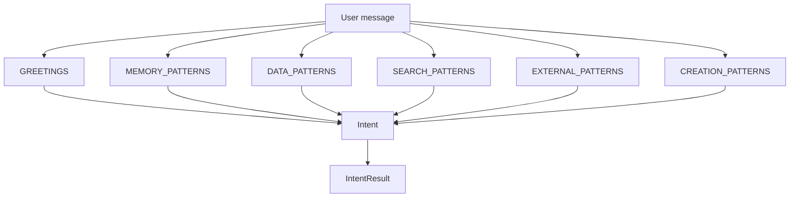
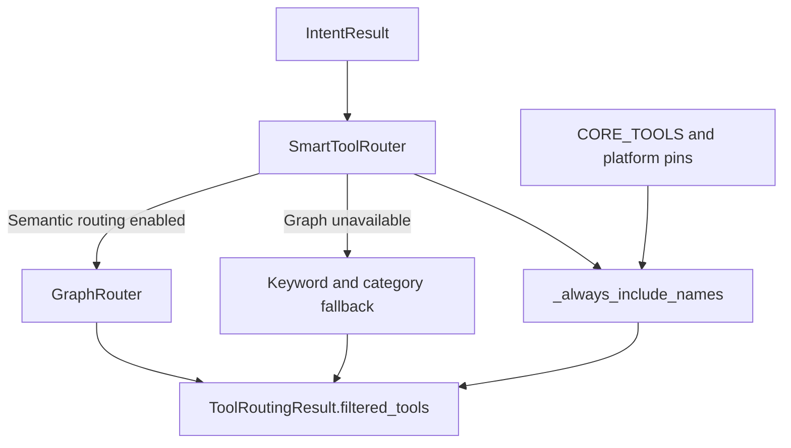
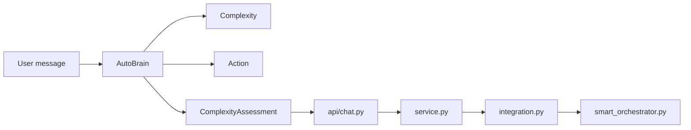
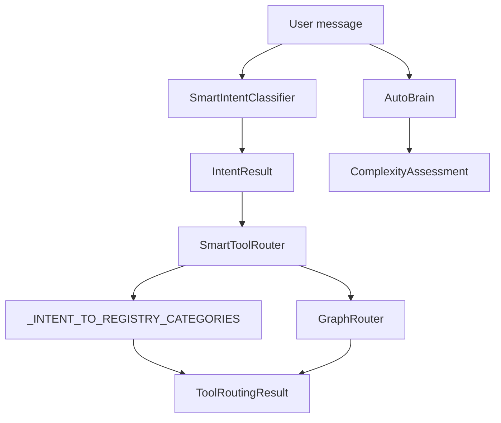

# Intent Classification & Smart Tool Router

Relevant source files

The following files were used as context for generating this wiki page:

- [frontend/components/assignments/__tests__/mission-team-copy.test.tsx](frontend/components/assignments/__tests__/mission-team-copy.test.tsx)
- [frontend/components/assignments/mission-card-constellation.tsx](frontend/components/assignments/mission-card-constellation.tsx)
- [frontend/components/assignments/studio/entry-grid.tsx](frontend/components/assignments/studio/entry-grid.tsx)
- [orchestrator/consumers/chatbot/auto.py](orchestrator/consumers/chatbot/auto.py)
- [orchestrator/consumers/chatbot/intent_classifier.py](orchestrator/consumers/chatbot/intent_classifier.py)
- [orchestrator/consumers/chatbot/personality.py](orchestrator/consumers/chatbot/personality.py)
- [orchestrator/consumers/chatbot/smart_tool_router.py](orchestrator/consumers/chatbot/smart_tool_router.py)
- [orchestrator/core/security/driving_user.py](orchestrator/core/security/driving_user.py)
- [orchestrator/core/seeds/llm_tier_settings.py](orchestrator/core/seeds/llm_tier_settings.py)
- [orchestrator/core/seeds/seed_packages.py](orchestrator/core/seeds/seed_packages.py)
- [orchestrator/core/seeds/seed_socials_package.py](orchestrator/core/seeds/seed_socials_package.py)
- [orchestrator/core/seeds/utterances/socials.yaml](orchestrator/core/seeds/utterances/socials.yaml)
- [orchestrator/core/services/auto_autonomy.py](orchestrator/core/services/auto_autonomy.py)
- [orchestrator/modules/socials/topics.py](orchestrator/modules/socials/topics.py)
- [orchestrator/modules/tools/discovery/actions_autonomy.py](orchestrator/modules/tools/discovery/actions_autonomy.py)
- [orchestrator/modules/tools/discovery/actions_socials.py](orchestrator/modules/tools/discovery/actions_socials.py)
- [orchestrator/modules/tools/discovery/handlers_autonomy.py](orchestrator/modules/tools/discovery/handlers_autonomy.py)
- [orchestrator/modules/tools/discovery/handlers_socials.py](orchestrator/modules/tools/discovery/handlers_socials.py)
- [orchestrator/modules/tools/discovery/platform_actions.py](orchestrator/modules/tools/discovery/platform_actions.py)
- [orchestrator/modules/tools/discovery/platform_executor.py](orchestrator/modules/tools/discovery/platform_executor.py)
- [orchestrator/modules/tools/discovery/social_post_list.py](orchestrator/modules/tools/discovery/social_post_list.py)
- [orchestrator/services/package_installer.py](orchestrator/services/package_installer.py)
- [orchestrator/tests/security/test_nl2sql_tenancy.py](orchestrator/tests/security/test_nl2sql_tenancy.py)
- [orchestrator/tests/security/test_w3_full_autonomy_gate.py](orchestrator/tests/security/test_w3_full_autonomy_gate.py)
- [orchestrator/tests/test_f379_e_the_posts_are_listed_with_what_they_need.py](orchestrator/tests/test_f379_e_the_posts_are_listed_with_what_they_need.py)
- [orchestrator/tests/test_package_installer_ref_resolution.py](orchestrator/tests/test_package_installer_ref_resolution.py)
- [orchestrator/tests/test_prd230_packages_seed.py](orchestrator/tests/test_prd230_packages_seed.py)
- [orchestrator/tests/test_prd232_us001_dispatcher_survives_route.py](orchestrator/tests/test_prd232_us001_dispatcher_survives_route.py)
- [orchestrator/tests/test_prd232_us002_flag_split.py](orchestrator/tests/test_prd232_us002_flag_split.py)
- [orchestrator/tests/test_prd251w1_social_post_tools.py](orchestrator/tests/test_prd251w1_social_post_tools.py)
- [orchestrator/tests/test_prd251w1_socials_package.py](orchestrator/tests/test_prd251w1_socials_package.py)
- [orchestrator/tests/test_prd251w3_one_way_out.py](orchestrator/tests/test_prd251w3_one_way_out.py)
- [orchestrator/tests/test_public_counts_auto_and_tier_tooltips.py](orchestrator/tests/test_public_counts_auto_and_tier_tooltips.py)
- [orchestrator/tests/test_us014_graph_router_delegation.py](orchestrator/tests/test_us014_graph_router_delegation.py)
- [orchestrator/tests/test_us015_registry_intent_filter.py](orchestrator/tests/test_us015_registry_intent_filter.py)
- [orchestrator/tests/test_w3_auto_autonomy_service.py](orchestrator/tests/test_w3_auto_autonomy_service.py)

## Purpose and Scope

This page describes the chatbot’s intent classifier, the smart tool router that narrows the available tool set, workspace-configurable personality prompts, and the registry categories used to select actions. It also explains how AutoBrain’s complexity assessment fits into the chatbot routing model. [orchestrator/consumers/chatbot/intent_classifier.py:1-12](), [orchestrator/consumers/chatbot/smart_tool_router.py:1-18](), [orchestrator/consumers/chatbot/personality.py:1-11](), [orchestrator/consumers/chatbot/auto.py:1-22]()

Sources: [orchestrator/consumers/chatbot/intent_classifier.py:1-12](), [orchestrator/consumers/chatbot/smart_tool_router.py:1-18](), [orchestrator/consumers/chatbot/personality.py:1-11](), [orchestrator/consumers/chatbot/auto.py:1-22]()

---

## 1. Smart Intent Classifier

`SmartIntentClassifier` classifies a user message according to whether it calls for conversation, personal-memory retrieval, tool use, or multi-step reasoning. Its documented default is to favor conversation unless the message contains clear tool or memory signals. The classifier represents the primary classification with `Intent` and packages its output in `IntentResult`. [orchestrator/consumers/chatbot/intent_classifier.py:1-12](), [orchestrator/consumers/chatbot/intent_classifier.py:23-56]()

### Intent Categories and Data Structures

The `Intent` enum defines nine primary categories. `IntentResult` carries the primary intent, confidence, tool and memory requirements, suggested tools, reasoning, and a flag indicating whether the request can be answered without tools. [orchestrator/consumers/chatbot/intent_classifier.py:23-46]()

| Intent | Meaning and code-level signals |
|---|---|
| `Intent.GREETING` | Greetings, acknowledgments, and sign-offs. Examples in `GREETINGS` include `hi`, `hello`, `thanks`, `ok`, and `goodbye`. [orchestrator/consumers/chatbot/intent_classifier.py:23-25](), [orchestrator/consumers/chatbot/intent_classifier.py:58-66]() |
| `Intent.CHITCHAT` | General conversation, feelings, and opinions. [orchestrator/consumers/chatbot/intent_classifier.py:26](), [orchestrator/consumers/chatbot/intent_classifier.py:48-56]() |
| `Intent.MEMORY_RECALL` | Questions about personal context or prior conversations; `MEMORY_PATTERNS` includes patterns such as `my name`, `who am i`, and `last time`. [orchestrator/consumers/chatbot/intent_classifier.py:27](), [orchestrator/consumers/chatbot/intent_classifier.py:68-75]() |
| `Intent.FACTUAL` | General-knowledge questions. [orchestrator/consumers/chatbot/intent_classifier.py:28]() |
| `Intent.DATA_QUERY` | Database, analytics, metrics, and platform-entity queries. `DATA_PATTERNS` includes terms such as `how many`, `analytics`, `my agents`, and board or ticket references. [orchestrator/consumers/chatbot/intent_classifier.py:29](), [orchestrator/consumers/chatbot/intent_classifier.py:77-110]() |
| `Intent.SEARCH` | Knowledge-base and document discovery. `SEARCH_PATTERNS` includes `find`, `search`, `look up`, and documentation-related phrasing. [orchestrator/consumers/chatbot/intent_classifier.py:30](), [orchestrator/consumers/chatbot/intent_classifier.py:112-119]() |
| `Intent.EXTERNAL_ACTION` | External-app operations and web research. `EXTERNAL_PATTERNS` includes email, Slack, GitHub, and online-research phrasing. [orchestrator/consumers/chatbot/intent_classifier.py:31](), [orchestrator/consumers/chatbot/intent_classifier.py:121-134]() |
| `Intent.CREATION` | Creating or exporting files, reports, documents, and platform entities. `CREATION_PATTERNS` includes requests to create an agent, recipe, or workflow. [orchestrator/consumers/chatbot/intent_classifier.py:32](), [orchestrator/consumers/chatbot/intent_classifier.py:136-147]() |
| `Intent.MULTI_STEP` | Complex tasks that require planning. [orchestrator/consumers/chatbot/intent_classifier.py:33]() |

The shown classifier code also defines `WORKSPACE_PATTERNS` for workspace file, execution, and Git operations; the displayed file excerpt does not include the remainder of those patterns or the classifier’s full classification method. [orchestrator/consumers/chatbot/intent_classifier.py:149-151]()

Sources: [orchestrator/consumers/chatbot/intent_classifier.py:23-56](), [orchestrator/consumers/chatbot/intent_classifier.py:58-151]()

### Diagram: Natural Language Space to Classifier Code Entities

The diagram connects example user phrasing to the named pattern collections and result types in `intent_classifier.py`. [orchestrator/consumers/chatbot/intent_classifier.py:23-46](), [orchestrator/consumers/chatbot/intent_classifier.py:58-147]()

Sources: [orchestrator/consumers/chatbot/intent_classifier.py:23-46](), [orchestrator/consumers/chatbot/intent_classifier.py:58-147]()

---

## 2. Smart Tool Router & Graph Delegation

`SmartToolRouter` determines whether tools should be included, which tools to make available, and how to prioritize them. It obtains the intent classifier through `get_intent_classifier()`. For semantic ranking, the module delegates to `GraphRouter` when semantic routing is enabled and falls back to keyword/category matching if the graph is unavailable. The module’s docstring identifies `ContextService` with `ToolLoadingStrategy.FILTERED` as its consumer and describes it as the only caller. [orchestrator/consumers/chatbot/smart_tool_router.py:1-18](), [orchestrator/consumers/chatbot/smart_tool_router.py:65-78](), [orchestrator/consumers/chatbot/smart_tool_router.py:137-139]()

### Routing Results and Core Pins

`ToolRoutingResult` records whether tools should be included, the filtered tool definitions, priority tool names, the tool-choice mode (`"auto"`, `"required"`, or `"none"`), and a reasoning string. [orchestrator/consumers/chatbot/smart_tool_router.py:55-63]()

The router defines several sets of tools intended to remain available through intent filtering:

- `CORE_TOOLS` contains `search_knowledge`, `semantic_search`, `search_codebase`, `composio_execute`, and `generate_document`. The source explicitly excludes `smart_query_database` and `query_database`, citing the lack of workspace scoping as a cross-tenant data-leak risk. [orchestrator/consumers/chatbot/smart_tool_router.py:80-92]()
- `_SIGNAL_TOOL_PINS` includes `widget_open_callback_form`. The source says this native signal tool must survive filtering when present in the available tools, because it represents an enabled site callback affordance. [orchestrator/consumers/chatbot/smart_tool_router.py:94-109]()
- `_CORE_PLATFORM_PINS` includes common platform and memory tools such as `platform_list_agents`, `platform_search_memory`, and `platform_field_query`. [orchestrator/consumers/chatbot/smart_tool_router.py:111-121]()
- `_DISPATCHER_PINS` contains `platform_execute`, which provides access to non-promoted platform actions through its action enum. [orchestrator/consumers/chatbot/smart_tool_router.py:123-135]()

The `_always_include_names()` method is documented as the single mechanism that combines dispatcher pins, signal pins, core platform pins, and registry-promoted actions. The comments state that route branches applying hints, graph selection, or category fallback union this set into their keep-set. [orchestrator/consumers/chatbot/smart_tool_router.py:140-152]()

### Diagram: Tool Routing Pipeline

The diagram summarizes the documented relationship between intent classification, semantic routing or category fallback, and the always-include set. [orchestrator/consumers/chatbot/smart_tool_router.py:1-18](), [orchestrator/consumers/chatbot/smart_tool_router.py:55-63](), [orchestrator/consumers/chatbot/smart_tool_router.py:137-152]()

Sources: [orchestrator/consumers/chatbot/smart_tool_router.py:1-18](), [orchestrator/consumers/chatbot/smart_tool_router.py:55-63](), [orchestrator/consumers/chatbot/smart_tool_router.py:137-152]()

### Diagram: Natural Language Space to Router and Registry Entities

The category mapping translates classified user intent into registry category names. The router comments specify that matching action names are pulled from the registry at call time, so actions registered in mapped categories can be discovered without editing the router. [orchestrator/consumers/chatbot/smart_tool_router.py:31-52]()

Sources: [orchestrator/consumers/chatbot/intent_classifier.py:23-46](), [orchestrator/consumers/chatbot/smart_tool_router.py:31-52](), [orchestrator/consumers/chatbot/smart_tool_router.py:55-63]()

---

## 3. Personality Layer (`AutomatosPersonality`)

`AutomatosPersonality` builds a system prompt with an assistant identity, a selected personality block, communication-style guidance, and memory/context instructions. Workspace orchestrator settings include `personality_mode`, `custom_soul`, `communication_style`, `proactive_level`, and `thinking_level`. [orchestrator/consumers/chatbot/personality.py:1-11](), [orchestrator/consumers/chatbot/personality.py:29-36](), [orchestrator/consumers/chatbot/personality.py:113-138]()

### Workspace Settings and Prompt Assembly

`load_orchestrator_settings(workspace_id)` starts from `_ORCHESTRATOR_DEFAULTS`, checks a per-workspace cache with a 120-second TTL, and loads the workspace’s `settings["orchestrator"]` values when needed. The source states that defaults are returned if no orchestrator configuration is present and that only successful database loads are cached. [orchestrator/consumers/chatbot/personality.py:22-35](), [orchestrator/consumers/chatbot/personality.py:38-70]()

`AutomatosPersonality.get_base_system_prompt()` accepts an optional user name, agent name, and settings dictionary. It uses the supplied agent name or `"Automatos"`, selects a custom soul when `personality_mode` is `"custom"` and the soul is non-empty, otherwise chooses a preset with a friendly fallback, and appends the communication-style suffix. [orchestrator/consumers/chatbot/personality.py:113-155]()

| Setting or mode | Prompt behavior |
|---|---|
| `friendly` | Uses a warm, approachable personality block that favors action when asked to do something. [orchestrator/consumers/chatbot/personality.py:77-84]() |
| `professional` | Uses a polished, structured, enterprise-appropriate block that flags risks and dependencies. [orchestrator/consumers/chatbot/personality.py:85-92]() |
| `technical` | Uses a precise, developer-focused block that leads with code, data, and specifics. [orchestrator/consumers/chatbot/personality.py:93-99]() |
| `custom` | Uses the trimmed `custom_soul` text when it is non-empty. [orchestrator/consumers/chatbot/personality.py:149-153]() |
| `concise` | Adds an instruction to keep responses short and direct. [orchestrator/consumers/chatbot/personality.py:105-110]() |
| `balanced` | Adds no communication-style suffix. [orchestrator/consumers/chatbot/personality.py:105-110]() |
| `detailed` | Adds an instruction to provide thorough explanations with examples and context. [orchestrator/consumers/chatbot/personality.py:105-110]() |

The constructed prompt includes an identity section and a memory/context section. Its text says memories may be injected below and should be used naturally. [orchestrator/consumers/chatbot/personality.py:157-169]()

Sources: [orchestrator/consumers/chatbot/personality.py:22-70](), [orchestrator/consumers/chatbot/personality.py:77-110](), [orchestrator/consumers/chatbot/personality.py:113-169]()

---

## 4. Registry Intent Filtering & Delegation

`_INTENT_TO_REGISTRY_CATEGORIES` maps tool-requiring intents to `ActionRegistry` category names instead of maintaining a hardcoded list of individual tools. The router comments say category matches are resolved from the registry at call time. `GREETING`, `CHITCHAT`, and `FACTUAL` are intentionally absent from this mapping because they are described as `requires_tools=False` and do not reach the filter. [orchestrator/consumers/chatbot/smart_tool_router.py:31-39]()

### Intent-to-Category Mappings

| Intent | Registry categories |
|---|---|
| `Intent.DATA_QUERY` | `analytics`, `database`, `graph`, `field`, `reports`. [orchestrator/consumers/chatbot/smart_tool_router.py:40-42]() |
| `Intent.SEARCH` | `discovery`, `documents`, `graph`, `memory`, `workspace_files`. [orchestrator/consumers/chatbot/smart_tool_router.py:40-42]() |
| `Intent.EXTERNAL_ACTION` | `integrations`, `notifications`, `marketplace`, `skills`. [orchestrator/consumers/chatbot/smart_tool_router.py:40-43]() |
| `Intent.CREATION` | `documents`, `reports`, `blog`, `socials`, `workspace_files`, `playbooks`. [orchestrator/consumers/chatbot/smart_tool_router.py:40-44]() |
| `Intent.MEMORY_RECALL` | `memory`, `field`. [orchestrator/consumers/chatbot/smart_tool_router.py:40-45]() |
| `Intent.MULTI_STEP` | A broad category set covering agents, missions, tasks, playbooks, workspace, analytics, documents, graph, memory, integrations, scheduling, governance, and other platform domains. [orchestrator/consumers/chatbot/smart_tool_router.py:46-51]() |

The category-based design lets newly registered actions in an already-mapped category be discoverable without adding their names to the router’s mapping. This is the behavior described in the router’s mapping comments. [orchestrator/consumers/chatbot/smart_tool_router.py:31-39]()

Sources: [orchestrator/consumers/chatbot/smart_tool_router.py:31-52]()

---

## 5. AutoBrain Complexity Assessment and Delegation

AutoBrain’s `Complexity` enum describes a progression from direct responses (`ATOM`) through tool use and memory-assisted reasoning to multi-agent coordination (`ORGAN`) and full pipeline work (`ORGANISM`). The module docstring describes a three-tier assessment: Redis cache lookup, regex fast paths, and LLM classification. [orchestrator/consumers/chatbot/auto.py:1-22](), [orchestrator/consumers/chatbot/auto.py:62-82]()

The `Action` enum represents possible handling outcomes: `RESPOND`, `DELEGATE`, `WORKFLOW`, `MISSION`, and `ASSIGN`. The source marks `WORKFLOW` as deprecated but retained for backward-compatible parsing. `ASSIGN_TOOL_HINTS` names the platform task-creation, assignment, and status-update tools associated with the assign lane. [orchestrator/consumers/chatbot/auto.py:75-89]()

| Complexity | Documented level |
|---|---|
| `ATOM` | Simple greeting, factual, or chitchat request. [orchestrator/consumers/chatbot/auto.py:66-72]() |
| `MOLECULE` | Request requiring a tool or specific agent skill. [orchestrator/consumers/chatbot/auto.py:66-72]() |
| `CELL` | Request requiring memory, tools, and reasoning. [orchestrator/consumers/chatbot/auto.py:66-72]() |
| `ORGAN` | Multi-agent coordination. [orchestrator/consumers/chatbot/auto.py:66-72]() |
| `ORGANISM` | Enterprise pipeline work with learning and feedback. [orchestrator/consumers/chatbot/auto.py:66-72]() |

The module documents the downstream path as `api/chat.py → service.py → integration.py → smart_orchestrator.py`; it identifies `needs_memory` and `tool_hints` as fields that drive downstream behavior. [orchestrator/consumers/chatbot/auto.py:19-22]()

### Diagram: Natural Language Space to AutoBrain Code Entities

This diagram connects the documented user-message assessment to its code-level complexity and action types and the named downstream path. [orchestrator/consumers/chatbot/auto.py:1-22](), [orchestrator/consumers/chatbot/auto.py:62-89]()

Sources: [orchestrator/consumers/chatbot/auto.py:1-22](), [orchestrator/consumers/chatbot/auto.py:62-89]()

### Diagram: Classification and Tool-Routing Responsibilities

The classifier and AutoBrain expose different named outputs: the classifier describes intent and tool/memory requirements, while AutoBrain describes complexity assessment and downstream `needs_memory` and `tool_hints`. The smart router consumes the classifier’s intent types and selects available tools through semantic routing or category filtering. [orchestrator/consumers/chatbot/intent_classifier.py:23-46](), [orchestrator/consumers/chatbot/auto.py:19-22](), [orchestrator/consumers/chatbot/smart_tool_router.py:1-18](), [orchestrator/consumers/chatbot/smart_tool_router.py:31-52]()

Sources: [orchestrator/consumers/chatbot/intent_classifier.py:23-46](), [orchestrator/consumers/chatbot/auto.py:1-22](), [orchestrator/consumers/chatbot/auto.py:62-89](), [orchestrator/consumers/chatbot/smart_tool_router.py:31-63]()

---