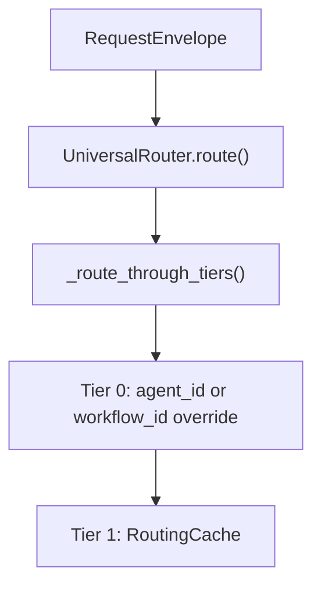
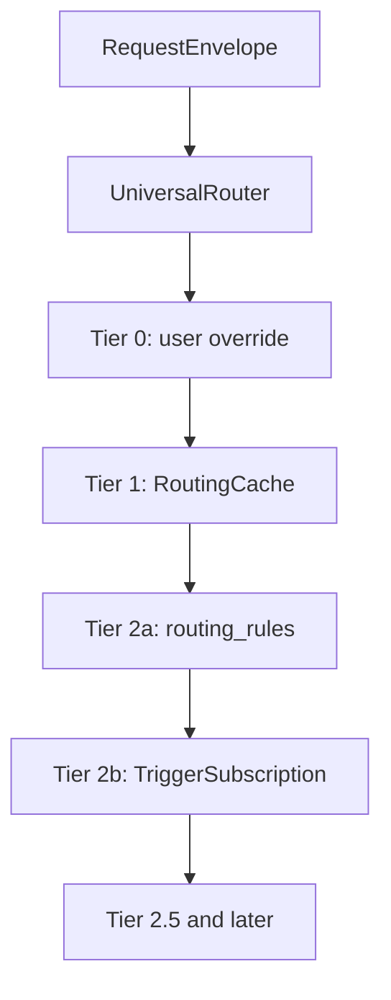
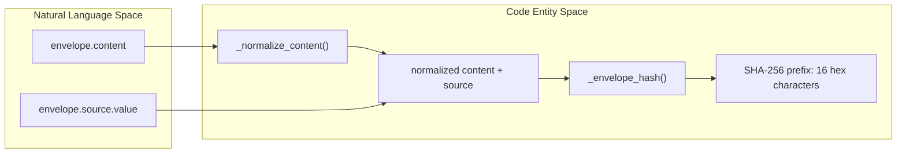
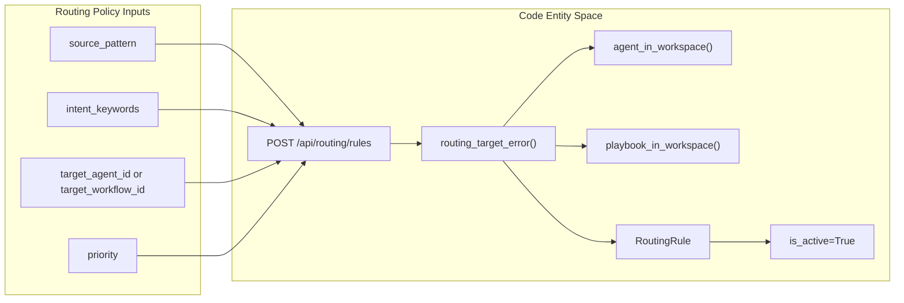
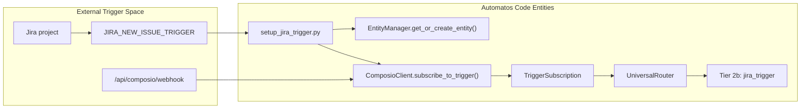

# Overrides, Cache & Rules

Relevant source files

The following files were used as context for generating this wiki page:

- [orchestrator/api/routing.py](orchestrator/api/routing.py)
- [orchestrator/channels/base.py](orchestrator/channels/base.py)
- [orchestrator/channels/primitive_heartbeat.py](orchestrator/channels/primitive_heartbeat.py)
- [orchestrator/core/routing/engine.py](orchestrator/core/routing/engine.py)
- [orchestrator/core/security/workspace_scope.py](orchestrator/core/security/workspace_scope.py)
- [orchestrator/scripts/setup_jira_trigger.py](orchestrator/scripts/setup_jira_trigger.py)
- [orchestrator/tests/test_channel_adapter_contract.py](orchestrator/tests/test_channel_adapter_contract.py)
- [orchestrator/tests/test_f149_a_message_runs_only_its_own_workspaces_agents.py](orchestrator/tests/test_f149_a_message_runs_only_its_own_workspaces_agents.py)

## Purpose and Scope

This page covers the Universal Router’s early routing tiers: explicit user overrides, an optional `RoutingCache`, workspace-scoped `RoutingRule` matching, and `TriggerSubscription` routing for Jira-trigger events. These tiers precede semantic similarity, intent classification, and LLM classification in the documented routing sequence. [orchestrator/core/routing/engine.py:4-15]()

Sources: [orchestrator/core/routing/engine.py:4-15]()

---

## Tier 0: User Overrides

Tier 0 handles an explicitly supplied `agent_id` or `workflow_id`. The router’s tier documentation identifies these as user overrides. [orchestrator/core/routing/engine.py:7-10]() The F149 tests construct a `RequestEnvelope` with `override_agent_id` and verify that the router returns a decision for an agent in the request workspace, but drops an override targeting an agent in another workspace. [orchestrator/tests/test_f149_a_message_runs_only_its_own_workspaces_agents.py:51-55](), [orchestrator/tests/test_f149_a_message_runs_only_its_own_workspaces_agents.py:82-88]()

The provided code excerpt does not show the override implementation inside `_route_through_tiers()`. Consequently, this page describes the override’s documented tier position and tested workspace behavior, not unshown parsing or precedence details. [orchestrator/core/routing/engine.py:7-15](), [orchestrator/tests/test_f149_a_message_runs_only_its_own_workspaces_agents.py:69-88]()

### RequestEnvelope and Override Path

**Diagram: Explicit override entering the router tier chain**

Sources: [orchestrator/core/routing/engine.py:7-15](), [orchestrator/core/routing/engine.py:80-95]()

After the tier chain returns, `UniversalRouter.route()` applies two chat-specific guards. `_chat_never_routes_to_a_session()` converts a chat route to a CLI/session agent into `orchestrate`, because that agent is not activated in the chat runtime. `_chat_never_routes_to_a_refused_model()` similarly converts a chat route to `orchestrate` when the selected agent’s model is unavailable. Both guards are scoped to `ChannelSource.CHATBOT`; the session guard’s documentation notes that other router consumers may legitimately route to a session agent. [orchestrator/core/routing/engine.py:80-95](), [orchestrator/core/routing/engine.py:97-134](), [orchestrator/core/routing/engine.py:135-152]()

Sources: [orchestrator/core/routing/engine.py:80-95](), [orchestrator/core/routing/engine.py:97-134](), [orchestrator/core/routing/engine.py:135-152]()

---

## Tier 1: Cache Lookup & Envelope Hashing

`UniversalRouter` accepts an optional `RoutingCache` in its constructor. The router’s tier documentation assigns cache lookup to Tier 1; the supplied excerpt does not show the cache lookup implementation or cache key semantics. [orchestrator/core/routing/engine.py:7-10](), [orchestrator/core/routing/engine.py:59-74]()

### Cache Lookup Position

**Diagram: Cache precedes rules and trigger subscriptions**

Sources: [orchestrator/core/routing/engine.py:4-15]()

### Natural Language and Code Entity Boundaries

`_envelope_hash()` creates a short identifier for logging or deduplication. It combines normalized envelope content from `_normalize_content()` with `envelope.source.value`, hashes the resulting string using SHA-256, and returns the first 16 hexadecimal characters. This is a logging/deduplication hash; the provided excerpt does not establish that it is the `RoutingCache` lookup key. [orchestrator/core/routing/engine.py:44](), [orchestrator/core/routing/engine.py:53-56]()

**Diagram: Request language mapped to envelope-hash code entities**

Sources: [orchestrator/core/routing/engine.py:44](), [orchestrator/core/routing/engine.py:53-56]()

| Code entity | Role |
|---|---|
| `UniversalRouter.__init__()` | Stores the database session and optional cache; creates an `IntentClassifier`. [orchestrator/core/routing/engine.py:59-75]() |
| `RoutingCache` | Optional cache type accepted by the router; designated as Tier 1 in the tier sequence. [orchestrator/core/routing/engine.py:7-10](), [orchestrator/core/routing/engine.py:59-74]() |
| `_normalize_content()` | Imported from `core.routing.cache` and used to normalize content for `_envelope_hash()`. [orchestrator/core/routing/engine.py:44](), [orchestrator/core/routing/engine.py:53-56]() |
| `_envelope_hash()` | Produces a 16-character SHA-256 prefix from normalized content and source. [orchestrator/core/routing/engine.py:53-56]() |

Sources: [orchestrator/core/routing/engine.py:7-10](), [orchestrator/core/routing/engine.py:44](), [orchestrator/core/routing/engine.py:53-56](), [orchestrator/core/routing/engine.py:59-75]()

---

## Tier 2a: Source-Pattern Rules & Workspace Security

Tier 2a is documented as a `routing_rules` lookup scoped by workspace and explicit source pattern. The routing API’s `CreateRuleRequest` accepts `source_pattern`, `intent_keywords`, an optional agent or workflow target, and `priority`. [orchestrator/core/routing/engine.py:9-10](), [orchestrator/api/routing.py:41-47]()

### Rule Management and Workspace Scope (F149)

`POST /api/routing/rules` requires the `workspace:manage` permission. It rejects a request that supplies neither `target_agent_id` nor `target_workflow_id`, calls `routing_target_error()` to validate the target against the current workspace, then creates an active `RoutingRule` with that workspace ID and the supplied pattern, keywords, target, and priority. [orchestrator/api/routing.py:163-194]()

`routing_target_error()` checks each supplied target: agents are checked with `agent_in_workspace()`, and playbooks with `playbook_in_workspace()`. The underlying workspace check fails closed for a missing workspace, invalid ID, or lookup failure. Agents are accepted when they belong to the workspace or are system agents with no workspace; playbooks are accepted when registered in code or present in the workspace’s `workflow_recipes` rows. [orchestrator/core/security/workspace_scope.py:21-43](), [orchestrator/core/security/workspace_scope.py:46-68]()

The F149 router tests verify that a rule naming another workspace’s agent or playbook is not used to route the request. [orchestrator/tests/test_f149_a_message_runs_only_its_own_workspaces_agents.py:91-99]()

**Diagram: Routing rule inputs mapped to workspace validation and persistence**

Sources: [orchestrator/api/routing.py:41-47](), [orchestrator/api/routing.py:163-194](), [orchestrator/core/security/workspace_scope.py:41-68]()

Sources: [orchestrator/api/routing.py:41-47](), [orchestrator/api/routing.py:163-194](), [orchestrator/core/security/workspace_scope.py:21-68](), [orchestrator/tests/test_f149_a_message_runs_only_its_own_workspaces_agents.py:91-99]()

---

## Tier 2b: TriggerSubscriptions

The router’s tier documentation identifies `TriggerSubscription` as Tier 2b for the `jira_trigger` source. The engine imports both `TriggerSubscription` and `ComposioEntity`; the supplied excerpt does not show the subscription lookup or matching implementation. [orchestrator/core/routing/engine.py:9-12](), [orchestrator/core/routing/engine.py:31-33]()

### Trigger Setup and Event Ingestion

`setup_jira_trigger.py` defaults to `JIRA_NEW_ISSUE_TRIGGER` and a Jira project key of `PILOT`. It builds the callback URL from `BACKEND_URL` (defaulting to `http://localhost:8000`) and the `/api/composio/webhook` path. The script obtains a Composio entity, subscribes through `ComposioClient.subscribe_to_trigger()`, and persists a `TriggerSubscription` with the entity, trigger name, callback URL, Composio subscription ID, optional agent/workflow targets, and `is_active=True`. [orchestrator/scripts/setup_jira_trigger.py:43-64](), [orchestrator/scripts/setup_jira_trigger.py:82-89](), [orchestrator/scripts/setup_jira_trigger.py:94-137]()

**Diagram: Jira trigger registration mapped to routing code entities**

Sources: [orchestrator/core/routing/engine.py:9-12](), [orchestrator/scripts/setup_jira_trigger.py:82-89](), [orchestrator/scripts/setup_jira_trigger.py:94-137]()

The setup script’s optional agent and workflow IDs are stored on the `TriggerSubscription` record. Its confirmation output describes those targets as optional, with the router deciding when neither is supplied. [orchestrator/scripts/setup_jira_trigger.py:53-63](), [orchestrator/scripts/setup_jira_trigger.py:127-153]()

Sources: [orchestrator/scripts/setup_jira_trigger.py:53-63](), [orchestrator/scripts/setup_jira_trigger.py:127-153]()

---

## Configuration & Management API

The routing API is mounted under `/api/routing`. The shown endpoint surface includes decision listing and rule creation; the request schema also defines a trigger-setup payload. [orchestrator/api/routing.py:32-34](), [orchestrator/api/routing.py:41-47](), [orchestrator/api/routing.py:87-102]()

| Endpoint or surface | Method or type | Purpose |
|---|---|---|
| `/api/routing/decisions` | `GET` | Lists routing decisions, with optional filters for source, agent ID, and correction status, plus pagination. [orchestrator/api/routing.py:111-155]() |
| `/api/routing/rules` | `POST` | Creates an active workspace rule after validating that it has a target and that its target belongs to the workspace. [orchestrator/api/routing.py:163-194]() |
| `CreateRuleRequest` | Pydantic schema | Describes pattern, keyword, target, and priority inputs for a rule. [orchestrator/api/routing.py:41-47]() |
| `TriggerSetupRequest` | Pydantic schema | Describes a trigger name, Jira project key, and optional agent/workflow targets. [orchestrator/api/routing.py:87-102]() |
| `setup_jira_trigger.py` | Script | Registers the Composio trigger and persists a `TriggerSubscription` record. [orchestrator/scripts/setup_jira_trigger.py:94-137]() |

Sources: [orchestrator/api/routing.py:32-34](), [orchestrator/api/routing.py:41-47](), [orchestrator/api/routing.py:87-102](), [orchestrator/api/routing.py:111-155](), [orchestrator/api/routing.py:163-194](), [orchestrator/scripts/setup_jira_trigger.py:94-137]()

---