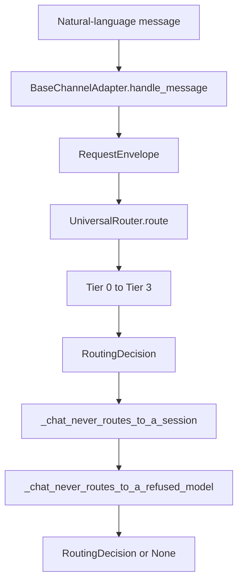
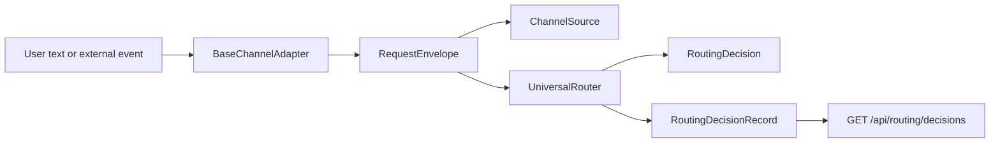
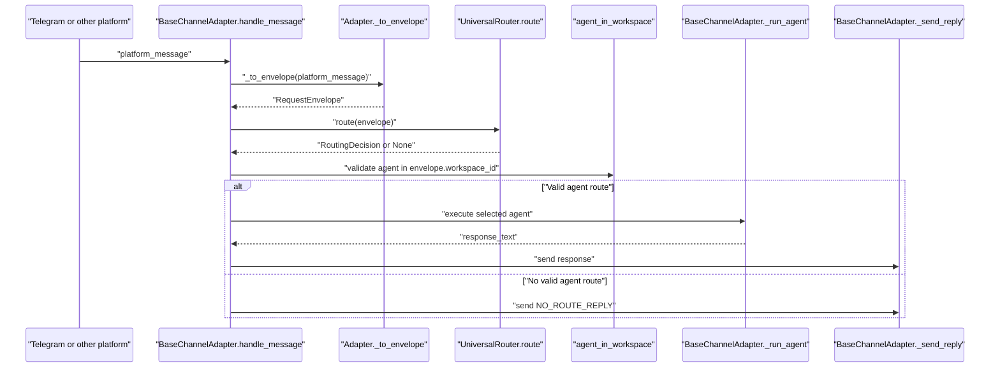

# Routing Architecture

Relevant source files

The following files were used as context for generating this wiki page:

- [orchestrator/api/routing.py](orchestrator/api/routing.py)
- [orchestrator/channels/base.py](orchestrator/channels/base.py)
- [orchestrator/channels/primitive_heartbeat.py](orchestrator/channels/primitive_heartbeat.py)
- [orchestrator/core/routing/engine.py](orchestrator/core/routing/engine.py)
- [orchestrator/core/security/workspace_scope.py](orchestrator/core/security/workspace_scope.py)
- [orchestrator/scripts/setup_jira_trigger.py](orchestrator/scripts/setup_jira_trigger.py)
- [orchestrator/tests/test_channel_adapter_contract.py](orchestrator/tests/test_channel_adapter_contract.py)
- [orchestrator/tests/test_f149_a_message_runs_only_its_own_workspaces_agents.py](orchestrator/tests/test_f149_a_message_runs_only_its_own_workspaces_agents.py)

## Purpose and Scope

This page describes how Automatos AI turns an incoming request into a routing choice, how channel adapters create and submit requests, and how routing decisions can be inspected through the routing API. It focuses on `RequestEnvelope`, `RoutingDecision`, the `RoutingDecisionRecord` model used for the routing-decision ledger, and the `UniversalRouter`. The implementation handles tier order resolution and final chat-safety checks. [orchestrator/core/routing/engine.py:1-16](), [orchestrator/core/routing/engine.py:59-95](), [orchestrator/api/routing.py:23-28]()

Sources: [orchestrator/core/routing/engine.py:1-16](), [orchestrator/core/routing/engine.py:59-95](), [orchestrator/api/routing.py:23-28]()

---

## Architecture Overview

`UniversalRouter.route(envelope)` runs the tiered routing process and then applies two chat-specific guards: one prevents chat turns from being sent to CLI-session agents, and the other converts a route to an agent with an unavailable model into an `orchestrate` decision. The router is constructed with a database session and an optional `RoutingCache`; it also initializes an `IntentClassifier`. [orchestrator/core/routing/engine.py:59-75](), [orchestrator/core/routing/engine.py:80-95]()

The router’s documented tier order is shown below. [orchestrator/core/routing/engine.py:1-16]()

### Routing Strategy Tiers

| Tier | Strategy | Purpose |
|---|---|---|
| **Tier 0** | User override | Use an explicit agent or workflow override when present. [orchestrator/core/routing/engine.py:7-8]() |
| **Tier 1** | `RoutingCache` lookup | Try a cached routing result. [orchestrator/core/routing/engine.py:8-9]() |
| **Tier 2a** | `routing_rules` | Match workspace routing rules, including an explicit source pattern. [orchestrator/core/routing/engine.py:9-10]() |
| **Tier 2b** | `TriggerSubscription` | Resolve trigger-based routing for the `jira_trigger` source. [orchestrator/core/routing/engine.py:10-11]() |
| **Tier 2.5** | Semantic similarity | Use cosine similarity against agent embeddings. [orchestrator/core/routing/engine.py:11-12]() |
| **Tier 2c** | Intent classification | Match intent keywords against routing rules using `IntentClassifier`. [orchestrator/core/routing/engine.py:12-13](), [orchestrator/core/routing/engine.py:44-45]() |
| **Tier 3** | LLM classification | Use LLM classification as a fallback, with semantic candidates when available. [orchestrator/core/routing/engine.py:13-15]() |

Sources: [orchestrator/core/routing/engine.py:1-16](), [orchestrator/core/routing/engine.py:44-45]()

### Tier Chain and Final Chat Guards

**Natural-language request mapped to router code entities and route output**

Sources: [orchestrator/channels/base.py:114-148](), [orchestrator/core/routing/engine.py:80-95]()

For chat requests, both guards leave non-agent decisions unchanged. The session guard also leaves `None` and decisions without an `agent_id` unchanged; otherwise it checks the target agent’s configuration and converts a chat route to a CLI-runtime agent into `orchestrate`. The model-refusal guard similarly applies only to chat agent decisions with an `agent_id`; if the agent’s model is unavailable, it returns an `orchestrate` decision while retaining the prior confidence and intent category and including the prior reasoning in the new reasoning text. Exceptions during the model check are logged and do not break routing. [orchestrator/core/routing/engine.py:97-133](), [orchestrator/core/routing/engine.py:135-162]()

Sources: [orchestrator/core/routing/engine.py:97-133](), [orchestrator/core/routing/engine.py:135-162]()

---

## Core Data Entities & Natural Language Bridge

The routing boundary has two representations: an incoming request represented by `RequestEnvelope`, and a routing result represented by `RoutingDecision`. The engine imports these alongside `ChannelSource`, `RoutingDecisionRecord`, `RoutingRule`, and `UnroutedEvent`. [orchestrator/core/routing/engine.py:35-43]()

**Domain concepts connected to the code entities used by the router**

Sources: [orchestrator/channels/base.py:114-148](), [orchestrator/core/routing/engine.py:35-43](), [orchestrator/api/routing.py:23-28](), [orchestrator/api/routing.py:107-155]()

### `RequestEnvelope`

`RequestEnvelope` is the structured input to `UniversalRouter.route`. The router hashes normalized request content together with the source value for logging or deduplication, and its guards inspect the envelope’s source. The channel base class builds an envelope through `_to_envelope(platform_message)` before routing. [orchestrator/core/routing/engine.py:35-43](), [orchestrator/core/routing/engine.py:53-56](), [orchestrator/core/routing/engine.py:80-95](), [orchestrator/channels/base.py:114-148]()

Sources: [orchestrator/core/routing/engine.py:35-43](), [orchestrator/core/routing/engine.py:53-56](), [orchestrator/core/routing/engine.py:80-95](), [orchestrator/channels/base.py:114-148]()

### `RoutingDecision`

`RoutingDecision` is the router’s result type. The guard code checks `route_type`, `agent_id`, `confidence`, `reasoning`, and `intent_category`; it constructs a replacement decision with `route_type="orchestrate"` when a chat route must not be executed by the selected agent. [orchestrator/core/routing/engine.py:35-42](), [orchestrator/core/routing/engine.py:108-133]()

Sources: [orchestrator/core/routing/engine.py:35-42](), [orchestrator/core/routing/engine.py:108-133]()

---

## Routing Data Flow

### Ingestors

Channel adapters implement the platform boundary. `BaseChannelAdapter.handle_message` converts an incoming platform payload with `_to_envelope`, opens a database session, constructs `UniversalRouter`, and calls `route`. If there is no usable agent route—or the selected agent is not in the channel’s workspace—the adapter sends a fallback reply rather than executing the agent. A valid agent decision proceeds to `_run_agent`, then the response is sent and activity statistics are updated. [orchestrator/channels/base.py:114-179]()

**Natural-language channel event through concrete ingestion and execution entities**

Sources: [orchestrator/channels/base.py:114-179](), [orchestrator/core/routing/engine.py:80-95]()

`ChannelManager` loads active polling-mode connections at startup and starts their adapters. It intentionally skips webhook-mode connections because those platforms post directly to `/api/webhooks/ws/{workspace_key}` and do not need an in-process polling adapter. [orchestrator/channels/manager.py:32-72]()

Sources: [orchestrator/channels/manager.py:32-72]()

A second routing input path is trigger-based. The `setup_jira_trigger.py` script subscribes to `JIRA_NEW_ISSUE_TRIGGER` through `ComposioClient.subscribe_to_trigger` and creates a `TriggerSubscription` database record with optional `agent_id` and `workflow_id` targets. [orchestrator/scripts/setup_jira_trigger.py:85-137](), [orchestrator/core/routing/engine.py:9-15]()

Sources: [orchestrator/scripts/setup_jira_trigger.py:85-137](), [orchestrator/core/routing/engine.py:9-15]()

### Workspace Boundary

The channel adapter checks that a chosen agent belongs to the request’s workspace before execution. The routing API also checks the workspace ownership of a rule’s target agent or workflow before saving the rule. [orchestrator/channels/base.py:150-167](), [orchestrator/api/routing.py:163-194]()

The `core.security.workspace_scope` module provides functions like `agent_in_workspace` and `playbook_in_workspace` to enforce this. These functions query the database to verify if a given agent or playbook ID belongs to the specified workspace. System agents (those with `is_system_agent=TRUE` and `workspace_id IS NULL`) are considered to belong to all workspaces. Code-registered playbooks are also considered valid regardless of workspace. [orchestrator/core/security/workspace_scope.py:21-59]()

Sources: [orchestrator/channels/base.py:150-167](), [orchestrator/api/routing.py:163-194](), [orchestrator/core/security/workspace_scope.py:21-59]()

---

## Tier Detail: Semantic & Heuristic Routing

The engine’s tier sequence includes semantic similarity at Tier 2.5, intent classification at Tier 2c, and LLM classification at Tier 3. The router constructs an `IntentClassifier`, and semantic candidates are available to the LLM fallback. [orchestrator/core/routing/engine.py:1-15](), [orchestrator/core/routing/engine.py:71-75]()

Sources: [orchestrator/core/routing/engine.py:1-15](), [orchestrator/core/routing/engine.py:71-75]()

The engine reads `ROUTING_LLM_CONFIDENCE_THRESHOLD` into `_LLM_CONFIDENCE_THRESHOLD`. [orchestrator/core/routing/engine.py:48]()

Sources: [orchestrator/core/routing/engine.py:48]()

---

## Decision Logging and Learning

The routing API imports `RoutingDecisionRecord` and exposes `GET /api/routing/decisions` to read recent decision records. The endpoint supports filtering by `source`, `agent_id`, and `was_corrected`, and paginates with `skip` and `limit`. Its response includes `request_id`, `envelope_hash`, source and target fields, confidence, cached status, correction status, corrected agent ID, and creation time. [orchestrator/api/routing.py:23-28](), [orchestrator/api/routing.py:64-80](), [orchestrator/api/routing.py:107-155]()

Sources: [orchestrator/api/routing.py:23-28](), [orchestrator/api/routing.py:64-80](), [orchestrator/api/routing.py:107-155]()

### Decision Record Fields Exposed by the API

| Field | Meaning in the API response |
|---|---|
| `request_id` | Request identifier associated with the decision. [orchestrator/api/routing.py:64-76]() |
| `envelope_hash` | Hash associated with the request envelope. [orchestrator/api/routing.py:64-76]() |
| `source` | Source channel or request source. [orchestrator/api/routing.py:64-76]() |
| `route_type` | Type of route selected. [orchestrator/api/routing.py:64-76]() |
| `agent_id`, `workflow_id` | Target identifiers returned for the decision. [orchestrator/api/routing.py:64-76]() |
| `confidence` | Decision confidence value. [orchestrator/api/routing.py:64-76]() |
| `cached` | Whether the record indicates a cached result. [orchestrator/api/routing.py:64-76]() |
| `was_corrected`, `corrected_agent_id` | Correction status and corrected agent identifier. [orchestrator/api/routing.py:64-76]() |
| `created_at` | Decision record creation time. [orchestrator/api/routing.py:64-79]() |

Sources: [orchestrator/api/routing.py:64-80]()

The engine’s `_envelope_hash` helper normalizes envelope content, appends the source value, computes a SHA-256 digest, and truncates the hexadecimal result to 16 characters for logging or deduplication. [orchestrator/core/routing/engine.py:53-56]()

Sources: [orchestrator/core/routing/engine.py:53-56]()

The routing API defines a `CorrectionRequest` containing `request_id` and `correct_agent_id`, and the decision response schema contains correction-related fields. [orchestrator/api/routing.py:64-85]()

Sources: [orchestrator/api/routing.py:64-85]()

---

## Configuration and Thresholds

- `ROUTING_LLM_CONFIDENCE_THRESHOLD` is read by `engine.py` into `_LLM_CONFIDENCE_THRESHOLD`. [orchestrator/core/routing/engine.py:48]()
- `UniversalRouter` accepts a SQLAlchemy `Session` and an optional `RoutingCache`. [orchestrator/core/routing/engine.py:59-75]()
- Routing rules are created through `POST /api/routing/rules`. The request supports a source pattern, intent keywords, agent or workflow target, and priority; at least one target is required, and the target is checked against the current workspace before the rule is committed. [orchestrator/api/routing.py:41-47](), [orchestrator/api/routing.py:163-194]()
- Trigger subscriptions can be created by `setup_jira_trigger.py`, which accepts optional agent and workflow targets and stores them on the `TriggerSubscription` record. [orchestrator/scripts/setup_jira_trigger.py:43-63](), [orchestrator/scripts/setup_jira_trigger.py:122-137]()

Sources: [orchestrator/core/routing/engine.py:48](), [orchestrator/core/routing/engine.py:59-75](), [orchestrator/api/routing.py:41-47](), [orchestrator/api/routing.py:163-194](), [orchestrator/scripts/setup_jira_trigger.py:43-63](), [orchestrator/scripts/setup_jira_trigger.py:122-137]()

---