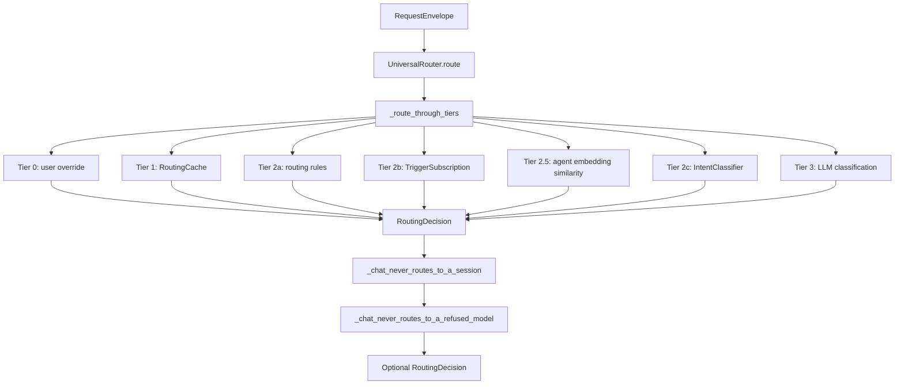
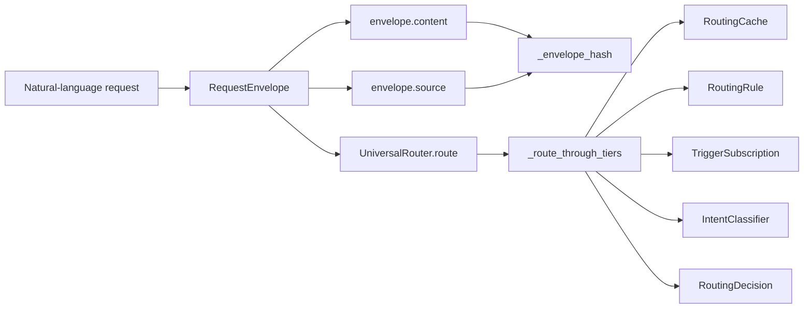
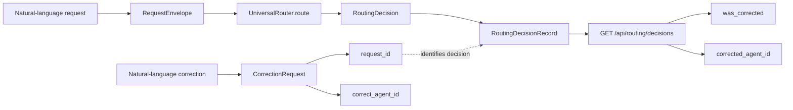

# Routing Corrections & Learning

Relevant source files

The following files were used as context for generating this wiki page:

- [orchestrator/api/routing.py](orchestrator/api/routing.py)
- [orchestrator/channels/base.py](orchestrator/channels/base.py)
- [orchestrator/channels/primitive_heartbeat.py](orchestrator/channels/primitive_heartbeat.py)
- [orchestrator/core/routing/engine.py](orchestrator/core/routing/engine.py)
- [orchestrator/core/security/workspace_scope.py](orchestrator/core/security/workspace_scope.py)
- [orchestrator/scripts/setup_jira_trigger.py](orchestrator/scripts/setup_jira_trigger.py)
- [orchestrator/tests/test_channel_adapter_contract.py](orchestrator/tests/test_channel_adapter_contract.py)
- [orchestrator/tests/test_f149_a_message_runs_only_its_own_workspaces_agents.py](orchestrator/tests/test_f149_a_message_runs_only_its_own_workspaces_agents.py)

## Purpose and scope

This page describes the routing-correction surfaces that are visible in the supplied code: how `UniversalRouter` resolves a request, how routing decisions can be inspected, and what the API’s correction payload contains. The available excerpts do not show the correction endpoint’s implementation or the internals of `RoutingCache`; they therefore do not establish that repeated corrections automatically update the cache or trigger semantic reindexing. [orchestrator/core/routing/engine.py:1-15](), [orchestrator/api/routing.py:1-6](), [orchestrator/api/routing.py:64-85]()

Sources: [orchestrator/core/routing/engine.py:1-15](), [orchestrator/api/routing.py:1-6](), [orchestrator/api/routing.py:64-85]()

---

## System overview

`UniversalRouter` routes a `RequestEnvelope` through ordered tiers that include explicit overrides, an optional `RoutingCache`, routing rules, trigger subscriptions, semantic similarity, intent classification, and LLM classification. Its public `route()` method then applies chat-specific guards to the resulting decision. [orchestrator/core/routing/engine.py:7-15](), [orchestrator/core/routing/engine.py:59-95]()

The routing API defines response and request schemas for decision inspection and corrections. The visible `CorrectionRequest` schema contains a `request_id` and `correct_agent_id`; the provided API excerpt does not show how a correction is handled after receipt. [orchestrator/api/routing.py:64-85]()

| Concern | Code symbol | Established behavior |
|---|---|---|
| Route resolution | `UniversalRouter.route()` | Runs the tier chain, then applies chat-specific routing guards. [orchestrator/core/routing/engine.py:80-95]() |
| Decision inspection | `list_decisions()` | Lists recent decisions and supports filters for source, routed agent, and correction status, plus pagination. [orchestrator/api/routing.py:107-155]() |
| Correction payload | `CorrectionRequest` | Defines `request_id` and `correct_agent_id`. [orchestrator/api/routing.py:82-85]() |
| Decision response | `DecisionResponse` | Includes decision routing fields and correction-related fields such as `was_corrected` and `corrected_agent_id`. [orchestrator/api/routing.py:64-79]() |

Sources: [orchestrator/core/routing/engine.py:59-95](), [orchestrator/api/routing.py:64-85](), [orchestrator/api/routing.py:107-155]()

---

## Routing decision flow

The router module documents the tier order. After `_route_through_tiers()` returns, `route()` applies `_chat_never_routes_to_a_session()` and `_chat_never_routes_to_a_refused_model()`. The guards are applied to the resulting decision, including a decision returned by an earlier tier such as the cache. [orchestrator/core/routing/engine.py:7-15](), [orchestrator/core/routing/engine.py:80-95]()

**Title: Request routing through code entities**

Sources: [orchestrator/core/routing/engine.py:7-15](), [orchestrator/core/routing/engine.py:80-95]()

---

## Decision inspection and correction request shape

`GET /api/routing/decisions` is implemented by `list_decisions()`. It orders records by creation time, accepts optional `source`, `agent_id`, and `was_corrected` filters, and paginates with `skip` and `limit`. The response includes the request ID, envelope hash, route type and target IDs, confidence, cache status, and correction status. [orchestrator/api/routing.py:64-79](), [orchestrator/api/routing.py:107-152]()

`CorrectionRequest` specifies `request_id` and `correct_agent_id`. The provided excerpt does not include a correction handler, so it does not establish how those fields are validated, persisted, or used to change future routing. [orchestrator/api/routing.py:82-85]()

| API/schema element | Fields or behavior |
|---|---|
| `DecisionResponse` | Includes `request_id`, `envelope_hash`, route target, confidence, `cached`, `was_corrected`, and `corrected_agent_id`. [orchestrator/api/routing.py:64-79]() |
| `CorrectionRequest` | Includes `request_id` and `correct_agent_id`. [orchestrator/api/routing.py:82-85]() |
| `list_decisions()` | Filters by source, agent ID, and correction status; supports `skip` and `limit`. [orchestrator/api/routing.py:111-135]() |

Sources: [orchestrator/api/routing.py:64-85](), [orchestrator/api/routing.py:107-155]()

---

## Cache learning and semantic reindexing: implementation boundary

The router documentation identifies `RoutingCache` as Tier 1 and semantic similarity as Tier 2.5. The shown constructor accepts an optional cache and initializes an `IntentClassifier`; the excerpt does not show cache internals or semantic-indexing code. [orchestrator/core/routing/engine.py:7-15](), [orchestrator/core/routing/engine.py:44-45](), [orchestrator/core/routing/engine.py:59-75]()

The visible correction schema alone does not establish repeated-correction counting, an automatic cache-update threshold, cache invalidation, or semantic reindexing. Those behaviors cannot be verified from the provided excerpts. [orchestrator/api/routing.py:82-85](), [orchestrator/core/routing/engine.py:7-15](), [orchestrator/core/routing/engine.py:44-45]()

| Learning-loop question | What the supplied code establishes |
|---|---|
| Can a correction identify a decision? | The request schema includes `request_id`. [orchestrator/api/routing.py:82-85]() |
| Can a correction specify a replacement agent? | The request schema includes `correct_agent_id`. [orchestrator/api/routing.py:82-85]() |
| Are correction outcomes exposed for inspection? | The decision response schema includes `was_corrected` and `corrected_agent_id`. [orchestrator/api/routing.py:64-79]() |
| Does a correction automatically update `RoutingCache`? | Not established by the provided excerpts. [orchestrator/api/routing.py:82-85](), [orchestrator/core/routing/engine.py:44-45]() |
| Does a correction trigger semantic reindexing? | Not established by the provided excerpts. [orchestrator/core/routing/engine.py:7-15]() |

Sources: [orchestrator/api/routing.py:64-85](), [orchestrator/core/routing/engine.py:7-15](), [orchestrator/core/routing/engine.py:44-45](), [orchestrator/core/routing/engine.py:59-75]()

---

## Natural-language request to routing code map

A request enters the routing API and engine as code-level objects: `RequestEnvelope` is resolved by `UniversalRouter.route()` into an optional `RoutingDecision`. The engine computes an envelope hash from normalized content and the source value for logging or deduplication. [orchestrator/core/routing/engine.py:53-56](), [orchestrator/core/routing/engine.py:80-95]()

**Title: Natural Language Space to Code Entity Space for route resolution**

Sources: [orchestrator/core/routing/engine.py:31-45](), [orchestrator/core/routing/engine.py:53-56](), [orchestrator/core/routing/engine.py:59-95]()

---

## Natural-language correction to decision-inspection map

The API schema maps a user correction to `CorrectionRequest(request_id, correct_agent_id)`. Decision inspection exposes `was_corrected` and `corrected_agent_id` through `DecisionResponse` and `list_decisions()`. The visible code establishes these names and data shapes, but not a state transition linking correction submission to a changed route. [orchestrator/api/routing.py:64-85](), [orchestrator/api/routing.py:107-152]()

**Title: Natural Language Space to Code Entity Space for corrections**

Sources: [orchestrator/core/routing/engine.py:80-95](), [orchestrator/api/routing.py:64-85](), [orchestrator/api/routing.py:107-152]()

---

## Workspace safety boundary

Routing targets are checked against the request workspace by `agent_in_workspace()` and `playbook_in_workspace()`. These checks fail closed for missing, invalid, or unreadable targets. `routing_target_error()` uses them to reject routing-rule targets that do not belong to the workspace. [orchestrator/core/security/workspace_scope.py:1-10](), [orchestrator/core/security/workspace_scope.py:21-43](), [orchestrator/core/security/workspace_scope.py:55-68]()

The routing API’s `create_rule()` checks that at least one target is supplied and calls `routing_target_error()` before creating a rule. The router’s public `route()` also applies post-resolution chat guards; workspace-scope tests verify that a route override for another workspace’s agent is dropped. [orchestrator/api/routing.py:163-194](), [orchestrator/core/routing/engine.py:80-95](), [orchestrator/tests/test_f149_a_message_runs_only_its_own_workspaces_agents.py:69-99]()

Sources: [orchestrator/api/routing.py:163-194](), [orchestrator/core/routing/engine.py:80-95](), [orchestrator/core/security/workspace_scope.py:1-10](), [orchestrator/core/security/workspace_scope.py:21-43](), [orchestrator/core/security/workspace_scope.py:55-68](), [orchestrator/tests/test_f149_a_message_runs_only_its_own_workspaces_agents.py:69-99]()

---

## Operational notes

- `list_decisions()` exposes correction-related fields and filters, but the provided API excerpt does not show the write path that sets them. [orchestrator/api/routing.py:64-79](), [orchestrator/api/routing.py:107-155]()
- The router documents cache and semantic similarity as distinct routing tiers; the provided lines do not establish automatic correction-driven cache updates or semantic reindexing. [orchestrator/core/routing/engine.py:7-15](), [orchestrator/core/routing/engine.py:44-45]()
- Routing-rule creation validates that a target belongs to the current workspace before saving the rule. [orchestrator/api/routing.py:163-194](), [orchestrator/core/security/workspace_scope.py:61-68]()
- Channel message handling routes through `UniversalRouter` and verifies that a selected agent belongs to the channel’s workspace before execution. [orchestrator/channels/base.py:114-166]()

Sources: [orchestrator/api/routing.py:64-79](), [orchestrator/api/routing.py:107-155](), [orchestrator/core/routing/engine.py:7-15](), [orchestrator/core/routing/engine.py:44-45](), [orchestrator/api/routing.py:163-194](), [orchestrator/core/security/workspace_scope.py:61-68](), [orchestrator/channels/base.py:114-166]()

---