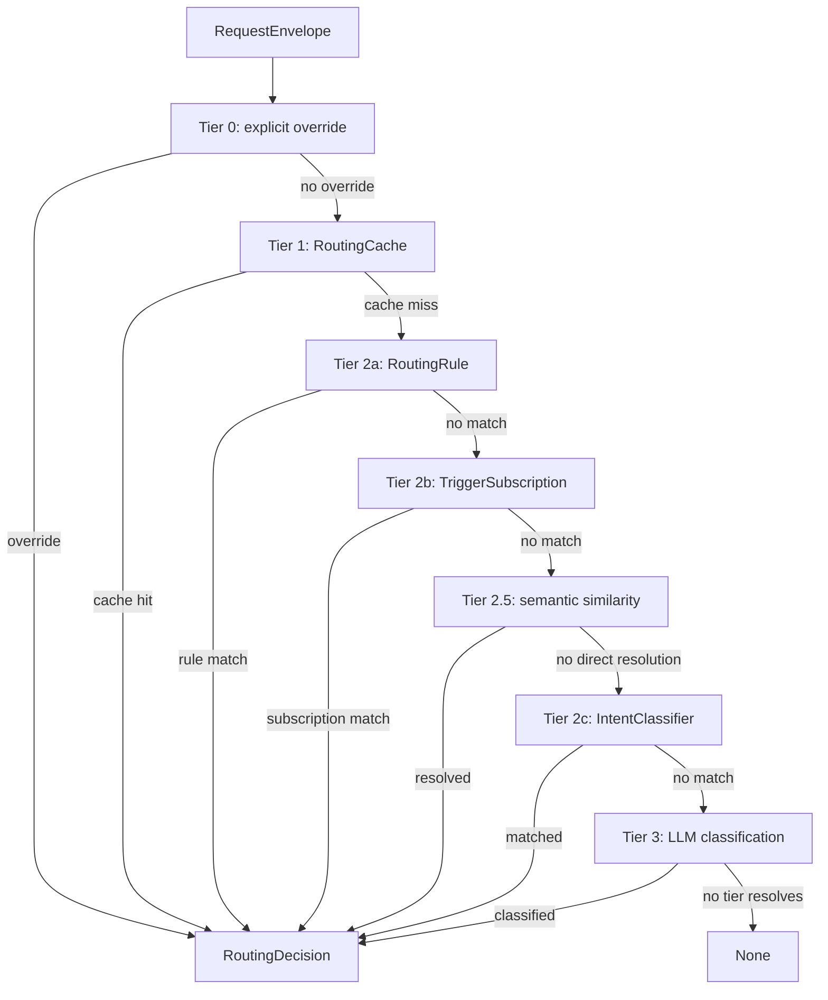
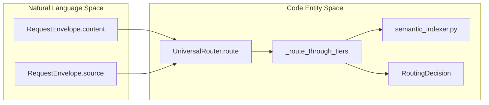
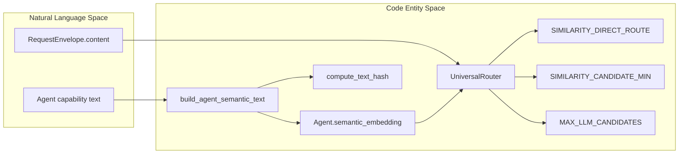
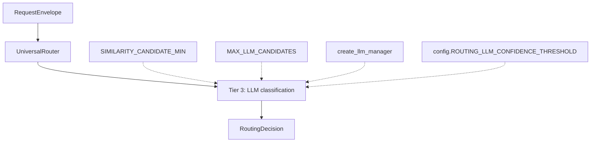
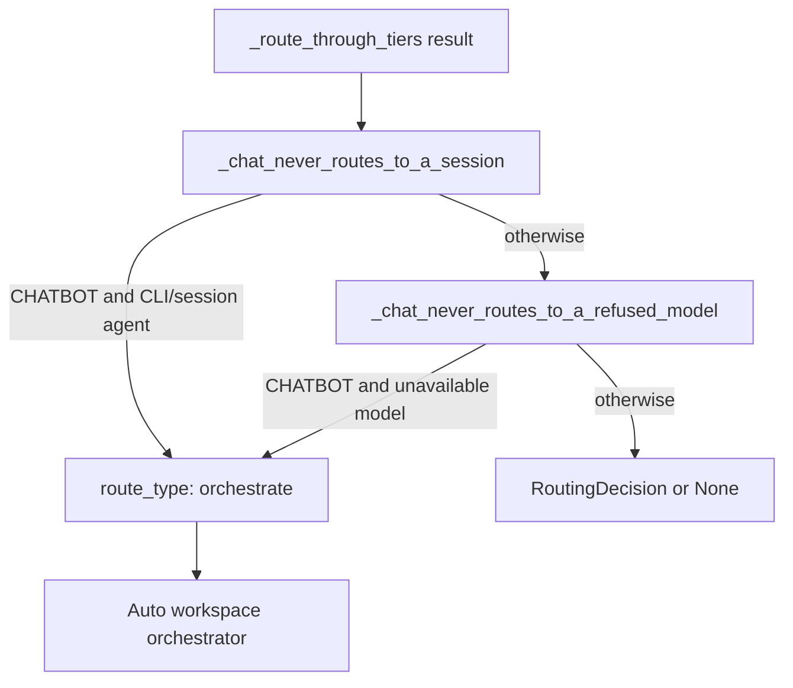

# Semantic & LLM Classification

Relevant source files

The following files were used as context for generating this wiki page:

- [docs/PRDS/67-CTO-AGENT-PLATFORM-BUILDER.md](docs/PRDS/67-CTO-AGENT-PLATFORM-BUILDER.md)
- [docs/PRDS/PRD-226-AUTO-MANAGER-DOCTRINE.md](docs/PRDS/PRD-226-AUTO-MANAGER-DOCTRINE.md)
- [docs/auto-cto-custom-soul.txt](docs/auto-cto-custom-soul.txt)
- [docs/auto-cto-soul.md](docs/auto-cto-soul.md)
- [orchestrator/alembic/versions/20260224_add_semantic_routing_columns.py](orchestrator/alembic/versions/20260224_add_semantic_routing_columns.py)
- [orchestrator/alembic/versions/20260225_create_marketplace_widgets.py](orchestrator/alembic/versions/20260225_create_marketplace_widgets.py)
- [orchestrator/alembic/versions/20260225_create_sdk_api_keys.py](orchestrator/alembic/versions/20260225_create_sdk_api_keys.py)
- [orchestrator/alembic/versions/20260225_create_widget_installs_reviews.py](orchestrator/alembic/versions/20260225_create_widget_installs_reviews.py)
- [orchestrator/alembic/versions/20260225_create_workspace_shares.py](orchestrator/alembic/versions/20260225_create_workspace_shares.py)
- [orchestrator/alembic/versions/20260226_add_cto_agent_columns.py](orchestrator/alembic/versions/20260226_add_cto_agent_columns.py)
- [orchestrator/alembic/versions/20260226_merge_heads_for_cto_agent.py](orchestrator/alembic/versions/20260226_merge_heads_for_cto_agent.py)
- [orchestrator/api/routing.py](orchestrator/api/routing.py)
- [orchestrator/channels/base.py](orchestrator/channels/base.py)
- [orchestrator/channels/primitive_heartbeat.py](orchestrator/channels/primitive_heartbeat.py)
- [orchestrator/consumers/chatbot/cto_prompt_builder.py](orchestrator/consumers/chatbot/cto_prompt_builder.py)
- [orchestrator/core/routing/engine.py](orchestrator/core/routing/engine.py)
- [orchestrator/core/routing/semantic_indexer.py](orchestrator/core/routing/semantic_indexer.py)
- [orchestrator/core/security/workspace_scope.py](orchestrator/core/security/workspace_scope.py)
- [orchestrator/core/seeds/auto-cto-custom-soul.txt](orchestrator/core/seeds/auto-cto-custom-soul.txt)
- [orchestrator/core/seeds/platform-management-skill.md](orchestrator/core/seeds/platform-management-skill.md)
- [orchestrator/core/seeds/seed_auto_agent.py](orchestrator/core/seeds/seed_auto_agent.py)
- [orchestrator/core/seeds/seed_cto_agent.py](orchestrator/core/seeds/seed_cto_agent.py)
- [orchestrator/modules/coordination/dispatch_contract.py](orchestrator/modules/coordination/dispatch_contract.py)
- [orchestrator/modules/tools/discovery/question_turns.py](orchestrator/modules/tools/discovery/question_turns.py)
- [orchestrator/scripts/setup_jira_trigger.py](orchestrator/scripts/setup_jira_trigger.py)
- [orchestrator/tests/test_channel_adapter_contract.py](orchestrator/tests/test_channel_adapter_contract.py)
- [orchestrator/tests/test_f149_a_message_runs_only_its_own_workspaces_agents.py](orchestrator/tests/test_f149_a_message_runs_only_its_own_workspaces_agents.py)
- [orchestrator/tests/test_f381_a_a_how_to_question_changes_nothing.py](orchestrator/tests/test_f381_a_a_how_to_question_changes_nothing.py)
- [orchestrator/tests/test_prd226_doctrine.py](orchestrator/tests/test_prd226_doctrine.py)
- [orchestrator/tests/test_prd263_persona_lift.py](orchestrator/tests/test_prd263_persona_lift.py)

## Purpose and Scope

This page documents the semantic and LLM-assisted classification stages of the `UniversalRouter`: Tier 2.5 agent-embedding similarity, Tier 3 LLM classification with semantic candidates, and the chat safety guards that can convert an agent route to `orchestrate`. The router’s tier list is documented in `engine.py`; the available `semantic_indexer.py` excerpt documents how agent text and embedding cache keys are built, but does not expose the full similarity-search or LLM-classification implementations. [orchestrator/core/routing/engine.py:1-15](), [orchestrator/core/routing/semantic_indexer.py:1-8]()

Sources: `orchestrator/core/routing/engine.py:1-15`, `orchestrator/core/routing/semantic_indexer.py:1-8`

---

## 1. Routing Tier Sequence & Architecture

`UniversalRouter` is constructed with a SQLAlchemy `Session` and an optional `RoutingCache`. Its public asynchronous `route()` method calls `_route_through_tiers()`, then applies two chat-specific guards before returning the resulting `RoutingDecision` or `None`. [orchestrator/core/routing/engine.py:59-95]()

The tier sequence declared by the router is:

| Tier | Strategy | Role in the declared sequence |
|---|---|---|
| 0 | User override | Explicit `agent_id` or `workflow_id` |
| 1 | Cache | `RoutingCache` lookup |
| 2a | Routing rules | Workspace rules matched by source pattern |
| 2b | Trigger subscriptions | `TriggerSubscription` handling for `jira_trigger` |
| 2.5 | Semantic similarity | Cosine similarity on agent embeddings |
| 2c | Intent classifier | Keyword matching against routing rules |
| 3 | LLM classification | Fallback classification, using semantic candidates when available |

The sequence and strategy descriptions are listed in the router module docstring. The public `route()` method delegates tier resolution to `_route_through_tiers()`; that method’s implementation is outside the supplied excerpt, so the exact internal branching and persistence behavior of each tier is not described here. [orchestrator/core/routing/engine.py:1-15](), [orchestrator/core/routing/engine.py:80-95]()

### Tier Chain Overview

**Diagram: Declared `UniversalRouter` tier sequence**

Sources: `orchestrator/core/routing/engine.py:1-15`, `orchestrator/core/routing/engine.py:80-95`

### Natural Language and Code-Entity Bridge

A request enters the router as a `RequestEnvelope`; the router’s declared tier chain includes semantic matching and LLM classification, and produces a `RoutingDecision` when it resolves the request. The diagram names the code entities that provide the semantic-indexing and decision surfaces. [orchestrator/core/routing/engine.py:1-15](), [orchestrator/core/routing/engine.py:35-43](), [orchestrator/core/routing/semantic_indexer.py:1-8]()

**Diagram: Request text to routing entities**

Sources: `orchestrator/core/routing/engine.py:35-43`, `orchestrator/core/routing/engine.py:80-95`, `orchestrator/core/routing/semantic_indexer.py:1-8`

---

## 2. Tier 2.5: Semantic Similarity on Agent Embeddings

Tier 2.5 is described as cosine similarity over agent embeddings. The semantic indexer constructs an agent capability text from identity and configuration fields, then uses an embedding model identifier and text hash to determine whether an embedding is current. [orchestrator/core/routing/engine.py:7-15](), [orchestrator/core/routing/semantic_indexer.py:1-8](), [orchestrator/core/routing/semantic_indexer.py:34-39](), [orchestrator/core/routing/semantic_indexer.py:144-172]()

### Agent Semantic Text

`build_agent_semantic_text(agent, db)` assembles a newline-separated text block from:

- Core identity: agent name, description, type, and marketplace category.
- Tags.
- Persona name and description, when available.
- The first 300 characters of a custom persona prompt when custom persona use is enabled.
- Skill names and descriptions.
- Active connected-app assignments, with cached app descriptions when present.
- Assigned marketplace plugins and their descriptions.

Optional persona, skill, app, and plugin data is guarded with exception handling; failures are logged at debug level rather than preventing the function from returning the text it could assemble. [orchestrator/core/routing/semantic_indexer.py:34-39](), [orchestrator/core/routing/semantic_indexer.py:42-79](), [orchestrator/core/routing/semantic_indexer.py:81-109](), [orchestrator/core/routing/semantic_indexer.py:111-127]()

### Embedding Cache and Candidate Thresholds

The semantic indexer declares three thresholds:

| Constant | Value | Meaning in the source |
|---|---:|---|
| `SIMILARITY_DIRECT_ROUTE` | `0.95` | Near-perfect matches are eligible for direct routing |
| `SIMILARITY_CANDIDATE_MIN` | `0.40` | Minimum similarity for inclusion in the Tier 3 candidate list |
| `MAX_LLM_CANDIDATES` | `5` | Maximum agents passed to Tier 3 |

These are constants in the supplied semantic-indexer excerpt; the excerpt does not include the search implementation that applies them. [orchestrator/core/routing/semantic_indexer.py:24-27]()

`_get_embedding_model_id()` obtains provider and model information from the centralized `EmbeddingManager`, falling back to `"unknown"` if it cannot retrieve that information. `compute_text_hash()` hashes the model identifier together with the semantic text, so a provider or model change changes the cache key. `_stale_semantic_text()` rebuilds the text and hash and returns `None` when a non-forced update finds a matching stored hash and an existing embedding. [orchestrator/core/routing/semantic_indexer.py:130-153](), [orchestrator/core/routing/semantic_indexer.py:160-172]()

`_store_embedding()` writes the vector and hash to the agent and commits the database session. The excerpt establishes this persistence operation, but does not show the embedding request or the full indexing/search lifecycle. [orchestrator/core/routing/semantic_indexer.py:175-181]()

### Natural Language and Code-Entity Bridge

The semantic text is assembled from fields on the `Agent` model and related records, while incoming request content is handled by the `UniversalRouter`. The router’s declared Tier 2.5 strategy connects these spaces through agent embeddings; the exact query-embedding and comparison call sites are not present in the supplied excerpts. [orchestrator/core/routing/engine.py:7-15](), [orchestrator/core/routing/semantic_indexer.py:1-8](), [orchestrator/core/routing/semantic_indexer.py:34-39]()

**Diagram: Agent capability fields to semantic-indexing entities**

Sources: `orchestrator/core/routing/engine.py:7-15`, `orchestrator/core/routing/engine.py:35-43`, `orchestrator/core/routing/semantic_indexer.py:24-27`, `orchestrator/core/routing/semantic_indexer.py:34-39`, `orchestrator/core/routing/semantic_indexer.py:144-181`

---

## 3. Tier 3: LLM Classification with Semantic Hints

The router declares Tier 3 as LLM classification fallback and notes that semantic candidates may be available to it. The semantic indexer’s constants define a candidate minimum and a maximum candidate count for Tier 3. The supplied excerpts do not show the complete Tier 3 prompt construction, model invocation, response parsing, or confidence decision logic, so those details cannot be specified from the available code. [orchestrator/core/routing/engine.py:7-15](), [orchestrator/core/routing/semantic_indexer.py:24-27]()

The router imports `create_llm_manager()` and reads `config.ROUTING_LLM_CONFIDENCE_THRESHOLD` into `_LLM_CONFIDENCE_THRESHOLD`. These lines establish the LLM-manager dependency and configured threshold symbol; the supplied excerpt does not establish exactly how either is used by the Tier 3 implementation. [orchestrator/core/routing/engine.py:27-48]()

**Diagram: Tier 3 declared inputs and code references**

Sources: `orchestrator/core/routing/engine.py:7-15`, `orchestrator/core/routing/engine.py:27-48`, `orchestrator/core/routing/semantic_indexer.py:24-27`

---

## 4. Orchestrate Mode & Chat Safety Guards

After `_route_through_tiers()` returns, `route()` applies `_chat_never_routes_to_a_session()` and then `_chat_never_routes_to_a_refused_model()`. Both guards are scoped to `ChannelSource.CHATBOT`; decisions for other sources pass through these chat-specific checks unchanged. [orchestrator/core/routing/engine.py:80-95](), [orchestrator/core/routing/engine.py:97-110](), [orchestrator/core/routing/engine.py:135-156]()

### Session-Agent Guard

`_chat_never_routes_to_a_session()` converts a chat decision targeting a CLI/session agent to a `RoutingDecision` with `route_type="orchestrate"` and no `agent_id`. The method’s documentation explains that session-agent work is handled through board-ticket/CLI-host execution rather than activation in the interactive LLM runtime. This guard applies to any tier’s decision, including a cached route, because it runs after tier resolution. [orchestrator/core/routing/engine.py:135-152]()

### Refused-Model Guard

`_chat_never_routes_to_a_refused_model()` checks agent routes for chat turns. It queries the agent’s name, configuration, and model configuration, then calls `unavailable_reason()` from `core.llm.model_refusals`. If the model is unavailable, the guard returns an `orchestrate` decision with no `agent_id`, preserving the original confidence and intent category and adding the reason to the routing explanation. If the lookup raises, the guard logs a warning and returns the original decision rather than failing routing. [orchestrator/core/routing/engine.py:97-133]()

The seeded per-workspace Auto agent is described as the workspace’s default chat agent and orchestrator, while the router guard changes the route type to `orchestrate` rather than selecting an agent ID. The supplied excerpts establish those separate roles but do not show the downstream consumer that executes an `orchestrate` decision. [orchestrator/core/seeds/seed_auto_agent.py:1-16](), [orchestrator/core/routing/engine.py:126-133]()

**Diagram: Chat safety guards and orchestrate routing**

Sources: `orchestrator/core/routing/engine.py:80-95`, `orchestrator/core/routing/engine.py:97-133`, `orchestrator/core/routing/engine.py:135-156`, `orchestrator/core/seeds/seed_auto_agent.py:1-16`

---