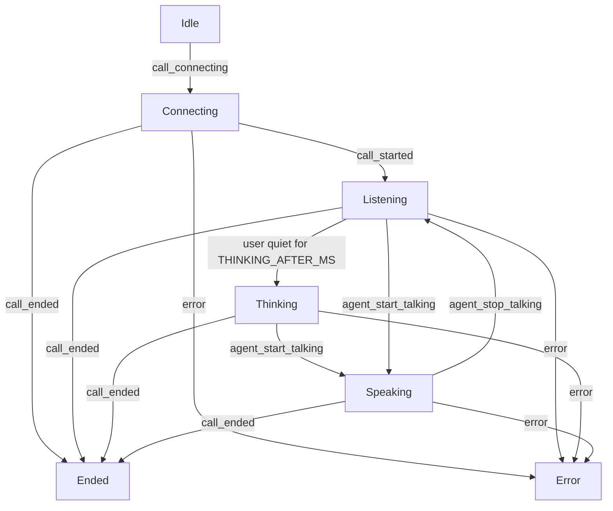
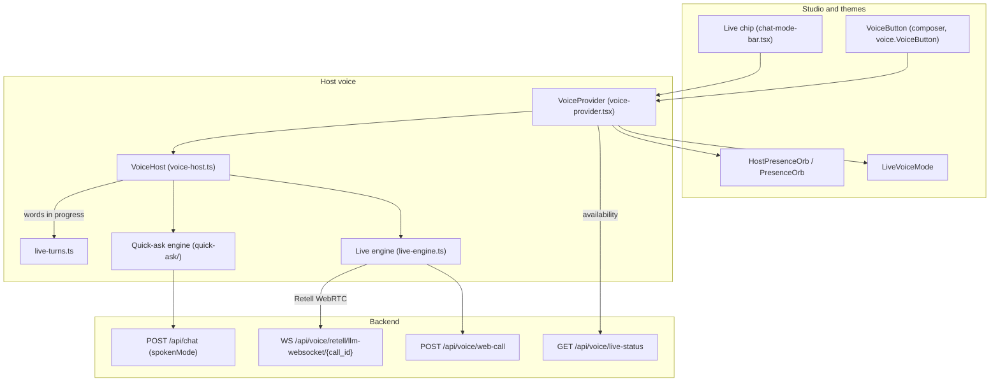

# Voice UI Components

Relevant source files

The following files were used as context for generating this wiki page:

- [frontend/app/chat/layout.tsx](../../frontend/app/chat/layout.tsx)
- [frontend/app/x/[...path]/page.tsx](../../frontend/app/x/[...path]/page.tsx)
- [frontend/components/chatbot/chat-mode-bar.tsx](../../frontend/components/chatbot/chat-mode-bar.tsx)
- [frontend/components/chatbot/chat.tsx](../../frontend/components/chatbot/chat.tsx)
- [frontend/components/chatbot/composer-actions.tsx](../../frontend/components/chatbot/composer-actions.tsx)
- [frontend/components/chatbot/composer-voice.tsx](../../frontend/components/chatbot/composer-voice.tsx)
- [frontend/components/voice/AiVoiceLabel.tsx](../../frontend/components/voice/AiVoiceLabel.tsx)
- [frontend/components/voice/LiveVoiceMode.tsx](../../frontend/components/voice/LiveVoiceMode.tsx)
- [frontend/components/voice/MicHealthControl.tsx](../../frontend/components/voice/MicHealthControl.tsx)
- [frontend/components/voice/PresenceOrb.tsx](../../frontend/components/voice/PresenceOrb.tsx)
- [frontend/components/voice/VoiceErrorBoundary.tsx](../../frontend/components/voice/VoiceErrorBoundary.tsx)
- [frontend/components/voice/host-presence-orb.tsx](../../frontend/components/voice/host-presence-orb.tsx)
- [frontend/components/voice/voice-button.tsx](../../frontend/components/voice/voice-button.tsx)
- [frontend/components/voice/voice-button-view.ts](../../frontend/components/voice/voice-button-view.ts)
- [frontend/components/voice/voice-controls.tsx](../../frontend/components/voice/voice-controls.tsx)
- [frontend/components/voice/voice-hotkey.ts](../../frontend/components/voice/voice-hotkey.ts)
- [frontend/components/voice/voice-press.ts](../../frontend/components/voice/voice-press.ts)
- [frontend/components/voice/voice-provider.tsx](../../frontend/components/voice/voice-provider.tsx)
- [frontend/lib/chat/live-voice-turns.ts](../../frontend/lib/chat/live-voice-turns.ts)
- [frontend/lib/theme-sdk/voice.ts](../../frontend/lib/theme-sdk/voice.ts)
- [frontend/lib/theme-sdk/host-cards/voice-button.tsx](../../frontend/lib/theme-sdk/host-cards/voice-button.tsx)
- [frontend/lib/voice/engine.ts](../../frontend/lib/voice/engine.ts)
- [frontend/lib/voice/support.ts](../../frontend/lib/voice/support.ts)
- [frontend/lib/voice/live-turns.ts](../../frontend/lib/voice/live-turns.ts)
- [frontend/lib/voice/mic-health.ts](../../frontend/lib/voice/mic-health.ts)
- [frontend/lib/voice/orb-state.ts](../../frontend/lib/voice/orb-state.ts)
- [frontend/lib/voice/host/availability.ts](../../frontend/lib/voice/host/availability.ts)
- [frontend/lib/voice/host/shared-host.ts](../../frontend/lib/voice/host/shared-host.ts)
- [frontend/lib/voice/host/voice-host.ts](../../frontend/lib/voice/host/voice-host.ts)
- [frontend/lib/voice/live/live-engine.ts](../../frontend/lib/voice/live/live-engine.ts)
- [frontend/lib/voice/live/refusal.ts](../../frontend/lib/voice/live/refusal.ts)
- [frontend/lib/voice/live/retell-call.ts](../../frontend/lib/voice/live/retell-call.ts)
- [frontend/lib/voice/quick-ask/create-engine.ts](../../frontend/lib/voice/quick-ask/create-engine.ts)
- [frontend/lib/voice/quick-ask/ai-notice.ts](../../frontend/lib/voice/quick-ask/ai-notice.ts)
- [frontend/lib/voice/quick-ask/config.ts](../../frontend/lib/voice/quick-ask/config.ts)
- [frontend/components/__tests__/prd207-live-voice.test.tsx](../../frontend/components/__tests__/prd207-live-voice.test.tsx)
- [frontend/components/voice/__tests__/voice-button.test.tsx](../../frontend/components/voice/__tests__/voice-button.test.tsx)
- [frontend/components/voice/__tests__/voice-provider.test.tsx](../../frontend/components/voice/__tests__/voice-provider.test.tsx)
- [frontend/lib/voice/live/__tests__/live-engine.test.ts](../../frontend/lib/voice/live/__tests__/live-engine.test.ts)
- [frontend/lib/voice/quick-ask/__tests__/quick-ask-engine.test.ts](../../frontend/lib/voice/quick-ask/__tests__/quick-ask-engine.test.ts)

This page covers the browser side of voice: the host voice provider and its two engines (Auto Live and quick ask),
the surfaces Studio draws from it, the voice button themes share, and the microphone and presence helpers. For what
the person using it sees, see the [Voice guide](../voice/_index.md).

## The host voice provider

`VoiceProvider` [frontend/components/voice/voice-provider.tsx](../../frontend/components/voice/voice-provider.tsx) holds the tab's one voice session. It is mounted
around the chat page's slot [frontend/app/chat/layout.tsx](../../frontend/app/chat/layout.tsx) and around a theme's routes
[frontend/app/x/[...path]/page.tsx](../../frontend/app/x/[...path]/page.tsx), so Studio's chat and a theme's screens read the same session through
`useHostVoice()` (or `useOptionalHostVoice()`, which answers null outside a provider).

The rules live outside React in `VoiceHost` [frontend/lib/voice/host/voice-host.ts](../../frontend/lib/voice/host/voice-host.ts):

- a start binds the session to the conversation on screen (null for a new chat), or to the one it names, and runs
  the engine asked for; starting the other engine stops the one running;
- a new chat takes the conversation the session names (the mint's `chat_id`, or quick ask's new chat), as a typed
  first message does;
- moving to another conversation ends the session;
- the session's words in progress go to the conversation they belong to [frontend/lib/voice/live-turns.ts](../../frontend/lib/voice/live-turns.ts), and
  every chat on the host's stream shows them as two live entries at the end of it
  [frontend/lib/chat/live-voice-turns.ts](../../frontend/lib/chat/live-voice-turns.ts). The saved rows arrive with `chat_changed` and replace them.

`availability.ts` [frontend/lib/voice/host/availability.ts](../../frontend/lib/voice/host/availability.ts) decides what the provider offers: Auto Live when
`GET /api/voice/live-status` says it can start and the browser can capture, quick ask when the browser has speech
recognition and speech synthesis [frontend/lib/voice/support.ts](../../frontend/lib/voice/support.ts). A start in `auto` mode picks Live when it can,
else quick ask. The mint stays the truth: asking for Live when it is unavailable still tries, and the refusal reaches
the member as a sentence [frontend/lib/voice/live/refusal.ts](../../frontend/lib/voice/live/refusal.ts).

Sources:
- [frontend/components/voice/voice-provider.tsx](../../frontend/components/voice/voice-provider.tsx)
- [frontend/lib/voice/host/voice-host.ts](../../frontend/lib/voice/host/voice-host.ts)
- [frontend/lib/voice/host/availability.ts](../../frontend/lib/voice/host/availability.ts)
- [frontend/lib/voice/live-turns.ts](../../frontend/lib/voice/live-turns.ts)

## The two engines

Both keep the contract in [frontend/lib/voice/engine.ts](../../frontend/lib/voice/engine.ts): `start`, `release` (hold-to-talk let go), `stop`, a
frozen `snapshot` (mode, phase, microphone open, muted, heard, reply, duration, error, conversation) and `levels()`
(the member's and Auto's, 0 to 1, read inside an animation frame without a render). Phases run
`connecting → listening → thinking → speaking`, with `ended` and `error`. Neither engine throws to its caller: a
failure is a plain sentence in `snapshot.error`.

### Auto Live

`live-engine.ts` [frontend/lib/voice/live/live-engine.ts](../../frontend/lib/voice/live/live-engine.ts) replaced the former `useRetellCall` hook. A start mints a
short-lived access token server-side (`POST /api/voice/web-call`; the Retell key never reaches the browser), then
Retell's WebRTC SDK, loaded on demand in one place [frontend/lib/voice/live/retell-call.ts](../../frontend/lib/voice/live/retell-call.ts), carries the audio both
ways and drives Auto's own agent loop through the custom-LLM socket. Retell's events walk the presence state machine
[frontend/lib/voice/orb-state.ts](../../frontend/lib/voice/orb-state.ts); a local analyser tap measures the microphone for the levels and for the
silent-capture check [frontend/lib/voice/mic-health.ts](../../frontend/lib/voice/mic-health.ts). The member can mute and pick the capture device, which is
kept across loads.

There is one Live engine per tab, so one Retell session per tab. Every call has a generation: `stop()` and a new
`start()` retire the old one, so a late answer or event of a retired call changes nothing.

### Quick ask

`createQuickAskEngine` [frontend/lib/voice/quick-ask/create-engine.ts](../../frontend/lib/voice/quick-ask/create-engine.ts) is hold-to-talk in the browser:

- the browser's speech recognition hears the member, with interim words in `snapshot.heard`;
- the release (or the browser's own end of speech, or 60 seconds of holding) sends the words as a normal
  `POST /api/chat` turn with `spokenMode`, through the app's own chat route as a typed turn goes;
- the streamed reply is cut into speakable sentences (no markdown, code, tables or URLs) and queued to
  `speechSynthesis`; a sentence over 200 characters is spoken in pieces;
- the AI notice, the backend's greeting, is spoken once per browser tab session before the first reply
  [frontend/lib/voice/quick-ask/ai-notice.ts](../../frontend/lib/voice/quick-ask/ai-notice.ts);
- "Auto, stop" (or "stop", "cancel", "stop it") as the whole utterance stops and sends nothing; a press while Auto
  speaks cancels the recognition, the speech and the streaming turn, on the server too;
- a hidden tab or an unloading page stops the microphone and the speech.

Sources:
- [frontend/lib/voice/engine.ts](../../frontend/lib/voice/engine.ts)
- [frontend/lib/voice/live/live-engine.ts](../../frontend/lib/voice/live/live-engine.ts)
- [frontend/lib/voice/quick-ask/create-engine.ts](../../frontend/lib/voice/quick-ask/create-engine.ts)
- [frontend/lib/voice/quick-ask/config.ts](../../frontend/lib/voice/quick-ask/config.ts)

## Studio's surfaces

| Surface | File | What it does |
|---|---|---|
| **Live chip** | [frontend/components/chatbot/chat-mode-bar.tsx](../../frontend/components/chatbot/chat-mode-bar.tsx) | In the mode bar under the chat box. Pressed while the tab's session is a live call; a press starts Auto Live on the conversation on screen or ends the call. Its title says why Live can't start, and a press still tries. |
| **Call strip** | [frontend/components/voice/LiveVoiceMode.tsx](../../frontend/components/voice/LiveVoiceMode.tsx) | Above the message box while the session is a live call: the "AI voice assistant" caption, the state and timer, the microphone state, mute, the device picker and End; a failure in plain words with Try again and Close. |
| **Presence wave** | [frontend/components/voice/host-presence-orb.tsx](../../frontend/components/voice/host-presence-orb.tsx) over [frontend/components/voice/PresenceOrb.tsx](../../frontend/components/voice/PresenceOrb.tsx) | The chat's full-bleed background while a session runs: the phase as its state, the engine's levels read each frame through a getter, never a render. |
| **Quick-ask button** | [frontend/components/chatbot/composer-voice.tsx](../../frontend/components/chatbot/composer-voice.tsx) | Beside Send in the composer's action row [frontend/components/chatbot/composer-actions.tsx](../../frontend/components/chatbot/composer-actions.tsx): the shared `VoiceButton` in quick mode, held, with no hotkey (Space types into the box). |

`chat.tsx` keeps no voice state of its own: it renders the strip and the wave, and the session's words reach its
messages through `useChatWithReceipts`.

Sources:
- [frontend/components/chatbot/chat-mode-bar.tsx](../../frontend/components/chatbot/chat-mode-bar.tsx)
- [frontend/components/voice/LiveVoiceMode.tsx](../../frontend/components/voice/LiveVoiceMode.tsx)
- [frontend/components/voice/host-presence-orb.tsx](../../frontend/components/voice/host-presence-orb.tsx)
- [frontend/components/chatbot/composer-voice.tsx](../../frontend/components/chatbot/composer-voice.tsx)

## The voice button

`VoiceButton` [frontend/components/voice/voice-button.tsx](../../frontend/components/voice/voice-button.tsx) is the one button Studio's composer and every theme use;
the theme SDK exports it as `voice.VoiceButton` [frontend/lib/theme-sdk/host-cards/voice-button.tsx](../../frontend/lib/theme-sdk/host-cards/voice-button.tsx), next to
`useVoice()` and `readVoiceLevels()` [frontend/lib/theme-sdk/voice.ts](../../frontend/lib/theme-sdk/voice.ts). Props: `mode` (`auto`, `quick`, `live`),
`press` (`hold`, `toggle`), `hotkey` (a `KeyboardEvent.code`, `Space` by default, or null), `size` and `label`.

- **The press** [frontend/components/voice/voice-press.ts](../../frontend/components/voice/voice-press.ts) is shared with the Live chip. Hold: pressing starts,
  letting go sends (Live ignores the release). A click no pointer made (a key on the focused button, a screen
  reader's activation) counts as a toggle, so hold-to-talk never shuts anyone out. A hold also ends when the window
  loses focus.
- **The hotkey** [frontend/components/voice/voice-hotkey.ts](../../frontend/components/voice/voice-hotkey.ts) presses the button from anywhere on the page, except
  while the member types or while focus is on another control the key would press.
- **While the session is the button's**, it draws the caption [frontend/components/voice/AiVoiceLabel.tsx](../../frontend/components/voice/AiVoiceLabel.tsx), the
  microphone state and timer, the stop control and, for a call, mute and the device picker
  [frontend/components/voice/voice-controls.tsx](../../frontend/components/voice/voice-controls.tsx), inside the protected surface `voice-control`, which no theme
  stylesheet can hide. It names the browser's microphone prompt while it waits, and shows a failure with Try again.
- **A theme styles it** by its data attributes (`data-voice-button`, `data-voice-state`, `data-voice-mode`,
  `data-voice-press`, `data-voice-size`, `data-voice-mic`) and the `--voice-button-*` custom properties
  [frontend/components/voice/voice-button-view.ts](../../frontend/components/voice/voice-button-view.ts). Outside a provider it is drawn disabled, saying voice isn't
  available on the page.

A theme never captures audio itself: the theme review flags `getUserMedia`, `SpeechRecognition` and
`speechSynthesis` in a theme's code as an error (`orchestrator/services/themes/audio_capture.py`).

Sources:
- [frontend/components/voice/voice-button.tsx](../../frontend/components/voice/voice-button.tsx)
- [frontend/components/voice/voice-press.ts](../../frontend/components/voice/voice-press.ts)
- [frontend/components/voice/voice-hotkey.ts](../../frontend/components/voice/voice-hotkey.ts)
- [frontend/lib/theme-sdk/voice.ts](../../frontend/lib/theme-sdk/voice.ts)

## MicHealthControl and mic-health

`mic-health.ts` [frontend/lib/voice/mic-health.ts](../../frontend/lib/voice/mic-health.ts) is a pure detector for a capture that delivers digital silence
(a dead or virtual device while the UI says "Mic live"): `feedMicLevel` folds each analyser reading in, any level at
or above `MIC_SILENT_PEAK` clears `silent` at once, and a full `MIC_SILENT_AFTER_MS` window below it raises it.
`MicHealthControl` [frontend/components/voice/MicHealthControl.tsx](../../frontend/components/voice/MicHealthControl.tsx) draws the result: `MicDevicePicker` to choose
the input device, and `MicSilentBanner`, which names the fault and offers another device. The Live engine feeds the
detector; the call strip and the voice button show the banner during a call.

Sources:
- [frontend/lib/voice/mic-health.ts](../../frontend/lib/voice/mic-health.ts)
- [frontend/components/voice/MicHealthControl.tsx](../../frontend/components/voice/MicHealthControl.tsx)
- [frontend/components/__tests__/prd207-live-voice.test.tsx](../../frontend/components/__tests__/prd207-live-voice.test.tsx)

## VoiceErrorBoundary

`VoiceErrorBoundary` [frontend/components/voice/VoiceErrorBoundary.tsx](../../frontend/components/voice/VoiceErrorBoundary.tsx) wraps each voice surface (the call strip,
the presence wave, the voice button). An exception inside is logged with the `[VoiceUI]` tag and the surface renders
nothing, so the chat beneath keeps working.

## Presence state flow

`orbReducer` [frontend/lib/voice/orb-state.ts](../../frontend/lib/voice/orb-state.ts) derives the Live call's phase from Retell's events. "Thinking" is
dead air: the member spoke, went quiet for `THINKING_AFTER_MS`, and Auto has not started talking.

## How the pieces connect

Sources:
- [frontend/lib/voice/orb-state.ts](../../frontend/lib/voice/orb-state.ts)
- [frontend/components/voice/voice-provider.tsx](../../frontend/components/voice/voice-provider.tsx)
- [frontend/lib/voice/host/voice-host.ts](../../frontend/lib/voice/host/voice-host.ts)
- [orchestrator/api/voice_retell.py](../../orchestrator/api/voice_retell.py)

---
