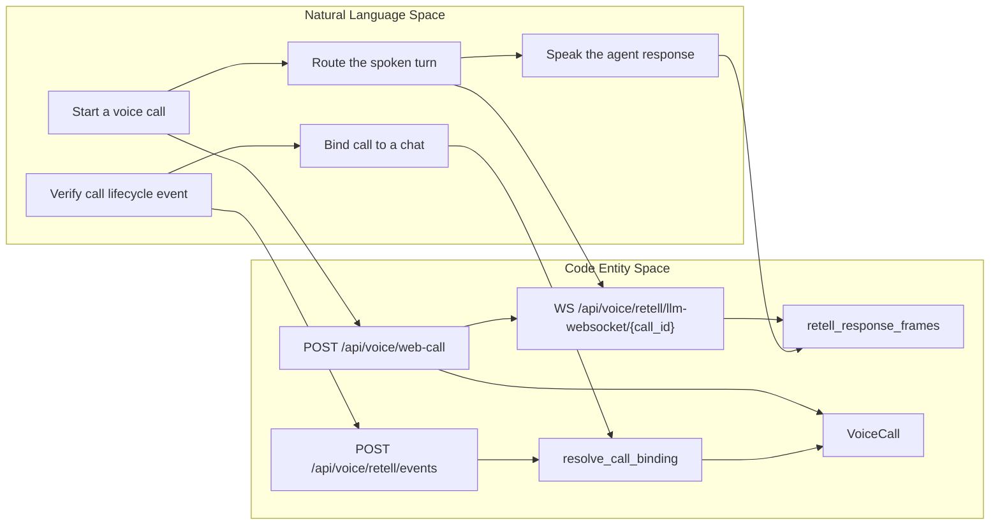
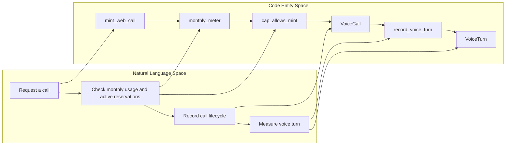

# Voice, Mobile & Auto Live

Relevant source files

The following files were used as context for generating this wiki page:

- [orchestrator/alembic/versions/prd203_voice_turns.py](orchestrator/alembic/versions/prd203_voice_turns.py)
- [orchestrator/alembic/versions/prd207_su_capture.py](orchestrator/alembic/versions/prd207_su_capture.py)
- [orchestrator/alembic/versions/prd207_voice_live.py](orchestrator/alembic/versions/prd207_voice_live.py)
- [orchestrator/api/voice_retell.py](orchestrator/api/voice_retell.py)
- [orchestrator/core/models/voice_calls.py](orchestrator/core/models/voice_calls.py)
- [orchestrator/core/models/voice_turns.py](orchestrator/core/models/voice_turns.py)
- [orchestrator/modules/voice/call_binding.py](orchestrator/modules/voice/call_binding.py)
- [orchestrator/modules/voice/live_settings.py](orchestrator/modules/voice/live_settings.py)
- [orchestrator/modules/voice/providers/retell.py](orchestrator/modules/voice/providers/retell.py)
- [orchestrator/modules/voice/retell_api.py](orchestrator/modules/voice/retell_api.py)
- [orchestrator/modules/voice/spoken_style.py](orchestrator/modules/voice/spoken_style.py)
- [orchestrator/modules/voice/telemetry.py](orchestrator/modules/voice/telemetry.py)
- [orchestrator/modules/voice/voice_meter.py](orchestrator/modules/voice/voice_meter.py)
- [orchestrator/tests/test_prd203_voice_retell.py](orchestrator/tests/test_prd203_voice_retell.py)
- [orchestrator/tests/test_prd207_voice_live.py](orchestrator/tests/test_prd207_voice_live.py)
- [orchestrator/tests/test_voice_quality.py](orchestrator/tests/test_voice_quality.py)

## Purpose & Scope

Section 24 introduces the real-time voice subsystem (PRD-203/207) and the Automatos Go mobile surface (PRD-266). Auto Live connects Retell’s voice transport to Automatos’ agent loop; the mobile surface is covered separately in the child page. This parent page maps the main components and their relationships without replacing the detailed implementation guides. [orchestrator/api/voice_retell.py:1-20]()

Sources: `orchestrator/api/voice_retell.py`

## 24.1 Voice Backend & Retell Provider

The voice backend covers call-session minting, Retell’s custom-LLM WebSocket, lifecycle webhooks, and call-to-chat binding. The `/api/voice/web-call` route checks eligibility and settings before creating a call; the resulting `voice_calls` row provides a server-side record used by later lifecycle and binding logic. [orchestrator/api/voice_retell.py:102-140](), [orchestrator/core/models/voice_calls.py:5-25]()

Retell handles speech transport, while the custom-LLM path streams Automatos agent output back as speech frames. Webhook authentication and call binding are separate checks: HMAC verifies the webhook signature, while `resolve_call_binding()` checks whether the call can safely be associated with a workspace, user, and chat. For details, see [Voice Backend & Retell Provider](#24.1). [orchestrator/modules/voice/providers/retell.py:5-19](), [orchestrator/modules/voice/call_binding.py:5-27]()

### Diagram: Auto Live Backend — Natural Language to Code Entities

Sources: `orchestrator/api/voice_retell.py:5-17`, `orchestrator/api/voice_retell.py:102-140`, `orchestrator/modules/voice/providers/retell.py:125-163`, `orchestrator/modules/voice/call_binding.py:157-175`, `orchestrator/core/models/voice_calls.py:42-79`

---

## 24.2 Voice UI & Mic Health

This child page covers the frontend voice experience, including call controls, presence rendering, and microphone-health behavior. The backend call mint returns a short-lived access token for the client to use when connecting; the provider adapter then streams response frames during the call. For UI and microphone details, see [Voice UI & Mic Health](#24.2). [orchestrator/api/voice_retell.py:108-118](), [orchestrator/modules/voice/providers/retell.py:125-141]()

Sources: `orchestrator/api/voice_retell.py`, `orchestrator/modules/voice/providers/retell.py`

---

## 24.3 Voice Metering & Telemetry

Auto Live’s call-level meter combines completed call duration with reservations for active calls. This prevents concurrent call mints from ignoring usage that has not yet been finalized. The `voice_calls` model stores call lifecycle data, while `voice_turns` records per-turn timing and quality fields; telemetry persistence is fire-and-forget so a recording failure does not fail the voice turn. For formulas, settings, and telemetry details, see [Voice Metering & Telemetry](#24.3). [orchestrator/modules/voice/voice_meter.py:5-23](), [orchestrator/core/models/voice_calls.py:5-19](), [orchestrator/modules/voice/telemetry.py:5-12]()

### Diagram: Metering and Turn Telemetry — Natural Language to Code Entities

Sources: `orchestrator/api/voice_retell.py:77-87`, `orchestrator/api/voice_retell.py:102-140`, `orchestrator/modules/voice/voice_meter.py:45-72`, `orchestrator/modules/voice/voice_meter.py:74-136`, `orchestrator/modules/voice/telemetry.py:70-117`, `orchestrator/core/models/voice_turns.py:35-85`

---

## 24.4 Mobile Devices, Pairing & Push (PRD-266)

Automatos Go is the mobile surface covered by this child page. Its detailed implementation topics include device models and migrations, pairing and device APIs, mobile device authentication, push delivery, and mobile theming. The supplied code excerpts do not include those mobile implementation files, so this parent page leaves their behavior to the child page rather than inferring details. For implementation specifics, see [Mobile Devices, Pairing & Push (PRD-266)](#24.4).

Sources: `orchestrator/api/voice_retell.py:1-20`

---