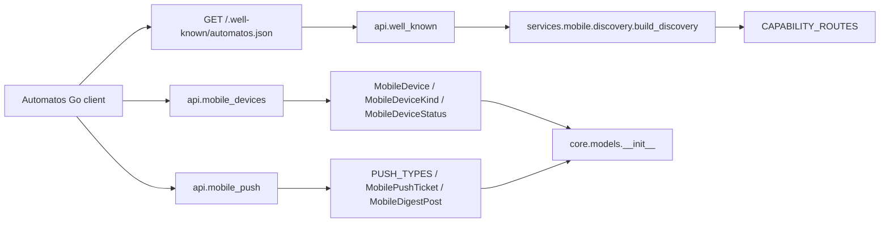
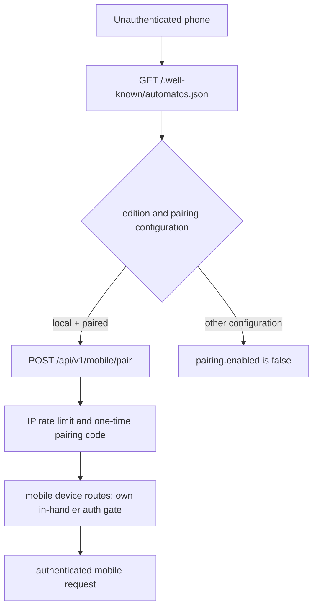
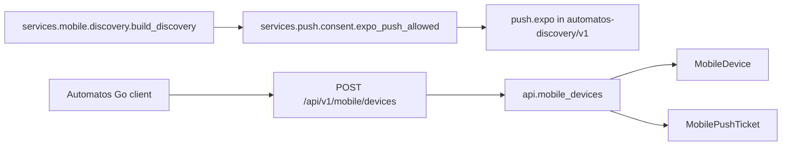

# Mobile Devices, Pairing & Push (PRD-266)

Relevant source files

The following files were used as context for generating this wiki page:

- [orchestrator/alembic/versions/prd263_harness_ledger_grants.py](orchestrator/alembic/versions/prd263_harness_ledger_grants.py)
- [orchestrator/alembic/versions/prd266_merge_heads.py](orchestrator/alembic/versions/prd266_merge_heads.py)
- [orchestrator/alembic/versions/prd266_mobile_devices.py](orchestrator/alembic/versions/prd266_mobile_devices.py)
- [orchestrator/api/mobile_push.py](orchestrator/api/mobile_push.py)
- [orchestrator/core/auth/device.py](orchestrator/core/auth/device.py)
- [orchestrator/core/models/__init__.py](orchestrator/core/models/__init__.py)
- [orchestrator/core/models/core.py](orchestrator/core/models/core.py)
- [orchestrator/core/models/harness.py](orchestrator/core/models/harness.py)
- [orchestrator/core/services/auto_cadence.py](orchestrator/core/services/auto_cadence.py)
- [orchestrator/router_manifest.py](orchestrator/router_manifest.py)
- [orchestrator/scripts/harness_backfill_runs.py](orchestrator/scripts/harness_backfill_runs.py)
- [orchestrator/services/mobile/digest_now.py](orchestrator/services/mobile/digest_now.py)
- [orchestrator/services/mobile/discovery.py](orchestrator/services/mobile/discovery.py)
- [orchestrator/services/themes/data/core-pages.json](orchestrator/services/themes/data/core-pages.json)
- [orchestrator/tests/authz_sweep_probe.py](orchestrator/tests/authz_sweep_probe.py)
- [orchestrator/tests/test_p2w2_authz_boundary_sweep.py](orchestrator/tests/test_p2w2_authz_boundary_sweep.py)
- [orchestrator/tests/test_prd209_alembic_single_head.py](orchestrator/tests/test_prd209_alembic_single_head.py)
- [orchestrator/tests/test_prd236_w1_routes.py](orchestrator/tests/test_prd236_w1_routes.py)
- [orchestrator/tests/test_prd263_harness_backfill_runs.py](orchestrator/tests/test_prd263_harness_backfill_runs.py)
- [orchestrator/tests/test_prd263_harness_history_runs.py](orchestrator/tests/test_prd263_harness_history_runs.py)
- [orchestrator/tests/test_prd263_harness_ledger_migration.py](orchestrator/tests/test_prd263_harness_ledger_migration.py)
- [orchestrator/tests/test_prd263_harness_review_cadence.py](orchestrator/tests/test_prd263_harness_review_cadence.py)
- [orchestrator/tests/test_prd266_device_lane.py](orchestrator/tests/test_prd266_device_lane.py)
- [orchestrator/tests/test_prd266_digest_now.py](orchestrator/tests/test_prd266_digest_now.py)
- [orchestrator/tests/test_prd266_discovery.py](orchestrator/tests/test_prd266_discovery.py)
- [orchestrator/tests/test_prd266_mobile_devices_model.py](orchestrator/tests/test_prd266_mobile_devices_model.py)
- [orchestrator/tests/test_prd266_mobile_devices_routes.py](orchestrator/tests/test_prd266_mobile_devices_routes.py)

## Purpose and scope

This page describes the Automatos Go mobile integration: server discovery, the SaaS and local authentication modes, the device and push model registration points, mobile API routing, and the documented mobile capabilities. The mobile model classes are exported through `core.models`, and the mobile routers are declared in the router mount manifest. The available implementation detail establishes discovery behavior and route registration; it does not expose the definitions of the device models, migrations, push fan-out implementation, or frontend pairing and theme components. [orchestrator/core/models/__init__.py:19-21]()

Sources: `orchestrator/core/models/__init__.py`; `orchestrator/router_manifest.py`; `orchestrator/services/mobile/discovery.py`

---

## 1. Scope & Core Architecture

Automatos Go’s backend surface includes the public discovery document, mobile device routes, and mobile push routes. The discovery service maps advertised capabilities to API routes and determines which capabilities to include based on server configuration. Its documented auth modes differ by edition: SaaS advertises Clerk; local advertises device authentication and enables pairing only when paired remote access is configured. [orchestrator/services/mobile/discovery.py:6-25]()

The model package exports `MobileDevice`, `MobileDeviceKind`, and `MobileDeviceStatus`, as well as `PUSH_TYPES`, `MobileDigestPost`, and `MobilePushTicket`. The router manifest registers `api.mobile_devices` and `api.mobile_push`; it separately registers `api.well_known` for discovery. [orchestrator/core/models/__init__.py:19-21](), [orchestrator/router_manifest.py:107-114]()

**Diagram: Mobile names mapped to backend entities**

The discovery service defines `CAPABILITY_ROUTES` as capability-name-to-method-and-path mappings. The model names are re-exported from `core.models`; the mobile routers are registered in `router_manifest.py`. [orchestrator/services/mobile/discovery.py:57-91](), [orchestrator/core/models/__init__.py:19-21](), [orchestrator/router_manifest.py:107-114]()

Sources: `orchestrator/services/mobile/discovery.py`; `orchestrator/core/models/__init__.py`; `orchestrator/router_manifest.py`

---

## 2. Database Models & Migrations

The model package imports and exposes the mobile device and push model symbols. The provided material identifies the Alembic migration filenames `prd266_mobile_devices.py` and `prd266_merge_heads.py`, but does not include their contents. Consequently, this page can identify the model export contract, but cannot safely specify columns, constraints, indexes, relationships, or migration operations. [orchestrator/core/models/__init__.py:19-21]()

| Model/export | Role established by available sources |
|---|---|
| `MobileDevice` | Mobile-device model exported by `core.models`. |
| `MobileDeviceKind` | Mobile-device kind symbol exported by `core.models`. |
| `MobileDeviceStatus` | Mobile-device status symbol exported by `core.models`. |
| `MobilePushTicket` | Mobile push-ticket model exported by `core.models`. |
| `MobileDigestPost` | Mobile digest-post model exported by `core.models`. |
| `PUSH_TYPES` | Push-type symbol exported alongside the push models. |

These are export-level descriptions only; the supplied model definitions are not available here. [orchestrator/core/models/__init__.py:19-21]()

Sources: `orchestrator/core/models/__init__.py`

### 2.1 MobileDevice & MobileDeviceKind Models

`core.models` imports `MobileDevice`, `MobileDeviceKind`, and `MobileDeviceStatus` from `core.models.mobile_devices`. The available sources do not show the model class definitions or establish token storage format, lifecycle values, or device ownership fields. [orchestrator/core/models/__init__.py:19-20]()

Sources: `orchestrator/core/models/__init__.py`

### 2.2 Mobile Push & Digest Models

`core.models` imports `PUSH_TYPES`, `MobileDigestPost`, and `MobilePushTicket` from `core.models.mobile_push`. The available source confirms these symbols are part of the model package’s public exports, but does not show their schema or persistence behavior. [orchestrator/core/models/__init__.py:21]()

Sources: `orchestrator/core/models/__init__.py`

---

## 3. Services Layer (`services/mobile`)

The documented `services.mobile.discovery` module builds the discovery document returned by `GET /.well-known/automatos.json`. It derives edition and pairing details from configuration, obtains URLs through `services.mobile.urls`, reads Expo push consent through `services.push.consent`, and conditionally advertises configured capabilities such as TTS, suggestion push, calibration, and turn timing. [orchestrator/services/mobile/discovery.py:1-25](), [orchestrator/services/mobile/discovery.py:39-45]()

The discovery capability map includes mobile push registration, digest preferences, an on-demand digest request, mobile theme retrieval, spoken mode, live voice, TTS, brief, suggestions, readiness, approval view, calibration, and turn timing (`turn_timing`, listed only while `CHAT_TURN_TIMING_ENABLED` is true: a phone then sends `turnRef` on a voice turn's chat and speech requests). The map is an advertisement contract: it associates capability names with route methods and paths. [orchestrator/services/mobile/discovery.py:57-98]()

| Component | Documented responsibility |
|---|---|
| `services.mobile.discovery` | Builds the public discovery response and advertises supported capabilities. |
| `services.mobile.urls` | Supplies `api_url` and `web_url` to discovery. |
| `services.mobile.remote_access` | Supplies the paired-mode constant used in discovery’s pairing decision. |
| `services.mobile.digest_now` | Identified as the implementation associated with the on-demand digest capability. |
| `services.push.consent` | Supplies the Expo push permission check used by discovery. |

Only the discovery-related responsibilities above are established by the available sources; implementation details for other mobile service modules are not included. [orchestrator/services/mobile/discovery.py:14-18](), [orchestrator/services/mobile/discovery.py:39-45](), [orchestrator/services/mobile/discovery.py:61-65]()

Sources: `orchestrator/services/mobile/discovery.py`

---

## 4. Authentication & Device Lane (`core/auth/device.py`)

The authZ sweep classifies `POST /api/v1/mobile/pair` as public by design. Its documented rationale is that a phone does not yet have an account and uses a one-time code minted by a workspace admin; the route is limited to local edition with paired remote access enabled and rate-limited per IP before the code is read. The sweep also identifies mobile device routes as having their own in-handler authentication gate rather than relying on the shared hybrid dependency. [orchestrator/tests/test_p2w2_authz_boundary_sweep.py:64-74](), [orchestrator/tests/authz_sweep_probe.py:101-109]()

The provided material names `core/auth/device.py` as the device-lane implementation, but does not include that file’s contents. Therefore, token prefix, hashing, lookup, context construction, and exact dependency/function names cannot be confirmed here.

**Diagram: Pairing and device auth boundary**

The discovery document advertises pairing only for local edition in paired mode. The pairing route’s public-by-design status and rate-limit/code checks are documented by the authZ sweep; the precise device-lane implementation is not present in the supplied file contents. [orchestrator/services/mobile/discovery.py:9-13](), [orchestrator/tests/test_p2w2_authz_boundary_sweep.py:69-74](), [orchestrator/tests/authz_sweep_probe.py:101-109]()

Sources: `orchestrator/services/mobile/discovery.py`; `orchestrator/tests/test_p2w2_authz_boundary_sweep.py`; `orchestrator/tests/authz_sweep_probe.py`

---

## 5. API Routers (`/api/mobile-devices` & `/api/mobile-push`)

The router manifest registers `api.mobile_devices` for the Automatos Go backend’s device discovery, pairing, and remote-access surface under `/api/v1/mobile/*`. It registers `api.mobile_push` for push consent and workspace push settings. The same manifest registers `api.well_known` for `GET /.well-known/automatos.json`. [orchestrator/router_manifest.py:107-114]()

The discovery capability map uses `/api/v1/mobile/devices` for the `push` capability and for `suggestion_push`; it maps `digest_now` to `POST /api/v1/mobile/digest/now`, and `mobile_theme` to `GET /api/themes/mobile/{install_id}`. These advertised paths are the route contract represented in the discovery service. [orchestrator/services/mobile/discovery.py:77-90]()

| Route surface | Documented purpose |
|---|---|
| `api.well_known` | Public server discovery document. |
| `api.mobile_devices` | Device discovery, pairing, and remote access under `/api/v1/mobile/*`. |
| `api.mobile_push` | Expo push consent and push settings surfaces. |
| `/api/v1/mobile/devices` | Advertised route for push registration and suggestion-push registration. |
| `/api/v1/mobile/digest/now` | Advertised on-demand digest route. |
| `/api/themes/mobile/{install_id}` | Advertised mobile theme route. |

The manifest and capability map establish these route names and purposes; the supplied contents do not include the router handler implementations or full endpoint inventory. [orchestrator/router_manifest.py:107-114](), [orchestrator/services/mobile/discovery.py:77-90]()

Sources: `orchestrator/router_manifest.py`; `orchestrator/services/mobile/discovery.py`

### 5.1 Discovery Endpoint (`/.well-known/automatos.json`)

The discovery schema identifier is `automatos-discovery/v1`. `build_discovery` returns the server name, edition, API and web URLs, authentication configuration, pairing state, Expo push state, and capabilities. It is designed to be available before sign-in. [orchestrator/services/mobile/discovery.py:1-5](), [orchestrator/services/mobile/discovery.py:47-55]()

For SaaS, discovery advertises Clerk authentication and a Clerk publishable key with its decoded frontend API host. For local installations, it advertises device authentication, sets Clerk information to null, and enables pairing only when `LOCAL_REMOTE_ACCESS` is paired. The service does not emit an OIDC mode in this build. [orchestrator/services/mobile/discovery.py:6-13]()

`api_url` and `web_url` come from `services.mobile.urls`. The discovery service reads the current Expo push consent state and configuration-dependent capabilities when building the response. [orchestrator/services/mobile/discovery.py:14-25](), [orchestrator/services/mobile/discovery.py:39-45]()

Sources: `orchestrator/services/mobile/discovery.py`

### 5.2 Mobile Devices Router (`api.mobile_devices`)

The router manifest describes `api.mobile_devices` as the Automatos Go backend for device discovery, pairing, and remote access under `/api/v1/mobile/*`. The authZ boundary test records `POST /api/v1/mobile/pair` as public by design, restricted to the local paired-device configuration and rate-limited per IP before code lookup. [orchestrator/router_manifest.py:107-109](), [orchestrator/tests/test_p2w2_authz_boundary_sweep.py:69-74]()

Sources: `orchestrator/router_manifest.py`; `orchestrator/tests/test_p2w2_authz_boundary_sweep.py`

### 5.3 Mobile Push Router (`api.mobile_push`)

The router manifest describes `api.mobile_push` as covering the operator’s Expo push-consent answer (local only) and workspace push-question redaction. The discovery capability map advertises `/api/v1/mobile/devices` for push registration and `/api/v1/mobile/digest/now` for an on-demand digest request. [orchestrator/router_manifest.py:110-112](), [orchestrator/services/mobile/discovery.py:77-90]()

Sources: `orchestrator/router_manifest.py`; `orchestrator/services/mobile/discovery.py`

---

## 6. Push Notification Subsystem (`services/push`)

The available sources establish that discovery reports whether the server sends notifications through Expo. This state is always enabled on SaaS and, on local installations, depends on the operator’s stored consent. The discovery service obtains that state using `services.push.consent.expo_push_allowed`. [orchestrator/services/mobile/discovery.py:16-18](), [orchestrator/services/mobile/discovery.py:39-45]()

The available material does not include the implementation of Expo delivery, notification fan-out, batching, ticket updates, quiet-hour filtering, or notification preference evaluation. Those behaviors cannot be specified from the supplied file contents.

**Diagram: Push capability and consent mapping**

Discovery reads Expo consent and reports it in `push.expo`; the capability map advertises `/api/v1/mobile/devices` for push registration. The model package exports `MobileDevice` and `MobilePushTicket`. The delivery/fan-out path is not shown in the supplied files. [orchestrator/services/mobile/discovery.py:16-18](), [orchestrator/services/mobile/discovery.py:77-88](), [orchestrator/core/models/__init__.py:20-21]()

Sources: `orchestrator/services/mobile/discovery.py`; `orchestrator/core/models/__init__.py`

---

## 7. Frontend Hooks, Panels & Mobile Theming

The provided source material does not include the frontend implementation of device-management hooks, the `go-pair` panel, or mobile theme rendering. Those UI details cannot be verified here.

The backend discovery contract does advertise `mobile_theme` as a capability mapped to `GET /api/themes/mobile/{install_id}`. Its documented intent is to provide the member’s installed theme as data for the phone, including colors, fonts, and mascot files rather than executable code. [orchestrator/services/mobile/discovery.py:64-65](), [orchestrator/services/mobile/discovery.py:77-90]()

The discovery service’s capability list is the mechanism by which the app can gate features on server support. It notes that mobile theme is offered under Studio only when that capability is listed. [orchestrator/services/mobile/discovery.py:19-25](), [orchestrator/services/mobile/discovery.py:64-65]()

Sources: `orchestrator/services/mobile/discovery.py`

---

## Sources

- `orchestrator/core/models/__init__.py:19-21`()
- `orchestrator/router_manifest.py:107-114`()
- `orchestrator/services/mobile/discovery.py:1-25`()
- `orchestrator/services/mobile/discovery.py:39-45`()
- `orchestrator/services/mobile/discovery.py:47-55`()
- `orchestrator/services/mobile/discovery.py:57-98`()
- `orchestrator/tests/test_p2w2_authz_boundary_sweep.py:64-74`()
- `orchestrator/tests/authz_sweep_probe.py:101-109`()

---