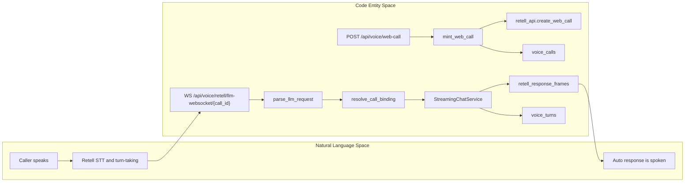
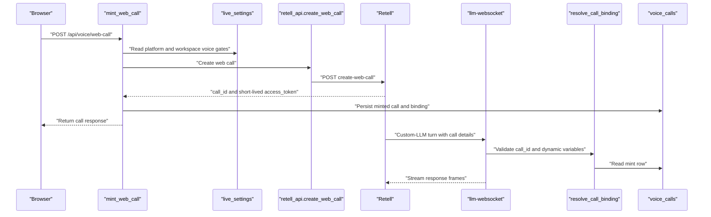
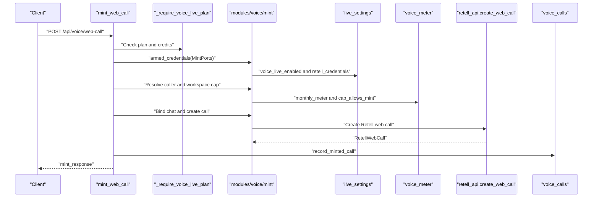

# Voice Backend & Retell Provider

Relevant source files

The following files were used as context for generating this wiki page:

- [orchestrator/alembic/versions/prd203_voice_turns.py](orchestrator/alembic/versions/prd203_voice_turns.py)
- [orchestrator/alembic/versions/prd207_su_capture.py](orchestrator/alembic/versions/prd207_su_capture.py)
- [orchestrator/alembic/versions/prd207_voice_live.py](orchestrator/alembic/versions/prd207_voice_live.py)
- [orchestrator/api/voice_retell.py](orchestrator/api/voice_retell.py)
- [orchestrator/core/models/voice_calls.py](orchestrator/core/models/voice_calls.py)
- [orchestrator/core/models/voice_turns.py](orchestrator/core/models/voice_turns.py)
- [orchestrator/modules/voice/call_binding.py](orchestrator/modules/voice/call_binding.py)
- [orchestrator/modules/voice/live_settings.py](orchestrator/modules/voice/live_settings.py)
- [orchestrator/modules/voice/providers/retell.py](orchestrator/modules/voice/providers/retell.py)
- [orchestrator/modules/voice/retell_api.py](orchestrator/modules/voice/retell_api.py)
- [orchestrator/modules/voice/spoken_style.py](orchestrator/modules/voice/spoken_style.py)
- [orchestrator/modules/voice/telemetry.py](orchestrator/modules/voice/telemetry.py)
- [orchestrator/modules/voice/voice_meter.py](orchestrator/modules/voice/voice_meter.py)
- [orchestrator/tests/test_prd203_voice_retell.py](orchestrator/tests/test_prd203_voice_retell.py)
- [orchestrator/tests/test_prd207_voice_live.py](orchestrator/tests/test_prd207_voice_live.py)
- [orchestrator/tests/test_voice_quality.py](orchestrator/tests/test_voice_quality.py)

## Purpose and Scope

This page documents the backend live-voice path: the `mint_web_call` gates, the server-side Retell REST client, inbound webhook verification and call binding, the `voice_calls` and `voice_turns` persistence models, and the boundary between live Retell speech and the separate `voice-tts` service. Retell handles live-call audio transport and speech processing; Automatos routes recognized turns through its own agent loop and streams text responses back to Retell [orchestrator/api/voice_retell.py:1-20](), [orchestrator/modules/voice/providers/retell.py:1-22]().

Sources: [orchestrator/api/voice_retell.py:1-20](), [orchestrator/modules/voice/providers/retell.py:1-22]()

## 1. Voice Architecture & Subsystem Overview

The live path has two distinct flows: the browser obtains a short-lived call token from the authenticated mint endpoint, while Retell connects to Automatos over the custom-LLM WebSocket and separately sends call-lifecycle events to the events endpoint. The mint-created `voice_calls` row is the server-side link between a Retell `call_id` and the workspace, user, and chat [orchestrator/api/voice_retell.py:5-17](), [orchestrator/core/models/voice_calls.py:7-19]().

The backend adapter parses Retell turn requests, validates binding against the mint row, and streams the Automatos agent’s response as Retell frames. The adapter’s response framing is progressive rather than waiting for the full agent stream [orchestrator/modules/voice/providers/retell.py:71-107](), [orchestrator/modules/voice/providers/retell.py:125-141]().

| Component | Responsibility |
|---|---|
| `POST /api/voice/web-call` | Authenticated call mint; records a `minted` call row before returning the client response [orchestrator/api/voice_retell.py:102-140](). |
| `modules/voice/retell_api.py` | Server-side Retell REST integration, including web-call payload construction [orchestrator/modules/voice/retell_api.py:1-11](). |
| `WS /api/voice/retell/llm-websocket/{call_id}` | Retell custom-LLM transport for Automatos agent responses [orchestrator/api/voice_retell.py:5-10](). |
| `POST /api/voice/retell/events` | Lifecycle webhook and call-meter write path; the route is described as HMAC fail-closed [orchestrator/api/voice_retell.py:14-17](). |
| `modules/voice/call_binding.py` | Resolves a turn to a proven chat and user, or a per-call fallback thread [orchestrator/modules/voice/call_binding.py:5-27](). |
| `VoiceCall` | Per-call mint registry and lifecycle/metering record [orchestrator/core/models/voice_calls.py:7-25](). |
| `VoiceTurn` | Append-only per-turn latency and delivery telemetry [orchestrator/core/models/voice_turns.py:5-23](). |

### Diagram: Natural Language Space to Code Entity Space

Sources: [orchestrator/api/voice_retell.py:5-17](), [orchestrator/api/voice_retell.py:102-140](), [orchestrator/modules/voice/providers/retell.py:71-107](), [orchestrator/modules/voice/providers/retell.py:125-141](), [orchestrator/modules/voice/call_binding.py:5-27](), [orchestrator/core/models/voice_calls.py:7-19](), [orchestrator/core/models/voice_turns.py:5-23]()

### Diagram: Retell Session and Lifecycle Trust Boundaries

Sources: [orchestrator/api/voice_retell.py:102-140](), [orchestrator/modules/voice/retell_api.py:26-43](), [orchestrator/modules/voice/call_binding.py:5-27](), [orchestrator/core/models/voice_calls.py:7-19]()

## 2. Session Minting & Fail-Closed Gates (`mint_web_call`)

`POST /api/voice/web-call` is protected by `_require_voice_live_plan`, which delegates to `mint.require_voice_live_plan` and translates a `MintRefused` into an HTTP error. The route then assembles `MintPorts` so the mint logic obtains settings, credentials, meter readings, and the Retell call-creation function through late-bound dependencies [orchestrator/api/voice_retell.py:77-100](), [orchestrator/api/voice_retell.py:102-107]().

The route’s order is significant: it obtains armed credentials, strictly resolves the caller to an integer user ID, checks workspace voice availability and cap through the mint helpers, binds the requested chat, creates the Retell call, then persists the minted row. A missing user is explicitly refused with 403. Only the returned mint response is sent to the client; the route documentation states the Retell API key does not reach the browser and the access token is short-lived [orchestrator/api/voice_retell.py:108-140]().

| Gate or operation | Code path | Effect |
|---|---|---|
| SaaS plan and credits | `_require_voice_live_plan` → `mint.require_voice_live_plan` | Converts mint refusal to the corresponding HTTP status [orchestrator/api/voice_retell.py:90-100](). |
| Platform switch and credentials | `_mint_ports` → `live_settings.voice_live_enabled`, `live_settings.retell_credentials` | Supplies the global enablement and Retell credentials to mint logic [orchestrator/api/voice_retell.py:77-87](). |
| Caller identity | `_resolve_caller_int_id` | Rejects a caller that cannot resolve to a real user [orchestrator/api/voice_retell.py:120-128](). |
| Workspace settings and cap | `mint.workspace_voice_within_cap` | Checks workspace voice settings and the meter before call creation [orchestrator/api/voice_retell.py:128-135](). |
| Chat binding | `mint.bind_chat` | Resolves the requested on-screen chat for the authenticated workspace and user [orchestrator/api/voice_retell.py:129-134](). |
| Call creation and registry | `mint.create_call` → `mint.record_minted_call` | Creates the vendor call, then records the `minted` row [orchestrator/api/voice_retell.py:135-140](). |

The monthly cap includes both ended usage and reservations for active calls. `cap_allows_mint` refuses when `ended_minutes + active_calls × reserve_minutes_per_call` reaches the cap. The meter counts recent `minted` and `started` rows as active, with stale thresholds to avoid reserving capacity indefinitely [orchestrator/modules/voice/voice_meter.py:8-23](), [orchestrator/modules/voice/voice_meter.py:45-71](), [orchestrator/modules/voice/voice_meter.py:74-136]().

### Diagram: Mint Gate Sequence

Sources: [orchestrator/api/voice_retell.py:77-100](), [orchestrator/api/voice_retell.py:102-140](), [orchestrator/modules/voice/voice_meter.py:60-71]()

## 3. Retell REST Client & Agent Tuning (`retell_api.py`)

`modules/voice/retell_api.py` is the server-side REST boundary to Retell. The API key is obtained through masked system settings rather than environment configuration or the browser. The create-web-call endpoint is the v2 URL; the module also declares Retell agent and call-read URLs [orchestrator/modules/voice/retell_api.py:1-11](), [orchestrator/modules/voice/retell_api.py:26-35]().

`build_agent_endpoints(host)` constructs the custom-LLM WebSocket URL and lifecycle webhook URL from a bare public host, rejecting an empty host or one containing a scheme or path. `build_agent_tuning()` builds Retell tuning from configuration, including interruption, responsiveness, speech normalization, reminder, language, denoising, STT, and optional voice parameters [orchestrator/modules/voice/retell_api.py:37-109]().

The `RetellWebCall` value carries the call ID and access token, plus optional transport details. Transport fields are filtered by expected type; invalid values are dropped and logged without logging the field contents [orchestrator/modules/voice/retell_api.py:116-158]().

| Client element | Role |
|---|---|
| `RETELL_CREATE_WEB_CALL_URL` | v2 create-web-call endpoint [orchestrator/modules/voice/retell_api.py:26-28](). |
| `build_agent_endpoints` | Validates host input and returns custom-LLM and events endpoints [orchestrator/modules/voice/retell_api.py:46-63](). |
| `build_agent_tuning` | Produces configuration-driven hearing and voice settings [orchestrator/modules/voice/retell_api.py:66-109](). |
| `RetellWebCall` | Typed representation of the call ID, token, and optional transport fields [orchestrator/modules/voice/retell_api.py:127-143](). |
| `RETELL_TRANSPORT_FIELD_TYPES` | Whitelist of supported transport response fields and expected types [orchestrator/modules/voice/retell_api.py:116-124](). |

Sources: [orchestrator/modules/voice/retell_api.py:1-11](), [orchestrator/modules/voice/retell_api.py:26-63](), [orchestrator/modules/voice/retell_api.py:66-109](), [orchestrator/modules/voice/retell_api.py:116-158]()

## 4. Webhook Verification & Custom-LLM Transport (`modules/voice/providers/retell.py`)

The Retell provider adapter defines parsing, response framing, and webhook-signature verification as transport concerns. `parse_llm_request` reads the latest user entry in Retell’s transcript and extracts `workspace_id`, `agent_id`, `call_id`, `user_id`, and `chat_id` from `call.retell_llm_dynamic_variables` [orchestrator/modules/voice/providers/retell.py:15-20](), [orchestrator/modules/voice/providers/retell.py:54-69](), [orchestrator/modules/voice/providers/retell.py:71-107]().

The HMAC check is fail-closed. The tests document Retell’s signature format as `v={ts_ms},d=HMAC(body + timestamp).hexdigest()` and verify the timestamp freshness window; the route module identifies the lifecycle webhook as HMAC fail-closed as well [orchestrator/tests/test_prd203_voice_retell.py:167-178](), [orchestrator/api/voice_retell.py:14-17]().

`retell_response_frames` extracts AI SDK text frames and emits Retell response frames incrementally. It groups output into speech units so formatting that spans stream chunks can be sanitized; it emits a terminal `content_complete` frame to close the turn. The adapter also defines WebSocket interaction types, including `call_details`, `update_only`, and `ping_pong` [orchestrator/modules/voice/providers/retell.py:38-51](), [orchestrator/modules/voice/providers/retell.py:110-141](). The tests exercise the first-frame-before-agent-completion property [orchestrator/tests/test_prd203_voice_retell.py:30-70]().

Sources: [orchestrator/modules/voice/providers/retell.py:15-20](), [orchestrator/modules/voice/providers/retell.py:38-51](), [orchestrator/modules/voice/providers/retell.py:71-107](), [orchestrator/modules/voice/providers/retell.py:110-141](), [orchestrator/tests/test_prd203_voice_retell.py:30-70](), [orchestrator/tests/test_prd203_voice_retell.py:167-178]()

## 5. Call Binding & Conversation Continuity (`call_binding.py`)

HMAC authentication establishes that a webhook came through Retell, but does not authorize its dynamic variables. `resolve_call_binding` uses the mint row as the trust anchor: the workspace variable must match the row, and the chat/user values must be consistent with the row and a chat that still belongs to that workspace and user. Workspace mismatch refuses the turn; chat or user mismatch falls back to a per-call chat attributed to the mint-proven user [orchestrator/modules/voice/call_binding.py:5-18](), [orchestrator/modules/voice/call_binding.py:157-170]().

For calls without a mint row, the phone lane uses the workspace steward as the user attribution. The fallback chat ID is stored on `voice_calls.fallback_chat_id`, so later turns for the same call can reuse the thread. `CallBinding` carries the selected chat, user, proven workspace, bound status, and captured super-admin flag [orchestrator/modules/voice/call_binding.py:20-27](), [orchestrator/modules/voice/call_binding.py:68-77](), [orchestrator/modules/voice/call_binding.py:79-97](), [orchestrator/core/models/voice_calls.py:60-65]().

Voice provenance is represented by `voice_source(role)`, which returns a `messages.source` document with `origin: voice` and a role-specific label. The module describes post-stream assistant stamping as bounded to messages created during that turn, to avoid labeling an interleaved text response as voice [orchestrator/modules/voice/call_binding.py:24-27](), [orchestrator/modules/voice/call_binding.py:43-55]().

Sources: [orchestrator/modules/voice/call_binding.py:5-27](), [orchestrator/modules/voice/call_binding.py:43-77](), [orchestrator/modules/voice/call_binding.py:79-97](), [orchestrator/modules/voice/call_binding.py:157-170](), [orchestrator/core/models/voice_calls.py:60-65]()

## 6. Voice Call and Voice Turn Models

The subsystem separates call lifecycle and billing grain from per-turn quality and latency telemetry. `VoiceCall` stores one row per call; `VoiceTurn` stores append-only measurements per voice turn [orchestrator/core/models/voice_calls.py:5-25](), [orchestrator/core/models/voice_turns.py:5-23]().

### 6.1. `VoiceCall` Model

`VoiceCall` maps to `voice_calls` and uses Retell’s `call_id` as its unique join key. The row is created at mint time and records the workspace, user, bound chat, fallback chat, lifecycle status, timestamps, duration, disconnect reason, and optional vendor latency data [orchestrator/core/models/voice_calls.py:42-48](), [orchestrator/core/models/voice_calls.py:50-84]().

| Field | Purpose |
|---|---|
| `call_id`, `provider` | Retell call identifier and provider name [orchestrator/core/models/voice_calls.py:52-54](). |
| `workspace_id`, `user_id` | Workspace and integer user attribution; workspace may be null for orphan rows [orchestrator/core/models/voice_calls.py:56-59](). |
| `chat_id`, `fallback_chat_id` | Mint-proven chat and remembered per-call fallback thread [orchestrator/core/models/voice_calls.py:60-65](). |
| `status` | Lifecycle state; declared states are `minted`, `started`, `ended`, and `failed` [orchestrator/core/models/voice_calls.py:37-40](), [orchestrator/core/models/voice_calls.py:67](). |
| `is_super_admin` | Privilege tier captured at mint for later webhook use [orchestrator/core/models/voice_calls.py:69-72](). |
| `minted_at`, `started_at`, `ended_at`, `duration_seconds` | Lifecycle timestamps and the duration used by the meter [orchestrator/core/models/voice_calls.py:74-79](). |
| `vendor_latency` | JSONB storage for Retell call-analysis latency data [orchestrator/core/models/voice_calls.py:80-82](). |

The model deliberately has no foreign keys so deletion of a chat or user does not cascade-delete call lifecycle and billing history. Nullable `workspace_id` is reserved for orphan rows [orchestrator/core/models/voice_calls.py:21-25]().

Sources: [orchestrator/core/models/voice_calls.py:5-25](), [orchestrator/core/models/voice_calls.py:37-84]()

### 6.2. `VoiceTurn` Model

`VoiceTurn` maps to `voice_turns`, with workspace-scoped rows and optional chat/message and call identifiers. Its measurements include STT, TTS, and total latency; transcript and response lengths; truncation; and whether audio was delivered. It stores lengths rather than transcript or response contents [orchestrator/core/models/voice_turns.py:35-68]().

Additional nullable timing fields record first frame, first Auto frame, preparation time, and tool calls before speech. `lead_in` and `prefetch_hit` are boolean fields [orchestrator/core/models/voice_turns.py:70-85]().

`voice_turn_fields` converts measurements to typed database fields and rounds latency values to whole milliseconds. `record_voice_turn` opens its own short-lived database session and catches persistence errors so a telemetry failure does not fail the voice turn [orchestrator/modules/voice/telemetry.py:23-67](), [orchestrator/modules/voice/telemetry.py:70-117]().

Sources: [orchestrator/core/models/voice_turns.py:35-85](), [orchestrator/modules/voice/telemetry.py:23-67](), [orchestrator/modules/voice/telemetry.py:70-117]()

## 7. Spoken Style & Text Sanitization (`spoken_style.py`)

The Retell response adapter uses `speechify` and `split_speech_unit` to prepare complete text units for speech. Unit boundaries allow sanitization to handle markdown markers that may be split across stream chunks; the provider can also be configured to pass through raw text chunks instead [orchestrator/modules/voice/providers/retell.py:135-147](), [orchestrator/modules/voice/providers/retell.py:157-172]().

The quality tests cover the spoken-style behavior: removing markdown emphasis and list markers, dropping code fences, speaking link labels rather than URLs, and preserving ordinary prose. They also test sentence and word-boundary splitting [orchestrator/tests/test_voice_quality.py:27-110]().

Sources: [orchestrator/modules/voice/providers/retell.py:135-147](), [orchestrator/modules/voice/providers/retell.py:157-172](), [orchestrator/tests/test_voice_quality.py:27-110]()

## 8. Server-Side TTS Service (`services/voice-tts`)

The live Retell path and the standalone `voice-tts` speech service are separate integration surfaces. The provided backend files document the Retell live path, but do not include the `services/voice-tts` implementation or its API/client files; endpoint behavior, synthesis pipeline, authentication, and deployment details therefore cannot be established from these sources.

Sources: [orchestrator/api/voice_retell.py:1-20](), [orchestrator/modules/voice/providers/retell.py:1-22]()

---