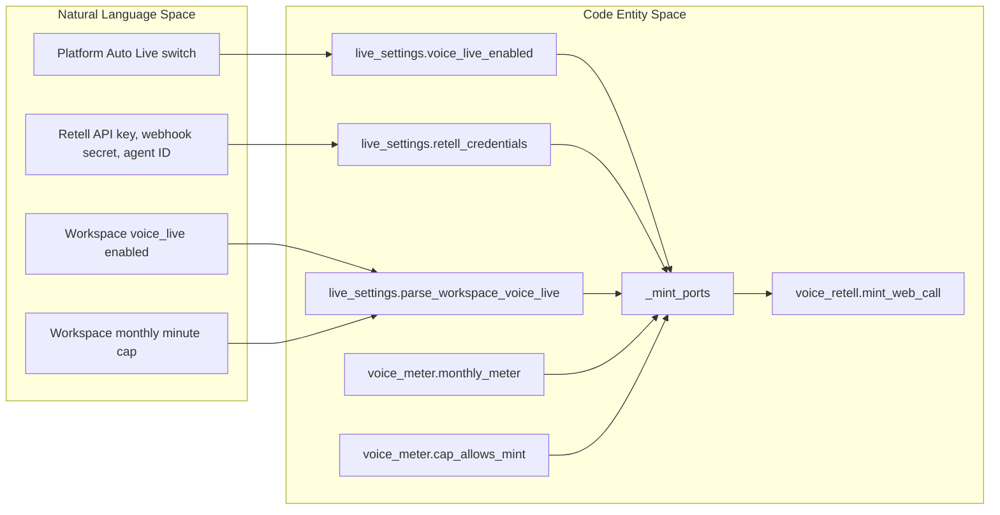
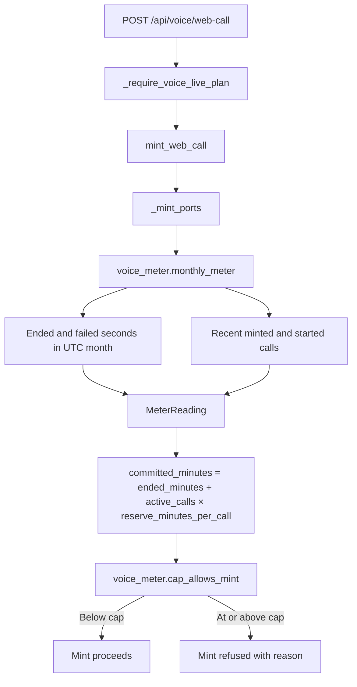
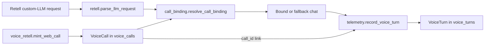

# Voice Metering & Telemetry

Relevant source files

The following files were used as context for generating this wiki page:

- [orchestrator/alembic/versions/prd203_voice_turns.py](orchestrator/alembic/versions/prd203_voice_turns.py)
- [orchestrator/alembic/versions/prd207_su_capture.py](orchestrator/alembic/versions/prd207_su_capture.py)
- [orchestrator/alembic/versions/prd207_voice_live.py](orchestrator/alembic/versions/prd207_voice_live.py)
- [orchestrator/api/voice_retell.py](orchestrator/api/voice_retell.py)
- [orchestrator/core/models/voice_calls.py](orchestrator/core/models/voice_calls.py)
- [orchestrator/core/models/voice_turns.py](orchestrator/core/models/voice_turns.py)
- [orchestrator/modules/voice/call_binding.py](orchestrator/modules/voice/call_binding.py)
- [orchestrator/modules/voice/live_settings.py](orchestrator/modules/voice/live_settings.py)
- [orchestrator/modules/voice/providers/retell.py](orchestrator/modules/voice/providers/retell.py)
- [orchestrator/modules/voice/retell_api.py](orchestrator/modules/voice/retell_api.py)
- [orchestrator/modules/voice/spoken_style.py](orchestrator/modules/voice/spoken_style.py)
- [orchestrator/modules/voice/telemetry.py](orchestrator/modules/voice/telemetry.py)
- [orchestrator/modules/voice/voice_meter.py](orchestrator/modules/voice/voice_meter.py)
- [orchestrator/tests/test_prd203_voice_retell.py](orchestrator/tests/test_prd203_voice_retell.py)
- [orchestrator/tests/test_prd207_voice_live.py](orchestrator/tests/test_prd207_voice_live.py)
- [orchestrator/tests/test_voice_quality.py](orchestrator/tests/test_voice_quality.py)

## Purpose & Scope

This page documents Auto Live’s monthly usage cap and active-call reservations, its platform and workspace settings switches, and the per-turn telemetry and spoken-output quality mechanisms. It focuses on the Retell live-call path and the code entities that implement and test these behaviors. [orchestrator/api/voice_retell.py:1-20]()

Sources: `[orchestrator/api/voice_retell.py:1-20]()`

---

## Master Switches & Live Settings Configuration

Auto Live uses separate platform-level and workspace-level controls. Platform activation and Retell credentials are read from `system_settings` in the `voice` category, while each workspace stores its own `voice_live` settings object. The platform switch defaults to off; missing or malformed workspace settings also fail closed. [orchestrator/modules/voice/live_settings.py:1-17]()[orchestrator/modules/voice/live_settings.py:28-57]()[orchestrator/modules/voice/live_settings.py:98-130]()

### Platform Settings and Credentials

`voice_live_enabled()` reads `voice.live_enabled` through `get_system_setting` and returns true only when its string value, after trimming and lowercasing, is `"true"`. `retell_credentials()` reads the API key, webhook secret, and Retell agent ID from the same settings category. A `RetellCredentials` instance is armed only when all three values are present. [orchestrator/modules/voice/live_settings.py:28-68]()

`set_voice_setting()` writes a `voice.*` system-setting row, creating a missing row if necessary. The API key and webhook secret are marked sensitive when a row is created. [orchestrator/modules/voice/live_settings.py:71-96]()

### Workspace Settings and Validation

`parse_workspace_voice_live()` produces a `WorkspaceVoiceLive` view with `enabled`, `monthly_cap_minutes`, and `retell_voice_id`. Missing, malformed, non-positive, or non-integer caps fall back to `config.VOICE_LIVE_DEFAULT_MONTHLY_CAP_MINUTES`. A missing or invalid settings object does not enable voice. [orchestrator/modules/voice/live_settings.py:98-130]()

`validate_voice_live_update()` is the shared validation seam for workspace setting writes: it requires an object, rejects keys outside `WORKSPACE_VOICE_LIVE_KEYS`, and returns a normalized object or raises `ValueError`. The tests cover invalid toggle types, boolean-as-integer caps, zero and excessive caps, oversized voice IDs, API-key-like voice IDs, and unknown fields. [orchestrator/modules/voice/live_settings.py:162-174]()[orchestrator/tests/test_prd207_voice_live.py:93-114]()

`voice_live_state()` reports `available` from the plan gate and `enabled` from the workspace setting. In the local edition, the plan gate is unrestricted; in SaaS, the setting delegates to the voice plan rule. The workspace switch does not itself represent platform arming or Retell credential readiness. [orchestrator/modules/voice/live_settings.py:133-159]()[orchestrator/tests/test_prd207_voice_live.py:123-153]()

### Natural Language Space to Code Entity Space: Settings and Mint Guards

This diagram connects the operational controls—platform switch, provider credentials, workspace switch, and usage cap—to the functions used by the mint route. The route supplies these dependencies to `modules.voice.mint` through `_mint_ports()`. [orchestrator/modules/voice/live_settings.py:28-68]()[orchestrator/api/voice_retell.py:77-87]()[orchestrator/api/voice_retell.py:102-140]()

**Diagram: Settings concepts mapped to voice settings and mint entities**

Sources: `[orchestrator/modules/voice/live_settings.py:28-68]()`, `[orchestrator/modules/voice/live_settings.py:98-159]()`, `[orchestrator/api/voice_retell.py:77-87]()`, `[orchestrator/api/voice_retell.py:102-140]()`

---

## Monthly Cap Formula & Active-Call Reserves

The monthly meter prevents concurrent call mints from consuming the same uncommitted headroom. Its admission rule is:

> Refuse when `ended_minutes + active_calls × reserve_minutes_per_call >= cap_minutes`.

`MeterReading.reserved_minutes` calculates the active-call reserve, and `committed_minutes` adds that reserve to ended minutes. `cap_allows_mint()` returns the admission decision and, when refusing, a reason that reports ended minutes and any active-call reservation. [orchestrator/modules/voice/voice_meter.py:45-71]()

### Meter Reading

`monthly_meter()` uses a UTC month window and reads `VoiceCall` rows for the workspace. Ended and failed calls contribute their `duration_seconds` when `ended_at` falls within the month window; the sum is converted to whole minutes with integer division by 60. [orchestrator/modules/voice/voice_meter.py:74-95]()

The active-call count includes:

- `minted` calls whose `minted_at` is within the five-minute `MINT_STALE_MINUTES` window.
- `started` calls whose `started_at` is within twice `VOICE_LIVE_MAX_CALL_MINUTES`.

A started call older than that second threshold is excluded from the reserve and logged as a zombie, making a missing end event visible rather than reserving capacity indefinitely. [orchestrator/modules/voice/voice_meter.py:41-43]()[orchestrator/modules/voice/voice_meter.py:96-130]()

The reserve amount per active call comes from `config.VOICE_LIVE_ACTIVE_CALL_RESERVE_MINUTES`. This is what closes the two-tab race: a newly minted call can consume reserved capacity before it has an end event or recorded duration. [orchestrator/modules/voice/voice_meter.py:5-23]()[orchestrator/modules/voice/voice_meter.py:132-136]()

### Mint Gate

`POST /api/voice/web-call` is protected by `_require_voice_live_plan` and then calls `mint.armed_credentials()`, resolves the caller, obtains the workspace’s voice settings within cap, binds the requested chat, and creates the call. `_mint_ports()` connects the mint flow to `monthly_meter()` and `cap_allows_mint()`. The route records the minted call after creation and returns the mint response. [orchestrator/api/voice_retell.py:77-87]()[orchestrator/api/voice_retell.py:90-100]()[orchestrator/api/voice_retell.py:102-140]()

The mint route translates `MintRefused` to an HTTP error using its status and detail. The available code identifies the plan gate and cap gate but does not establish one universal HTTP status for every cap refusal. [orchestrator/api/voice_retell.py:90-100]()[orchestrator/api/voice_retell.py:121-140]()

**Diagram: Meter calculation and mint admission**

Sources: `[orchestrator/modules/voice/voice_meter.py:45-71]()`, `[orchestrator/modules/voice/voice_meter.py:74-136]()`, `[orchestrator/api/voice_retell.py:77-87]()`, `[orchestrator/api/voice_retell.py:90-140]()`

---

## Per-Turn Telemetry & Call Binding

Live voice has two distinct telemetry grains. `VoiceCall` stores call lifecycle and billing-meter facts; `VoiceTurn` stores per-turn latency, output shape, and delivery measurements. The call row is created at mint time, while per-turn rows are persisted independently of the request transaction. [orchestrator/core/models/voice_calls.py:5-25]()[orchestrator/core/models/voice_turns.py:5-23]()[orchestrator/modules/voice/telemetry.py:70-90]()

### Call Binding Mechanics

Retell’s custom-LLM request includes dynamic variables such as workspace, user, and chat identifiers. `parse_llm_request()` extracts the latest user transcript entry, call ID, and dynamic variables into a `RetellLLMRequest`. [orchestrator/modules/voice/providers/retell.py:54-69]()[orchestrator/modules/voice/providers/retell.py:71-107]()

The mint-created `VoiceCall` row serves as the server-side registry for `call_id` and its workspace, user, and chat association. `resolve_call_binding()` uses that row to validate the incoming binding; the documented trust boundary refuses an unproven workspace and falls back to a per-call chat for chat/user mismatches. For an unminted call, the binding module describes steward attribution and a loud orphan row. [orchestrator/core/models/voice_calls.py:5-25]()[orchestrator/modules/voice/call_binding.py:5-27]()[orchestrator/modules/voice/call_binding.py:157-170]()

`create_voice_chat()` creates fallback voice threads, while `_fallback_chat()` stores the resulting chat ID on the call row so subsequent turns can reuse it. `voice_source()` defines persisted message provenance labels for user and assistant voice messages. [orchestrator/modules/voice/call_binding.py:43-55]()[orchestrator/modules/voice/call_binding.py:108-154]()

### Natural Language Space to Code Entity Space: Call-to-Turn Data Flow

This diagram maps the live voice concepts—minted call, Retell turn, binding, and telemetry—to the functions and models used by the codebase. The mint route records the call, while `record_voice_turn()` writes a separate turn record linked by `call_id`. [orchestrator/api/voice_retell.py:102-140]()[orchestrator/modules/voice/providers/retell.py:71-107]()[orchestrator/modules/voice/call_binding.py:157-170]()[orchestrator/modules/voice/telemetry.py:70-117]()

**Diagram: Live call and per-turn entities**

Sources: `[orchestrator/api/voice_retell.py:102-140]()`, `[orchestrator/modules/voice/providers/retell.py:71-107]()`, `[orchestrator/modules/voice/call_binding.py:108-170]()`, `[orchestrator/modules/voice/telemetry.py:70-117]()`, `[orchestrator/core/models/voice_calls.py:42-84]()`, `[orchestrator/core/models/voice_turns.py:35-85]()`

---

## Per-Turn Telemetry and Quality Evaluation

### Voice Turn Telemetry

`VoiceTurn` is an append-only, workspace-scoped record with optional conversation, message, and live-call identifiers. Its latency columns are `stt_latency_ms`, `tts_latency_ms`, and `total_ms`; content characteristics are represented by transcript and response lengths rather than stored text. It also records `truncated` and `audio_delivered`. [orchestrator/core/models/voice_turns.py:35-68]()

Additional live-turn fields include `first_frame_ms`, `first_auto_frame_ms`, `prep_ms`, `tools_before_speech`, `lead_in`, and `prefetch_hit`. The timing fields are nullable where a measurement may not have occurred, distinguishing “not measured” from a measured zero. [orchestrator/core/models/voice_turns.py:70-84]()

`voice_turn_fields()` converts raw measurements to column values: latency values are rounded to whole milliseconds, optional timing values remain `None` when absent, and text inputs contribute only their lengths. `record_voice_turn()` opens its own `get_db_session`, constructs the `VoiceTurn`, and catches persistence exceptions so telemetry failure does not fail the voice turn. [orchestrator/modules/voice/telemetry.py:23-67]()[orchestrator/modules/voice/telemetry.py:70-117]()

The per-turn `call_id` links a live voice turn to its `VoiceCall`; it may be `None` for the push-to-talk path. The model’s workspace-and-created-time index supports workspace-scoped telemetry queries. [orchestrator/modules/voice/telemetry.py:85-90]()[orchestrator/core/models/voice_turns.py:35-53]()

### Call-Level Lifecycle and Vendor Latency

`VoiceCall` stores the lifecycle status (`minted`, `started`, `ended`, or `failed`), timestamps, duration, disconnect reason, and optional `vendor_latency` JSON. Its call ID is unique, and its workspace/mint timestamp index supports workspace-level call lookup. [orchestrator/core/models/voice_calls.py:37-48]()[orchestrator/core/models/voice_calls.py:52-84]()

The provided model identifies `vendor_latency` as Retell’s call-level latency data, but the supplied excerpts do not show the event handler that populates it. [orchestrator/core/models/voice_calls.py:77-84]()

### Spoken Output Quality

The Retell streaming adapter consumes AI-SDK text chunks and converts them to Retell custom-LLM response frames. `extract_agent_text()` ignores non-text stream frames. `retell_response_frames()` emits speech units as the reply forms and sends a terminal `content_complete=True` frame to close the turn. [orchestrator/modules/voice/providers/retell.py:110-141]()[orchestrator/modules/voice/providers/retell.py:150-172]()

When speech-unit mode is enabled, the adapter buffers text until a sentence or clause boundary, then applies `speechify()` before yielding it. This allows markdown cleanup to operate across chunk boundaries while still streaming before the complete agent response has finished. When units are disabled, text is passed through without that unit-level sanitization. [orchestrator/modules/voice/providers/retell.py:125-162]()[orchestrator/modules/voice/providers/retell.py:165-172]()

The quality tests exercise `speechify()` behavior for bullets, numbering, headings, links, code fences, inline code, emoji, and ordinary prose. They also test speech-unit splitting at sentence and newline boundaries, maximum-length word boundaries, and progressive frame delivery. [orchestrator/tests/test_voice_quality.py:27-110]()[orchestrator/tests/test_voice_quality.py:112-178]()

The streaming tests verify that a frame can be emitted before the agent stream completes, that a long opening clause can begin speaking before its sentence ends, and that even an empty stream produces a terminal frame. These tests establish streaming and frame-closure behavior; they are not a model-based subjective quality score. [orchestrator/tests/test_prd203_voice_retell.py:25-70]()[orchestrator/tests/test_prd203_voice_retell.py:73-114]()

Sources: `[orchestrator/core/models/voice_turns.py:35-85]()`, `[orchestrator/modules/voice/telemetry.py:23-117]()`, `[orchestrator/core/models/voice_calls.py:37-84]()`, `[orchestrator/modules/voice/providers/retell.py:110-172]()`, `[orchestrator/tests/test_voice_quality.py:27-178]()`, `[orchestrator/tests/test_prd203_voice_retell.py:25-114]()`

---