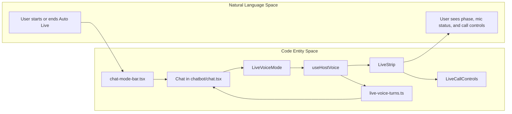
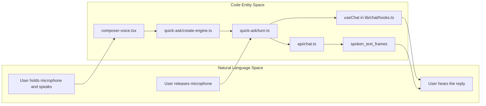
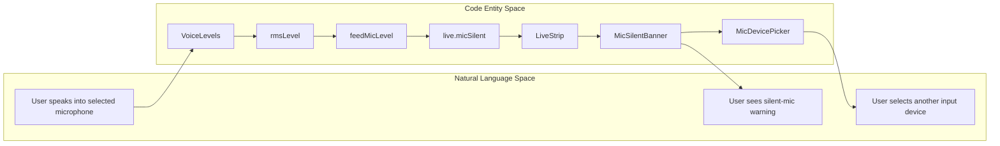

# Voice UI & Mic Health

Relevant source files

The following files were used as context for generating this wiki page:

- [README.md](README.md)
- [docs/PRDS/PRD-269-AUTOMATIC-LANGUAGE.md](docs/PRDS/PRD-269-AUTOMATIC-LANGUAGE.md)
- [docs/assets/showcase/go-play-chat-laptop.jpg](docs/assets/showcase/go-play-chat-laptop.jpg)
- [docs/assets/showcase/go-play-shelf-blog.jpg](docs/assets/showcase/go-play-shelf-blog.jpg)
- [docs/voice-auto-live/voice-ui-components.md](docs/voice-auto-live/voice-ui-components.md)
- [docs/voice/_index.md](docs/voice/_index.md)
- [frontend/app/api/chat/route.ts](frontend/app/api/chat/route.ts)
- [frontend/components/__tests__/prd207-live-voice.test.tsx](frontend/components/__tests__/prd207-live-voice.test.tsx)
- [frontend/components/chatbot/__tests__/composer-voice.test.tsx](frontend/components/chatbot/__tests__/composer-voice.test.tsx)
- [frontend/components/chatbot/chat.tsx](frontend/components/chatbot/chat.tsx)
- [frontend/components/chatbot/message.tsx](frontend/components/chatbot/message.tsx)
- [frontend/components/voice/LiveVoiceMode.tsx](frontend/components/voice/LiveVoiceMode.tsx)
- [frontend/components/voice/PresenceOrb.tsx](frontend/components/voice/PresenceOrb.tsx)
- [frontend/components/voice/VoiceErrorBoundary.tsx](frontend/components/voice/VoiceErrorBoundary.tsx)
- [frontend/components/voice/__tests__/voice-button.test.tsx](frontend/components/voice/__tests__/voice-button.test.tsx)
- [frontend/components/voice/voice-button-view.ts](frontend/components/voice/voice-button-view.ts)
- [frontend/components/voice/voice-button.tsx](frontend/components/voice/voice-button.tsx)
- [frontend/components/voice/voice-controls.tsx](frontend/components/voice/voice-controls.tsx)
- [frontend/lib/chat/__tests__/turn-stream.test.ts](frontend/lib/chat/__tests__/turn-stream.test.ts)
- [frontend/lib/chat/hooks.ts](frontend/lib/chat/hooks.ts)
- [frontend/lib/chat/turn-stream.ts](frontend/lib/chat/turn-stream.ts)
- [frontend/lib/voice/quick-ask/__tests__/audio-player.test.ts](frontend/lib/voice/quick-ask/__tests__/audio-player.test.ts)
- [frontend/lib/voice/quick-ask/__tests__/quick-ask-browser.test.ts](frontend/lib/voice/quick-ask/__tests__/quick-ask-browser.test.ts)
- [frontend/lib/voice/quick-ask/__tests__/quick-ask-engine.test.ts](frontend/lib/voice/quick-ask/__tests__/quick-ask-engine.test.ts)
- [frontend/lib/voice/quick-ask/__tests__/quick-ask-server-voice.test.ts](frontend/lib/voice/quick-ask/__tests__/quick-ask-server-voice.test.ts)
- [frontend/lib/voice/quick-ask/__tests__/server-speech-fakes.ts](frontend/lib/voice/quick-ask/__tests__/server-speech-fakes.ts)
- [frontend/lib/voice/quick-ask/__tests__/server-speech-fallback.test.ts](frontend/lib/voice/quick-ask/__tests__/server-speech-fallback.test.ts)
- [frontend/lib/voice/quick-ask/__tests__/server-speech.test.ts](frontend/lib/voice/quick-ask/__tests__/server-speech.test.ts)
- [frontend/lib/voice/quick-ask/config.ts](frontend/lib/voice/quick-ask/config.ts)
- [frontend/lib/voice/quick-ask/create-engine.ts](frontend/lib/voice/quick-ask/create-engine.ts)
- [frontend/lib/voice/quick-ask/deps.ts](frontend/lib/voice/quick-ask/deps.ts)
- [frontend/lib/voice/quick-ask/turn.ts](frontend/lib/voice/quick-ask/turn.ts)
- [frontend/types/chat.ts](frontend/types/chat.ts)
- [orchestrator/api/chat.py](orchestrator/api/chat.py)
- [orchestrator/consumers/chatbot/service.py](orchestrator/consumers/chatbot/service.py)
- [orchestrator/modules/agents/factory/agent_factory.py](orchestrator/modules/agents/factory/agent_factory.py)
- [services/voice-tts/README.md](services/voice-tts/README.md)

## Purpose & Scope

Section 24.2 documents the frontend voice surfaces: the Auto Live strip, the `PresenceOrb` canvas renderer, quick ask, and live-call microphone health indicators. The available source excerpts identify the host-voice architecture, but do not include the implementation of `useRetellCall`; this page therefore describes the visible call integration without attributing unverified behavior to that hook. [frontend/components/voice/LiveVoiceMode.tsx:3-15]()[docs/voice/_index.md:8-27]()

Sources: `frontend/components/voice/LiveVoiceMode.tsx`, `docs/voice/_index.md`

---

## 1. LiveVoiceMode and Chat Integration

`LiveVoiceMode` is the compact Auto Live status-and-controls strip. It reads the current session through `useHostVoice()`, and renders only when `voice.snapshot.mode === 'live'`. Its `LiveStrip` displays the AI voice label, phase text, elapsed duration while the call is active, and controls for microphone state, mute, input-device selection, and ending the call. [frontend/components/voice/LiveVoiceMode.tsx:28-49]()[frontend/components/voice/LiveVoiceMode.tsx:52-95]()

The call itself is owned by the host voice provider and live engine; the strip observes and controls that session rather than creating a separate call. The chat mounts `LiveVoiceMode` and `VoiceErrorBoundary`, and uses `HostPresenceOrb` as the ambient background renderer. Voice turns are integrated with the chat thread through `live-voice-turns.ts`; the chat hook also follows a changed chat ID so sends and its message-merge listener target the conversation currently on screen. [frontend/components/voice/LiveVoiceMode.tsx:4-11]()[frontend/components/chatbot/chat.tsx:57-68]()[frontend/lib/chat/hooks.ts:90-95]()

### Phase-dependent controls

`ON_THE_CALL` defines `listening`, `thinking`, and `speaking` as active-call phases. In these phases the strip displays mic state, mute control, and device picker; duration is also shown. The end/close control remains available while connecting or in an active phase. When the phase is `error`, `LiveStrip` uses the reported error or `LIVE_UNAVAILABLE`, displays `LiveCallFailure`, and offers retry via `voice.start({ mode: 'live' })` or close via `voice.stop()`. [frontend/components/voice/LiveVoiceMode.tsx:25-49]()[frontend/components/voice/LiveVoiceMode.tsx:52-78]()

| UI element | Condition / input | Behavior |
|---|---|---|
| Phase label | `snapshot.phase` | Uses `ORB_STATE_LABELS` and is announced with `aria-live="polite"`. [frontend/components/voice/LiveVoiceMode.tsx:36-40]() |
| Duration | Active phase | Formats `snapshot.durationSec` for display. [frontend/components/voice/LiveVoiceMode.tsx:36-40]() |
| Mute control | Active phase | Calls `live.toggleMute`. [frontend/components/voice/LiveVoiceMode.tsx:42-44]() |
| Device picker | Active phase | Lists `live.inputDevices`; selection calls `live.pickDevice`. [frontend/components/voice/LiveVoiceMode.tsx:44-46]() |
| End / close | Active or connecting phase | Calls `voice.stop`. [frontend/components/voice/LiveVoiceMode.tsx:47-47]() |
| Silent-mic banner | Active, unmuted, silent capture, and no call failure | Shows the input devices and lets the user select a different capture device. [frontend/components/voice/LiveVoiceMode.tsx:52-55]()[frontend/components/voice/LiveVoiceMode.tsx:72-75]() |
| Failure controls | `snapshot.phase === 'error'` | Displays a readable failure and provides retry and close actions. [frontend/components/voice/LiveVoiceMode.tsx:52-55]()[frontend/components/voice/LiveVoiceMode.tsx:76-78]() |

**Diagram 1 — From Auto Live interaction to rendered UI**

Sources: `frontend/components/voice/LiveVoiceMode.tsx:4-11`, `frontend/components/voice/LiveVoiceMode.tsx:28-49`, `frontend/components/voice/LiveVoiceMode.tsx:52-95`, `frontend/components/chatbot/chat.tsx:57-68`

### `useRetellCall` and host voice boundary

The supplied excerpts describe the call as owned by the host voice provider and live engine, and show `LiveVoiceMode` consuming `useHostVoice()` to read state and invoke controls. They do not show a `useRetellCall` definition or its call sites, so its precise API, responsibilities, and relationship to the host provider cannot be established from this source set. [frontend/components/voice/LiveVoiceMode.tsx:4-11]()[frontend/components/voice/LiveVoiceMode.tsx:23-24]()[docs/voice/_index.md:10-27]()

Sources: `frontend/components/voice/LiveVoiceMode.tsx`, `docs/voice/_index.md`

---

## 2. Quick Ask and Spoken Chat Turns

Quick ask is the hold-to-talk interaction associated with the chat microphone button. The voice documentation describes browser speech recognition converting the user’s speech to words; Automatos receives the words rather than the captured audio. Releasing the control submits those words as a chat message, and the response is spoken sentence by sentence as it arrives. [docs/voice/_index.md:44-56]()[docs/voice/_index.md:64-79]()

The documented UX includes a browser-language voice choice, a server-voice path when available, and a browser speech fallback. If server speech fails for a sentence, the browser voice is used for that sentence and the rest of that answer, avoiding a voice switch mid-answer. A stop phrase such as “Auto, stop” can stop speech without sending a request; the docs distinguish that from a request such as “Stop the deploy.” [docs/voice/_index.md:75-88]()

`create-engine.ts`, `turn.ts`, `config.ts`, and related quick-ask modules are listed as part of the voice source cluster, but their implementations are not included in the supplied excerpts. Accordingly, the engine’s internal function sequence and exact hook interfaces are not specified here. [docs/voice/_index.md:20-26]()

**Diagram 2 — Quick ask: user intent mapped to voice and chat entities**

Sources: `docs/voice/_index.md:20-26`, `docs/voice/_index.md:64-79`, `orchestrator/api/chat.py:14-16`, `orchestrator/api/chat.py:39-40`, `frontend/lib/chat/hooks.ts:21-48`

---

## 3. PresenceOrb Canvas Renderer

`PresenceOrb` renders a canvas from an `OrbState` and a `VoiceLevelsSource`; the latter exposes the current `VoiceLevels` snapshot via a `current` property. It supports a compact `size` mode and a background mode, which is enabled by `fullBleed` or implied when `horizon` is provided. In background mode the canvas fills its host, and `horizon` controls the vertical placement toward which the beamline glides. [frontend/components/voice/PresenceOrb.tsx:28-46]()[frontend/components/voice/PresenceOrb.tsx:93-107]()

The renderer maps states including `speaking`, `listening`, `thinking`, `connecting`, `idle`, `error`, and `ended` to intensity values. It reads CSS HSL tokens for its palette, with fallbacks when tokens are unavailable. Its canvas dimensions are based on the host element in background mode and on the fixed compact width and `size` otherwise; device-pixel ratio is capped, with a lower cap in background mode. [frontend/components/voice/PresenceOrb.tsx:48-60]()[frontend/components/voice/PresenceOrb.tsx:68-81]()[frontend/components/voice/PresenceOrb.tsx:108-127]()[frontend/components/voice/PresenceOrb.tsx:157-170]()

The component’s stated safety contract is that a drawing fault is caught and logged once, then the animation loop stops instead of taking down the page. The supplied implementation excerpt ends at line 170, so details of the drawing loop are not expanded here. [frontend/components/voice/PresenceOrb.tsx:18-25]()

Sources: `frontend/components/voice/PresenceOrb.tsx:18-25`, `frontend/components/voice/PresenceOrb.tsx:28-46`, `frontend/components/voice/PresenceOrb.tsx:48-81`, `frontend/components/voice/PresenceOrb.tsx:93-170`

---

## 4. Mic Health Detection

Mic health is surfaced by `LiveVoiceMode` using `live.micSilent`, the mute state, and the active input-device information. The silent warning is shown only when there is no call failure, the call is in an active phase, the capture is reported silent, and the microphone is not muted. The banner includes device selection so the user can switch away from a silent input. [frontend/components/voice/LiveVoiceMode.tsx:28-34]()[frontend/components/voice/LiveVoiceMode.tsx:52-55]()[frontend/components/voice/LiveVoiceMode.tsx:72-75]()

The voice tests document the pure mic-health helpers `initialMicHealth` and `feedMicLevel`, and the constants `MIC_SILENT_AFTER_MS` and `MIC_SILENT_PEAK`. Tests establish that a full interval of silence marks the state silent, a real signal clears that state and restarts the interval, and a quiet signal above the threshold does not trigger the warning. They also verify that feeding a level does not mutate the previous health snapshot. [frontend/components/__tests__/prd207-live-voice.test.tsx:17-22]()[frontend/components/__tests__/prd207-live-voice.test.tsx:90-125]()

The same test file exercises `rmsLevel`: silence produces zero, large values are clamped to one, and greater signal amplitude yields a larger result. These tests describe the intended level calculation and mic-health state behavior; the implementation of `mic-health.ts` itself is not present in the supplied file contents. [frontend/components/__tests__/prd207-live-voice.test.tsx:10-16]()[frontend/components/__tests__/prd207-live-voice.test.tsx:29-40]()

**Diagram 3 — Capture health state to user-facing recovery**

Sources: `frontend/components/__tests__/prd207-live-voice.test.tsx:10-22`, `frontend/components/__tests__/prd207-live-voice.test.tsx:29-40`, `frontend/components/__tests__/prd207-live-voice.test.tsx:90-125`, `frontend/components/voice/LiveVoiceMode.tsx:52-55`, `frontend/components/voice/LiveVoiceMode.tsx:72-75`

---

## 5. VoiceErrorBoundary and UI Resilience

`LiveVoiceMode` wraps the rendered live strip in `VoiceErrorBoundary`, keyed as `live-voice-strip`. This isolates that UI surface so an error in the strip does not propagate through its immediate render boundary. The supplied excerpts show the boundary’s placement but do not include its implementation or fallback behavior. [frontend/components/voice/LiveVoiceMode.tsx:83-95]()

The `PresenceOrb` separately documents a guarded drawing loop: a rendering fault is caught, logged once, and stops that loop. This is a renderer-level protection, distinct from the React error boundary around the live strip. [frontend/components/voice/PresenceOrb.tsx:18-25]()

Sources: `frontend/components/voice/LiveVoiceMode.tsx:83-95`, `frontend/components/voice/PresenceOrb.tsx:18-25`

---