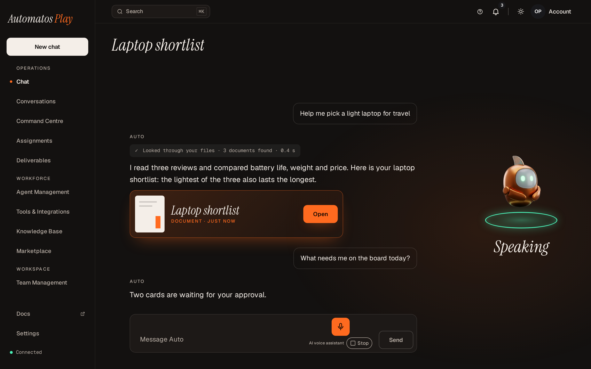

# Voice

Relevant source files

The following files were used as context for generating this page:

- [frontend/components/chatbot/composer-voice.tsx](../../frontend/components/chatbot/composer-voice.tsx)
- [frontend/components/chatbot/chat-mode-bar.tsx](../../frontend/components/chatbot/chat-mode-bar.tsx)
- [frontend/components/voice/voice-provider.tsx](../../frontend/components/voice/voice-provider.tsx)
- [frontend/components/voice/voice-button.tsx](../../frontend/components/voice/voice-button.tsx)
- [frontend/components/voice/voice-button-view.ts](../../frontend/components/voice/voice-button-view.ts)
- [frontend/components/voice/voice-press.ts](../../frontend/components/voice/voice-press.ts)
- [frontend/components/voice/voice-hotkey.ts](../../frontend/components/voice/voice-hotkey.ts)
- [frontend/components/voice/LiveVoiceMode.tsx](../../frontend/components/voice/LiveVoiceMode.tsx)
- [frontend/components/voice/MicHealthControl.tsx](../../frontend/components/voice/MicHealthControl.tsx)
- [frontend/components/voice/AiVoiceLabel.tsx](../../frontend/components/voice/AiVoiceLabel.tsx)
- [frontend/lib/voice/host/availability.ts](../../frontend/lib/voice/host/availability.ts)
- [frontend/lib/voice/host/voice-host.ts](../../frontend/lib/voice/host/voice-host.ts)
- [frontend/lib/voice/quick-ask/create-engine.ts](../../frontend/lib/voice/quick-ask/create-engine.ts)
- [frontend/lib/voice/quick-ask/ai-notice.ts](../../frontend/lib/voice/quick-ask/ai-notice.ts)
- [frontend/lib/voice/quick-ask/config.ts](../../frontend/lib/voice/quick-ask/config.ts)
- [frontend/lib/voice/quick-ask/copy.ts](../../frontend/lib/voice/quick-ask/copy.ts)
- [frontend/lib/voice/quick-ask/stop-phrase.ts](../../frontend/lib/voice/quick-ask/stop-phrase.ts)
- [frontend/lib/voice/live/live-engine.ts](../../frontend/lib/voice/live/live-engine.ts)
- [frontend/lib/voice/live/refusal.ts](../../frontend/lib/voice/live/refusal.ts)
- [frontend/lib/theme-sdk/voice.ts](../../frontend/lib/theme-sdk/voice.ts)
- [frontend/components/settings/VoiceLiveArmingTab.tsx](../../frontend/components/settings/VoiceLiveArmingTab.tsx)
- [orchestrator/api/chat_models.py](../../orchestrator/api/chat_models.py)
- [orchestrator/api/voice_retell.py](../../orchestrator/api/voice_retell.py)
- [orchestrator/api/workspaces.py](../../orchestrator/api/workspaces.py)
- [orchestrator/modules/voice/availability.py](../../orchestrator/modules/voice/availability.py)
- [orchestrator/modules/voice/mint.py](../../orchestrator/modules/voice/mint.py)
- [orchestrator/modules/voice/spoken_style.py](../../orchestrator/modules/voice/spoken_style.py)
- [orchestrator/services/themes/audio_capture.py](../../orchestrator/services/themes/audio_capture.py)

You can talk to Auto instead of typing, in two ways:

| | Quick ask | Auto Live |
|---|---|---|
| **What it is** | Hold to talk: ask, let go, and hear Auto's reply. | A real-time voice call with Auto. You talk back and forth, and can speak over Auto to cut in. |
| **Where it is** | The microphone beside **Send** in the chat box, and a theme's voice button. | The **Live** chip under the chat box, next to **Code** and **Plan**, and a theme's voice button. |
| **Who hears you and who speaks** | Your browser: its own speech recognition and speech voice. Automatos receives only the words. | Retell, the voice service Auto Live runs on. Automatos writes the replies. |
| **Plans and editions** | Every plan, both editions. | Where the server has it set up (below). On the hosted edition, the workspace's plan decides too. |
| **What you need** | A browser that can recognise speech. Where it can't, the button says so and you can still type. | A current Chrome, Edge or Safari, and a microphone. |
| **Language** | Your browser's language. See [Languages](#languages). | One language for the whole server, `en-GB` unless the server sets another. |

Either way, what you say and Auto's reply land in the conversation on screen, saved like typed messages. Voice belongs
to that conversation: opening another one ends the voice session.

  

---

## Quick ask

1. Press and hold the microphone beside **Send**. Your browser may ask to use the microphone the first time; the
   button says "Allow the microphone if your browser asks."
2. Speak. What the browser hears shows as you talk.
3. Let go. Your words go to Auto as a message in the conversation on screen, or in a new chat if none is open.

Auto is told the reply will be heard, so it answers in short sentences without formatting. The reply is spoken
sentence by sentence as it arrives. Code, tables and links aren't read out ("There's code in the chat."): the chat
shows them.

- **Keyboard and screen readers.** A press that no pointer made (Space or Enter on the focused button, a screen
  reader's activation) works as a toggle: press once to start, again to send.
- **Stop.** The stop control next to the button ends listening or the reply. Pressing the button while Auto speaks
  cuts it off and starts a new question.
- **"Auto, stop".** Said as the whole of what you hold to say, "stop", "cancel", "stop it" or "Auto, stop" stops
  Auto and sends nothing. "Stop the deploy" is a request, and goes to Auto as said.
- **Time limit.** Listening stops after a minute, as if you had let go.
- **Leaving the tab** stops the microphone and the speech. A reply already on its way still lands in the chat.

When something goes wrong, the button says why in a sentence, with **Try again**: the microphone is blocked for the
site, nothing was heard, no microphone was found, or the browser can't recognise speech.

Your browser does the listening and the speaking. Some browsers send the audio to their maker's online speech
service to turn it into words; Automatos never receives the audio.

---

## Auto Live

Press **Live** to start a call; press it again to end it. In Studio, while the call runs:

- a strip above the chat box shows the call's state (connecting, listening, thinking, speaking) and its length, with
  **Mute**, a microphone picker and **End**;
- the chat's background moves with the call, with your voice and with Auto's;
- your words and Auto's appear in the conversation as they are spoken, and the server saves each turn;
- if your microphone sends only silence (a wrong or disconnected device), a notice says so and lets you pick another.

A theme's voice button shows the same controls beside it during a call.

If Live can't start, its chip and the strip say why: Auto Live isn't set up on this server, it is off for the
workspace, the workspace has used its Auto Live minutes for the month, or the workspace's plan doesn't include it.

### Setting it up

Auto Live needs a Retell account. On a server you run:

- an admin enters the Retell API key, the webhook signing key and the Retell agent id, and turns on **Live voice
  enabled**, in **Settings › System Settings › Voice**. Turning it off refuses new calls and silences the calls in
  progress at once;
- each workspace has its own switch and monthly allowance of minutes, which an owner or admin sets with
  `PUT /api/workspaces/current/voice-live`. A workspace is off until it is turned on. Studio has no screen for this
  switch.

---

## Auto says it is an AI

- **Quick ask:** before the first reply in a browser tab's session, Auto says "Hi, this is Auto, your AI assistant."
  (with the answering agent's name in place of Auto's), and not again in that session.
- **Auto Live:** every call opens with the same greeting.
- On screen, the small caption "AI voice assistant" shows beside the voice controls while voice runs, and for the
  whole of a call.

---

## Languages

- **Writing.** Auto answers in the language you write or speak to it in, for any language the model handles. There
  is nothing to set.
- **Quick ask in the browser.** The browser listens and speaks in the language it is set to (`en-US` when it names
  none). To talk in another language, change the browser's language. The reply is spoken in the browser's own voice
  for that language; Auto's natural server voice (below) is coming to the web, and isn't wired up there yet.
- **Auto Live** listens in one language for the whole server: `VOICE_LIVE_LANGUAGE`, `en-GB` by default.
- **Automatos Go** (iPhone) listens and speaks English and Portuguese (Brazil). Choose the language in
  **Settings → Voice**; a one-tap EN/PT switch changes it. Your voice is recognised on the iPhone for the iPhone's own
  language; for another language, on the iPhone when its dictation model is installed, otherwise by Apple's speech
  recognition.
- **Auto's natural voice** is the server voice, `voice-tts` (Kokoro, run on the server's CPU; see
  [self-hosting](../getting-started/self-hosting.md#7c-autos-server-voice-the-voice-profile)). It speaks Kokoro's
  nine languages: English (US and UK), Spanish, French, Italian, Portuguese (Brazil), Hindi, Japanese and Mandarin.
  Japanese and Mandarin sound weaker: their words are turned into sounds by espeak.

**Planned, not built: automatic language detection.** Speak in any of about 100 languages without choosing one
first. The server would recognise the speech (Whisper-family models), and Auto would answer and speak in the same
language. It needs a GPU server, so it waits for one. The plan is
[PRD-269](../PRDS/PRD-269-AUTOMATIC-LANGUAGE.md).

---

## In themes

A theme places the voice button through the theme SDK (`voice.VoiceButton`, SDK 1.2.0); Play and HUD do. Automatos
draws the button and everything around it, so voice behaves the same in every theme:

- the press, as a hold or a toggle, and a key a theme can give it (in HUD, hold **Space** anywhere except while you
  type);
- the "AI voice assistant" caption and the stop control, which no theme's styles can hide;
- the microphone prompt, a failure with **Try again**, and, for a call, mute and the microphone picker.

A theme is not meant to open the microphone or speak by itself: the automated checks report code that does as an
error, and the Marketplace review refuses that version.

<table>
  <tr>
    <td></td>
    <td></td>
  </tr>
  <tr>
    <td colspan="2">HUD listening, on a desktop and on a phone.</td>
  </tr>
</table>

---

## On your phone

[Automatos Go](https://github.com/AutomatosAI/automatos-go), the phone app, has hold-to-talk too, in English and
Portuguese (Brazil), chosen in **Settings → Voice**. Where the server runs Auto's natural voice, the phone
can play Auto's replies in it; otherwise it uses the phone's own voice.

Related:

- [Themes](../themes/_index.md)
- [Voice (Auto Live)](../voice-auto-live/_index.md) (technical: the call's backend, the components and telemetry)
- [The theme SDK's voice area](../theme-host/sdk-surface-map.md) (technical)
