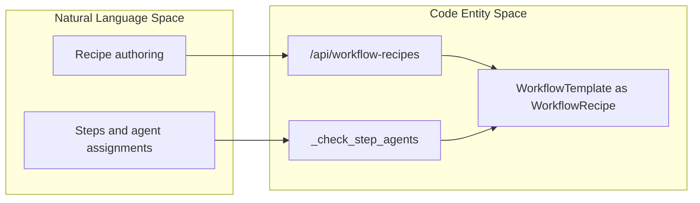
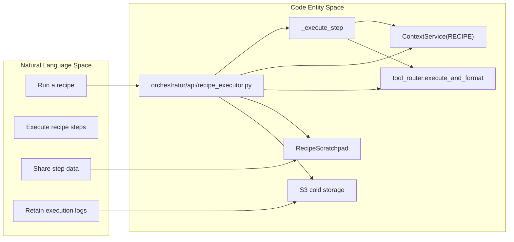
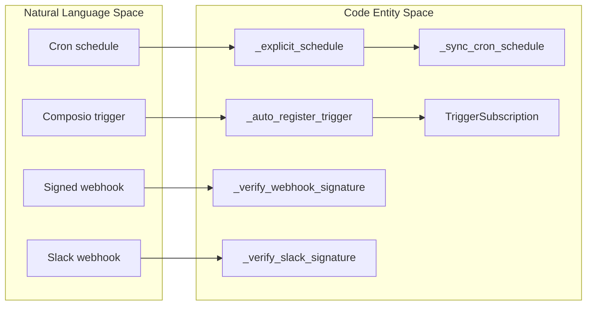
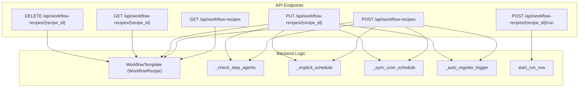

# Workflows & Recipes

Relevant source files

The following files were used as context for generating this wiki page:

- [frontend/components/workflows/execution-kitchen.tsx](frontend/components/workflows/execution-kitchen.tsx)
- [orchestrator/alembic/versions/dedupe_skills_unique_workspace_name.py](orchestrator/alembic/versions/dedupe_skills_unique_workspace_name.py)
- [orchestrator/api/composio.py](orchestrator/api/composio.py)
- [orchestrator/api/patterns.py](orchestrator/api/patterns.py)
- [orchestrator/api/recipe_executor.py](orchestrator/api/recipe_executor.py)
- [orchestrator/api/skills.py](orchestrator/api/skills.py)
- [orchestrator/api/templates.py](orchestrator/api/templates.py)
- [orchestrator/api/tools.py](orchestrator/api/tools.py)
- [orchestrator/api/webhooks.py](orchestrator/api/webhooks.py)
- [orchestrator/api/workflow_recipes.py](orchestrator/api/workflow_recipes.py)
- [orchestrator/core/composio/client.py](orchestrator/core/composio/client.py)
- [orchestrator/core/composio/linkedin_image_workaround.py](orchestrator/core/composio/linkedin_image_workaround.py)
- [orchestrator/core/credentials/tester.py](orchestrator/core/credentials/tester.py)
- [orchestrator/core/credentials/types.py](orchestrator/core/credentials/types.py)
- [orchestrator/core/database/credential_types_seed.json](orchestrator/core/database/credential_types_seed.json)
- [orchestrator/core/routing/ingestors/webhook.py](orchestrator/core/routing/ingestors/webhook.py)
- [orchestrator/core/services/skill_materializer.py](orchestrator/core/services/skill_materializer.py)
- [orchestrator/modules/agents/services/skill_loader.py](orchestrator/modules/agents/services/skill_loader.py)
- [orchestrator/services/metadata_sync_service.py](orchestrator/services/metadata_sync_service.py)
- [orchestrator/services/webhook_dedup.py](orchestrator/services/webhook_dedup.py)
- [orchestrator/tests/test_p2w2_webhook_dedup.py](orchestrator/tests/test_p2w2_webhook_dedup.py)
- [orchestrator/tests/test_p2w2_webhook_signature_reject.py](orchestrator/tests/test_p2w2_webhook_signature_reject.py)
- [orchestrator/tests/test_prd251_linkedin_scope.py](orchestrator/tests/test_prd251_linkedin_scope.py)

## Purpose and Scope

Automatos AI workflows and recipes organize agent work into reusable playbooks that can be run directly or started by configured schedules and triggers. The direct recipe executor describes sequential step execution using chatbot components, a scratchpad, compact database summaries, S3 cold storage for full step logs, and recipe memory hooks [orchestrator/api/recipe_executor.py:1-18](). The workflow-recipe API defines the `/api/workflow-recipes` router and connects saved schedules and trigger subscriptions to scheduler and Composio integration code [orchestrator/api/workflow_recipes.py:22-36](), [orchestrator/api/workflow_recipes.py:40-48](), [orchestrator/api/workflow_recipes.py:104-123]().

This parent page maps the system’s main areas; implementation details belong in the child pages linked below.

| Child page | Scope |
|---|---|
| [Creating Recipes](#6.1) | Playbook creation UI, step builder, preview, and assignments |
| [Recipe Execution Engine](#6.2) | Direct execution, step handling, and execution storage |
| [Execution Configuration](#6.3) | Execution modes, limits, retries, and memory settings |
| [Scheduling & Triggers](#6.4) | Manual, cron, and webhook starts |
| [Recipe Memory & Learning](#6.5) | Memory, pattern extraction, and learning feedback |
| [Recipe Scratchpad](#6.6) | Structured data shared between steps |
| [Workflow Pipeline Architecture](#6.7) | Legacy and dynamic workflow execution approaches |
| [Workflow API Reference](#6.8) | Workflow and recipe API details |
| [Step Outcomes, Redo & Lessons](#6.9) | Outcomes, redo, and lessons carried between steps |

Sources: [orchestrator/api/recipe_executor.py:1-18](), [orchestrator/api/workflow_recipes.py:22-48](), [orchestrator/api/workflow_recipes.py:104-123]().

---

## 6.1 Creating Recipes

A recipe is represented in the workflow-recipe API through the `WorkflowTemplate` model, aliased there as `WorkflowRecipe`. The API validates that step agents belong to the current workspace and are active before accepting them [orchestrator/api/workflow_recipes.py:24-27](), [orchestrator/api/workflow_recipes.py:58-78]().

**Diagram: Recipe authoring concepts mapped to API entities**

Sources: [orchestrator/api/workflow_recipes.py:22-27](), [orchestrator/api/workflow_recipes.py:58-78]().

For details, see [Creating Recipes](#6.1).

---

## 6.2 Recipe Execution Engine

The direct executor is described as a step-by-step recipe path that uses chatbot-aligned components, including `ContextService(RECIPE)`, `ComposioHintService`, an LLM manager, and tool routing. Its stated supporting mechanisms include `RecipeScratchpad`, `scratchpad_write`, S3 cold storage for full logs, compact database summaries, and pre/post execution recipe memory [orchestrator/api/recipe_executor.py:1-18](). The `_execute_step` function is responsible for the core logic of executing a single step within a recipe [orchestrator/api/recipe_executor.py:200-200]().

**Diagram: Recipe execution concepts mapped to code entities**

Sources: [orchestrator/api/recipe_executor.py:1-18](), [orchestrator/api/recipe_executor.py:200-200]().

For details, see [Recipe Execution Engine](#6.2).

---

## 6.3 Execution Configuration

The recipe executor’s module documentation identifies a sequential direct-execution path. Broader configuration topics—including parallel modes, retries, timeouts, and memory isolation—are covered in the child page rather than specified here [orchestrator/api/recipe_executor.py:1-18]().

For details, see [Execution Configuration](#6.3).

Sources: [orchestrator/api/recipe_executor.py:1-18]().

---

## 6.4 Scheduling & Triggers

The workflow-recipe API validates saved schedule configuration and attempts to synchronize cron schedules through `sync_playbook_schedule`; a synchronization failure is logged rather than raised from the helper [orchestrator/api/workflow_recipes.py:40-48](), [orchestrator/api/workflow_recipes.py:81-102](). For trigger schedules, `_auto_register_trigger` handles Composio-sourced triggers by creating or reusing a `TriggerSubscription`; non-Composio triggers skip Composio registration [orchestrator/api/workflow_recipes.py:104-143]().

The webhook API documents HMAC-SHA256 verification for configured secrets: missing or mismatched signatures are rejected. The Composio API also exposes a webhook path for trigger handling [orchestrator/api/webhooks.py:46-91](), [orchestrator/api/composio.py:1-9](). Slack's v0 signing scheme is also supported, including timestamp validation and signature comparison [orchestrator/api/webhooks.py:127-153]().

**Diagram: Schedule and trigger concepts mapped to code entities**

Sources: [orchestrator/api/workflow_recipes.py:40-48](), [orchestrator/api/workflow_recipes.py:81-102](), [orchestrator/api/workflow_recipes.py:104-143](), [orchestrator/api/webhooks.py:46-91](), [orchestrator/api/webhooks.py:127-153]().

For details, see [Scheduling & Triggers](#6.4).

---

## 6.5 Recipe Memory & Learning

The direct executor’s module documentation identifies recipe memory hooks before and after execution, alongside compact summaries in the database and full step logs in S3 cold storage. The detailed memory and learning behavior is documented separately [orchestrator/api/recipe_executor.py:14-18]().

For details, see [Recipe Memory & Learning](#6.5).

Sources: [orchestrator/api/recipe_executor.py:14-18]().

---

## 6.6 Recipe Scratchpad

The executor documentation describes `RecipeScratchpad` as the mechanism for inter-step data sharing and names `scratchpad_write` as the explicit agent export tool. It presents this approach as a replacement for verbose text dumps [orchestrator/api/recipe_executor.py:14-16]().

For details, see [Recipe Scratchpad](#6.6).

Sources: [orchestrator/api/recipe_executor.py:14-16]().

---

## 6.7 Workflow Pipeline Architecture

The direct recipe executor explicitly distinguishes its step-by-step path from the 9-stage pipeline it bypasses [orchestrator/api/recipe_executor.py:5-7](). The execution interface also models both `workflow` and `recipe` execution types, and includes display labels for a nine-stage workflow log [frontend/components/workflows/execution-kitchen.tsx:46-54](), [frontend/components/workflows/execution-kitchen.tsx:72-88]().

For details, see [Workflow Pipeline Architecture](#6.7).

Sources: [orchestrator/api/recipe_executor.py:5-7](), [frontend/components/workflows/execution-kitchen.tsx:46-54](), [frontend/components/workflows/execution-kitchen.tsx:72-88]().

---

## 6.8 Workflow API Reference

The workflow-recipe router is mounted at `/api/workflow-recipes` and is described as providing CRUD operations for recipes users can browse, customize, and use to create workflows [orchestrator/api/workflow_recipes.py:1-7](), [orchestrator/api/workflow_recipes.py:22-27](). The API also contains schedule validation and trigger-registration helpers [orchestrator/api/workflow_recipes.py:81-143]().

**Diagram: Workflow API endpoints and their functions**

Sources: [orchestrator/api/workflow_recipes.py:1-7](), [orchestrator/api/workflow_recipes.py:22-27](), [orchestrator/api/workflow_recipes.py:58-78](), [orchestrator/api/workflow_recipes.py:81-143](), [orchestrator/api/workflow_recipes.py:33-35]().

For details, see [Workflow API Reference](#6.8).

---

## 6.9 Step Outcomes, Redo & Lessons

The direct executor imports step-reference and step-lesson helpers, plus utilities for representing and recording a step waiting on an owner’s action [orchestrator/api/recipe_executor.py:41-48](). The executor’s module documentation also identifies recipe memory hooks, while the detailed outcome, redo, and lesson flows are covered in the child page [orchestrator/api/recipe_executor.py:14-18]().

For details, see [Step Outcomes, Redo & Lessons](#6.9).

Sources: [orchestrator/api/recipe_executor.py:41-48](), [orchestrator/api/recipe_executor.py:14-18]().

---