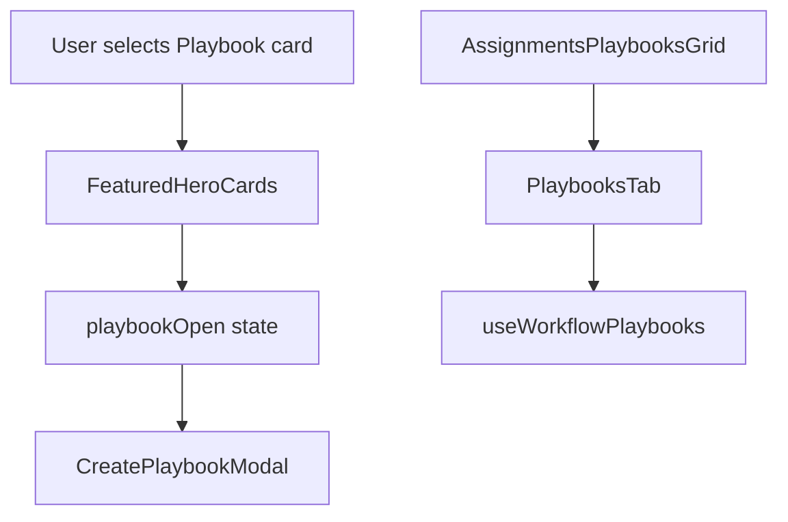
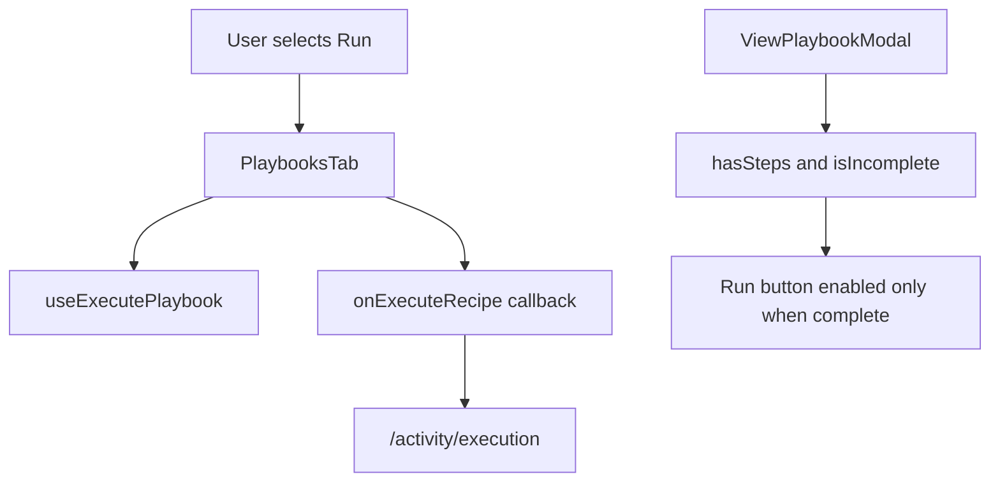
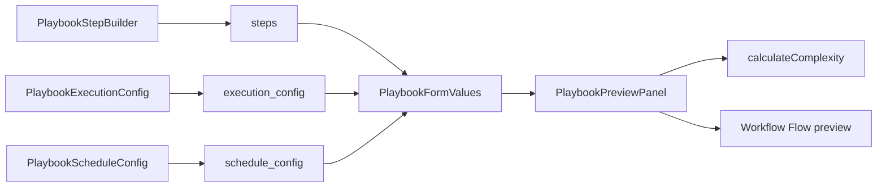

# Creating Recipes

Relevant source files

The following files were used as context for generating this wiki page:

- [frontend/app/tools/__tests__/tools-route.test.tsx](frontend/app/tools/__tests__/tools-route.test.tsx)
- [frontend/app/tools/page.tsx](frontend/app/tools/page.tsx)
- [frontend/components/assignments/assignments-missions-grid.tsx](frontend/components/assignments/assignments-missions-grid.tsx)
- [frontend/components/assignments/assignments-page.tsx](frontend/components/assignments/assignments-page.tsx)
- [frontend/components/assignments/assignments-playbooks-grid.tsx](frontend/components/assignments/assignments-playbooks-grid.tsx)
- [frontend/components/layout/header.tsx](frontend/components/layout/header.tsx)
- [frontend/components/layout/mobile-sidebar.tsx](frontend/components/layout/mobile-sidebar.tsx)
- [frontend/components/layout/sidebar.tsx](frontend/components/layout/sidebar.tsx)
- [frontend/components/missions/mission-list.tsx](frontend/components/missions/mission-list.tsx)
- [frontend/components/tools/__tests__/tools-studio-variant.test.ts](frontend/components/tools/__tests__/tools-studio-variant.test.ts)
- [frontend/components/tools/my-tools-dashboard.tsx](frontend/components/tools/my-tools-dashboard.tsx)
- [frontend/components/workflows/playbook-execution-config.tsx](frontend/components/workflows/playbook-execution-config.tsx)
- [frontend/components/workflows/playbook-preview-panel.tsx](frontend/components/workflows/playbook-preview-panel.tsx)
- [frontend/components/workflows/playbook-schedule-config.tsx](frontend/components/workflows/playbook-schedule-config.tsx)
- [frontend/components/workflows/playbook-step-builder.tsx](frontend/components/workflows/playbook-step-builder.tsx)
- [frontend/components/workflows/playbooks-tab.tsx](frontend/components/workflows/playbooks-tab.tsx)
- [frontend/components/workflows/view-playbook-modal.tsx](frontend/components/workflows/view-playbook-modal.tsx)
- [frontend/hooks/use-assignments-api.ts](frontend/hooks/use-assignments-api.ts)
- [orchestrator/api/assignments.py](orchestrator/api/assignments.py)

## Purpose and Scope

This page describes the recipe/playbook creation experience visible in the provided code: entry points from the Assignments interface, the step builder, live preview, execution settings, and schedule configuration. It focuses on frontend form behavior; the supplied files do not show the creation modal’s submission handler or backend persistence path. [frontend/components/assignments/assignments-page.tsx:20-23](), [frontend/components/workflows/playbook-step-builder.tsx:109-202](), [frontend/components/workflows/playbook-preview-panel.tsx:70-120]()

Sources: `frontend/components/assignments/assignments-page.tsx`, `frontend/components/workflows/playbook-step-builder.tsx`, `frontend/components/workflows/playbook-preview-panel.tsx`

---

## Assignments Hub & Discovery Flow

The Assignments interface provides a Playbooks view alongside a Missions view. `resolveTab` accepts only the `playbooks` and `missions` query values and defaults to `playbooks`; the page imports `AssignmentsPlaybooksGrid` and the `CreatePlaybookModal`. [frontend/components/assignments/assignments-page.tsx:20-40]()

The featured Playbook card opens a playbook modal when clicked or activated with Enter or Space. The `AssignmentsPlaybooksGrid` component renders filter chips for `all`, `mine`, `workspace`, and `imported`, then delegates its playbook grid to `PlaybooksTab`. The supplied grid code stores the selected chip in `activeFilter`; it does not pass that value to `PlaybooksTab`. [frontend/components/assignments/assignments-page.tsx:44-85](), [frontend/components/assignments/assignments-playbooks-grid.tsx:11-24](), [frontend/components/assignments/assignments-playbooks-grid.tsx:49-81]()

The `PlaybooksTab` component fetches playbooks with `useWorkflowPlaybooks`, using an optional search term and a limit of 100. It also initializes mutations for deletion, usage recording, execution, and marketplace submission. An externally controlled create request opens its create modal and clears any current edit data. [frontend/components/workflows/playbooks-tab.tsx:111-160]()

**Natural Language Space to Code Entity Space: Open Playbook Creation**

Sources: `frontend/components/assignments/assignments-page.tsx`, `frontend/components/assignments/assignments-playbooks-grid.tsx`, `frontend/components/workflows/playbooks-tab.tsx`

### Listing, viewing, and execution entry points

`PlaybooksTab` maps fetched agents by numeric ID for use in playbook cards and loads playbook suggestions and recent executions when a playbook is selected for viewing. The list component’s `handleRunPlaybook` uses a ref to prevent overlapping runs and sets the selected playbook’s cooking state before its asynchronous work. [frontend/components/workflows/playbooks-tab.tsx:133-173](), [frontend/components/workflows/playbooks-tab.tsx:189-194]()

The view modal identifies marketplace recipes using `owner_type === 'marketplace'`. It considers a playbook incomplete when it has no steps, displays an incomplete-playbook warning, and disables the Run button in that state. Workspace recipes can show Edit and Run actions; marketplace recipes do not show those workspace actions. [frontend/components/workflows/view-playbook-modal.tsx:47-54](), [frontend/components/workflows/view-playbook-modal.tsx:81-119]()

**Natural Language Space to Code Entity Space: Run from a Playbook Card**

Sources: `frontend/components/workflows/playbooks-tab.tsx`, `frontend/components/workflows/view-playbook-modal.tsx`, `frontend/components/assignments/assignments-playbooks-grid.tsx`

---

## Step Builder & Agent Staffing

`PlaybookStepBuilder` reads and updates the shared `PlaybookFormValues` through `useFormContext`. It watches the `steps` field and fetches agents using `useAgents`; the builder’s agent list includes only agents whose status is `active`. [frontend/components/workflows/playbook-step-builder.tsx:109-118]()

Adding a step appends a record with a generated `step_id`, a one-based `order`, empty `agent_id` and `prompt_template`, an undefined `pass_to`, `error_handling` set to `stop`, and an empty `pre_exec`. Removing a step re-numbers the remaining steps and clears any `pass_to` reference to the removed step. Moving a step swaps its position and re-numbers all step orders. [frontend/components/workflows/playbook-step-builder.tsx:120-159]()

`updateStep` replaces a selected step field in the steps array and writes the array back to form state. The builder checks `pass_to` chains for cycles by following each referenced step ID and detecting revisits. Its validation messages require at least one step, require an agent for every step, and report a circular `pass_to` chain. [frontend/components/workflows/playbook-step-builder.tsx:161-202]()

### Prompt variables and step fields

`VariableHighlightTextarea` overlays a formatted `<pre>` over a textarea to highlight `{word}`-shaped variables. It escapes HTML entities in the entered value before applying the variable markup, and synchronizes the overlay’s scroll position with the textarea. [frontend/components/workflows/playbook-step-builder.tsx:56-107]()

The step builder defines error-handling choices named `stop`, `skip`, `retry`, and `fallback`. The available lines also show the initial step’s `error_handling` default as `stop`. [frontend/components/workflows/playbook-step-builder.tsx:49-54](), [frontend/components/workflows/playbook-step-builder.tsx:120-130]()

Sources: `frontend/components/workflows/playbook-step-builder.tsx`

---

## Preview Panel & Complexity Engine

`PlaybookPreviewPanel` watches the form’s `name`, `description`, `steps`, `execution_config`, and `schedule_config` values. It fetches agents with `useAgents`, filters them to active agents, and maps the agents referenced by steps so the preview can display the selected step assignments. [frontend/components/workflows/playbook-preview-panel.tsx:70-97]()

The panel aggregates skills from the selected step agents into a set keyed by skill ID, then exposes the collected skill names as the preview’s tool list. Its complexity calculation is memoized from the current steps, execution configuration, and schedule configuration. [frontend/components/workflows/playbook-preview-panel.tsx:99-115]()

`calculateComplexity` adds points for step count, parallel execution, retry settings, scheduled or triggered execution, and custom `pass_to` routing. It caps the score at 100 and assigns the labels `Simple`, `Moderate`, `Complex`, or `Advanced` at score thresholds of 25, 50, and 75. [frontend/components/workflows/playbook-preview-panel.tsx:37-68]()

The preview renders the playbook name and optional description, badges for execution mode, schedule type, and step count, and a visual flow section when steps exist. The schedule badge maps `manual`, `cron`, and `trigger` to Manual, Scheduled, and Triggered labels. [frontend/components/workflows/playbook-preview-panel.tsx:31-35](), [frontend/components/workflows/playbook-preview-panel.tsx:120-183]()

Sources: `frontend/components/workflows/playbook-preview-panel.tsx`

---

## Execution Configuration & Scheduling

`PlaybookExecutionConfig` reads `execution_config` and `steps` from the shared form context. Its update helper replaces one execution-config field while preserving the others. [frontend/components/workflows/playbook-execution-config.tsx:21-28]()

The execution mode controls offer `sequential` and `parallel`. The component calculates the displayed maximum time as `stepCount × timeout_per_step` for sequential execution, where `stepCount` is at least one; for parallel execution it uses a single `timeout_per_step`. The UI also exposes maximum retries, per-step timeout, and total timeout fields. [frontend/components/workflows/playbook-execution-config.tsx:30-35](), [frontend/components/workflows/playbook-execution-config.tsx:45-80](), [frontend/components/workflows/playbook-execution-config.tsx:83-140]()

The schedule configuration offers `manual`, `cron`, and `trigger` types. It updates `schedule_config` through the shared form context and provides quick-pick cron expressions for hourly, daily, weekdays, weekly, or custom scheduling. [frontend/components/workflows/playbook-schedule-config.tsx:12-24](), [frontend/components/workflows/playbook-schedule-config.tsx:86-118]()

For a cron preview, `getNextCronRuns` accepts five whitespace-separated fields and iterates minute-by-minute, up to roughly one month of minutes, to find matching times. `PlaybookScheduleConfig` requests five preview runs when the selected schedule type is `cron` and a cron expression is present. [frontend/components/workflows/playbook-schedule-config.tsx:26-84](), [frontend/components/workflows/playbook-schedule-config.tsx:120-123]()

**Creation Form Data Flow**

Sources: `frontend/components/workflows/playbook-step-builder.tsx`, `frontend/components/workflows/playbook-execution-config.tsx`, `frontend/components/workflows/playbook-schedule-config.tsx`, `frontend/components/workflows/playbook-preview-panel.tsx`

---

## Assignments Recommended Feed

The Assignments page imports `useRecommendedAssignments`; the provided hook calls `apiClient.getRecommendedAssignments(limit)` through React Query and uses a five-minute stale time. The hook’s default limit is 8. [frontend/components/assignments/assignments-page.tsx:26-29](), [frontend/hooks/use-assignments-api.ts:24-35]()

The backend endpoint `GET /api/assignments/recommended` accepts a limit from 1 to 24, defaulting to 12. It selects approved marketplace `WorkflowTemplate` records, excludes marketplace templates already cloned into the current workspace, and orders the results by featured status, install count, then creation time. [orchestrator/api/assignments.py:22-59]()

The endpoint returns item summaries marked with `type: "playbook"` and `source: "marketplace"`, alongside `workspace_count` and `marketplace_count`. [orchestrator/api/assignments.py:61-81]()

Sources: `frontend/components/assignments/assignments-page.tsx`, `frontend/hooks/use-assignments-api.ts`, `orchestrator/api/assignments.py`

---