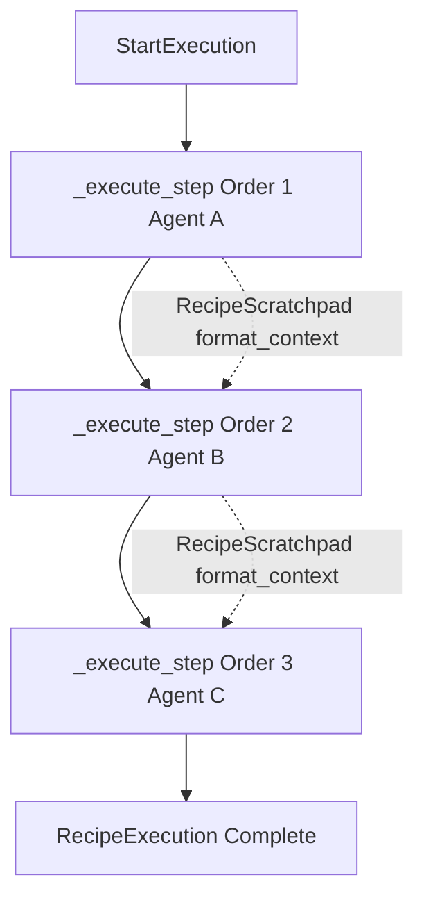
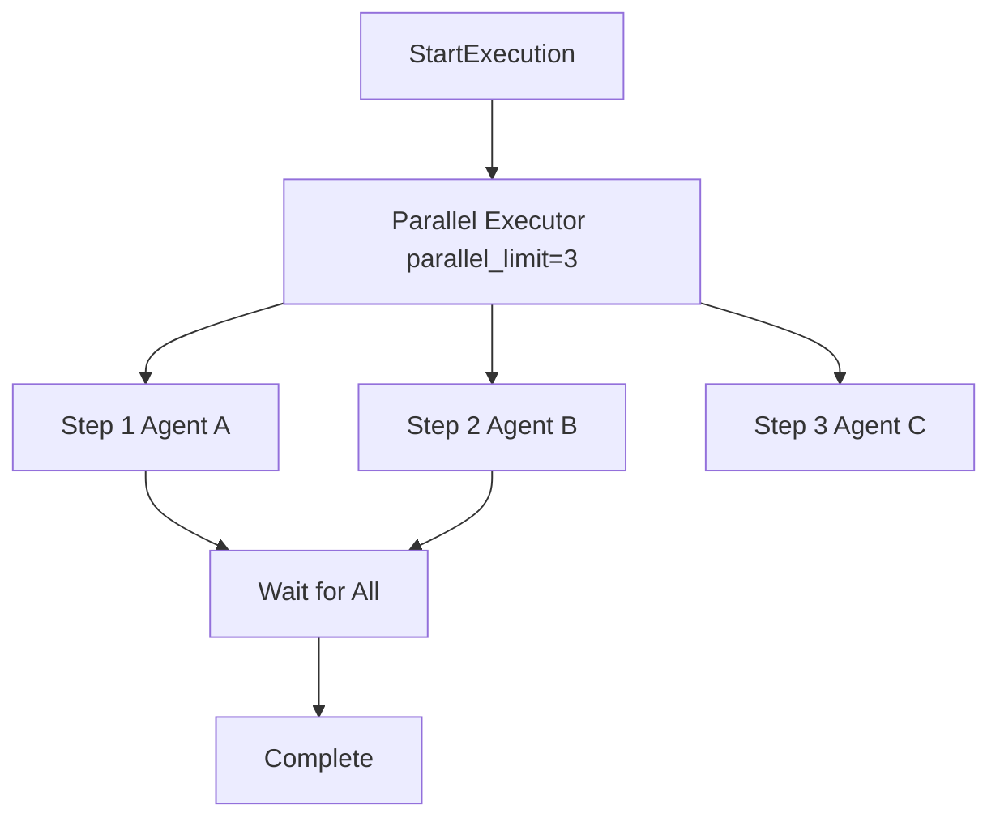
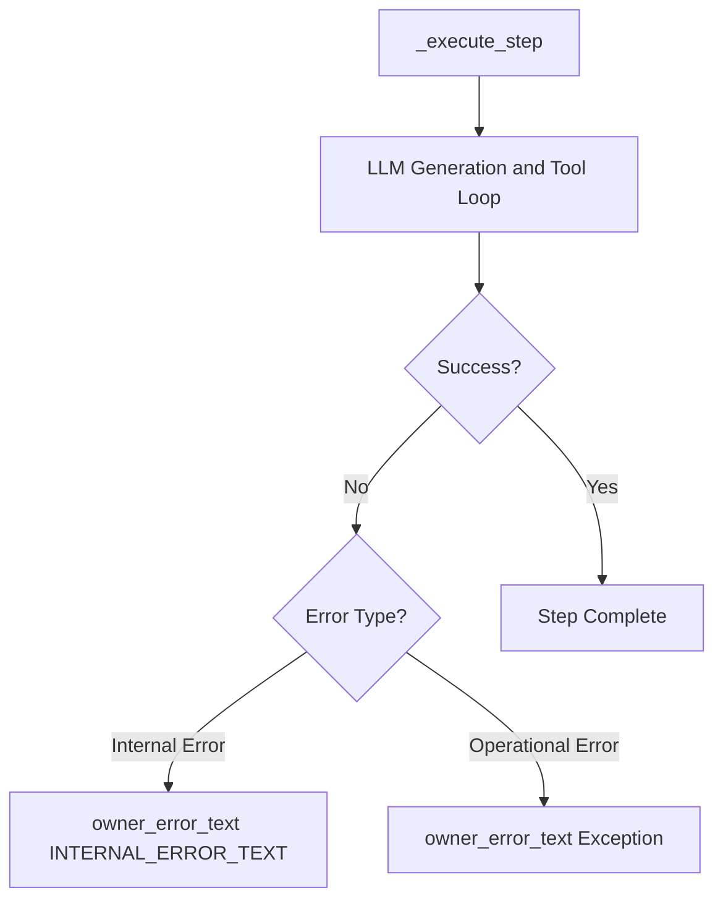
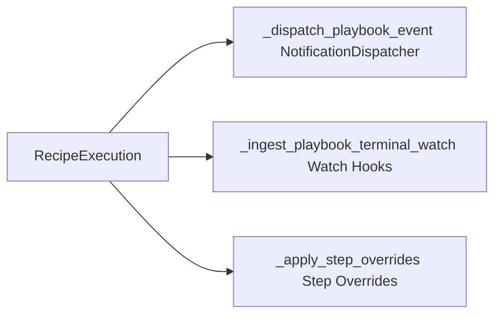
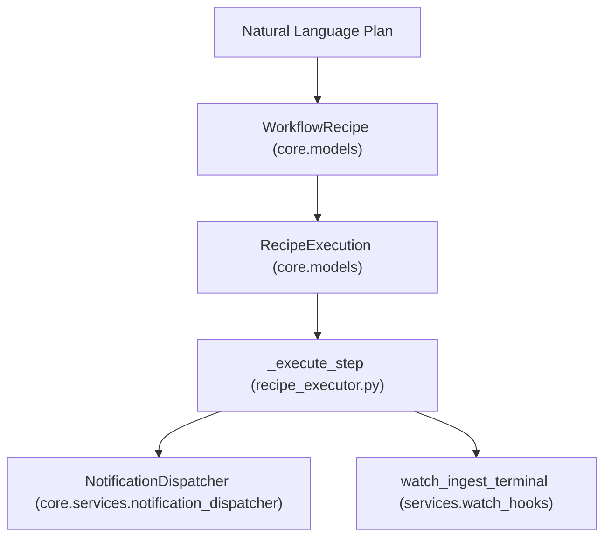
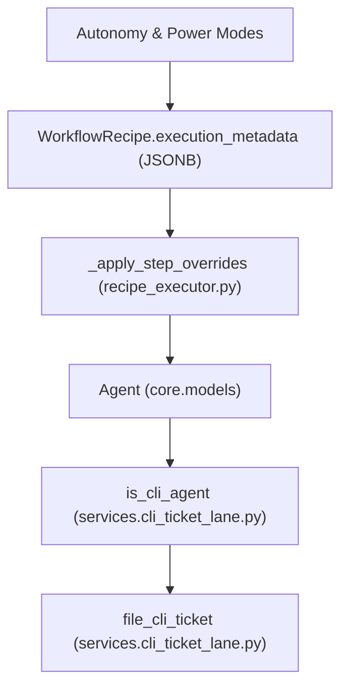

# Execution Configuration

Relevant source files

The following files were used as context for generating this wiki page:

- [frontend/components/workflows/execution-kitchen.tsx](frontend/components/workflows/execution-kitchen.tsx)
- [orchestrator/alembic/versions/dedupe_skills_unique_workspace_name.py](orchestrator/alembic/versions/dedupe_skills_unique_workspace_name.py)
- [orchestrator/api/composio.py](orchestrator/api/composio.py)
- [orchestrator/api/patterns.py](orchestrator/api/patterns.py)
- [orchestrator/api/recipe_executor.py](orchestrator/api/recipe_executor.py)
- [orchestrator/api/skills.py](orchestrator/api/skills.py)
- [orchestrator/api/templates.py](orchestrator/api/templates.py)
- [orchestrator/api/tools.py](orchestrator/api/tools.py)
- [orchestrator/api/webhooks.py](orchestrator/api/webhooks.py)
- [orchestrator/api/workflow_recipes.py](orchestrator/api/workflow_recipes.py)
- [orchestrator/core/composio/client.py](orchestrator/core/composio/client.py)
- [orchestrator/core/composio/linkedin_image_workaround.py](orchestrator/core/composio/linkedin_image_workaround.py)
- [orchestrator/core/credentials/tester.py](orchestrator/core/credentials/tester.py)
- [orchestrator/core/credentials/types.py](orchestrator/core/credentials/types.py)
- [orchestrator/core/database/credential_types_seed.json](orchestrator/core/database/credential_types_seed.json)
- [orchestrator/core/routing/ingestors/webhook.py](orchestrator/core/routing/ingestors/webhook.py)
- [orchestrator/core/services/skill_materializer.py](orchestrator/core/services/skill_materializer.py)
- [orchestrator/modules/agents/services/skill_loader.py](orchestrator/modules/agents/services/skill_loader.py)
- [orchestrator/services/metadata_sync_service.py](orchestrator/services/metadata_sync_service.py)
- [orchestrator/services/webhook_dedup.py](orchestrator/services/webhook_dedup.py)
- [orchestrator/tests/test_p2w2_webhook_dedup.py](orchestrator/tests/test_p2w2_webhook_dedup.py)
- [orchestrator/tests/test_p2w2_webhook_signature_reject.py](orchestrator/tests/test_p2w2_webhook_signature_reject.py)
- [orchestrator/tests/test_prd251_linkedin_scope.py](orchestrator/tests/test_prd251_linkedin_scope.py)

This page documents the execution configuration system for workflow recipes, which controls how recipe steps are executed, retried, timed out, and isolated. Execution configuration determines the runtime behavior of multi-step workflows, including concurrency strategy, error handling, memory management, and power modes.

For information about creating recipes and defining steps, see [Creating Recipes](6.1). For the execution engine that processes these configurations, see [Recipe Execution Engine](6.2). For scheduling recipes to run automatically, see [Scheduling & Triggers](6.4).

---

## 1. Configuration Structure & Parameters

Execution configuration is stored as a JSONB field within workflow template tables (`WorkflowTemplate`), controlling runtime parameters such as retry limits, step timeouts, concurrency limits, and execution modes [orchestrator/api/workflow_recipes.py:25](). Per-execution step overrides allow fine-tuning individual step prompts without modifying the shared template [orchestrator/api/recipe_executor.py:166-173]().

### Configuration Parameters

| Field | Type | Description | Default | Range/Options |
|-------|------|-------------|---------|---------------|
| `mode` | string | Execution strategy | `"sequential"` | `"sequential"`, `"parallel"` |
| `max_retries` | integer | Retry attempts per step | `3` | `0-5` |
| `timeout_per_step` | integer | Step timeout (seconds) | `120` | `10-600` |
| `total_timeout` | integer | Total execution timeout (seconds) | `600` | `10-3600` |
| `auto_learning` | boolean | Enable pattern extraction | `true` | `true`, `false` |
| `parallel_limit` | integer | Max concurrent steps (parallel mode) | `3` | `1-20` |
| `memory_isolation` | string | Context sharing strategy | `"shared"` | `"shared"`, `"isolated"` |
| `power_mode` | string | Execution governance tier | `"standard"` | `"standard"`, `"aggressive"`, `"autonomous"` |
| `step_overrides` | dict | Per-execution prompt tweaks | `None` | `{step_id: {"prompt_template": "..."}}` |

Sources: [orchestrator/api/workflow_recipes.py:25](), [orchestrator/api/recipe_executor.py:166-173]()

---

## 2. Execution Modes

### Sequential Mode

Steps execute one after another in order. Each step waits for the previous step to complete before starting. Output from step $N$ is passed to step $N+1$ via the `RecipeScratchpad` which provides token efficiency over verbose text dumps [orchestrator/api/recipe_executor.py:14-16]().

Title: "Recipe Execution Data Flow Sequential"

Sources: [orchestrator/api/recipe_executor.py:14-16]()

**Characteristics:**
- **Predictable Order**: Guaranteed execution sequence based on the step configuration.
- **Contextual Awareness**: Steps access scratchpad exports via context injection.
- **Step Overrides**: The `_apply_step_overrides` function merges execution metadata step overrides into the step list for a specific execution without mutating the shared template [orchestrator/api/recipe_executor.py:166-173]().

### Parallel Mode

Steps execute simultaneously up to the `parallel_limit`. While direct recipe execution handles sequential processing, advanced parallel scheduling manages concurrency constraints, worker pools, and task synchronization. The `RecipeExecution` model tracks the execution of recipes [orchestrator/core/models/core.py:38]().

Title: "Parallel Execution Logic"

Sources: [orchestrator/core/models/core.py:38]()

---

## 3. Retry and Timeout Configuration

### Maximum Retries & Iterations

The system handles operational vs. programming errors distinctly during execution. Internal errors like `TypeError` or `AttributeError` are trapped and reported via `owner_error_text` [orchestrator/api/recipe_executor.py:71-76](), while operational errors retain their provider messages. The `_INTERNAL_ERRORS` tuple defines the types of exceptions considered internal [orchestrator/api/recipe_executor.py:56-57]().

Title: "Error and Retry Handling Flow"

Sources: [orchestrator/api/recipe_executor.py:56-57](), [orchestrator/api/recipe_executor.py:71-76]()

---

## 4. Memory Isolation, Learning & Dispatch Pipelines

### Memory Isolation
Memory isolation controls whether steps share execution context or run independently:
- **Shared Memory (Default)**: Steps share a common `RecipeScratchpad` and utilize the `scratchpad_write` tool for explicit data exports [orchestrator/api/recipe_executor.py:14-16]().
- **Isolated Memory**: Each step runs in an isolated context without referencing prior step states.

### Auto-Learning, Watch Integration & Notifications
When recipes execute, the backend integrates with watch hooks, notification dispatchers, and memory services [orchestrator/api/recipe_executor.py:82-112](), [orchestrator/api/recipe_executor.py:126-159]().

Title: "Execution Seams and Dispatch Pipeline"

Sources: [orchestrator/api/recipe_executor.py:82-112](), [orchestrator/api/recipe_executor.py:126-159]()

- **Notifications**: Fires playbook events through `_dispatch_playbook_event` using `NotificationDispatcher` [orchestrator/api/recipe_executor.py:82-112]().
- **Terminal Watches**: Reports terminal states to the live watch registry via `_ingest_playbook_terminal_watch` [orchestrator/api/recipe_executor.py:126-159]().
- **Memory Seams**: Integrates recipe memory pre- and post-execution.

---

## 5. Natural Language to Code Entity Space Bridges

The following diagrams map abstract execution concepts to actual code entities and services within the Automatos AI codebase.

Title: "Natural Language to Code Entity Execution Tracking"

Sources: [orchestrator/core/models/core.py:38](), [orchestrator/api/recipe_executor.py:6](), [orchestrator/api/recipe_executor.py:100](), [orchestrator/api/recipe_executor.py:138]()

Title: "Natural Language to Code Entity Policy and Power Modes"

Sources: [orchestrator/api/workflow_recipes.py:25](), [orchestrator/api/recipe_executor.py:166-173](), [orchestrator/core/models/core.py:37](), [orchestrator/services/cli_ticket_lane.py:81](), [orchestrator/services/cli_ticket_lane.py:127]()

---