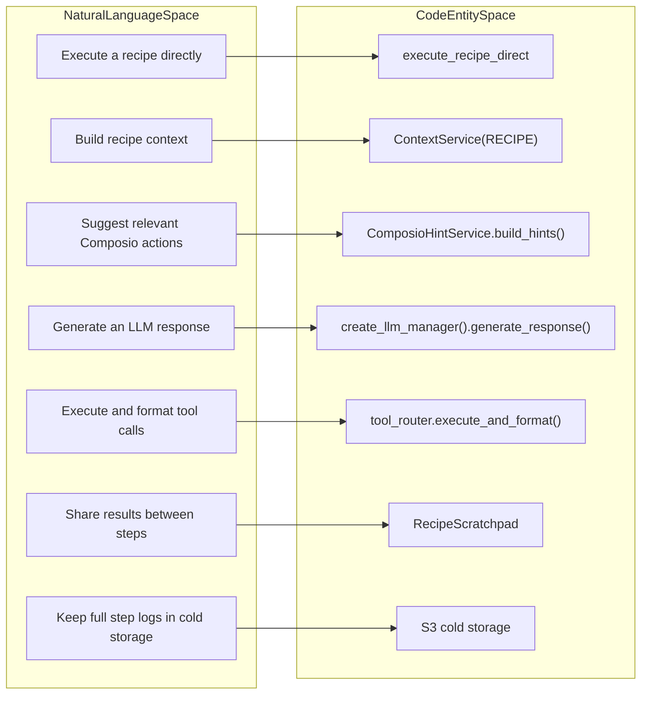
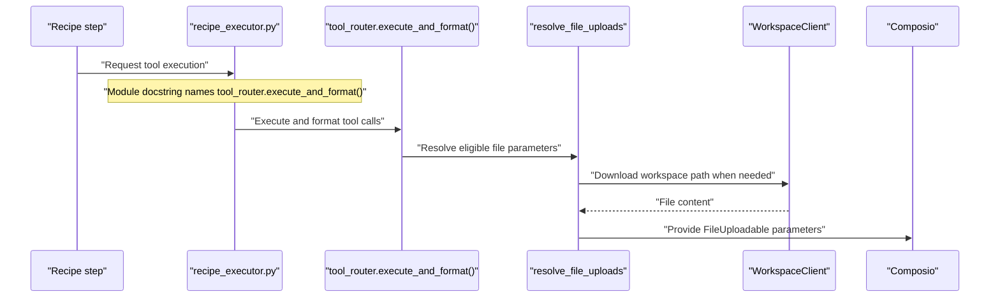
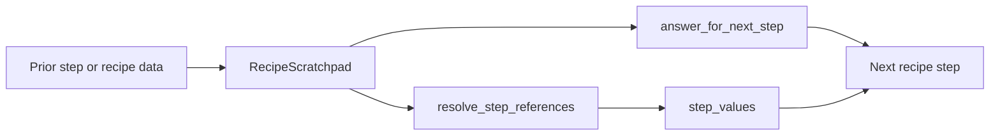

# Recipe Execution Engine

Relevant source files

The following files were used as context for generating this wiki page:

- [frontend/components/workflows/execution-kitchen.tsx](frontend/components/workflows/execution-kitchen.tsx)
- [orchestrator/alembic/versions/dedupe_skills_unique_workspace_name.py](orchestrator/alembic/versions/dedupe_skills_unique_workspace_name.py)
- [orchestrator/api/composio.py](orchestrator/api/composio.py)
- [orchestrator/api/patterns.py](orchestrator/api/patterns.py)
- [orchestrator/api/recipe_executor.py](orchestrator/api/recipe_executor.py)
- [orchestrator/api/skills.py](orchestrator/api/skills.py)
- [orchestrator/api/templates.py](orchestrator/api/templates.py)
- [orchestrator/api/tools.py](orchestrator/api/tools.py)
- [orchestrator/api/webhooks.py](orchestrator/api/webhooks.py)
- [orchestrator/api/workflow_recipes.py](orchestrator/api/workflow_recipes.py)
- [orchestrator/core/composio/client.py](orchestrator/core/composio/client.py)
- [orchestrator/core/composio/linkedin_image_workaround.py](orchestrator/core/composio/linkedin_image_workaround.py)
- [orchestrator/core/credentials/tester.py](orchestrator/core/credentials/tester.py)
- [orchestrator/core/credentials/types.py](orchestrator/core/credentials/types.py)
- [orchestrator/core/database/credential_types_seed.json](orchestrator/core/database/credential_types_seed.json)
- [orchestrator/core/routing/ingestors/webhook.py](orchestrator/core/routing/ingestors/webhook.py)
- [orchestrator/core/services/skill_materializer.py](orchestrator/core/services/skill_materializer.py)
- [orchestrator/modules/agents/services/skill_loader.py](orchestrator/modules/agents/services/skill_loader.py)
- [orchestrator/services/metadata_sync_service.py](orchestrator/services/metadata_sync_service.py)
- [orchestrator/services/webhook_dedup.py](orchestrator/services/webhook_dedup.py)
- [orchestrator/tests/test_p2w2_webhook_dedup.py](orchestrator/tests/test_p2w2_webhook_dedup.py)
- [orchestrator/tests/test_p2w2_webhook_signature_reject.py](orchestrator/tests/test_p2w2_webhook_signature_reject.py)
- [orchestrator/tests/test_prd251_linkedin_scope.py](orchestrator/tests/test_prd251_linkedin_scope.py)

## Purpose and Scope

The Recipe Execution Engine is a direct, step-by-step executor for Starter Plan recipes. Its module documentation says it bypasses the nine-stage pipeline and executes recipe steps sequentially using components also used by the chatbot: `ContextService(RECIPE)`, `ComposioHintService.build_hints()`, `create_llm_manager().generate_response()`, and `tool_router.execute_and_format()` [orchestrator/api/recipe_executor.py:1-12](). The module also describes v2 changes: `RecipeScratchpad`, an injected `scratchpad_write` tool, S3 cold storage for full step logs with compact database summaries, and Mem0 recipe memory before and after execution [orchestrator/api/recipe_executor.py:14-18]().

This page covers the execution module’s documented design and the implementation details visible in the supplied source. The excerpt provided does not include the definitions of `execute_recipe_direct`, `_execute_step`, workspace semaphores, or the S3 write path, so their internal control flow and configuration are not specified here.

Sources: [orchestrator/api/recipe_executor.py:1-18]()

---

## Architecture Overview

The recipe executor imports the recipe and execution models, database session helpers, step-reference utilities, step-lesson and usage helpers, brand hooks, held execution context, and recipe step-outcome helpers [orchestrator/api/recipe_executor.py:32-48](). Its module documentation identifies the chatbot-aligned context, LLM, hint, and tool-execution components used by the direct executor [orchestrator/api/recipe_executor.py:5-12]().

### System Component Map: Natural Language to Code Entities

This diagram maps recipe-execution concepts to names explicitly present in the supplied source. It does not imply call relationships beyond those documented in the module description.

Sources: [orchestrator/api/recipe_executor.py:5-18]()

### Execution Responsibilities

| Concern | Documented entity or behavior |
|---|---|
| Recipe execution | The module describes direct, sequential execution of recipe steps [orchestrator/api/recipe_executor.py:5-7](). |
| Context and tools | `ContextService(RECIPE)` supplies the system prompt and base tools; `ComposioHintService.build_hints()` supplies hints [orchestrator/api/recipe_executor.py:9-10](). |
| LLM response | `create_llm_manager().generate_response()` is the documented LLM path [orchestrator/api/recipe_executor.py:11](). |
| Tool execution | `tool_router.execute_and_format()` is the documented tool path [orchestrator/api/recipe_executor.py:12](). |
| Inter-step data | The v2 notes identify `RecipeScratchpad` and an injected `scratchpad_write` tool [orchestrator/api/recipe_executor.py:14-16](). |
| Step logs | The v2 notes describe full step logs in S3 and compact summaries in the database [orchestrator/api/recipe_executor.py:17-18](). |

Sources: [orchestrator/api/recipe_executor.py:5-18]()

---

## Workspace Semaphores

The supplied excerpt does not show the workspace semaphore definitions or their acquisition and release sites. Consequently, it does not establish the semaphore key, concurrency limit, waiting behavior, or whether limits are process-local or shared across workers. The visible imports and module documentation are insufficient to infer those implementation details [orchestrator/api/recipe_executor.py:1-48]().

Sources: [orchestrator/api/recipe_executor.py:1-48]()

---

## Main Execution Loop: `execute_recipe_direct`

The module’s docstring describes a direct executor that processes recipe steps sequentially and bypasses the nine-stage pipeline [orchestrator/api/recipe_executor.py:1-7](). It names the components used for context construction, tool hints, LLM generation, and tool execution [orchestrator/api/recipe_executor.py:9-12](). The definition and body of `execute_recipe_direct` are not included in the supplied excerpt, so its database transitions, semaphore lifecycle, and exact step-loop implementation cannot be detailed from the available source.

The visible imports show several execution-related helpers:
*   `_dispatch_playbook_event` [orchestrator/api/recipe_executor.py:82-119]()
*   `_ingest_playbook_terminal_watch` [orchestrator/api/recipe_executor.py:126-159]()
*   `_apply_step_overrides` [orchestrator/api/recipe_executor.py:166-173]()

### Execution-Related Helpers Visible in the Excerpt

`_dispatch_playbook_event` constructs a `NotificationDispatcher` using the executor’s database session and workspace ID, then dispatches a playbook event linked to the recipe execution [orchestrator/api/recipe_executor.py:82-112](). It catches exceptions and logs the failure rather than allowing notification errors to block playbook execution [orchestrator/api/recipe_executor.py:93-119]().

`_ingest_playbook_terminal_watch` builds a cost snapshot from `output_data` and, when a final output exists, creates a pointer in the form `recipe_execution:<execution_id>:output_data.final_output` before reporting the terminal state through `watch_ingest_terminal` [orchestrator/api/recipe_executor.py:126-159]().

`_apply_step_overrides` is documented to merge `execution_metadata.step_overrides` into a step list and return new dictionaries so that the shared recipe definition is not mutated [orchestrator/api/recipe_executor.py:163-173](). The provided excerpt shows only the function’s opening and documentation, not the remainder of its implementation.

Sources: [orchestrator/api/recipe_executor.py:32-48](), [orchestrator/api/recipe_executor.py:82-119](), [orchestrator/api/recipe_executor.py:126-159](), [orchestrator/api/recipe_executor.py:163-173]()

---

## Step Execution Logic: `_execute_step`

The module-level description says recipe execution uses the same context, hint, LLM-generation, and tool-execution components as the chatbot [orchestrator/api/recipe_executor.py:5-12](). The supplied excerpt does not show the definition of `_execute_step`, so its parameters, agent activation sequence, prompt construction, model invocation arguments, and tool-loop behavior cannot be verified from the available lines.

The visible imports show several step-level dependencies: `answer_for_next_step`, `resolve_step_references`, and `step_values` support scratchpad and step-reference handling; `a_playbook_step_carries_its_lessons` and `a_playbook_step_is_on_brand` provide lesson and brand-related hooks; and `books_the_step_to_its_agent` is imported alongside run usage accounting [orchestrator/api/recipe_executor.py:41-46](). These imports identify integration points but do not, by themselves, establish when or how `_execute_step` invokes them.

Sources: [orchestrator/api/recipe_executor.py:5-12](), [orchestrator/api/recipe_executor.py:41-46]()

---

## Tool Execution Loop and File Upload Resolution

The recipe executor’s module documentation identifies `tool_router.execute_and_format()` as the tool-execution path [orchestrator/api/recipe_executor.py:9-12](). The supplied excerpt does not show the recipe executor’s tool-call loop or the call site that connects it to the router.

The Composio tool executor provides a visible file-upload helper shared by the Composio executor and `recipe_executor`. `resolve_file_uploads` is documented as converting file references in parameters into Composio `FileUploadable` objects and returning temporary files alongside the resolved parameters [orchestrator/core/composio/tool_executor.py:126-141](). It applies only to actions listed in `UPLOAD_ACTIONS` [orchestrator/core/composio/tool_executor.py:41-51](), recognizes URL references and paths with supported file extensions [orchestrator/core/composio/tool_executor.py:53-68](), and obtains workspace files through `WorkspaceClient.download_file` before staging them in a temporary file [orchestrator/core/composio/tool_executor.py:100-123]().

### Tool Execution and Upload Resolution: Natural Language to Code Entities

Sources: [orchestrator/api/recipe_executor.py:9-12](), [orchestrator/core/composio/tool_executor.py:38-51](), [orchestrator/core/composio/tool_executor.py:71-123](), [orchestrator/core/composio/tool_executor.py:126-141]()

### File Upload Resolution Details

For eligible actions, `resolve_file_uploads` inspects parameter values and skips empty values and dictionaries that already contain an `s3key` [orchestrator/core/composio/tool_executor.py:137-162](). URL references are converted using `FileUploadable.from_url`; workspace paths are downloaded with `WorkspaceClient` and converted using `FileUploadable.from_path` [orchestrator/core/composio/tool_executor.py:89-123](). The helper returns unchanged parameters for actions outside `UPLOAD_ACTIONS` [orchestrator/core/composio/tool_executor.py:138-142]().

A specific workaround exists for LinkedIn image posts. The `linkedin_image_workaround` module bypasses Composio and directly calls LinkedIn's Community Management API directly for image posts [orchestrator/core/composio/linkedin_image_workaround.py:3-6](). This is due to Composio's inability to upload images to LinkedIn as of May 2026 [orchestrator/core/composio/linkedin_image_workaround.py:3-4](). The `resolve_file_uploads` function is decorated with `@leaves_its_images_to_the_direct_api` [orchestrator/core/composio/tool_executor.py:126]() to ensure that LinkedIn image references are handled by this direct API call rather than being processed by Composio's file upload mechanism [orchestrator/core/composio/linkedin_image_workaround.py:40-44](). Credentials for this direct API are loaded from the platform's credential store and are workspace-scoped [orchestrator/core/composio/linkedin_image_workaround.py:8-13]().

Sources: [orchestrator/core/composio/tool_executor.py:41-68](), [orchestrator/core/composio/tool_executor.py:71-123](), [orchestrator/core/composio/tool_executor.py:126-162](), [orchestrator/core/composio/linkedin_image_workaround.py:3-13](), [orchestrator/core/composio/linkedin_image_workaround.py:40-44]()

---

## S3 Cold Storage of Step Logs

The recipe executor’s module documentation states that full step logs are stored in S3 cold storage while the database retains compact summaries [orchestrator/api/recipe_executor.py:14-18](). The supplied excerpt does not show the S3 client, object-key format, upload function, database pointer field, retrieval path, or retention policy; those details cannot be established from the available lines.

The visible terminal-watch helper may create a `recipe_execution:<execution_id>:output_data.final_output` pointer when `output_data.final_output` exists, but this is an output pointer passed to the watch-ingestion seam, not evidence of an S3 object key [orchestrator/api/recipe_executor.py:140-159]().

Sources: [orchestrator/api/recipe_executor.py:14-18](), [orchestrator/api/recipe_executor.py:140-159]()

---

## Data Flow: Recipe Scratchpad

The module documentation says `RecipeScratchpad` replaces verbose text dumps, reports 80–90% token savings, and provides the injected `scratchpad_write` tool for explicit agent exports [orchestrator/api/recipe_executor.py:14-16](). The executor imports `answer_for_next_step` from `core.services.playbook_scratchpad`, as well as `resolve_step_references` and `step_values` from `core.services.playbook_step_refs` [orchestrator/api/recipe_executor.py:41-42]().

The provided excerpt does not include the `RecipeScratchpad` class or the code that writes inputs, stores step results, formats context for subsequent steps, or handles `scratchpad_write`. The diagram therefore represents only the documented inter-step sharing concept and the visible imported names.

### Scratchpad Data Flow: Natural Language to Code Entities

Sources: [orchestrator/api/recipe_executor.py:14-16](), [orchestrator/api/recipe_executor.py:41-42]()

---

## UI and Progress Visualization

The workflow execution frontend defines an `ExecutionKitchen` component with workflow and recipe execution identifiers, optional recipe metadata, and a recipe step shape containing `step_id`, `order`, `prompt_template`, and `agent_id` [frontend/components/workflows/execution-kitchen.tsx:46-54](). Its log-entry type includes event categories such as `stage_start`, `stage_complete`, `agent_spawn`, `task_progress`, `task_complete`, `task_error`, `inter_agent`, and `memory_write` [frontend/components/workflows/execution-kitchen.tsx:56-70](). The component imports `PlaybookStepProgress` and `WorkflowStreamViewer` for execution display [frontend/components/workflows/execution-kitchen.tsx:25-44]().

The supplied frontend excerpt does not show how recipe step logs are fetched, how S3-backed logs are retrieved, or how backend events map to the displayed recipe progress.

Sources: [frontend/components/workflows/execution-kitchen.tsx:25-70]()

---