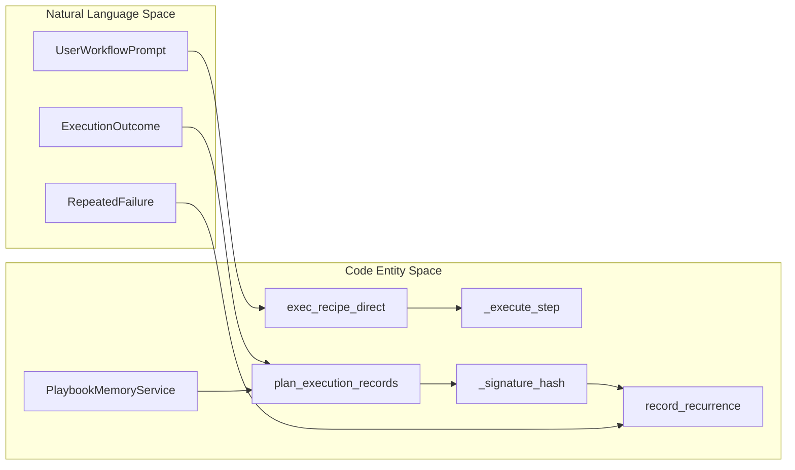
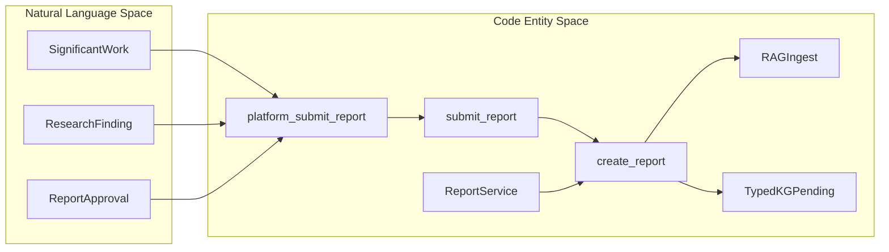
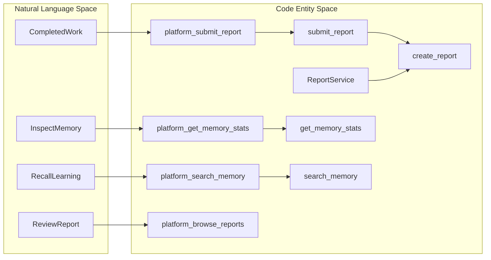

# Recipe Memory & Learning

Relevant source files

The following files were used as context for generating this wiki page:

- [orchestrator/api/widget_memory.py](orchestrator/api/widget_memory.py)
- [orchestrator/core/services/mission_memory_service.py](orchestrator/core/services/mission_memory_service.py)
- [orchestrator/core/services/playbook_memory_service.py](orchestrator/core/services/playbook_memory_service.py)
- [orchestrator/modules/memory/injection_filter.py](orchestrator/modules/memory/injection_filter.py)
- [orchestrator/modules/tools/discovery/actions_agents.py](orchestrator/modules/tools/discovery/actions_agents.py)
- [orchestrator/modules/tools/discovery/actions_assignments.py](orchestrator/modules/tools/discovery/actions_assignments.py)
- [orchestrator/modules/tools/discovery/actions_marketplace.py](orchestrator/modules/tools/discovery/actions_marketplace.py)
- [orchestrator/modules/tools/discovery/actions_monitoring.py](orchestrator/modules/tools/discovery/actions_monitoring.py)
- [orchestrator/modules/tools/discovery/actions_reports.py](orchestrator/modules/tools/discovery/actions_reports.py)
- [orchestrator/modules/tools/discovery/actions_search.py](orchestrator/modules/tools/discovery/actions_search.py)
- [orchestrator/modules/tools/discovery/actions_workspace.py](orchestrator/modules/tools/discovery/actions_workspace.py)
- [orchestrator/modules/tools/discovery/handlers_agents.py](orchestrator/modules/tools/discovery/handlers_agents.py)
- [orchestrator/modules/tools/discovery/handlers_monitoring.py](orchestrator/modules/tools/discovery/handlers_monitoring.py)
- [orchestrator/modules/tools/discovery/handlers_reports.py](orchestrator/modules/tools/discovery/handlers_reports.py)
- [orchestrator/modules/tools/discovery/handlers_search.py](orchestrator/modules/tools/discovery/handlers_search.py)
- [orchestrator/modules/tools/discovery/handlers_workspace.py](orchestrator/modules/tools/discovery/handlers_workspace.py)
- [orchestrator/tests/test_f134_edits_say_they_apply_to_the_next_run.py](orchestrator/tests/test_f134_edits_say_they_apply_to_the_next_run.py)
- [orchestrator/tests/test_f141_an_agents_model_is_checked_on_every_write.py](orchestrator/tests/test_f141_an_agents_model_is_checked_on_every_write.py)
- [orchestrator/tests/test_f144_every_namesake_is_named.py](orchestrator/tests/test_f144_every_namesake_is_named.py)
- [orchestrator/tests/test_f159_a_playbook_run_recalls_its_past_runs.py](orchestrator/tests/test_f159_a_playbook_run_recalls_its_past_runs.py)
- [orchestrator/tests/test_f189_a_memory_is_never_filed_as_another_agent.py](orchestrator/tests/test_f189_a_memory_is_never_filed_as_another_agent.py)
- [orchestrator/tests/test_p2w1_playbook_write_dedup.py](orchestrator/tests/test_p2w1_playbook_write_dedup.py)
- [orchestrator/tests/test_prd222_unknown_model_error_names_the_way_out.py](orchestrator/tests/test_prd222_unknown_model_error_names_the_way_out.py)

## Purpose and scope

This page describes how recipe execution experience can be retained and reused, with emphasis on `PlaybookMemoryService` pattern planning, report-driven knowledge capture, and the observable feedback available through workspace memory and reports. The supplied code excerpts also show that report submission delegates knowledge-flywheel work to `ReportService.create_report`; they do not include the implementation of `PlaybookMemoryService`, quality-assessment services, or KPI endpoints, so those details are limited to the previously documented references and are not expanded beyond what those references support. [orchestrator/modules/tools/discovery/handlers_reports.py:82-106]()

Sources: [orchestrator/modules/tools/discovery/handlers_reports.py:82-106](), [orchestrator/core/services/playbook_memory_service.py:5-18]()

---

## 1. PlaybookMemoryService & Durable State

Recipes need execution memory that is scoped to the playbook and workspace, rather than relying only on conversation memory. The existing implementation notes identify `PlaybookMemoryService` as the service for durable playbook memory and cite its execution-record planning and recurrence-handling responsibilities. [orchestrator/core/services/playbook_memory_service.py:5-18]()

The documented planning contract is selective rather than “store every run and every step”:

- `plan_execution_records` produces a playbook-level `playbook_summary` record for an execution. [orchestrator/core/services/playbook_memory_service.py:11-16]()
- It plans step records for failed steps when their error class differs from the run-level error class. [orchestrator/core/services/playbook_memory_service.py:11-16]()
- `_signature_hash` and `record_recurrence` represent repeated outcomes as a recurrence signal rather than writing a new memory row for every identical occurrence. [orchestrator/core/services/playbook_memory_service.py:11-18]()

This design separates two concerns: a durable record of a run’s outcome and a recurrence signal that can represent repeated failures compactly. [orchestrator/core/services/playbook_memory_service.py:11-18]()

### Natural-language intent mapped to code entities

The first diagram connects a user’s request to run a recipe with the execution and memory symbols identified in the existing implementation notes. The diagram is a conceptual association; it does not establish call-site relationships beyond those noted above. [orchestrator/core/services/playbook_memory_service.py:5-18]()

**Title: Recipe request and execution-memory entities**

Sources: [orchestrator/core/services/playbook_memory_service.py:5-18]()

### Recurrence handling

The existing service notes describe an in-process recurrence registry with a maximum size of 512 entries. `record_recurrence` increments the recurrence count for a matching signature, preserving a frequency signal without accumulating duplicate memory rows. [orchestrator/core/services/playbook_memory_service.py:42-66]()

The signature is described as a SHA-256 fingerprint based on the outcome and workspace/playbook identifiers. Error-classification helpers are cited separately as the mechanism for mapping raw exception strings into stable classes. [orchestrator/core/services/playbook_memory_service.py:49-51](), [orchestrator/modules/memory/tool_outcome_capture.py:43-56]()

Sources: [orchestrator/core/services/playbook_memory_service.py:42-66](), [orchestrator/modules/memory/tool_outcome_capture.py:43-56]()

---

## 2. Report capture as a knowledge-flywheel input

Recipe memory is not the only durable record of work. Agents can submit structured reports through the `platform_submit_report` action, which is registered as a write action and intended for significant work such as research, heartbeat results, audits, and deliverables. [orchestrator/modules/tools/discovery/actions_reports.py:17-38]()

The `submit_report` handler validates required fields, report type, status, placeholders, and optional required sections before calling `ReportService.create_report`. It passes through report content and metadata including summary, metrics, recommendations, action items, linked task IDs, and approval requirements. [orchestrator/modules/tools/discovery/handlers_reports.py:16-61](), [orchestrator/modules/tools/discovery/handlers_reports.py:63-98]()

The handler explicitly documents that the knowledge flywheel inside `ReportService.create_report` owns both RAG ingestion and typed knowledge-graph pending work, including report text and agent attribution, while honoring the workspace opt-out. The previous direct scheduling path was removed. [orchestrator/modules/tools/discovery/handlers_reports.py:100-104]()

### Natural-language report intent mapped to code entities

This diagram associates report-oriented user intent with the actual action and handler symbols. The report’s downstream knowledge capture is delegated to `ReportService.create_report`, rather than scheduled directly in the handler. [orchestrator/modules/tools/discovery/actions_reports.py:17-38](), [orchestrator/modules/tools/discovery/handlers_reports.py:16-18](), [orchestrator/modules/tools/discovery/handlers_reports.py:82-104]()

**Title: Report submission and knowledge-flywheel entities**

Sources: [orchestrator/modules/tools/discovery/actions_reports.py:17-38](), [orchestrator/modules/tools/discovery/handlers_reports.py:16-18](), [orchestrator/modules/tools/discovery/handlers_reports.py:82-104]()

### Report lifecycle and feedback

Reports can be read, acknowledged, or linked to tasks through separate platform actions. `platform_browse_reports` is described for workspace-wide analysis of cost, model, duration, task, and playbook patterns; `platform_get_latest_report` retrieves the latest report for an agent. [orchestrator/modules/tools/discovery/actions_reports.py:41-61](), [orchestrator/modules/tools/discovery/actions_reports.py:128-165]()

Acknowledging a report stamps acknowledgement fields in the workspace-scoped `agent_reports` row. After the database update commits, the handler calls `file_owner_approved`, documenting that acknowledged reports become Documents. [orchestrator/modules/tools/discovery/handlers_reports.py:109-148]()

`platform_link_report_to_task` preserves a finding-to-task trail by adding a task identifier to a report’s linked task IDs. The handler accepts ticket-number references and validates that the task ID can be converted to an integer before updating the report. [orchestrator/modules/tools/discovery/actions_reports.py:99-125](), [orchestrator/modules/tools/discovery/handlers_reports.py:151-174]()

Sources: [orchestrator/modules/tools/discovery/actions_reports.py:41-61](), [orchestrator/modules/tools/discovery/actions_reports.py:99-165](), [orchestrator/modules/tools/discovery/handlers_reports.py:109-148](), [orchestrator/modules/tools/discovery/handlers_reports.py:151-174]()

---

## 3. Quality assessment and execution evaluation

The supplied excerpts do not include a recipe quality-assessment implementation, its scoring dimensions, a grade mapping, or the UI that displays execution quality. Those details therefore cannot be verified from the current source material. The existing page cited a five-dimensional assessment and letter grades, but those claims are not supported by the provided file contents and are intentionally omitted here. [orchestrator/core/services/playbook_memory_service.py:5-18]()

The available code does establish adjacent quality controls for report capture: `submit_report` rejects missing title/content, unresolved template placeholders, invalid report types or statuses, and missing required sections. These checks validate report completeness and shape; they are not presented as a recipe execution quality score. [orchestrator/modules/tools/discovery/handlers_reports.py:20-61]()

Sources: [orchestrator/modules/tools/discovery/handlers_reports.py:20-61]()

---

## 4. Learning flywheel and KPI feedback

The code shown supports a knowledge-capture loop in which an agent submits a report, `ReportService.create_report` performs the documented knowledge-flywheel work, and later report operations can expose, acknowledge, or connect the result to a task. [orchestrator/modules/tools/discovery/handlers_reports.py:82-104](), [orchestrator/modules/tools/discovery/handlers_reports.py:109-148](), [orchestrator/modules/tools/discovery/handlers_reports.py:151-174]()

Workspace memory actions provide a complementary read path. `platform_get_memory_stats` is registered as a read action for memory statistics, while the handler obtains `UnifiedMemoryService`, checks whether durable memory is configured, and retrieves workspace-global memories plus memories for a bounded scan of workspace agents. [orchestrator/modules/tools/discovery/actions_workspace.py:36-58](), [orchestrator/modules/tools/discovery/handlers_workspace.py:66-104]()

`platform_search_memory` is supported by a handler that searches long-term workspace memories and up to the first five workspace agents’ memories. It filters results through `owners_memories` and reports whether the scan was partial when the workspace has more agents than were searched. [orchestrator/modules/tools/discovery/handlers_search.py:50-72](), [orchestrator/modules/tools/discovery/handlers_search.py:75-94](), [orchestrator/modules/tools/discovery/handlers_search.py:96-120]()

### Learning loop and code-entity map

This diagram maps the natural-language concepts of learning from completed work and checking memory to code entities present in the supplied excerpts. The report-to-knowledge relationship is explicitly documented in the report handler; the memory-statistics and search paths are implemented by their respective handlers. [orchestrator/modules/tools/discovery/handlers_reports.py:82-104](), [orchestrator/modules/tools/discovery/handlers_workspace.py:66-104](), [orchestrator/modules/tools/discovery/handlers_search.py:50-120]()

**Title: Learning and memory-feedback entities**

Sources: [orchestrator/modules/tools/discovery/actions_reports.py:17-61](), [orchestrator/modules/tools/discovery/actions_workspace.py:36-58](), [orchestrator/modules/tools/discovery/handlers_reports.py:16-18](), [orchestrator/modules/tools/discovery/handlers_reports.py:82-104](), [orchestrator/modules/tools/discovery/handlers_search.py:50-120](), [orchestrator/modules/tools/discovery/handlers_workspace.py:66-104]()

### KPI feedback boundary

The previous page described `/api/kpi/*` endpoints and recipe metrics aggregation, but the current excerpts do not include `orchestrator/api/kpi_api.py`, the frontend KPI hooks, or the recipe learning and quality endpoints. Consequently, this page does not assert KPI endpoint behavior, metric formulas, or connections between KPI data and playbook configuration. The available report action description does state that reports can be browsed to analyze cost, model, and duration patterns across agents, tasks, and playbooks. [orchestrator/modules/tools/discovery/actions_reports.py:41-50]()

Sources: [orchestrator/modules/tools/discovery/actions_reports.py:41-61]()

---

## 5. API and action reference: learning-related surfaces

The supplied sources document platform actions rather than a complete recipe-learning HTTP API. The following table summarizes only the actions and handler behavior present in the excerpts. [orchestrator/modules/tools/discovery/actions_reports.py:6-165](), [orchestrator/modules/tools/discovery/actions_workspace.py:36-84](), [orchestrator/modules/tools/discovery/handlers_search.py:50-120]()

| Action or handler | Purpose | Implementation evidence |
|---|---|---|
| `platform_submit_report` → `submit_report` | Submit a validated report; `ReportService.create_report` owns the documented RAG and typed KG flywheel work. [orchestrator/modules/tools/discovery/actions_reports.py:17-38](), [orchestrator/modules/tools/discovery/handlers_reports.py:16-18](), [orchestrator/modules/tools/discovery/handlers_reports.py:82-104]() | The handler validates content and forwards report fields to the service. [orchestrator/modules/tools/discovery/handlers_reports.py:20-98]() |
| `platform_browse_reports` | Browse reports with optional filters; its action description calls out analysis of cost, model, and duration patterns. [orchestrator/modules/tools/discovery/actions_reports.py:41-61]() | The corresponding handler implementation is not included in the supplied excerpt. |
| `platform_get_latest_report` | Read an agent’s most recent report, optionally by report type. [orchestrator/modules/tools/discovery/actions_reports.py:128-165]() | The corresponding handler implementation is not included in the supplied excerpt. |
| `platform_acknowledge_report` → `acknowledge_report` | Acknowledge a workspace report; after committing the acknowledgement, file it as owner-approved knowledge. [orchestrator/modules/tools/discovery/actions_reports.py:64-96](), [orchestrator/modules/tools/discovery/handlers_reports.py:109-148]() | Workspace scoping is applied in the `agent_reports` update. [orchestrator/modules/tools/discovery/handlers_reports.py:119-144]() |
| `platform_link_report_to_task` → `link_report_to_task` | Link a report to a task so the finding-to-ticket trail remains connected. [orchestrator/modules/tools/discovery/actions_reports.py:99-125]() | The handler validates `task_id` and updates the report’s `linked_task_ids`. [orchestrator/modules/tools/discovery/handlers_reports.py:151-174]() |
| `platform_get_memory_stats` → `get_memory_stats` | Inspect workspace-global and agent-specific durable memory counts and samples. [orchestrator/modules/tools/discovery/actions_workspace.py:36-58](), [orchestrator/modules/tools/discovery/handlers_workspace.py:66-134]() | The handler checks durable configuration and scans up to ten workspace agents. [orchestrator/modules/tools/discovery/handlers_workspace.py:70-104]() |
| `search_memory` | Search long-term workspace and agent memories, then filter and format results. [orchestrator/modules/tools/discovery/handlers_search.py:50-72]() | Searches workspace memories and up to five agents, with partial-scan metadata. [orchestrator/modules/tools/discovery/handlers_search.py:75-120]()

Sources: [orchestrator/modules/tools/discovery/actions_reports.py:6-165](), [orchestrator/modules/tools/discovery/actions_workspace.py:36-84](), [orchestrator/modules/tools/discovery/handlers_reports.py:16-174](), [orchestrator/modules/tools/discovery/handlers_search.py:50-120](), [orchestrator/modules/tools/discovery/handlers_workspace.py:66-134]()

---