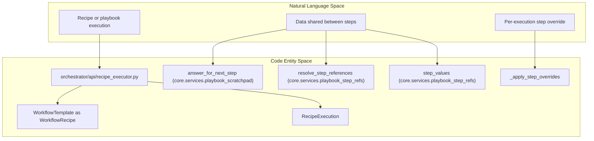
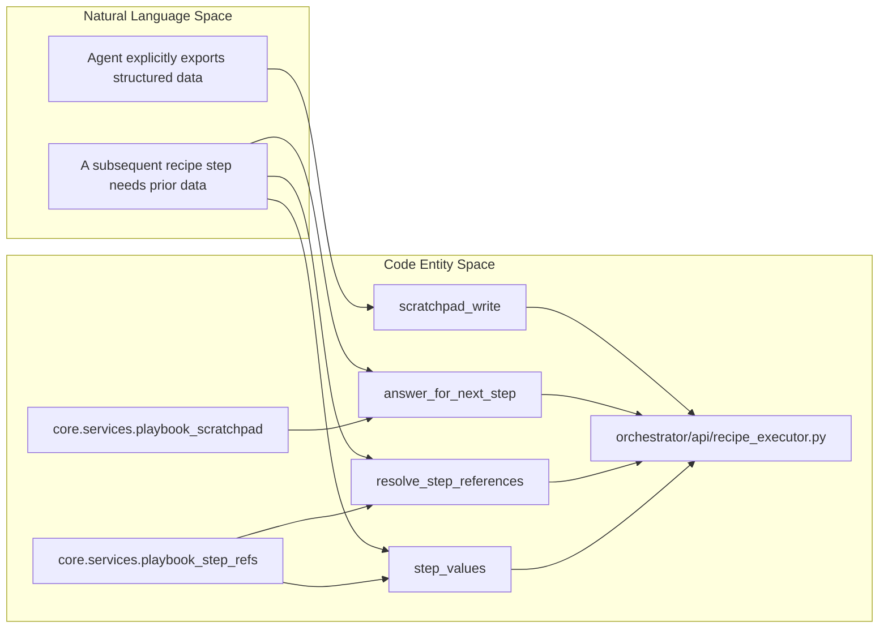

# Recipe Scratchpad

Relevant source files

The following files were used as context for generating this wiki page:

- [frontend/components/workflows/execution-kitchen.tsx](frontend/components/workflows/execution-kitchen.tsx)
- [orchestrator/alembic/versions/dedupe_skills_unique_workspace_name.py](orchestrator/alembic/versions/dedupe_skills_unique_workspace_name.py)
- [orchestrator/api/composio.py](orchestrator/api/composio.py)
- [orchestrator/api/patterns.py](orchestrator/api/patterns.py)
- [orchestrator/api/recipe_executor.py](orchestrator/api/recipe_executor.py)
- [orchestrator/api/skills.py](orchestrator/api/skills.py)
- [orchestrator/api/templates.py](orchestrator/api/templates.py)
- [orchestrator/api/tools.py](orchestrator/api/tools.py)
- [orchestrator/api/webhooks.py](orchestrator/api/webhooks.py)
- [orchestrator/api/workflow_recipes.py](orchestrator/api/workflow_recipes.py)
- [orchestrator/core/composio/client.py](orchestrator/core/composio/client.py)
- [orchestrator/core/composio/linkedin_image_workaround.py](orchestrator/core/composio/linkedin_image_workaround.py)
- [orchestrator/core/credentials/tester.py](orchestrator/core/credentials/tester.py)
- [orchestrator/core/credentials/types.py](orchestrator/core/credentials/types.py)
- [orchestrator/core/database/credential_types_seed.json](orchestrator/core/database/credential_types_seed.json)
- [orchestrator/core/routing/ingestors/webhook.py](orchestrator/core/routing/ingestors/webhook.py)
- [orchestrator/core/services/skill_materializer.py](orchestrator/core/services/skill_materializer.py)
- [orchestrator/modules/agents/services/skill_loader.py](orchestrator/modules/agents/services/skill_loader.py)
- [orchestrator/services/metadata_sync_service.py](orchestrator/services/metadata_sync_service.py)
- [orchestrator/services/webhook_dedup.py](orchestrator/services/webhook_dedup.py)
- [orchestrator/tests/test_p2w2_webhook_dedup.py](orchestrator/tests/test_p2w2_webhook_dedup.py)
- [orchestrator/tests/test_p2w2_webhook_signature_reject.py](orchestrator/tests/test_p2w2_webhook_signature_reject.py)
- [orchestrator/tests/test_prd251_linkedin_scope.py](orchestrator/tests/test_prd251_linkedin_scope.py)

## Purpose and Scope

The Recipe Scratchpad supports structured data sharing between steps in a recipe or playbook execution. The direct executor describes `RecipeScratchpad` as replacing verbose text dumps, with a stated goal of reducing token use by 80–90%, and identifies `scratchpad_write` as the explicit agent-export tool [orchestrator/api/recipe_executor.py:14-18](). The executor also imports `answer_for_next_step`, `resolve_step_references`, and `step_values`, which identify the code-facing helpers associated with passing data to subsequent steps and resolving step references [orchestrator/api/recipe_executor.py:41-43]().

This page covers the scratchpad’s documented purpose and its visible integration points in the direct executor. The provided file excerpt does not show the scratchpad implementation, the tool schema or handler, or the executor’s step loop, so those details cannot be specified here [orchestrator/api/recipe_executor.py:1-19](), [orchestrator/api/recipe_executor.py:41-43]().

Sources: [orchestrator/api/recipe_executor.py:1-19](), [orchestrator/api/recipe_executor.py:41-43]()

---

## Architecture and Data Flow

The visible integration points are in `orchestrator/api/recipe_executor.py`: the executor imports the helper `answer_for_next_step` from `core.services.playbook_scratchpad` and imports `resolve_step_references` and `step_values` from `core.services.playbook_step_refs` [orchestrator/api/recipe_executor.py:41-43](). These imports establish that the direct executor depends on scratchpad and step-reference helpers, but the excerpt does not show where or how the helpers are called [orchestrator/api/recipe_executor.py:41-43]().

The executor operates on a `WorkflowTemplate` aliased as `WorkflowRecipe` and a `RecipeExecution` model [orchestrator/api/recipe_executor.py:36-38](). Its module documentation describes a sequential recipe executor and lists the components used by that execution path, including `ContextService(RECIPE)`, `ComposioHintService.build_hints()`, `create_llm_manager().generate_response()`, and `tool_router.execute_and_format()` [orchestrator/api/recipe_executor.py:5-12]().

### Natural Language to Code Entity Mapping: Execution and Overrides

This diagram maps recipe concepts to code entities visible in the supplied excerpt. It does not imply a call relationship between the override helper and scratchpad helpers; the excerpt shows the imports and the override helper definition, not the complete execution loop [orchestrator/api/recipe_executor.py:41-43](), [orchestrator/api/recipe_executor.py:160-173]().

**Title: Recipe Concepts and Executor Entities**

Sources: [orchestrator/api/recipe_executor.py:36-43](), [orchestrator/api/recipe_executor.py:160-173]()

### Natural Language to Code Entity Mapping: Explicit Scratchpad Export

The executor module documentation names `scratchpad_write` as the tool injected for explicit agent exports, while its imports name `answer_for_next_step` as a helper from `core.services.playbook_scratchpad` [orchestrator/api/recipe_executor.py:14-18](), [orchestrator/api/recipe_executor.py:41-41](). The available excerpt does not show the tool’s registration, parameters, execution handler, or the mechanism connecting its writes to `answer_for_next_step` [orchestrator/api/recipe_executor.py:14-18](), [orchestrator/api/recipe_executor.py:41-43]().

**Title: Scratchpad Export Concepts and Code Entities**

Sources: [orchestrator/api/recipe_executor.py:14-18](), [orchestrator/api/recipe_executor.py:41-43]()

---

## Data Layout and Storage Strategy

The executor’s module documentation characterizes `RecipeScratchpad` as structured inter-step storage and says it replaces verbose text dumps with explicit agent exports [orchestrator/api/recipe_executor.py:14-16](). The excerpt does not provide a scratchpad data model, key/value schema, storage backend, lifecycle, or persistence guarantees; therefore, no Redis, database, or object-storage behavior can be established from the available code [orchestrator/api/recipe_executor.py:14-18]().

| Concern | What the provided code establishes |
|---|---|
| Scratchpad role | Used for inter-step data sharing, according to the executor’s module documentation [orchestrator/api/recipe_executor.py:14-16](). |
| Explicit export | The executor documentation says `scratchpad_write` is injected for agent exports [orchestrator/api/recipe_executor.py:16-16](). |
| Downstream helper | The executor imports `answer_for_next_step` from `core.services.playbook_scratchpad` [orchestrator/api/recipe_executor.py:41-41](). |
| Step-reference helpers | The executor imports `resolve_step_references` and `step_values` from `core.services.playbook_step_refs` [orchestrator/api/recipe_executor.py:42-42](). |
| Storage and schema | Not shown in the supplied excerpt [orchestrator/api/recipe_executor.py:1-19](). |

Sources: [orchestrator/api/recipe_executor.py:14-18](), [orchestrator/api/recipe_executor.py:41-43]()

---

## Context Assembly and Tool Integration

The executor’s module documentation says recipe steps use `ContextService(RECIPE)` for the system prompt and base tools, and lists the LLM and tool execution components used by the direct executor [orchestrator/api/recipe_executor.py:5-12](). It separately documents `scratchpad_write` as an explicit export tool [orchestrator/api/recipe_executor.py:14-18]().

The provided excerpt does not show how scratchpad values are inserted into the context assembled by `ContextService(RECIPE)`, nor how `scratchpad_write` is registered or routed. The imports of `answer_for_next_step`, `resolve_step_references`, and `step_values` show dependencies available to the executor but do not, by themselves, establish their call order or runtime behavior [orchestrator/api/recipe_executor.py:9-12](), [orchestrator/api/recipe_executor.py:41-43]().

Sources: [orchestrator/api/recipe_executor.py:5-18](), [orchestrator/api/recipe_executor.py:41-43]()

---

## Tool Integration: `scratchpad_write`

The direct executor’s module documentation says `scratchpad_write` is injected for explicit agent exports [orchestrator/api/recipe_executor.py:14-16](). The available excerpt does not include the tool’s schema, key validation, write semantics, return value, or executor-side registration, so those details cannot be documented from the supplied content [orchestrator/api/recipe_executor.py:14-18]().

The executor also imports helpers for next-step answering and step-reference resolution, which are the visible code touchpoints for consuming data across steps [orchestrator/api/recipe_executor.py:41-43]().

Sources: [orchestrator/api/recipe_executor.py:14-18](), [orchestrator/api/recipe_executor.py:41-43]()

---

## Execution Configuration and Related Recipe Entry Points

The recipe API is mounted at `/api/workflow-recipes` and aliases `WorkflowTemplate` as `WorkflowRecipe` [orchestrator/api/workflow_recipes.py:22-27](). The API module includes helpers for synchronizing cron schedules, validating explicit schedules, and registering Composio triggers for recipes [orchestrator/api/workflow_recipes.py:40-48](), [orchestrator/api/workflow_recipes.py:81-102](), [orchestrator/api/workflow_recipes.py:104-160]().

These are recipe scheduling and trigger entry points; the provided excerpts do not show them initializing scratchpad state or passing trigger payloads into scratchpad keys [orchestrator/api/workflow_recipes.py:40-48](), [orchestrator/api/workflow_recipes.py:81-160](). The direct executor imports the scratchpad and step-reference helpers independently [orchestrator/api/recipe_executor.py:41-43]().

Sources: [orchestrator/api/workflow_recipes.py:22-27](), [orchestrator/api/workflow_recipes.py:40-48](), [orchestrator/api/workflow_recipes.py:81-102](), [orchestrator/api/workflow_recipes.py:104-160](), [orchestrator/api/recipe_executor.py:41-43]()

---