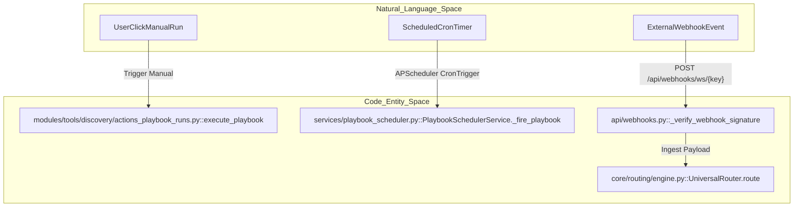
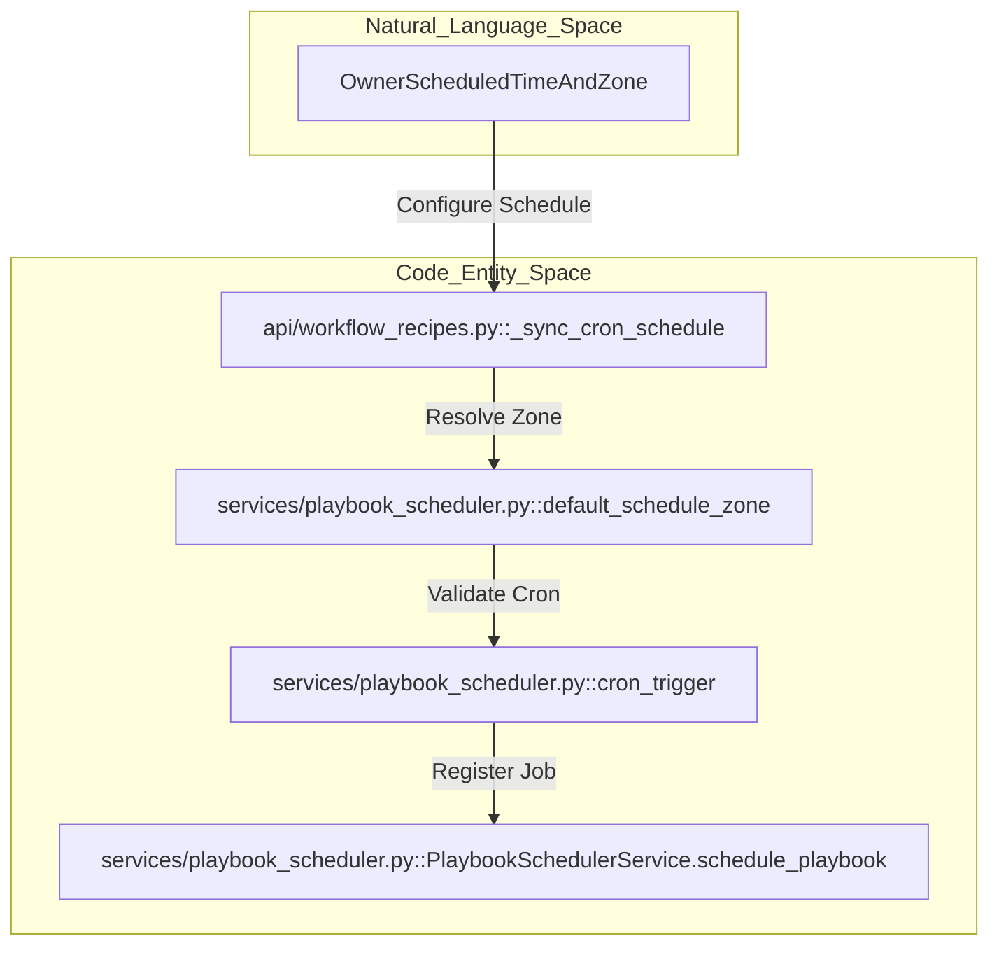

# Scheduling & Triggers

Relevant source files

The following files were used as context for generating this wiki page:

- [frontend/components/workflows/execution-kitchen.tsx](frontend/components/workflows/execution-kitchen.tsx)
- [orchestrator/alembic/versions/dedupe_skills_unique_workspace_name.py](orchestrator/alembic/versions/dedupe_skills_unique_workspace_name.py)
- [orchestrator/api/composio.py](orchestrator/api/composio.py)
- [orchestrator/api/patterns.py](orchestrator/api/patterns.py)
- [orchestrator/api/recipe_executor.py](orchestrator/api/recipe_executor.py)
- [orchestrator/api/skills.py](orchestrator/api/skills.py)
- [orchestrator/api/templates.py](orchestrator/api/templates.py)
- [orchestrator/api/tools.py](orchestrator/api/tools.py)
- [orchestrator/api/webhooks.py](orchestrator/api/webhooks.py)
- [orchestrator/api/workflow_recipes.py](orchestrator/api/workflow_recipes.py)
- [orchestrator/core/composio/client.py](orchestrator/core/composio/client.py)
- [orchestrator/core/composio/linkedin_image_workaround.py](orchestrator/core/composio/linkedin_image_workaround.py)
- [orchestrator/core/credentials/tester.py](orchestrator/core/credentials/tester.py)
- [orchestrator/core/credentials/types.py](orchestrator/core/credentials/types.py)
- [orchestrator/core/database/credential_types_seed.json](orchestrator/core/database/credential_types_seed.json)
- [orchestrator/core/routing/ingestors/webhook.py](orchestrator/core/routing/ingestors/webhook.py)
- [orchestrator/core/services/skill_materializer.py](orchestrator/core/services/skill_materializer.py)
- [orchestrator/modules/agents/services/skill_loader.py](orchestrator/modules/agents/services/skill_loader.py)
- [orchestrator/modules/tools/discovery/actions_mission_create.py](orchestrator/modules/tools/discovery/actions_mission_create.py)
- [orchestrator/modules/tools/discovery/actions_playbook_runs.py](orchestrator/modules/tools/discovery/actions_playbook_runs.py)
- [orchestrator/modules/tools/discovery/actions_playbook_schedule.py](orchestrator/modules/tools/discovery/actions_playbook_schedule.py)
- [orchestrator/modules/tools/discovery/actions_playbook_steps.py](orchestrator/modules/tools/discovery/actions_playbook_steps.py)
- [orchestrator/modules/tools/discovery/actions_playbooks.py](orchestrator/modules/tools/discovery/actions_playbooks.py)
- [orchestrator/modules/tools/discovery/card_numbers.py](orchestrator/modules/tools/discovery/card_numbers.py)
- [orchestrator/modules/tools/discovery/handlers_playbooks.py](orchestrator/modules/tools/discovery/handlers_playbooks.py)
- [orchestrator/modules/tools/discovery/playbook_lookup.py](orchestrator/modules/tools/discovery/playbook_lookup.py)
- [orchestrator/modules/tools/discovery/playbook_staffing.py](orchestrator/modules/tools/discovery/playbook_staffing.py)
- [orchestrator/modules/tools/discovery/timer_zones.py](orchestrator/modules/tools/discovery/timer_zones.py)
- [orchestrator/modules/tools/discovery/wait_for_me.py](orchestrator/modules/tools/discovery/wait_for_me.py)
- [orchestrator/services/metadata_sync_service.py](orchestrator/services/metadata_sync_service.py)
- [orchestrator/services/playbook_scheduler.py](orchestrator/services/playbook_scheduler.py)
- [orchestrator/services/schedule_util.py](orchestrator/services/schedule_util.py)
- [orchestrator/services/scheduler.py](orchestrator/services/scheduler.py)
- [orchestrator/services/webhook_dedup.py](orchestrator/services/webhook_dedup.py)
- [orchestrator/tests/test_f240_a_weekly_timer_fires_on_its_day.py](orchestrator/tests/test_f240_a_weekly_timer_fires_on_its_day.py)
- [orchestrator/tests/test_f241_b_mission_and_playbook_cards_are_named_by_number.py](orchestrator/tests/test_f241_b_mission_and_playbook_cards_are_named_by_number.py)
- [orchestrator/tests/test_f288_c_a_started_run_is_named_by_its_card.py](orchestrator/tests/test_f288_c_a_started_run_is_named_by_its_card.py)
- [orchestrator/tests/test_f321_a_a_playbook_auto_builds_has_an_agent_on_every_step.py](orchestrator/tests/test_f321_a_a_playbook_auto_builds_has_an_agent_on_every_step.py)
- [orchestrator/tests/test_p2w2_webhook_dedup.py](orchestrator/tests/test_p2w2_webhook_dedup.py)
- [orchestrator/tests/test_p2w2_webhook_signature_reject.py](orchestrator/tests/test_p2w2_webhook_signature_reject.py)
- [orchestrator/tests/test_playbook_scheduler.py](orchestrator/tests/test_playbook_scheduler.py)
- [orchestrator/tests/test_prd251_linkedin_scope.py](orchestrator/tests/test_prd251_linkedin_scope.py)
- [orchestrator/tests/test_unified_scheduler.py](orchestrator/tests/test_unified_scheduler.py)

## Purpose & Scope
This page details the execution trigger mechanisms for workflow recipes (playbooks) and workspace integrations within Automatos AI. It covers manual execution workflows, time-based cron scheduling managed by `PlaybookSchedulerService`, external webhook triggers handled via `TriggerSubscription`, cryptographic webhook signature verification (HMAC-SHA256 and Slack schemes), and idempotency through deduplication layers.

Sources: [orchestrator/api/webhooks.py:6-14](), [orchestrator/api/workflow_recipes.py:40-112](), [orchestrator/services/playbook_scheduler.py:1-11]()

---

## Schedule Types Overview

Workflow recipes support three mutually exclusive execution trigger categories defined within their schedule configurations: `manual`, `cron`, and `trigger`. These configuration types determine how executions are initiated within the runtime environment.

| Type | Trigger Mechanism | Code Reference / Implementation | Use Case |
|------|------------------|--------------------------------|----------|
| `manual` | User-initiated via UI action or API call | `modules/tools/discovery/actions_playbook_runs.py::execute_playbook` | One-off workflows, testing, and ad-hoc tasks |
| `cron` | Time-based scheduling using `APScheduler` | `services/playbook_scheduler.py::PlaybookSchedulerService` | Periodic reports, scheduled maintenance, and batch jobs |
| `trigger` | External HTTP POST (Composio or custom webhooks) | `api/webhooks.py` and `api/workflow_recipes.py::_auto_register_trigger` | Event-driven automation responding to external webhooks (GitHub, Slack, Jira) |

**Diagram: Natural Language Space to Code Entity Space - Trigger Routing**

Sources: [orchestrator/api/webhooks.py:6-37](), [orchestrator/api/workflow_recipes.py:104-124](), [orchestrator/modules/tools/discovery/actions_playbook_runs.py:69-74]()

---

## PlaybookSchedulerService & Cron Execution

Time-based cron execution relies on `PlaybookSchedulerService`, which integrates `APScheduler` (`AsyncIOScheduler`) with database-backed persistence or Redis job stores.

### Lifecycle, Zones & Cron Synchronization
*   **Startup Initialization**: During application startup, the service queries all cron-enabled playbooks where the `schedule_config` dictionary specifies a valid cron expression.
*   **Timezones & Explicit Zones**: `default_schedule_zone` resolves execution timezones, while `with_explicit_zone` normalizes cron definitions to execute in the owner's configured local timezone rather than default server UTC [orchestrator/api/workflow_recipes.py:95]().
*   **Job Reconciliation**: When a recipe is created or updated, `_sync_cron_schedule` calls `sync_playbook_schedule`, dynamically adding, updating, or removing scheduled jobs [orchestrator/api/workflow_recipes.py:40-49]() & [orchestrator/services/playbook_scheduler.py:87-110]().

**Diagram: Natural Language Space to Code Entity Space - Scheduler Flow**

Sources: [orchestrator/api/workflow_recipes.py:40-49](), [orchestrator/api/workflow_recipes.py:95](), [orchestrator/services/playbook_scheduler.py:35-154]()

---

## Workspace Webhooks vs. Recipe Webhooks

The platform separates workspace-scoped ingestion endpoints from specific recipe triggers.

### 1. Workspace Webhooks (Universal Routing)
Every workspace exposes a unique endpoint where inbound payloads are accepted and routed through the Universal Router engine.
*   **Endpoint Route**: `POST /api/webhooks/ws/{workspace_key}` [orchestrator/api/webhooks.py:6-7]().
*   **Platform Detection**: `_detect_platform` analyzes incoming payload structures to categorize Telegram, Slack, WhatsApp, or Twilio transport types [orchestrator/api/webhooks.py:159-185]().
*   **Normalization**: `WebhookIngestor` parses raw HTTP bodies into standardized request envelopes [orchestrator/api/webhooks.py:34]().

### 2. Recipe-Specific Webhooks
Recipes configured with the `trigger` type register workflow subscriptions.
*   **Subscription Tracking**: `_auto_register_trigger` evaluates incoming trigger metadata, interacts with `EntityManager` and `get_composio_client()`, and persists active records via the `TriggerSubscription` model [orchestrator/api/workflow_recipes.py:104-160](). This function specifically handles Composio-sourced triggers by calling `client.subscribe_to_trigger` [orchestrator/api/workflow_recipes.py:153](). Non-Composio triggers are noted and skipped for Composio registration [orchestrator/api/workflow_recipes.py:120-123]().

Sources: [orchestrator/api/webhooks.py:6-37](), [orchestrator/api/workflow_recipes.py:104-160](), [orchestrator/core/models/composio.py:1-25]()

---

## Webhook Security & Verification

Incoming webhook requests enforce rigorous validation to reject tampering, unauthorized calls, and replay attacks.

### HMAC-SHA256 Signature Verification
The helper `_verify_webhook_signature` authenticates requests across GitHub, Composio, and custom webhook integrations [orchestrator/api/webhooks.py:50-64]().
*   **Headers Evaluated**: Checks `X-Hub-Signature-256`, `X-Composio-Signature`, and `X-Webhook-Signature` [orchestrator/api/webhooks.py:69-73]().
*   **Fail-Closed Policy**: If a secret is provisioned, missing or mismatched signatures raise an `HTTPException(401)` [orchestrator/api/webhooks.py:60-76]() & [orchestrator/api/webhooks.py:89-91](). Comparisons utilize constant-time evaluation via `hmac.compare_digest` [orchestrator/api/webhooks.py:87-89]().

### Slack Signature Verification
Slack integrations execute `_verify_slack_signature`, implementing the `v0` signing schema (`v0:{timestamp}:{raw_body}`) along with a strict timestamp skew window (`_SLACK_TS_SKEW_SECONDS = 300` seconds) to block replay attacks [orchestrator/api/webhooks.py:94-152]().

### Deduplication
Webhook payloads pass through `webhook_dedup` checks to guarantee idempotency and prevent duplicate executions during upstream provider retries [orchestrator/api/webhooks.py:35]() & [orchestrator/services/webhook_dedup.py:1-10](). The `webhook_dedup` service uses a Redis-backed mechanism to store hashes of incoming webhook payloads for a short duration, preventing reprocessing of identical events within the deduplication window [orchestrator/services/webhook_dedup.py:12-30]().

Sources: [orchestrator/api/webhooks.py:33-152](), [orchestrator/services/webhook_dedup.py:1-30]()

---

## Configuration Reference

### RecipeScheduleConfig Structure
The schedule configuration dictionary stored within workflow templates controls runtime scheduling properties.

| Field | Type | Description |
|-------|------|-------------|
| `type` | `string` | Execution trigger category: `manual`, `cron`, or `trigger` [orchestrator/modules/tools/discovery/actions_playbook_runs.py:71]() |
| `cron_expression` | `string` | Standard cron string evaluated by `PlaybookSchedulerService` [orchestrator/modules/tools/discovery/actions_playbook_runs.py:71]() |
| `timezone` | `string` | Target timezone for scheduled evaluation [orchestrator/services/playbook_scheduler.py:82-83]() |
| `enabled` | `boolean` | Toggle flag to pause or resume timers without clearing parameters [orchestrator/modules/tools/discovery/actions_playbook_runs.py:72-73]() |
| `trigger_config` | `dict` | Metadata parameters for webhook or third-party event bindings [orchestrator/api/workflow_recipes.py:113-117]() |

Sources: [orchestrator/api/workflow_recipes.py:113-117](), [orchestrator/modules/tools/discovery/actions_playbook_runs.py:69-74](), [orchestrator/services/playbook_scheduler.py:80-85]()

---