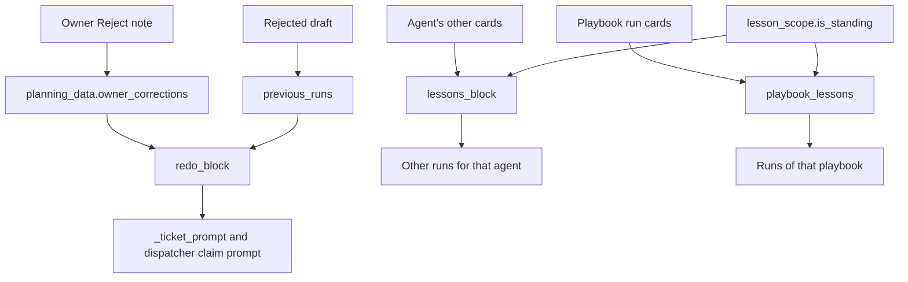
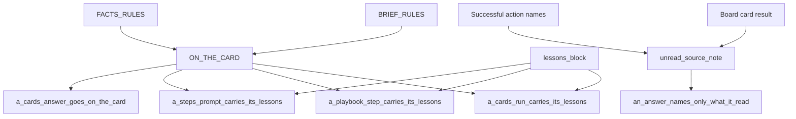

# Step Outcomes, Redo & Lessons

<details>
<summary>Relevant source files</summary>

The following files were used as context for generating this wiki page:

- [frontend/stores/discussion-store.ts](frontend/stores/discussion-store.ts)
- [orchestrator/modules/tools/execution/subject_targets.py](orchestrator/modules/tools/execution/subject_targets.py)
- [orchestrator/services/answer_sources.py](orchestrator/services/answer_sources.py)
- [orchestrator/services/host_paths.py](orchestrator/services/host_paths.py)
- [orchestrator/services/lesson_scope.py](orchestrator/services/lesson_scope.py)
- [orchestrator/services/playbook_given.py](orchestrator/services/playbook_given.py)
- [orchestrator/services/playbook_last_step.py](orchestrator/services/playbook_last_step.py)
- [orchestrator/services/result_files.py](orchestrator/services/result_files.py)
- [orchestrator/services/step_lessons.py](orchestrator/services/step_lessons.py)
- [orchestrator/services/task_reconciler.py](orchestrator/services/task_reconciler.py)
- [orchestrator/services/ticket_redo.py](orchestrator/services/ticket_redo.py)
- [orchestrator/tests/test_818_a_windows_hosts_session_paths_map_into_the_workspace.py](orchestrator/tests/test_818_a_windows_hosts_session_paths_map_into_the_workspace.py)
- [orchestrator/tests/test_839_a_subfolder_relative_name_is_found_by_suffix.py](orchestrator/tests/test_839_a_subfolder_relative_name_is_found_by_suffix.py)
- [orchestrator/tests/test_f014_result_names_missing_file.py](orchestrator/tests/test_f014_result_names_missing_file.py)
- [orchestrator/tests/test_f091_card_names_what_it_acts_on.py](orchestrator/tests/test_f091_card_names_what_it_acts_on.py)
- [orchestrator/tests/test_f093_skipped_only_result_is_not_done.py](orchestrator/tests/test_f093_skipped_only_result_is_not_done.py)
- [orchestrator/tests/test_f114_a_run_waiting_on_a_session_survives.py](orchestrator/tests/test_f114_a_run_waiting_on_a_session_survives.py)
- [orchestrator/tests/test_f161_a_session_file_named_from_the_root_is_found.py](orchestrator/tests/test_f161_a_session_file_named_from_the_root_is_found.py)
- [orchestrator/tests/test_f175_a_stalled_task_is_failed_not_done.py](orchestrator/tests/test_f175_a_stalled_task_is_failed_not_done.py)
- [orchestrator/tests/test_f249_a_rejects_lesson_reaches_the_agents_next_card.py](orchestrator/tests/test_f249_a_rejects_lesson_reaches_the_agents_next_card.py)
- [orchestrator/tests/test_f249_c_a_playbooks_standing_notes_reach_every_run.py](orchestrator/tests/test_f249_c_a_playbooks_standing_notes_reach_every_run.py)
- [orchestrator/tests/test_f249_d_a_note_goes_where_it_was_meant.py](orchestrator/tests/test_f249_d_a_note_goes_where_it_was_meant.py)
- [orchestrator/tests/test_f288_a_a_runs_details_reach_its_steps.py](orchestrator/tests/test_f288_a_a_runs_details_reach_its_steps.py)
- [orchestrator/tests/test_f297_a_a_file_named_from_the_workspace_folder_is_found.py](orchestrator/tests/test_f297_a_a_file_named_from_the_workspace_folder_is_found.py)
- [orchestrator/tests/test_f297_b_a_cards_answer_goes_on_the_card.py](orchestrator/tests/test_f297_b_a_cards_answer_goes_on_the_card.py)
- [orchestrator/tests/test_f300_a_f313_a_every_agent_run_reads_the_live_system_first.py](orchestrator/tests/test_f300_a_f313_a_every_agent_run_reads_the_live_system_first.py)
- [orchestrator/tests/test_f315_a_a_lesson_from_the_rosa_card_never_turns_a_general_card_into_a_letter.py](orchestrator/tests/test_f315_a_a_lesson_from_the_rosa_card_never_turns_a_general_card_into_a_letter.py)
- [orchestrator/tests/test_f318_a_a_note_about_one_cards_facts_stays_on_that_card.py](orchestrator/tests/test_f318_a_a_note_about_one_cards_facts_stays_on_that_card.py)
- [orchestrator/tests/test_f321_a_a_playbooks_last_step_gives_the_whole_answer.py](orchestrator/tests/test_f321_a_a_playbooks_last_step_gives_the_whole_answer.py)
- [orchestrator/tests/test_f365_b_a_sessions_report_is_found_where_the_platform_wrote_it.py](orchestrator/tests/test_f365_b_a_sessions_report_is_found_where_the_platform_wrote_it.py)
- [orchestrator/tests/test_prd171_execution_spine.py](orchestrator/tests/test_prd171_execution_spine.py)
- [orchestrator/tests/test_prd234_s1a_board_lane.py](orchestrator/tests/test_prd234_s1a_board_lane.py)
- [orchestrator/tests/test_prd238_w1_honest_window.py](orchestrator/tests/test_prd238_w1_honest_window.py)
- [orchestrator/tests/test_prd252_discuss.py](orchestrator/tests/test_prd252_discuss.py)

</details>


## Purpose and Scope

This page explains how task outcomes are checked before completion, how rejected work is prepared for redo, and how applicable lessons reach board cards, mission steps, and playbook steps. It also covers answer and source instructions, named-file resolution, and scheduled reconciliation of stalled or orphaned work. [orchestrator/services/ticket_redo.py:1-77]() [orchestrator/services/step_lessons.py:1-52]() [orchestrator/services/result_files.py:1-15]() [orchestrator/services/task_reconciler.py:1-12]()

Sources: `[orchestrator/services/ticket_redo.py:1-77]()`, `[orchestrator/services/step_lessons.py:1-52]()`, `[orchestrator/services/result_files.py:1-15]()`, `[orchestrator/services/task_reconciler.py:1-12]()`

---

## 1. Result File Resolution & Completion Validation

`result_files.py` checks whether file paths named in a task result resolve to files in the workspace. The purpose is to prevent a task from closing as `done` when its result claims that a deliverable was saved but the file cannot be found. If the worker cannot provide a reliable answer, the check does not treat that as proof the file is missing. [orchestrator/services/result_files.py:1-15]()

### 1.1. Extracting paths from the result

`named_files(text)` collects candidate paths from backtick spans, Markdown links, and prose. It excludes fenced code blocks from prose scanning, ignores URLs and home-directory paths, requires a folder and an extension from `FILE_EXTENSIONS`, removes duplicates, and returns at most `MAX_NAMED_FILES` candidates. [orchestrator/services/result_files.py:30-33]() [orchestrator/services/result_files.py:50-92]()

| Candidate source | Included when | Excluded or limited by |
|---|---|---|
| Backtick span | The span is a whole path matching the path pattern. | A bare filename without a folder is not a candidate. |
| Markdown link target | The target is a whole path matching the path pattern. | URL-like values are excluded. |
| Prose | A path-like value with a folder and recognized extension appears in the prose. | Fenced code is removed before prose scanning. |
| All sources | The extension is in `FILE_EXTENSIONS`; the path is not already present. | The result is capped by `MAX_NAMED_FILES`. |

[orchestrator/services/result_files.py:50-92]()

### 1.2. Mapping candidate paths into worker-visible locations

`_session_base(runtime_ref, workspace_id, projects_dir)` maps a session’s working directory into the workspace using `workspace_relative_path`. It returns no base when the run has no session host or working directory, or when the directory cannot be mapped. [orchestrator/services/result_files.py:95-105]()

For a session run, `_session_places(name, base)` constructs the candidate locations relative to the session directory and, for root-relative or platform-written paths, at the workspace root. `_platform_written(name)` recognizes configured platform root folders; the shown implementation includes `reports`. For a non-session API run, `_workspace_places(name)` checks the path as written and also removes the leading `workspace/` component when present. [orchestrator/services/result_files.py:108-139]()

The resolution strategy accounts for different path conventions used by agents and platform tools:

| Run or path convention | Resolution behavior |
|---|---|
| Session-relative path | Join the result path to the session’s workspace-relative base. |
| Path written from the workspace root | Also consider the root-relative form where applicable. |
| Platform-written report | Consider the root-level path under `reports/`. |
| API result beginning with `workspace/` | Also check the path without the `workspace/` prefix. |
| Session path relative to a nested project folder | A bounded suffix walk can find a unique match by path components. |

[orchestrator/services/result_files.py:95-139]() [orchestrator/services/result_files.py:34-48]()

The fallback walk is bounded by `MAX_WALK_DIRS`, `WALK_CONCURRENCY`, and `WALK_TIMEOUT_SECONDS`. It skips dependency, build, cache, and dot folders, and is intended to avoid unbounded traversal or letting the fallback consume the entire check budget. [orchestrator/services/result_files.py:34-48]()

### 1.3. Completion outcome

The completion check distinguishes a missing file from an inconclusive lookup. The supplied tests verify that a named file found by the worker passes; a missing named file produces a review note; and a worker that is unreachable or returns a truncated listing does not produce a verdict. They also verify that a result naming no file does not trigger a worker listing. [orchestrator/tests/test_f014_result_names_missing_file.py:105-118]()

A knowledge-base document can also satisfy a named result path without being a workspace file: the test suite verifies that such a result is identified as saved to the knowledge base rather than sent to review as a missing workspace file. [orchestrator/tests/test_f014_result_names_missing_file.py:121-129]()

**Diagram 1: Result text to workspace verification**

```mermaid
flowchart TD
    Result["Board task result text"] --> NamedFiles["named_files"]
    NamedFiles --> Candidates["Candidate paths"]
    Candidates --> SessionBase["_session_base"]
    SessionBase --> SessionPlaces["_session_places"]
    Candidates --> WorkspacePlaces["_workspace_places"]
    SessionPlaces --> Worker["Workspace worker directory listings"]
    WorkspacePlaces --> Worker
    Worker --> Check["check_named_files"]
    Check -->| "All named files found or lookup inconclusive" | Continue["Completion proceeds without a missing-file verdict"]
    Check -->| "A named file is missing" | Review["Review note prevents false done"]
```

Sources: `[orchestrator/services/result_files.py:1-15]()`, `[orchestrator/services/result_files.py:30-48]()`, `[orchestrator/services/result_files.py:50-139]()`, `[orchestrator/tests/test_f014_result_names_missing_file.py:105-129]()`

### 1.4. Session suffix matching

For session results, an exact lookup can be supplemented by a bounded walk of the session’s folder. The walk matches trailing path components, not arbitrary string suffixes. A unique match can resolve the name; a path-component mismatch, multiple matches, or a name not found remains unresolved. The walk is session-only: an API run without a session folder does not receive this fallback. [orchestrator/services/result_files.py:34-48]() [orchestrator/tests/test_839_a_subfolder_relative_name_is_found_by_suffix.py:1-21]() [orchestrator/tests/test_839_a_subfolder_relative_name_is_found_by_suffix.py:78-115]()

The tests also specify that an unavailable folder or timed-out walk must not turn a genuinely missing path into a successful resolution, and that dependency folders such as `node_modules` are not traversed. [orchestrator/services/result_files.py:34-48]() [orchestrator/tests/test_839_a_subfolder_relative_name_is_found_by_suffix.py:118-144]()

Sources: `[orchestrator/services/result_files.py:34-48]()`, `[orchestrator/tests/test_839_a_subfolder_relative_name_is_found_by_suffix.py:1-21]()`, `[orchestrator/tests/test_839_a_subfolder_relative_name_is_found_by_suffix.py:78-144]()`

---

## 2. Ticket Redo & Correction Tracking

A ticket redo needs both the rejected draft and the owner’s corrections. The `ticket_redo.py` module describes the storage and prompt behavior: a Reject records corrections in `planning_data.owner_corrections` and preserves the draft being sent back in `previous_runs`; the redo prompt carries the draft and corrections, oldest first, and asks the agent to correct the draft rather than restart from the brief. [orchestrator/services/ticket_redo.py:1-14]()

The module defines `SENT_BACK`, `RUN_NOW`, and `SENT_BACK_WITHOUT_A_NOTE` to distinguish send-back and run-now history, including a no-note Reject that still needs to be recognized as a redo. It sets `MAX_CORRECTIONS_KEPT` to 20. [orchestrator/services/ticket_redo.py:85-93]()

### 2.1. Redo ordering and re-briefing

For a send-back with an owner note, `OWNER_WORDS_LEAD` identifies the lead-in for the owner’s words. The module’s documented PRD-252 R2 behavior places the current send-back note at the start of the redo block, before the draft it corrects. [orchestrator/services/ticket_redo.py:10-18]() [orchestrator/services/ticket_redo.py:94-95]()

A re-briefed ticket takes a different path: `REBRIEFED`, `BRIEF_AGREED`, and `AGREED_BRIEF_BLOCK` represent the agreed replacement brief. The module states that drafts and notes before that agreed brief are not carried forward. It also defines `MAX_BRIEF_CHARS` and `PREVIOUS_BRIEFS_KEPT` for brief and history limits. [orchestrator/services/ticket_redo.py:96-107]()

The `test_prd252_discuss.py` test suite verifies the re-briefing behavior. When a ticket is re-briefed, its `raw_prompt` and `description` are updated to the `AGREED` brief. The previous brief is stored in `planning_data["previous_briefs"]`, and the `owner_corrections` record the `BRIEF_AGREED` message. The `previous_runs` are updated with `REBRIEFED` as the reason, and the `result` and `review_feedback` fields are cleared or set to `BRIEF_AGREED`. The subsequent prompt for the agent includes the `AGREED_BRIEF_BLOCK`. [orchestrator/tests/test_prd252_discuss.py:80-93]() [orchestrator/tests/test_prd252_discuss.py:96-104]()

Crucially, a re-brief after previous send-backs ensures that the new prompt does not mix old drafts or corrections from before the discussion. [orchestrator/tests/test_prd252_discuss.py:107-122]() Re-briefing is refused for mission-sourced tickets or tickets currently `in_progress`. [orchestrator/tests/test_prd252_discuss.py:125-135]() [orchestrator/tests/test_prd252_discuss.py:146-155]()

### 2.2. Agent lessons versus ticket-specific redo content

`ticket_redo.py` documents a separation between the ticket’s own corrections and lessons intended for other work by the same agent. Agent lessons are drawn from that agent’s other cards; they are not sourced from a playbook run’s card. Playbook notes are scoped to playbook runs, and mission-step or playbook-step redo wording does not duplicate agent lessons when those steps already receive them through their step prompts. [orchestrator/services/ticket_redo.py:20-25]() [orchestrator/services/ticket_redo.py:47-52]()

The module also documents lesson scoping: a correction about facts specific to one card stays with that card, while standing rules can be propagated. A note about another kind of work must not change what the current card asks for. [orchestrator/services/ticket_redo.py:54-69]()

The `test_f249_a_rejects_lesson_reaches_the_agents_next_card.py` test confirms that an agent's next card carries the owner's corrections, newest first and each once, and that another agent never receives these lessons. [orchestrator/tests/test_f249_a_rejects_lesson_reaches_the_agents_next_card.py:108-122]() [orchestrator/tests/test_f249_a_rejects_lesson_reaches_the_agents_next_card.py:125-130]() A redo for a specific ticket will include its own corrections in the redo part, and then add other standing lessons for the agent. [orchestrator/tests/test_f249_a_rejects_lesson_reaches_the_agents_next_card.py:133-142]()

**Diagram 2: Owner correction and lesson routing**



Sources: `[orchestrator/services/ticket_redo.py:1-25]()`, `[orchestrator/services/ticket_redo.py:36-69]()`, `[orchestrator/services/ticket_redo.py:85-110]()`, `[orchestrator/tests/test_prd252_discuss.py:80-155]()`, `[orchestrator/tests/test_f249_a_rejects_lesson_reaches_the_agents_next_card.py:108-142]()`

---

## 3. Step Lessons & Answer Format Propagation

`step_lessons.py` provides shared prompt text and wrappers for delivering it to different agent execution paths. Its documented consumers include mission steps, playbook steps, and plain board cards. The file also documents that CLI-session ticket prompts carry their own lessons, so wrappers avoid duplicating that prompt responsibility. [orchestrator/services/step_lessons.py:1-2]() [orchestrator/services/step_lessons.py:43-51]()

### 3.1. `ON_THE_CARD`: answer format and destination

`ON_THE_CARD` begins with the `## Where your answer goes` heading. It instructs the agent to put the requested work directly in the card answer, avoid narration and tool-status text, fill in drafts rather than leave placeholders, and provide a saved file alongside the answer rather than instead of it. It also tells the agent not to reproduce tool errors as the answer. [orchestrator/services/step_lessons.py:64-80]()

The module’s documented wrappers associate answer-destination guidance with these execution paths:

| Wrapper | Documented consumer |
|---|---|
| `a_steps_prompt_carries_its_lessons` | `MissionDispatcher.build_task_prompt` |
| `a_playbook_step_carries_its_lessons` | A playbook step, including a timer’s `_execute_step` |
| `a_cards_answer_goes_on_the_card` | `api.board_tasks._launch_task_execution` for a plain board card |
| `a_cards_run_carries_its_lessons` | A card launched without its lessons, including Auto’s move to In progress |

[orchestrator/services/step_lessons.py:43-51]()

`_with(prompt, *blocks)` joins the original prompt and non-empty blocks with blank lines. `_session_of(obj)` obtains the SQLAlchemy session for a mapped object and returns `None` for an unmapped object. `_runs_in_a_session(db, agent_id)` identifies CLI-session agents. [orchestrator/services/step_lessons.py:83-101]()

### 3.2. Lesson retrieval for mission steps

`_mission_step_lessons(task)` obtains the step’s database session and assigned agent, looks up its `OrchestrationRun` when a run ID is present, and checks for a corresponding `BoardTask`. It then builds the step text from its title and description and calls `lessons_block`, passing the workspace, agent, excluded corresponding card when available, `MISSION_STEP_ASK`, and the step text for scope filtering. [orchestrator/services/step_lessons.py:104-117]()

### 3.3. Answer sources and current-run evidence

`FACTS_RULES` is included in `ON_THE_CARD`; it instructs agents to use the live system first for “now” questions, inspect database tables and columns through tools, and cite only what tools returned during the current run. It also distinguishes business data from web-searchable information and directs agents to interpret relative dates against the date in their instructions. [orchestrator/services/answer_sources.py:41-58]() [orchestrator/services/step_lessons.py:64-80]()

`unread_source_note(result, succeeded)` checks source claims in the result against the names of successful actions. It can flag a result that cites a previous or earlier run, or that claims a database source when no database query action succeeded. `an_answer_names_only_what_it_read(check)` wraps an existing check, passing through its note and appending any unread-source note. The module notes that this check sees successful action names, not their returned content. [orchestrator/services/answer_sources.py:28-33]() [orchestrator/services/answer_sources.py:60-110]()

### 3.4. Prompt composition bridge

**Diagram 3: Answer rules from shared prompt constants to step consumers**



Sources: `[orchestrator/services/step_lessons.py:43-80]()`, `[orchestrator/services/step_lessons.py:83-123]()`, `[orchestrator/services/answer_sources.py:41-58]()`, `[orchestrator/services/answer_sources.py:82-110]()`

---

## 4. Playbook Standing Notes and Per-Run Details

Playbook steps receive both agent lessons and playbook-specific standing notes. The `step_lessons.py` module identifies the playbook step wrapper and notes that a session agent’s step receives the run’s details and playbook notes, while its ticket supplies the agent’s lessons. [orchestrator/services/step_lessons.py:43-51]()

The module documents `ticket_redo.playbook_lessons` as the source of a playbook’s own standing notes, collected from its last runs’ cards. It also points to `playbook_given.py` for passing run details—such as `cafe_name`, `owner_email`, `first_order`, and `delivery_day`—to every agent step in a run. [orchestrator/services/step_lessons.py:12-19]()

The intended separation is important: agent lessons come from the agent’s own cards; playbook standing notes come from that playbook’s run cards. This prevents a playbook-specific instruction or figure from being treated as a general lesson for an agent’s unrelated work. [orchestrator/services/ticket_redo.py:36-52]()

Sources: `[orchestrator/services/step_lessons.py:12-19]()`, `[orchestrator/services/step_lessons.py:43-51]()`, `[orchestrator/services/ticket_redo.py:36-52]()`

---

## 5. Task Reconciliation & Stall Detection

`TaskReconciler` is a scheduled stall-detection and retry service. Its documented tick detects running executions that exceed `TASK_STALL_TIMEOUT_SECONDS`, pending executions stuck longer than `TASK_PENDING_TIMEOUT_SECONDS`, marks stalled executions failed, and retries eligible executions with exponential backoff. [orchestrator/services/task_reconciler.py:1-12]()

### 5.1. Scheduler lifecycle

`TaskReconciler.start(scheduler)` registers `_tick` as an interval job named `task_reconciler_tick`, using `TASK_RECONCILE_INTERVAL_SECONDS`, replacing an existing job with the same ID, and limiting the job to one instance. `stop()` removes that job when it exists. [orchestrator/services/task_reconciler.py:42-78]()

### 5.2. What the tick examines

`_tick()` opens a database session and performs separate checks for stalled running executions, stuck pending executions, and orphaned board tasks. The running-execution query accounts for `execution_metadata.last_progress_at` when determining whether a run has progressed recently. It also excludes runs with recipe board tasks still in `assigned`, `in_progress`, or `blocked` status, so a step ticket can represent active progress. [orchestrator/services/task_reconciler.py:84-120]()

The pending query selects `recipe_executions` with `status = 'pending'` whose `started_at` predates the configured pending cutoff. [orchestrator/services/task_reconciler.py:122-134]()

The orphaned-board query selects old `in_progress` tasks without a live lease. It is restricted to user-sourced tasks and recipe-sourced tasks whose corresponding recipe execution has already completed, failed, or been cancelled. [orchestrator/services/task_reconciler.py:25-39]()

Once candidates are collected, `_tick()` returns early if there are none; otherwise, it logs the counts and passes stalled running executions to `_handle_stalled`. [orchestrator/services/task_reconciler.py:149-160]()

The `test_f114_a_run_waiting_on_a_session_survives.py` test suite confirms that the reconciler correctly identifies and handles stalled tasks. It verifies that a playbook run waiting on a session is not marked as stalled if its step ticket is still being worked on. It also tests the resilience of the system to database outages, ensuring that the wait for a CLI ticket can ride out a temporary database restart. [orchestrator/tests/test_f114_a_run_waiting_on_a_session_survives.py:163-169]() [orchestrator/tests/test_f114_a_run_waiting_on_a_session_survives.py:72-78]()

### 5.3. Subject Target Resolution for Gated Actions

The `subject_targets.py` module ensures that confirmation cards for gated actions (e.g., `platform_delete_document`) accurately name the entities they act upon. Before a gated call stages its card, the IDs in its parameters are looked up in the workspace. If an entity is missing, the call fails back to the model without staging a card. If it exists, it is named on the card. [orchestrator/modules/tools/execution/subject_targets.py:1-9]()

`resolve_targets(db, workspace_id, params, action)` is the core function for this. It takes the database session, workspace ID, action parameters, and the action name. It iterates through predefined `_TARGETS` (e.g., `document_id`, `agent_id`, `task_id`, `playbook_id`) and `_ACTION_TARGETS` (action-specific overrides) to resolve IDs to actual entity names. [orchestrator/modules/tools/execution/subject_targets.py:58-73]()

The `test_f091_card_names_what_it_acts_on.py` test suite validates this behavior:
- An ID that exists in the workspace is correctly named and found. [orchestrator/tests/test_f091_card_names_what_it_acts_on.py:51-57]()
- A missing ID or an ID from another workspace is correctly identified as missing. [orchestrator/tests/test_f091_card_names_what_it_acts_on.py:58-68]()
- `platform_cancel_scheduled_task` correctly looks up `task_id` as a scheduled task, not a board ticket. [orchestrator/tests/test_f091_card_names_what_it_acts_on.py:71-82]()
- Tickets can be identified by their number (e.g., `#0042`), and the card names the ticket by this number. [orchestrator/tests/test_f091_card_names_what_it_acts_on.py:85-95]()
- `missing_targets_error` generates an informative error message for the model when targets are missing. [orchestrator/modules/tools/execution/subject_targets.py:151-161]() [orchestrator/tests/test_f091_card_names_what_it_acts_on.py:98-104]()
- The subject line for the approval card is correctly constructed using `named_subject`. [orchestrator/modules/tools/execution/subject_targets.py:145-148]() [orchestrator/tests/test_f091_card_names_what_it_acts_on.py:107-117]()
- The confirmation gate performs target resolution *before* asking for approval. [orchestrator/tests/test_f091_card_names_what_it_acts_on.py:120-128]()

**Diagram 4: Reconciliation tick and candidate paths**

```mermaid
flowchart TD
    Scheduler["AsyncIOScheduler"] --> Start["TaskReconciler.start"]
    Start --> Tick["TaskReconciler._tick"]
    Tick --> Running["Stalled running recipe_executions"]
    Tick --> Pending["Stuck pending recipe_executions"]
    Tick --> Orphan["Orphaned in_progress board_tasks"]
    Running --> Handle["_handle_stalled"]
    Pending --> Retry["Retry handling"]
    Orphan --> Retry
    Progress["execution_metadata.last_progress_at"] -. "stalled cutoff" .-> Running
    StepTicket["Active recipe board task"] -. "excludes run from stalled set" .-> Running
    Lease["board_tasks.lease_until"] -. "live lease excludes orphan" .-> Orphan

    subgraph "Subject Target Resolution"
        ActionCall["Platform Action Call (e.g., platform_delete_document)"] --> Params["Parameters (e.g., document_id=716)"]
        Params --> ResolveTargets["resolve_targets(db, ws, params, action)"]
        ResolveTargets -->| "Found" | FoundTargets["List[Target]"]
        ResolveTargets -->| "Missing" | MissingTargets["List[Target]"]
        FoundTargets --> NamedSubject["named_subject"]
        MissingTargets --> MissingError["missing_targets_error"]
        NamedSubject --> ApprovalCard["Approval Card Subject Line"]
        MissingError --> ModelFeedback["Model Feedback (Action Refused)"]
    end
```

Sources: `[orchestrator/services/task_reconciler.py:25-39]()`, `[orchestrator/services/task_reconciler.py:42-78]()`, `[orchestrator/services/task_reconciler.py:84-160]()`, `[orchestrator/tests/test_f114_a_run_waiting_on_a_session_survives.py:72-78]()`, `[orchestrator/tests/test_f114_a_run_waiting_on_a_session_survives.py:163-169]()`, `[orchestrator/modules/tools/execution/subject_targets.py:1-9]()`, `[orchestrator/modules/tools/execution/subject_targets.py:58-73]()`, `[orchestrator/modules/tools/execution/subject_targets.py:145-148]()`, `[orchestrator/modules/tools/execution/subject_targets.py:151-161]()`, `[orchestrator/tests/test_f091_card_names_what_it_acts_on.py:51-128]()`

---