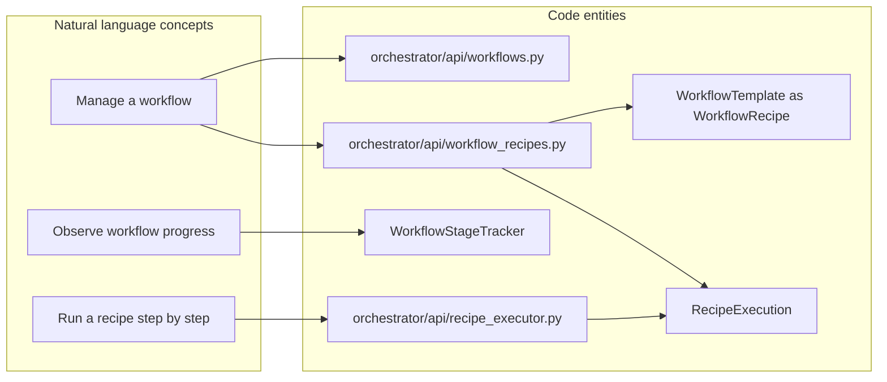
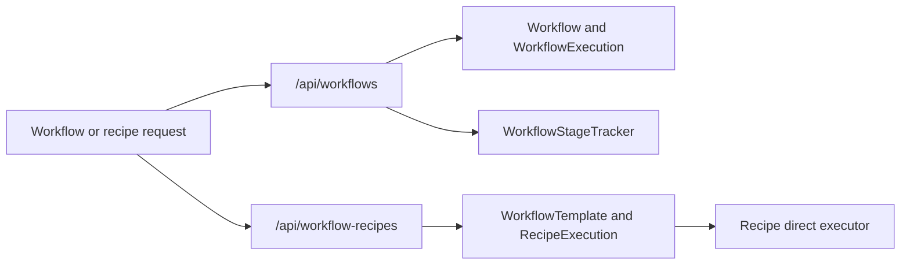
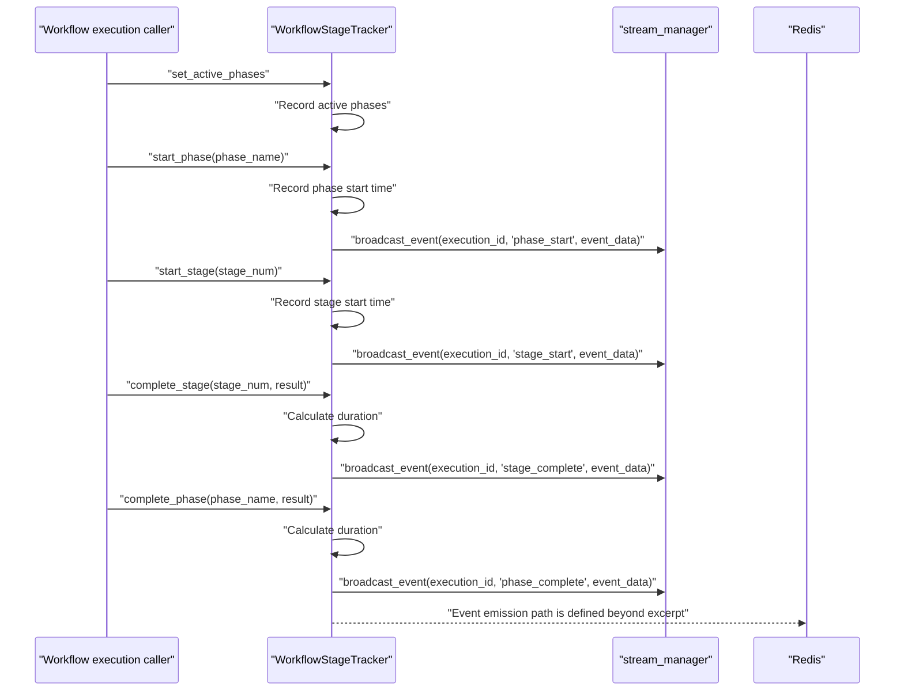
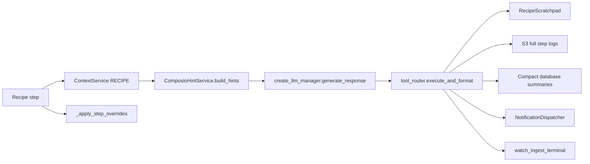

# Workflow API Reference

Relevant source files

The following files were used as context for generating this wiki page:

- [frontend/components/workflows/execution-kitchen.tsx](frontend/components/workflows/execution-kitchen.tsx)
- [orchestrator/alembic/versions/dedupe_skills_unique_workspace_name.py](orchestrator/alembic/versions/dedupe_skills_unique_workspace_name.py)
- [orchestrator/api/composio.py](orchestrator/api/composio.py)
- [orchestrator/api/patterns.py](orchestrator/api/patterns.py)
- [orchestrator/api/recipe_executor.py](orchestrator/api/recipe_executor.py)
- [orchestrator/api/skills.py](orchestrator/api/skills.py)
- [orchestrator/api/templates.py](orchestrator/api/templates.py)
- [orchestrator/api/tools.py](orchestrator/api/tools.py)
- [orchestrator/api/webhooks.py](orchestrator/api/webhooks.py)
- [orchestrator/api/workflow_recipes.py](orchestrator/api/workflow_recipes.py)
- [orchestrator/api/workflows.py](orchestrator/api/workflows.py)
- [orchestrator/core/composio/client.py](orchestrator/core/composio/client.py)
- [orchestrator/core/composio/linkedin_image_workaround.py](orchestrator/core/composio/linkedin_image_workaround.py)
- [orchestrator/core/credentials/tester.py](orchestrator/core/credentials/tester.py)
- [orchestrator/core/credentials/types.py](orchestrator/core/credentials/types.py)
- [orchestrator/core/database/credential_types_seed.json](orchestrator/core/database/credential_types_seed.json)
- [orchestrator/core/routing/ingestors/webhook.py](orchestrator/core/routing/ingestors/webhook.py)
- [orchestrator/core/services/skill_materializer.py](orchestrator/core/services/skill_materializer.py)
- [orchestrator/modules/agents/services/skill_loader.py](orchestrator/modules/agents/services/skill_loader.py)
- [orchestrator/services/metadata_sync_service.py](orchestrator/services/metadata_sync_service.py)
- [orchestrator/services/webhook_dedup.py](orchestrator/services/webhook_dedup.py)
- [orchestrator/tests/test_p2w2_webhook_dedup.py](orchestrator/tests/test_p2w2_webhook_dedup.py)
- [orchestrator/tests/test_p2w2_webhook_signature_reject.py](orchestrator/tests/test_p2w2_webhook_signature_reject.py)
- [orchestrator/tests/test_prd251_linkedin_scope.py](orchestrator/tests/test_prd251_linkedin_scope.py)

## Purpose and Scope

This page describes the workflow-related API surfaces and execution components visible in the supplied code. It covers the `/api/workflows` and `/api/workflow-recipes` routers, the workflow stage/phase tracker, and the recipe direct executor. Endpoint behavior not shown in the supplied source excerpts— including specific CRUD operations, templates, active-workflow queries, and cleanup routines—is not specified here. [orchestrator/api/workflows.py:1-35](), [orchestrator/api/workflow_recipes.py:1-35](), [orchestrator/api/recipe_executor.py:1-18]()

Sources: [orchestrator/api/workflows.py:1-35](), [orchestrator/api/workflow_recipes.py:1-35](), [orchestrator/api/recipe_executor.py:1-18]()

---

## 1. API Architecture Overview

The workflow surface has two routers in the supplied excerpts: `workflows.py` registers `/api/workflows`, and `workflow_recipes.py` registers `/api/workflow-recipes`. The former imports workflow and workflow-execution models and defines `WorkflowStageTracker`; the latter aliases `WorkflowTemplate` as `WorkflowRecipe` and imports `RecipeExecution`. [orchestrator/api/workflows.py:21-38](), [orchestrator/api/workflow_recipes.py:22-35]()

The recipe direct executor is a separate execution path. Its module describes step-by-step execution that bypasses the nine-stage pipeline and reuses chatbot components including `ContextService(RECIPE)`, `ComposioHintService.build_hints()`, `create_llm_manager().generate_response()`, and `tool_router.execute_and_format()`. [orchestrator/api/recipe_executor.py:1-18]()

### Architecture Mapping: Natural Language to Code Entity Space

Sources: [orchestrator/api/workflows.py:21-38](), [orchestrator/api/workflow_recipes.py:22-35](), [orchestrator/api/recipe_executor.py:1-18]()

### Request and Execution Components

Both routers use FastAPI `APIRouter` instances and import `get_db`; the workflow-recipes router also imports hybrid request context and workspace permission dependencies. The visible recipe API helpers include schedule synchronization, step-agent validation, schedule validation, and trigger registration. [orchestrator/api/workflows.py:9-35](), [orchestrator/api/workflow_recipes.py:16-36](), [orchestrator/api/workflow_recipes.py:40-160]()

Sources: [orchestrator/api/workflows.py:21-38](), [orchestrator/api/workflow_recipes.py:22-35](), [orchestrator/api/recipe_executor.py:1-18]()

Sources: [orchestrator/api/workflows.py:9-38](), [orchestrator/api/workflow_recipes.py:16-36]()

---

## 2. Workflow & Recipe CRUD Endpoints

The supplied excerpts establish the router prefixes and selected model/helper imports, but do not show the route-handler definitions for workflow or recipe CRUD. Therefore, this section does not enumerate CRUD paths, request schemas, response schemas, pagination, or status codes beyond the information visible in the excerpts. The workflow router is mounted at `/api/workflows`; the recipe router is mounted at `/api/workflow-recipes`. [orchestrator/api/workflows.py:21-35](), [orchestrator/api/workflow_recipes.py:16-35]()

The recipe API excerpt shows `_check_step_agents`, which queries `Agent` rows constrained by the supplied `workspace_id`. It raises HTTP 400 when a step references agents not found in that workspace or agents whose status is not `active`. [orchestrator/api/workflow_recipes.py:58-79]()

The recipe API also defines `_explicit_schedule`. It rejects unknown schedule types with HTTP 422, invalid schedule configuration with HTTP 400, applies an explicit timezone, and validates live cron configuration using the scheduler’s `cron_trigger`. [orchestrator/api/workflow_recipes.py:81-102]()

The `_auto_register_trigger` function in `orchestrator/api/workflow_recipes.py` handles the automatic registration of triggers for workflows. If a `WorkflowRecipe` has a `schedule_config` of type "trigger" and its source is "composio", this function attempts to subscribe to the trigger via the Composio API. It checks for existing subscriptions to prevent duplicates and uses `core.composio.client.get_composio_client` and `core.composio.entity_manager.EntityManager` to interact with Composio. The `callback_url` for Composio webhooks is constructed using `config.BACKEND_URL` and points to `/api/composio/webhook`. [orchestrator/api/workflow_recipes.py:104-160]()

| API surface | What the supplied source establishes |
|---|---|
| `/api/workflows` | Router prefix, workflow/execution model imports, and tracker class definition; route-handler details are not visible in the excerpt. [orchestrator/api/workflows.py:21-38]() |
| `/api/workflow-recipes` | Router prefix, `WorkflowTemplate` aliased as `WorkflowRecipe`, `RecipeExecution`, and selected helper functions; route-handler details are not visible in the excerpt. [orchestrator/api/workflow_recipes.py:22-35](), [orchestrator/api/workflow_recipes.py:40-160]() |

Sources: [orchestrator/api/workflows.py:21-38](), [orchestrator/api/workflow_recipes.py:22-35](), [orchestrator/api/workflow_recipes.py:58-102](), [orchestrator/api/workflow_recipes.py:104-160]()

---

## 3. Workflow Execution & Stage Tracking (SSE)

`WorkflowStageTracker` is defined in `orchestrator/api/workflows.py`. It supports legacy numbered stages and PRD-59 dynamic phases, stores current stage/phase state and start times, and can be initialized with Redis and stream-manager references. [orchestrator/api/workflows.py:38-80]()

### Stage and Phase Mapping

The tracker’s legacy stage names are defined in `STAGES`; dynamic stage names extend that mapping with stages `2b`, `3b`, and `4b`. `PHASES` groups stages into planning, preparation, execution, evaluation, and learning phases. [orchestrator/api/workflows.py:41-69]()

| Phase key | Label | Included stage IDs |
|---|---|---|
| `PLAN` | Planning | `1`, `2`, `2b` — Task Decomposition, Agent Selection, Agent Negotiation. [orchestrator/api/workflows.py:41-65]() |
| `PREPARE` | Preparation | `3`, `3b` — Context Engineering, Prompt Optimization. [orchestrator/api/workflows.py:41-66]() |
| `EXECUTE` | Execution | `4`, `4b` — Agent Execution, Inter-Agent Coordination. [orchestrator/api/workflows.py:41-67]() |
| `EVALUATE` | Evaluation | `5`, `6` — Result Aggregation, Learning Update. [orchestrator/api/workflows.py:41-68]() |
| `LEARN` | Learning | `7`, `8`, `9` — Quality Assessment, Memory Storage, Response Generation. [orchestrator/api/workflows.py:41-69]() |

`set_active_phases` records the ordered phases selected for an execution. `_get_stage_name` resolves integer or string stage IDs against the dynamic stage mapping. [orchestrator/api/workflows.py:81-88]()

`start_phase` records the phase start time and emits a `phase_start` event; `complete_phase` computes elapsed milliseconds and emits `phase_complete`. Stage-level equivalents are `start_stage` and `complete_stage`, which emit `stage_start` and `stage_complete` events. [orchestrator/api/workflows.py:89-160]()

The visible `_emit` implementation attempts to broadcast events through `stream_manager.broadcast_event`; the class docstring says it tracks execution using SSE events and the router module notes that websocket management was removed in favor of AI SDK SSE streaming. The remainder of `_emit` is outside the supplied excerpt, so this page does not assert its full Redis behavior. [orchestrator/api/workflows.py:28-39](), [orchestrator/api/workflows.py:162-167]()

### Tracker Event Flow

Sources: [orchestrator/api/workflows.py:71-107](), [orchestrator/api/workflows.py:109-167]()

Sources: [orchestrator/api/workflows.py:38-167]()

---

## 4. Active Workflows, Templates & Cleanup

The supplied source excerpts do not show endpoint definitions for listing active workflows, browsing workflow templates, or cleaning up stale workflow executions. Although `workflows.py` imports `Workflow`, `WorkflowExecution`, `WorkflowStatus`, and `ExecutionStatus`, the visible lines do not establish the filtering, response shape, retention policy, or cleanup behavior of any endpoint. [orchestrator/api/workflows.py:21-35]()

The recipe API excerpt imports `WorkflowTemplate as WorkflowRecipe` and `RecipeExecution`, but does not expose template-listing routes in the shown lines. The additional-file listing mentions `orchestrator/api/templates.py`, but provides no contents from which to document its endpoint contract. [orchestrator/api/workflow_recipes.py:24-28]()

Accordingly, active-workflow monitoring, template operations, and cleanup should be documented only after reviewing the corresponding route-handler implementations and their registered paths. [orchestrator/api/workflows.py:21-35](), [orchestrator/api/workflow_recipes.py:22-35]()

Sources: [orchestrator/api/workflows.py:21-35](), [orchestrator/api/workflow_recipes.py:22-35]()

---

## 5. Recipe Direct Execution

`orchestrator/api/recipe_executor.py` describes a direct, step-by-step executor for recipes that bypasses the nine-stage pipeline. The module’s stated component flow uses recipe-mode context assembly, Composio hints, LLM generation, and tool routing/execution. [orchestrator/api/recipe_executor.py:1-12]()

The module also documents several implementation choices: `RecipeScratchpad` replaces verbose text dumps, `scratchpad_write` is injected for explicit exports, full step logs are stored in S3 while the database stores compact summaries, and recipe memory is connected before and after execution. These are module-level descriptions; the implementation details for the corresponding functions are not included in the supplied excerpt. [orchestrator/api/recipe_executor.py:14-18]()

The `_dispatch_playbook_event` function handles unified notification dispatch for playbook-related events. It uses `core.services.notification_dispatcher.NotificationDispatcher` to send events, ensuring that notifications are logged but do not block playbook execution. [orchestrator/api/recipe_executor.py:82-119]()

The `_ingest_playbook_terminal_watch` function reports the terminal state of a playbook execution to its live watch. It captures cost snapshots and output pointers, then calls `services.watch_hooks.watch_ingest_terminal` to update the watch registry. This mechanism is designed to be fail-soft, meaning it logs errors but does not interrupt the executor. [orchestrator/api/recipe_executor.py:126-159]()

The `_apply_step_overrides` function merges `execution_metadata.step_overrides` into the step list. This allows for dynamic modification of recipe steps, such as changing a prompt template, without altering the original `workflow_recipes.steps` definition. [orchestrator/api/recipe_executor.py:166-173]()

Sources: [orchestrator/api/recipe_executor.py:1-18](), [orchestrator/api/recipe_executor.py:82-119](), [orchestrator/api/recipe_executor.py:126-159](), [orchestrator/api/recipe_executor.py:166-173]()

Sources: [orchestrator/api/recipe_executor.py:1-18]()

---