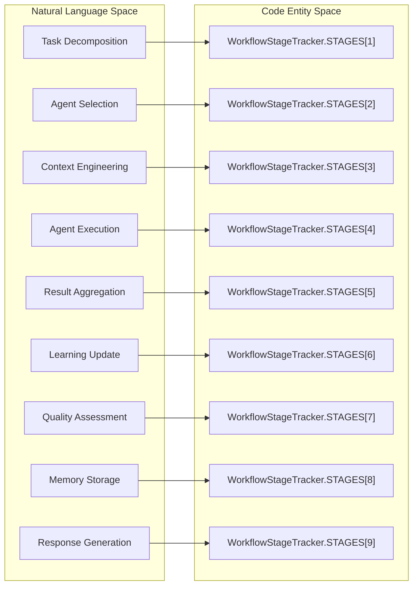
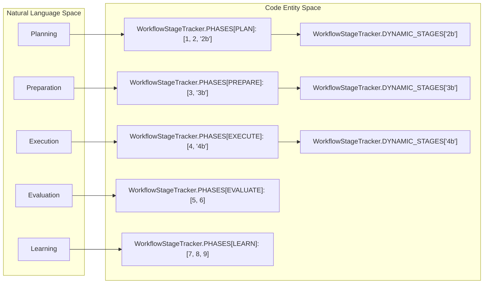
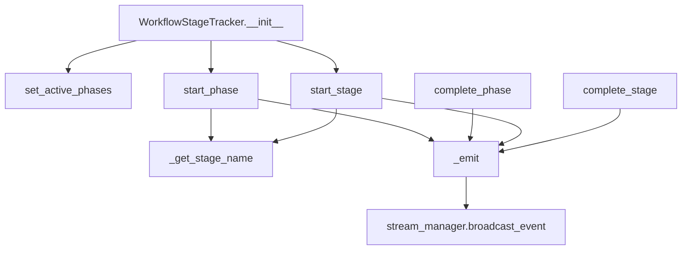

# Workflow Pipeline Architecture

Relevant source files

The following files were used as context for generating this wiki page:

- [orchestrator/api/workflows.py](orchestrator/api/workflows.py)

## Purpose and Scope

This page documents the workflow stage and phase model represented by `WorkflowStageTracker` in `orchestrator/api/workflows.py`. It covers the legacy nine-stage names, PRD-59 phase groupings and sub-stages, tracker state, and the event payloads visible in the supplied implementation excerpt. The excerpt does not show the complete workflow execution path, the remainder of `_emit`, or a workflow SSE route; those behaviors are therefore not inferred here. [orchestrator/api/workflows.py:38-80]() [orchestrator/api/workflows.py:89-167]()

Sources: [orchestrator/api/workflows.py:38-80](), [orchestrator/api/workflows.py:89-167]()

---

## Overview: Execution Models

`WorkflowStageTracker` defines two compatible ways to describe workflow progress: a legacy sequence of nine named stages and PRD-59 phases that group those stages and add three named sub-stages. The tracker accepts an `execution_id` and optional Redis client and stream manager, and initializes state for the current stage and phase, start-time maps, and active phases. [orchestrator/api/workflows.py:38-80]()

| Model | What the implementation defines | Code reference |
|---|---|---|
| Legacy nine-stage names | Integer IDs `1`–`9`, from `Task Decomposition` through `Response Generation`. | `STAGES` [orchestrator/api/workflows.py:41-52]() |
| PRD-59 dynamic names | The legacy names plus string IDs `"2b"`, `"3b"`, and `"4b"`. | `DYNAMIC_STAGES` [orchestrator/api/workflows.py:54-60]() |
| PRD-59 phases | Five named groups mapping phase names to stage IDs and a display label. | `PHASES` [orchestrator/api/workflows.py:62-69]() |

These definitions establish tracker vocabulary and grouping; the cited excerpt does not establish that every execution follows all nine stages or all five phases. `set_active_phases()` stores the phase list selected for an execution, while `start_phase()` uses that list to derive the phase index and count for its event payload. [orchestrator/api/workflows.py:81-83]() [orchestrator/api/workflows.py:89-107]()

Sources: [orchestrator/api/workflows.py:38-83](), [orchestrator/api/workflows.py:89-107]()

---

## Legacy 9-Stage Pipeline

### Natural Language to Code Entity Mapping: Legacy Stages

The following mapping connects the stage names exposed to users or logs with the corresponding integer keys in `WorkflowStageTracker.STAGES`. The code excerpt defines these names and IDs; it does not show an execution function for each stage. [orchestrator/api/workflows.py:41-52]()

### Figure 1: Legacy Stage Names and Tracker Identifiers

Sources: [orchestrator/api/workflows.py:41-52]()

---

## PRD-59 Dynamic Phase Architecture

### Five-Phase Model and Sub-Stages

`WorkflowStageTracker.PHASES` maps each PRD-59 phase name to an ordered list of stage identifiers and a label. `PLAN` includes stages `1`, `2`, and `"2b"`; `PREPARE` includes `3` and `"3b"`; `EXECUTE` includes `4` and `"4b"`; `EVALUATE` includes `5` and `6`; and `LEARN` includes `7`, `8`, and `9`. The dynamic stage names give `"2b"`, `"3b"`, and `"4b"` the labels `Agent Negotiation`, `Prompt Optimization`, and `Inter-Agent Coordination`, respectively. [orchestrator/api/workflows.py:54-69]()

### Figure 2: PRD-59 Phase Definitions Mapped to Code

Sources: [orchestrator/api/workflows.py:54-69]()

### Phase Selection and Progress Metadata

`set_active_phases(phases)` assigns the supplied list to `active_phases`. When `start_phase(phase_name)` runs, it sets `current_phase`, records a start time, reads the phase label and stage list from `PHASES` (or uses a fallback for an unknown phase), and calculates `phase_index` from `active_phases`. If the phase is not in that list, the index is `0`; if the list is empty, `total_phases` defaults to `5`. [orchestrator/api/workflows.py:81-83]() [orchestrator/api/workflows.py:89-105]()

Sources: [orchestrator/api/workflows.py:81-105]()

---

## WorkflowStageTracker Implementation

### Class Structure & Event Flow

`WorkflowStageTracker` stores the execution identifier, optional Redis and stream-manager references, current stage and phase, per-stage and per-phase start times, and the active phase list. Its methods start and complete phases and stages, resolve stage names, and pass event data to `_emit`. [orchestrator/api/workflows.py:38-87]() [orchestrator/api/workflows.py:89-167]()

### Figure 3: Tracker State and Event-Emission Path

Sources: [orchestrator/api/workflows.py:71-87](), [orchestrator/api/workflows.py:89-167]()

### Key Execution Methods

1.  **Phase lifecycle:** `start_phase(phase_name)` records the phase start time and emits a `phase_start` event containing the phase name and label, phase index, total phase count, the phase’s stage IDs and resolved names, and a timestamp. `complete_phase(phase_name, result)` calculates elapsed milliseconds when a start time exists, then emits `phase_complete` with the label, result (or an empty object), duration, and timestamp. [orchestrator/api/workflows.py:89-125]()

2.  **Stage lifecycle:** `start_stage(stage_num)` and `complete_stage(stage_num, result)` accept stage identifiers such as integers or string sub-stage IDs. Both resolve a display name with `_get_stage_name`; start records a timestamp and emits `stage_start`, while completion computes elapsed milliseconds if a start time exists and emits `stage_complete`. [orchestrator/api/workflows.py:85-87]() [orchestrator/api/workflows.py:127-160]()

3.  **Event handoff:** The visible beginning of `_emit(event_type, data)` checks whether `stream_manager` is set and, if so, awaits `stream_manager.broadcast_event(...)` with the execution ID. The supplied excerpt ends during this call, so it does not establish the remainder of `_emit` or whether and how Redis is used. [orchestrator/api/workflows.py:162-167]()

Sources: [orchestrator/api/workflows.py:85-87](), [orchestrator/api/workflows.py:89-167]()

### Event Payload Reference

| Event type | Emitting method | Payload fields visible in the implementation |
|---|---|---|
| `phase_start` | `start_phase()` | `phase`, `phase_label`, `phase_index`, `total_phases`, `stages`, `timestamp` [orchestrator/api/workflows.py:89-107]() |
| `phase_complete` | `complete_phase()` | `phase`, `phase_label`, `result`, `duration_ms`, `timestamp` [orchestrator/api/workflows.py:109-125]() |
| `stage_start` | `start_stage()` | `stage`, `stage_name`, `phase`, `timestamp` [orchestrator/api/workflows.py:127-141]() |
| `stage_complete` | `complete_stage()` | `stage`, `stage_name`, `phase`, `result`, `duration_ms`, `timestamp` [orchestrator/api/workflows.py:143-160]() |

Sources: [orchestrator/api/workflows.py:89-160]()

---

## Code Entity Reference

### Tracker Fields and Methods

| Code entity | Role shown in the implementation |
|---|---|
| `WorkflowStageTracker.STAGES` | Maps legacy integer stage IDs to display names. [orchestrator/api/workflows.py:41-52]() |
| `WorkflowStageTracker.DYNAMIC_STAGES` | Extends the legacy mapping with the three named sub-stages. [orchestrator/api/workflows.py:54-60]() |
| `WorkflowStageTracker.PHASES` | Maps PRD-59 phase names to stage IDs and labels. [orchestrator/api/workflows.py:62-69]() |
| `set_active_phases()` | Stores the execution’s active phase list. [orchestrator/api/workflows.py:81-83]() |
| `_get_stage_name()` | Resolves integer or string stage IDs to names, with a `Stage {stage_id}` fallback. [orchestrator/api/workflows.py:85-87]() |
| `start_phase()` / `complete_phase()` | Track phase timing and create phase event payloads. [orchestrator/api/workflows.py:89-125]() |
| `start_stage()` / `complete_stage()` | Track stage timing and create stage event payloads. [orchestrator/api/workflows.py:127-160]() |
| `_emit()` | Begins the event handoff and, when a stream manager is provided, calls its `broadcast_event` method. The supplied excerpt does not show the full method. [orchestrator/api/workflows.py:162-167]() |

Sources: [orchestrator/api/workflows.py:38-167]()

---