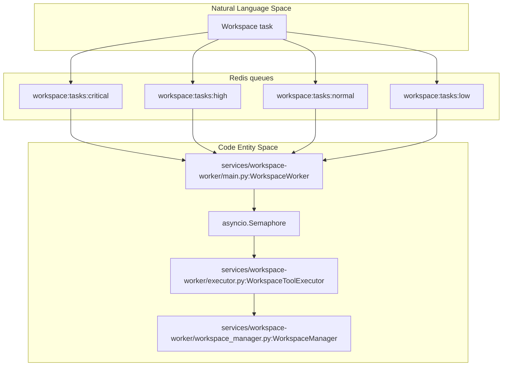
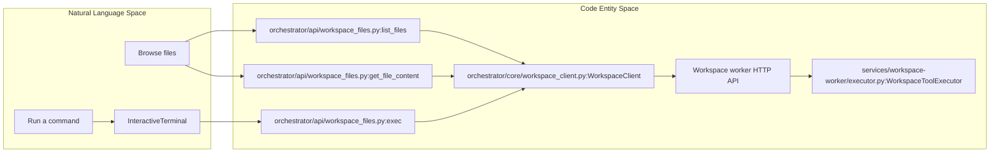
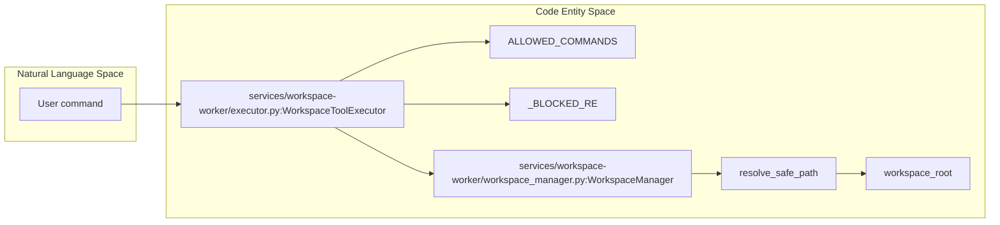

# Workspace Execution

Relevant source files

The following files were used as context for generating this wiki page:

- [docs/workspace-execution/_index.md](docs/workspace-execution/_index.md)
- [docs/workspace-execution/file-operations.md](docs/workspace-execution/file-operations.md)
- [frontend/components/widgets/TerminalWidget/InteractiveTerminal.tsx](frontend/components/widgets/TerminalWidget/InteractiveTerminal.tsx)
- [frontend/components/widgets/TerminalWidget/index.tsx](frontend/components/widgets/TerminalWidget/index.tsx)
- [orchestrator/api/socials_campaigns.py](orchestrator/api/socials_campaigns.py)
- [orchestrator/api/workspace_files.py](orchestrator/api/workspace_files.py)
- [orchestrator/api/workspace_github.py](orchestrator/api/workspace_github.py)
- [orchestrator/core/utils/slug.py](orchestrator/core/utils/slug.py)
- [orchestrator/core/workspace_client.py](orchestrator/core/workspace_client.py)
- [orchestrator/modules/socials/workspace_copies.py](orchestrator/modules/socials/workspace_copies.py)
- [orchestrator/modules/tools/discovery/canvas_git.py](orchestrator/modules/tools/discovery/canvas_git.py)
- [orchestrator/services/owner_knowledge.py](orchestrator/services/owner_knowledge.py)
- [orchestrator/tests/helpers_workspace_worker.py](orchestrator/tests/helpers_workspace_worker.py)
- [orchestrator/tests/test_f173_a_new_workspace_can_save_a_file.py](orchestrator/tests/test_f173_a_new_workspace_can_save_a_file.py)
- [orchestrator/tests/test_f178_b_a_rendered_page_loads_no_protected_file.py](orchestrator/tests/test_f178_b_a_rendered_page_loads_no_protected_file.py)
- [orchestrator/tests/test_f178_the_worker_never_serves_a_deploy_key.py](orchestrator/tests/test_f178_the_worker_never_serves_a_deploy_key.py)
- [orchestrator/tests/test_p2w2_tasks_lane_deleted.py](orchestrator/tests/test_p2w2_tasks_lane_deleted.py)
- [orchestrator/tests/test_prd170_canvas_git.py](orchestrator/tests/test_prd170_canvas_git.py)
- [orchestrator/tests/test_slugify.py](orchestrator/tests/test_slugify.py)
- [orchestrator/tests/test_socials_worker_binary_pieces.py](orchestrator/tests/test_socials_worker_binary_pieces.py)
- [orchestrator/tests/test_socials_workspace_copies.py](orchestrator/tests/test_socials_workspace_copies.py)
- [services/workspace-worker/canvas_session_service.py](services/workspace-worker/canvas_session_service.py)
- [services/workspace-worker/executor.py](services/workspace-worker/executor.py)
- [services/workspace-worker/main.py](services/workspace-worker/main.py)
- [services/workspace-worker/workspace_manager.py](services/workspace-worker/workspace_manager.py)

## Purpose and scope

Workspace Execution provides an isolated filesystem and worker service for workspace tasks. The worker consumes prioritized tasks from Redis and runs work in workspace directories on a persistent volume; the orchestrator exposes workspace file and command operations through HTTP proxy routes. [services/workspace-worker/main.py:1-20](), [orchestrator/api/workspace_files.py:1-20]()

This parent page maps the subsystem and its neighboring features. For details, see [Workspace Worker Architecture](#21.1), [File Operations & Command Execution](#21.2), [GitHub & Code Canvas Integration](#21.3), [Security & Sandboxing](#21.4), [Board Tasks & Command Center](#21.5), [Deliverables & Reports](#21.6), [CLI Host & Session Mode](#21.7), and [Session Tools Bridge](#21.8).

Sources: [services/workspace-worker/main.py:1-20](), [orchestrator/api/workspace_files.py:1-20]()

---

## Workspace Worker Architecture

`WorkspaceWorker` polls Redis priority queues in critical-to-low order and limits concurrent execution with a semaphore. It also starts heartbeat and health-check tasks and waits for active tasks during shutdown. [services/workspace-worker/main.py:46-70](), [services/workspace-worker/main.py:73-89](), [services/workspace-worker/main.py:119-148]()

`WorkspaceManager` provisions a directory tree per workspace, separating persistent content such as repositories and artifacts from ephemeral task directories. The worker also has a `CanvasSessionManager` for workspace-scoped canvas sessions. For worker lifecycle and queue details, see [Workspace Worker Architecture](#21.1). [services/workspace-worker/workspace_manager.py:6-21](), [services/workspace-worker/workspace_manager.py:91-105](), [services/workspace-worker/canvas_session_service.py:138-154]()

Sources: [services/workspace-worker/main.py:46-70](), [services/workspace-worker/main.py:73-89](), [services/workspace-worker/main.py:119-148](), [services/workspace-worker/workspace_manager.py:6-21](), [services/workspace-worker/workspace_manager.py:91-105](), [services/workspace-worker/canvas_session_service.py:138-154]()

### Workspace Task Flow

The diagram connects the task queues and worker-side execution entities. It illustrates queue consumption and execution, not a specific task-submission API. [services/workspace-worker/main.py:46-70](), [services/workspace-worker/executor.py:111-120](), [services/workspace-worker/workspace_manager.py:67-84]()

Title: Workspace Task Flow

Sources: [services/workspace-worker/main.py:46-70](), [services/workspace-worker/main.py:73-89](), [services/workspace-worker/executor.py:111-120](), [services/workspace-worker/workspace_manager.py:67-84]()

---

## File Operations & Command Execution

The orchestrator’s `WorkspaceClient` proxies file and command operations to the worker’s HTTP API. Workspace routes include file listing and content access; the API also documents raw downloads, writes, execution, and canvas endpoints. Paths under `graph/` can instead be routed to `DbWorkspaceClient`. [orchestrator/core/workspace_client.py:1-14](), [orchestrator/api/workspace_files.py:1-20](), [orchestrator/api/workspace_files.py:50-73]()

The `InteractiveTerminal` sends commands to `/api/workspaces/{workspaceId}/exec` and presents results in the browser. For route behavior, file operations, and command execution details, see [File Operations & Command Execution](#21.2). [frontend/components/widgets/TerminalWidget/InteractiveTerminal.tsx:67-90]()

Sources: [orchestrator/core/workspace_client.py:1-14](), [orchestrator/api/workspace_files.py:1-20](), [orchestrator/api/workspace_files.py:50-73](), [frontend/components/widgets/TerminalWidget/InteractiveTerminal.tsx:67-90]()

### Workspace File and Command Path

This diagram associates user-facing file and terminal actions with the route, proxy, and worker-side entities that implement them. [orchestrator/api/workspace_files.py:79-119](), [orchestrator/core/workspace_client.py:80-110](), [frontend/components/widgets/TerminalWidget/InteractiveTerminal.tsx:67-90](), [services/workspace-worker/executor.py:111-120]()

Title: Workspace File and Command Path

Sources: [orchestrator/api/workspace_files.py:79-119](), [orchestrator/core/workspace_client.py:80-110](), [frontend/components/widgets/TerminalWidget/InteractiveTerminal.tsx:67-90](), [services/workspace-worker/executor.py:111-120]()

For details, see [File Operations & Command Execution](#21.2).

Sources: [orchestrator/api/workspace_files.py:1-20](), [orchestrator/api/workspace_files.py:50-73](), [orchestrator/core/workspace_client.py:1-14](), [frontend/components/widgets/TerminalWidget/InteractiveTerminal.tsx:67-90]()

---

## GitHub & Code Canvas Integration

The workspace GitHub API lists repositories accessible through Composio and provides a clone route. Clone requests validate HTTPS URLs against an allowed-host set and validate optional branch names. [orchestrator/api/workspace_github.py:1-8](), [orchestrator/api/workspace_github.py:37-42](), [orchestrator/api/workspace_github.py:82-108](), [orchestrator/api/workspace_github.py:114-139]()

Canvas sessions are managed by `CanvasSessionManager`; the workspace file API documents session lifecycle, event-stream, decision, message, and commit routes. For cloning, canvas Git, and frontend integration details, see [GitHub & Code Canvas Integration](#21.3). [services/workspace-worker/canvas_session_service.py:138-154](), [orchestrator/api/workspace_files.py:9-20]()

Sources: [orchestrator/api/workspace_github.py:1-8](), [orchestrator/api/workspace_github.py:37-42](), [orchestrator/api/workspace_github.py:82-139](), [orchestrator/api/workspace_files.py:9-20](), [services/workspace-worker/canvas_session_service.py:138-154]()

---

## Security & Sandboxing

`WorkspaceToolExecutor` is the worker-side boundary for shell commands and file operations. It validates commands, resolves working directories through `WorkspaceManager`, and uses a sandboxed environment; the executor defines allowed commands and blocked patterns. [services/workspace-worker/executor.py:4-14](), [services/workspace-worker/executor.py:38-101](), [services/workspace-worker/executor.py:125-168]()

`WorkspaceManager` provisions workspace roots, tracks disk usage against a quota, and identifies sensitive names that file routes must not serve or list. Canvas tool calls also pass through a workspace-mount confinement check. For the security controls and their boundaries, see [Security & Sandboxing](#21.4). [services/workspace-worker/workspace_manager.py:42-54](), [services/workspace-worker/workspace_manager.py:67-85](), [services/workspace-worker/workspace_manager.py:132-155](), [services/workspace-worker/canvas_session_service.py:19-23]()

### Execution Security Boundary

The diagram connects a command request to the worker entities responsible for command validation and workspace path resolution. [services/workspace-worker/executor.py:111-120](), [services/workspace-worker/executor.py:125-168](), [services/workspace-worker/workspace_manager.py:67-85]()

Title: Execution Security Boundary

Sources: [services/workspace-worker/executor.py:38-101](), [services/workspace-worker/executor.py:125-168](), [services/workspace-worker/workspace_manager.py:35-36](), [services/workspace-worker/workspace_manager.py:67-85]()

For details, see [Security & Sandboxing](#21.4).

Sources: [services/workspace-worker/executor.py:4-14](), [services/workspace-worker/executor.py:38-101](), [services/workspace-worker/workspace_manager.py:42-54](), [services/workspace-worker/workspace_manager.py:67-85](), [services/workspace-worker/workspace_manager.py:132-155](), [services/workspace-worker/canvas_session_service.py:19-23]()

---

## Board Tasks & Command Center

The worker consumes workspace tasks from Redis priority queues, records task status through its status-recording integration, and uses workspace task directories for ephemeral execution. This queue-based worker flow is one part of the broader task lifecycle; board dispatch, task state, SSE, and Command Center UI are covered separately. [services/workspace-worker/main.py:43-56](), [services/workspace-worker/main.py:155-176](), [services/workspace-worker/workspace_manager.py:165-178]()

For board dispatch, task lifecycle, and Command Center details, see [Board Tasks & Command Center](#21.5).

Sources: [services/workspace-worker/main.py:43-56](), [services/workspace-worker/main.py:155-176](), [services/workspace-worker/workspace_manager.py:165-178]()

---

## Deliverables & Reports

The workspace directory layout includes locations for reports, content, artifacts, analytics, and graph files. Some approved social media assets are also copied into workspace `socials/images/` or `socials/videos/` paths. The records, report services, and Outputs Hub are covered in [Deliverables & Reports](#21.6). [services/workspace-worker/workspace_manager.py:10-21](), [services/workspace-worker/workspace_manager.py:91-105](), [orchestrator/modules/socials/workspace_copies.py:1-21]()

Sources: [services/workspace-worker/workspace_manager.py:10-21](), [services/workspace-worker/workspace_manager.py:91-105](), [orchestrator/modules/socials/workspace_copies.py:1-21]()

---

## CLI Host & Session Mode

`CanvasSessionManager` starts, resumes, reports status for, and stops headless SDK sessions. Session state and transcript data are described as persisted on the workspace volume, with tool calls subject to workspace confinement. This canvas session mechanism is distinct from the subscription-based CLI Host and Session Mode runtime. [services/workspace-worker/canvas_session_service.py:4-23](), [services/workspace-worker/canvas_session_service.py:138-154]()

For the CLI Host package, adapters, policy allowlist, and Session Mode UI, see [CLI Host & Session Mode](#21.7).

Sources: [services/workspace-worker/canvas_session_service.py:4-23](), [services/workspace-worker/canvas_session_service.py:138-154]()

---

## Session Tools Bridge

The canvas session manager’s tool gate applies workspace confinement before its human-approval flow for confined mutating operations. This canvas approval mechanism is separate from the session-tools service and RPC bridge. [services/workspace-worker/canvas_session_service.py:165-180]()

For session tool groups, work tools, plans, and ticket-lane integration, see [Session Tools Bridge](#21.8).

Sources: [services/workspace-worker/canvas_session_service.py:165-180]()

---

## Sources

- [services/workspace-worker/main.py:1-20]()
- [services/workspace-worker/main.py:43-70]()
- [services/workspace-worker/main.py:73-89]()
- [services/workspace-worker/main.py:119-148]()
- [services/workspace-worker/main.py:155-176]()
- [services/workspace-worker/executor.py:4-14]()
- [services/workspace-worker/executor.py:38-101]()
- [services/workspace-worker/executor.py:111-120]()
- [services/workspace-worker/executor.py:125-168]()
- [services/workspace-worker/workspace_manager.py:6-21]()
- [services/workspace-worker/workspace_manager.py:35-36]()
- [services/workspace-worker/workspace_manager.py:42-54]()
- [services/workspace-worker/workspace_manager.py:67-85]()
- [services/workspace-worker/workspace_manager.py:91-105]()
- [services/workspace-worker/workspace_manager.py:132-155]()
- [services/workspace-worker/workspace_manager.py:165-178]()
- [services/workspace-worker/canvas_session_service.py:4-23]()
- [services/workspace-worker/canvas_session_service.py:138-154]()
- [services/workspace-worker/canvas_session_service.py:165-180]()
- [orchestrator/api/workspace_files.py:1-20]()
- [orchestrator/api/workspace_files.py:9-20]()
- [orchestrator/api/workspace_files.py:50-73]()
- [orchestrator/api/workspace_files.py:79-119]()
- [orchestrator/core/workspace_client.py:1-14]()
- [orchestrator/core/workspace_client.py:80-110]()
- [orchestrator/api/workspace_github.py:1-8]()
- [orchestrator/api/workspace_github.py:37-42]()
- [orchestrator/api/workspace_github.py:82-139]()
- [frontend/components/widgets/TerminalWidget/InteractiveTerminal.tsx:67-90]()
- [orchestrator/modules/socials/workspace_copies.py:1-21]()

---