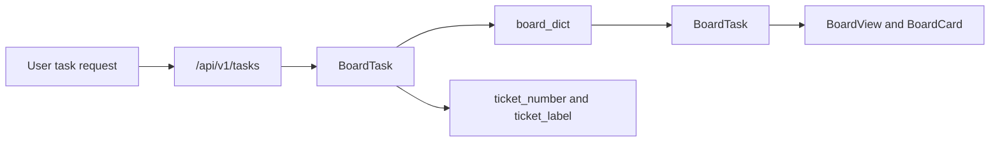
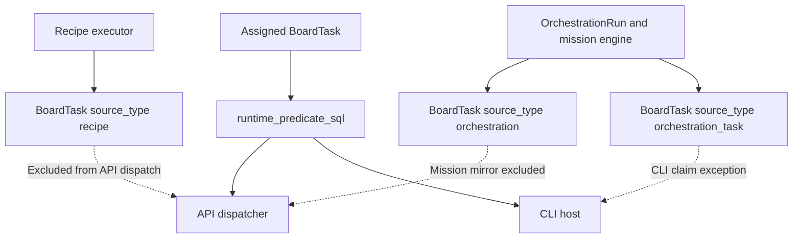
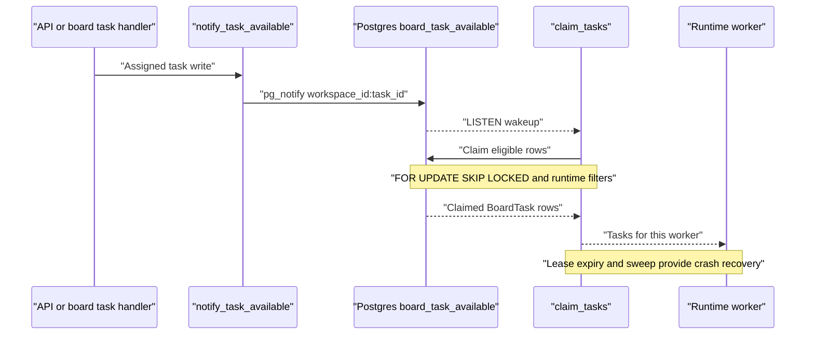
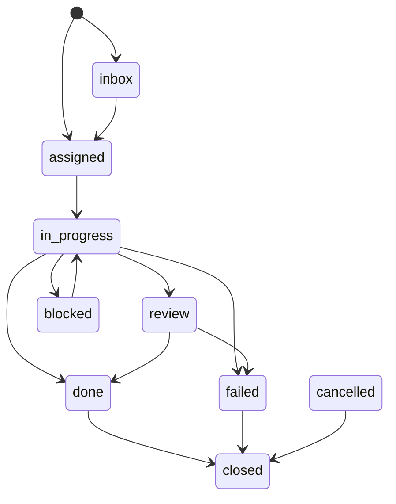
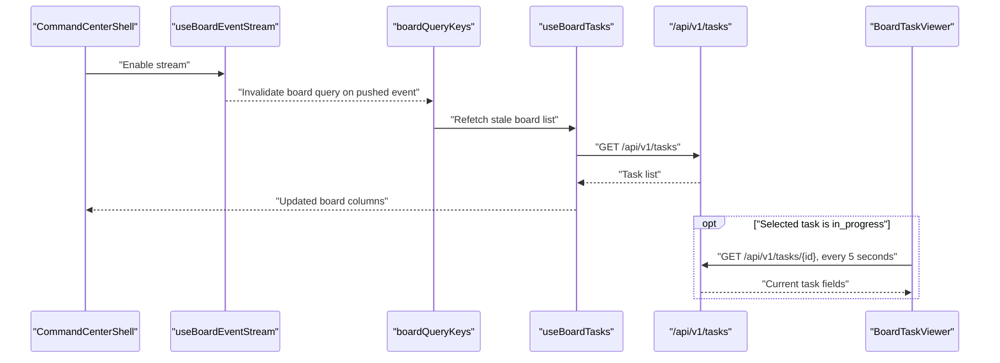
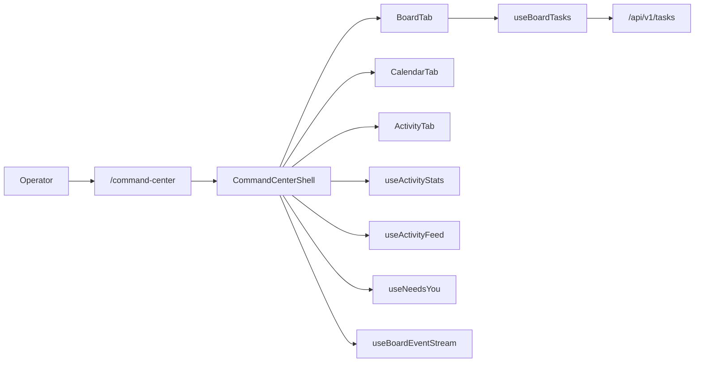

# Board Tasks & Command Center

Relevant source files

The following files were used as context for generating this wiki page:

- [docs/PRDS/PRD-235-LOCAL-AI-OS-MANAGER.md](docs/PRDS/PRD-235-LOCAL-AI-OS-MANAGER.md)
- [docs/PRDS/PRD-239-SESSION-AGENTS-PARITY.md](docs/PRDS/PRD-239-SESSION-AGENTS-PARITY.md)
- [frontend/app/command-center/page.tsx](frontend/app/command-center/page.tsx)
- [frontend/app/globals.css](frontend/app/globals.css)
- [frontend/components/activity/__tests__/board-status-word.test.ts](frontend/components/activity/__tests__/board-status-word.test.ts)
- [frontend/components/activity/board-status-word.ts](frontend/components/activity/board-status-word.ts)
- [frontend/components/activity/board/__tests__/agent-cant-run-pickers.test.tsx](frontend/components/activity/board/__tests__/agent-cant-run-pickers.test.tsx)
- [frontend/components/activity/board/__tests__/ticket-approvals.test.tsx](frontend/components/activity/board/__tests__/ticket-approvals.test.tsx)
- [frontend/components/activity/board/board-agent-sidebar.tsx](frontend/components/activity/board/board-agent-sidebar.tsx)
- [frontend/components/activity/board/board-card.tsx](frontend/components/activity/board/board-card.tsx)
- [frontend/components/activity/board/board-column.tsx](frontend/components/activity/board/board-column.tsx)
- [frontend/components/activity/board/board-filters.tsx](frontend/components/activity/board/board-filters.tsx)
- [frontend/components/activity/board/board-task-viewer.tsx](frontend/components/activity/board/board-task-viewer.tsx)
- [frontend/components/activity/board/board-view.tsx](frontend/components/activity/board/board-view.tsx)
- [frontend/components/activity/board/create-task-dialog.tsx](frontend/components/activity/board/create-task-dialog.tsx)
- [frontend/components/activity/board/create-task-steps.tsx](frontend/components/activity/board/create-task-steps.tsx)
- [frontend/components/activity/board/index.ts](frontend/components/activity/board/index.ts)
- [frontend/components/activity/board/ticket-approvals.tsx](frontend/components/activity/board/ticket-approvals.tsx)
- [frontend/components/command-center/activity-tab.tsx](frontend/components/command-center/activity-tab.tsx)
- [frontend/components/command-center/agent-tones.ts](frontend/components/command-center/agent-tones.ts)
- [frontend/components/command-center/board-tab.tsx](frontend/components/command-center/board-tab.tsx)
- [frontend/components/command-center/calendar-tab.tsx](frontend/components/command-center/calendar-tab.tsx)
- [frontend/components/command-center/command-center-shell.tsx](frontend/components/command-center/command-center-shell.tsx)
- [frontend/components/command-center/sparkline.tsx](frontend/components/command-center/sparkline.tsx)
- [frontend/components/command-center/stats-strip.tsx](frontend/components/command-center/stats-strip.tsx)
- [frontend/components/command-center/summary-tab.tsx](frontend/components/command-center/summary-tab.tsx)
- [frontend/hooks/use-board-tasks-api.ts](frontend/hooks/use-board-tasks-api.ts)
- [frontend/hooks/use-board-tasks.ts](frontend/hooks/use-board-tasks.ts)
- [frontend/types/board.ts](frontend/types/board.ts)
- [orchestrator/alembic/versions/prd72_board_tasks.py](orchestrator/alembic/versions/prd72_board_tasks.py)
- [orchestrator/api/board_tasks.py](orchestrator/api/board_tasks.py)
- [orchestrator/consumers/chatbot/named_template.py](orchestrator/consumers/chatbot/named_template.py)
- [orchestrator/consumers/chatbot/named_template_note.py](orchestrator/consumers/chatbot/named_template_note.py)
- [orchestrator/modules/tools/discovery/handlers_board_tasks.py](orchestrator/modules/tools/discovery/handlers_board_tasks.py)
- [orchestrator/modules/tools/discovery/mission_refs.py](orchestrator/modules/tools/discovery/mission_refs.py)
- [orchestrator/services/board_dispatcher.py](orchestrator/services/board_dispatcher.py)
- [orchestrator/services/ticket_cards.py](orchestrator/services/ticket_cards.py)
- [orchestrator/services/ticket_numbers.py](orchestrator/services/ticket_numbers.py)
- [orchestrator/services/ticket_refs.py](orchestrator/services/ticket_refs.py)
- [orchestrator/tests/test_1115_run_now_says_why_a_ticket_cannot_start.py](orchestrator/tests/test_1115_run_now_says_why_a_ticket_cannot_start.py)
- [orchestrator/tests/test_board_task_handlers.py](orchestrator/tests/test_board_task_handlers.py)
- [orchestrator/tests/test_f155_a_widget_turn_sees_tasks_and_playbooks_as_their_status.py](orchestrator/tests/test_f155_a_widget_turn_sees_tasks_and_playbooks_as_their_status.py)
- [orchestrator/tests/test_f176_run_now_asks_whether_a_run_holds_the_ticket.py](orchestrator/tests/test_f176_run_now_asks_whether_a_run_holds_the_ticket.py)
- [orchestrator/tests/test_f241_auto_acts_on_the_ticket_it_is_given.py](orchestrator/tests/test_f241_auto_acts_on_the_ticket_it_is_given.py)
- [orchestrator/tests/test_f351_c_a_named_template_gets_the_studio_prompt.py](orchestrator/tests/test_f351_c_a_named_template_gets_the_studio_prompt.py)
- [orchestrator/tests/test_f369_a_no_questions_means_defaults_not_questions.py](orchestrator/tests/test_f369_a_no_questions_means_defaults_not_questions.py)
- [orchestrator/tests/test_f369_b_a_ticket_number_in_autos_chat_is_its_number.py](orchestrator/tests/test_f369_b_a_ticket_number_in_autos_chat_is_its_number.py)
- [orchestrator/tests/test_prd234_lane_consent.py](orchestrator/tests/test_prd234_lane_consent.py)
- [orchestrator/tests/test_prd234_s1a_cli_runtime.py](orchestrator/tests/test_prd234_s1a_cli_runtime.py)
- [orchestrator/tests/test_prd234_s3_cli_ticket_lane.py](orchestrator/tests/test_prd234_s3_cli_ticket_lane.py)
- [orchestrator/tests/test_prd238_w3_follow_through.py](orchestrator/tests/test_prd238_w3_follow_through.py)
- [orchestrator/tests/test_prd252_ticket_numbers.py](orchestrator/tests/test_prd252_ticket_numbers.py)
- [orchestrator/tests/test_run_now_leaves_a_missions_steps_to_the_mission.py](orchestrator/tests/test_run_now_leaves_a_missions_steps_to_the_mission.py)

## Purpose & Scope

This page describes the board-task API and dispatch path, the frontend Kanban and Command Center surfaces, and the real-time and scheduled-work views. The supplied code identifies the board entity as `BoardTask`, the API router as `/api/v1/tasks`, the dispatcher as a Postgres-backed claim/lease service, and the Command Center as a tabbed frontend surface. [orchestrator/api/board_tasks.py:1-7]()[orchestrator/api/board_tasks.py:69-76]()[orchestrator/services/board_dispatcher.py:1-17]()[frontend/components/command-center/command-center-shell.tsx:3-21]()

Sources: [orchestrator/api/board_tasks.py:1-7](), [orchestrator/api/board_tasks.py:69-76](), [orchestrator/services/board_dispatcher.py:1-17](), [frontend/components/command-center/command-center-shell.tsx:3-21]()

---

## 1. BoardTask Data Model & Backend API

`BoardTask` is the ORM entity used by the board API. The API mounts under `/api/v1/tasks`; its module describes the board as a Kanban lifecycle and imports `BoardTask` from `core.models.core`. The model definition itself is not included in the supplied excerpts, so the fields described here are limited to those referenced by the API, dispatcher, and UI. [orchestrator/api/board_tasks.py:1-7]()[orchestrator/api/board_tasks.py:30-30]()[orchestrator/api/board_tasks.py:69-76]()

| Concern | Implementation detail |
|---|---|
| Status values | `VALID_STATUSES` includes `inbox`, `assigned`, `in_progress`, `review`, `blocked`, `done`, `failed`, `cancelled`, and `closed`. [orchestrator/api/board_tasks.py:72-76]() |
| Priorities | `VALID_PRIORITIES` is `urgent`, `high`, `medium`, and `low`. [orchestrator/api/board_tasks.py:93-93]() |
| Review modes | The API recognizes `human`, `llm`, and `auto`; only `human` and `auto` are offered as new choices. [orchestrator/api/board_tasks.py:94-97]() |
| User-creatable source types | The API identifies `user` and `activity` as user-creatable source types. [orchestrator/api/board_tasks.py:77-80]() |
| PATCH surface | `PATCHABLE_TASK_FIELDS` enumerates the accepted patch fields, including `title`, `description`, `status`, `priority`, assignment, result, tags, planning data, notes, and review feedback. [orchestrator/api/board_tasks.py:86-92]() |
| Ticket numbers | Ticket-number helpers format workspace sequence numbers as `#0042`; mission steps can be represented as `#0051.3`. [orchestrator/services/ticket_numbers.py:1-8]()[orchestrator/services/ticket_numbers.py:43-48]() |

The API module imports request-context and workspace-permission dependencies, task-read scope definitions, database access, and board-view serialization helpers. Those imports establish the API’s integration points, while the supplied excerpt does not include individual endpoint bodies or their complete authorization rules. [orchestrator/api/board_tasks.py:17-30]()[orchestrator/api/board_tasks.py:44-47]()

### Task Entity Mapping

Title: "BoardTask API and UI entities"

Sources: [orchestrator/api/board_tasks.py:30-30](), [orchestrator/api/board_tasks.py:44-44](), [orchestrator/api/board_tasks.py:69-76](), [orchestrator/services/ticket_numbers.py:19-20](), [orchestrator/services/ticket_numbers.py:43-48](), [frontend/hooks/use-board-tasks.ts:10-13](), [frontend/components/activity/board/board-card.tsx:7-13]()

---

## 2. Board Integration Bridges

The board supports tasks that originate from different execution paths. The dispatcher explicitly excludes API-runtime recipe mirrors and mission mirrors because their owning executors drive those tasks. Its comments distinguish the mission’s own ticket from mission-step tickets, and allow a CLI runtime to claim `orchestration_task` mirrors. [orchestrator/services/board_dispatcher.py:84-106]()[orchestrator/services/board_dispatcher.py:94-99]()

The API imports helpers for ticket redo, review verdicts, board status changes, mission-card behavior, and result handling. The provided excerpts establish these integration points but do not include the implementation of the orchestration board bridge or a re-brief function. Accordingly, the bridge’s detailed state mapping and re-brief data flow cannot be specified from the supplied code. [orchestrator/api/board_tasks.py:39-44]()[orchestrator/api/board_tasks.py:54-67]()

### Bridge Architecture Mapping

Title: "Board dispatch ownership by source type"

Sources: [orchestrator/services/board_dispatcher.py:68-91](), [orchestrator/services/board_dispatcher.py:94-106]()

---

## 3. Board Task Dispatcher

`services/board_dispatcher.py` implements a Postgres-native claim, lease, and requeue primitive for board tasks. Its stated goals are exclusive claims across concurrent workers, recovery through lease expiry, and fast wakeups through PostgreSQL notifications with polling as fallback. [orchestrator/services/board_dispatcher.py:1-17]()

### Dispatcher Mechanism

- **Atomic claiming:** `claim_tasks` claims up to a requested limit. The dispatcher documentation specifies `FOR UPDATE SKIP LOCKED` so concurrent claimants lock disjoint rows rather than waiting on or double-claiming the same task. [orchestrator/services/board_dispatcher.py:7-9]()[orchestrator/services/board_dispatcher.py:142-155]()
- **Lease recovery:** A claimed task has a lease; the module describes expiry and sweeping as the recovery path when a worker crashes or hangs. [orchestrator/services/board_dispatcher.py:10-12]()
- **Wakeups:** `notify_task_available` sends a `pg_notify` on `board_task_available`, with a payload containing workspace and task identifiers. Notification failure is fail-soft, leaving the poll loop as the fallback. [orchestrator/services/board_dispatcher.py:49-50]()[orchestrator/services/board_dispatcher.py:127-139]()
- **Runtime and provider selection:** `runtime_predicate_sql` distinguishes API and CLI agents using agent configuration. `provider_predicate_sql` optionally restricts CLI host claims to providers the host serves. [orchestrator/services/board_dispatcher.py:68-82]()[orchestrator/services/board_dispatcher.py:109-124]()
- **Executor ownership:** Recipe mirrors and mission mirrors are excluded according to runtime-specific rules, so work driven by the recipe or mission executor is not accidentally claimed as ordinary API board work. [orchestrator/services/board_dispatcher.py:85-106]()

The API and tool-handler layers call `notify_task_available` after relevant assigned-task writes. The tool handler wraps the notification in `_notify_dispatch_safe`, treating notification as an optimization rather than a condition for the write to succeed. [orchestrator/api/board_tasks.py:35-40]()[orchestrator/modules/tools/discovery/handlers_board_tasks.py:56-74]()

### Dispatcher Flow

Title: "BoardTask dispatch from assignment to claim"

Sources: [orchestrator/api/board_tasks.py:35-40](), [orchestrator/modules/tools/discovery/handlers_board_tasks.py:56-74](), [orchestrator/services/board_dispatcher.py:7-17](), [orchestrator/services/board_dispatcher.py:49-50](), [orchestrator/services/board_dispatcher.py:127-155]()

---

## 4. Kanban Board UI & Real-Time Synchronization

The board hooks fetch tasks from `/api/v1/tasks`, map API records to frontend `BoardTask` values, and group top-level tasks into `BOARD_COLUMNS`. The hook also annotates parent tasks with child counts and applies client-side type and suggestion-source filters. [frontend/hooks/use-board-tasks.ts:10-13]()[frontend/hooks/use-board-tasks.ts:72-134]()

### Component Architecture & Hooks

- **`useBoardTasks`** builds the list request, maps returned tasks, groups them by status, and derives parent-card child counts. It requests a `finished_limit` of 200 and documents that open tickets are not windowed in the same way as finished work. [frontend/hooks/use-board-tasks.ts:72-97]()[frontend/hooks/use-board-tasks.ts:99-134]()
- **`useUpdateTaskStatus`** sends a `PATCH` to `/api/v1/tasks/{taskId}/status`, optimistically updates cached board tasks, restores previous cached data on error, and invalidates board queries after settlement. [frontend/hooks/use-board-tasks.ts:136-180]()
- **`BoardCard`** renders draggable cards with status-relevant details such as description, blocked reason, progress, errors, tags, child count, and ticket actions. [frontend/components/activity/board/board-card.tsx:58-65]()[frontend/components/activity/board/board-card.tsx:73-145]()[frontend/components/activity/board/board-card.tsx:149-183]()
- **`BoardTaskViewer`** uses `useLiveTask` for an active task. When the task is `in_progress`, that hook queries `/api/v1/tasks/{id}` every five seconds and merges live status, result, error, timestamps, progress, and runtime reference into the displayed task. [frontend/components/activity/board/board-task-viewer.tsx:35-40]()[frontend/components/activity/board/board-task-viewer.tsx:43-71]()
- **SSE-driven refresh:** `CommandCenterShell` enables `useBoardEventStream(true)`. The board-list hook comments that the SSE invalidates board queries on pushed events, replacing interval polling for the board list. [frontend/components/command-center/command-center-shell.tsx:115-118]()[frontend/hooks/use-board-tasks.ts:86-97]()

### Task Lifecycle State Machine

The API defines the recognized statuses, but the provided excerpt does not define every permitted transition. The diagram therefore represents the visible status vocabulary rather than claiming that each arrow is accepted by the API. [orchestrator/api/board_tasks.py:72-76]()

Title: "BoardTask status vocabulary"

Sources: [orchestrator/api/board_tasks.py:72-76]()

### UI Synchronization Sequence

The Command Center subscribes to the board event stream, and the board query is invalidated on pushed events. Separately, an open task viewer polls its task endpoint while the task remains `in_progress`. [frontend/components/command-center/command-center-shell.tsx:115-118]()[frontend/hooks/use-board-tasks.ts:86-97]()[frontend/components/activity/board/board-task-viewer.tsx:43-71]()

Title: "Board SSE and active-task refresh"

Sources: [frontend/components/command-center/command-center-shell.tsx:115-118](), [frontend/hooks/use-board-tasks.ts:48-54](), [frontend/hooks/use-board-tasks.ts:72-97](), [frontend/components/activity/board/board-task-viewer.tsx:43-71]()

---

## 5. Command Center Shell & Tabs

`CommandCenterShell` is the page frame for the Studio `/command-center` route. It defines tabs for Summary, Board, Calendar, Activity, Watchlist, Questions, and Governance; the active tab is read from the `?tab=` URL parameter, with invalid values falling back to Summary. [frontend/components/command-center/command-center-shell.tsx:3-21]()[frontend/components/command-center/command-center-shell.tsx:50-77]()[frontend/components/command-center/command-center-shell.tsx:92-99]()

The shell reads activity stats, needs-you totals, schedule data, activity-feed data, watches, and questions. Its Board badge uses the needs-you total; the Calendar badge counts scheduled items that are not paused; and the Activity badge uses the feed total or returned item count. [frontend/components/command-center/command-center-shell.tsx:100-118]()[frontend/components/command-center/command-center-shell.tsx:128-145]()

- **Board tab:** The shell mounts `BoardTab`; the supplied excerpt does not include that component’s implementation. [frontend/components/command-center/command-center-shell.tsx:38-45]()
- **Calendar tab:** `CalendarTab` supports Day, Week, and Month views. It consumes `useActivitySchedule` and renders schedule items that include heartbeat routines, playbooks, scheduled tasks, mission SLA deadlines, board-task SLA deadlines, and scheduled social posts. [frontend/components/command-center/calendar-tab.tsx:4-21]()[frontend/components/command-center/calendar-tab.tsx:77-89]()
- **Activity tab:** `ActivityTab` uses `useActivityFeed`, supports Cards and Table density on non-phone layouts, and filters by event type and failed status. Clicking a row routes to the corresponding feed-item destination when one is available. [frontend/components/command-center/activity-tab.tsx:3-16]()[frontend/components/command-center/activity-tab.tsx:113-149]()

### Command Center Entity Mapping

Title: "Command Center concepts mapped to frontend entities"

Sources: [frontend/components/command-center/command-center-shell.tsx:3-21](), [frontend/components/command-center/command-center-shell.tsx:29-45](), [frontend/components/command-center/command-center-shell.tsx:115-118](), [frontend/hooks/use-board-tasks.ts:72-97]()

---

## 6. Widgets & Analytics

The supplied Command Center shell obtains `useActivityStats` data and uses `working_now`, `agents_active`, and `tasks_in_queue` in its summary state. It also obtains a needs-you total and schedule/feed data for tab counts. [frontend/components/command-center/command-center-shell.tsx:100-118]()[frontend/components/command-center/command-center-shell.tsx:128-155]()

The Calendar tab provides schedule-oriented views, including an always-on band, a Next Up panel, health and load-error panels, and Day/Week/Month grid components. Its data source is `useActivitySchedule`; event actions are wired through navigation, heartbeat toggling, scheduled-task status updates, and social-post rescheduling dependencies. [frontend/components/command-center/calendar-tab.tsx:47-62]()[frontend/components/command-center/calendar-tab.tsx:77-106]()[frontend/components/command-center/calendar-tab.tsx:110-130]()

The Activity tab is a merged feed/history surface, not a speculative action console: its documented interactions are density selection, type/status filters, and opening a feed item. [frontend/components/command-center/activity-tab.tsx:3-16]()[frontend/components/command-center/activity-tab.tsx:113-149]()

Sources: [frontend/components/command-center/command-center-shell.tsx:100-155](), [frontend/components/command-center/calendar-tab.tsx:47-62](), [frontend/components/command-center/calendar-tab.tsx:77-130](), [frontend/components/command-center/activity-tab.tsx:3-16](), [frontend/components/command-center/activity-tab.tsx:113-149]()

---