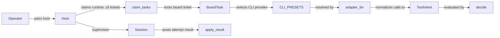
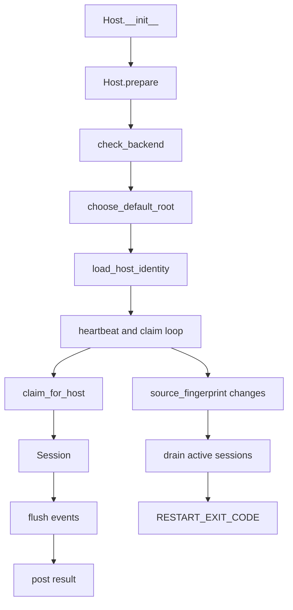
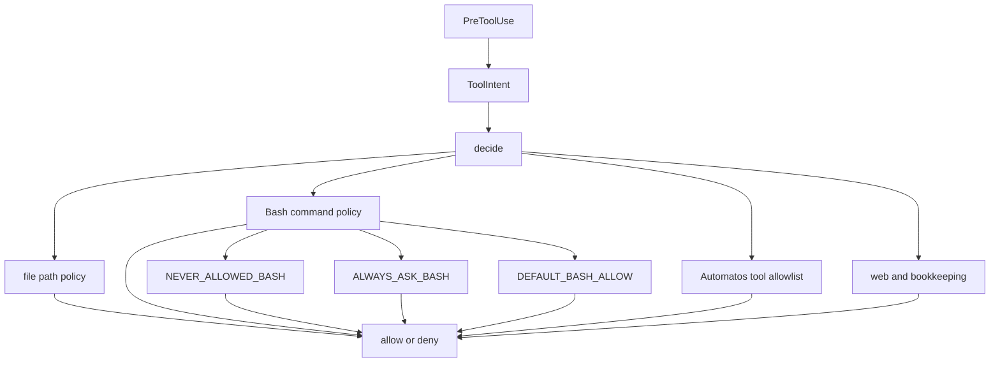
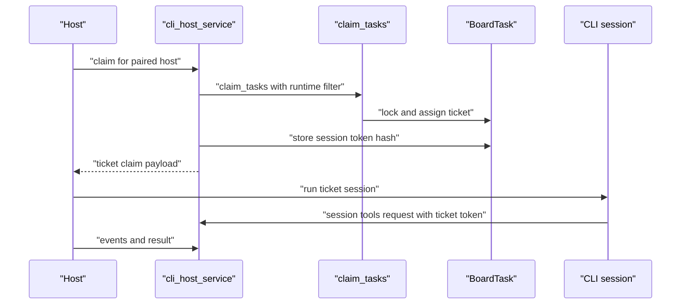
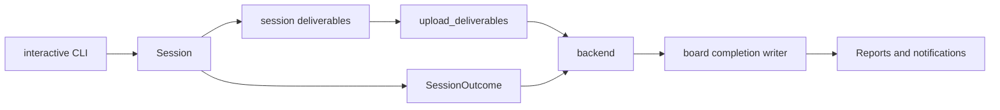

# CLI Host & Session Mode

Relevant source files

The following files were used as context for generating this wiki page:

- [docs/PRDS/PRD-245-SESSION-TOOLS-BRIDGE.md](docs/PRDS/PRD-245-SESSION-TOOLS-BRIDGE.md)
- [docs/PRDS/PRD-253-COPILOT-SESSION-RUNTIME.md](docs/PRDS/PRD-253-COPILOT-SESSION-RUNTIME.md)
- [docs/architecture/CLI-RUNTIME-ADAPTER-DESIGN.md](docs/architecture/CLI-RUNTIME-ADAPTER-DESIGN.md)
- [orchestrator/api/cli_hosts.py](orchestrator/api/cli_hosts.py)
- [orchestrator/services/cli_host_service.py](orchestrator/services/cli_host_service.py)
- [orchestrator/services/cli_session_prompt.py](orchestrator/services/cli_session_prompt.py)
- [orchestrator/services/session_uploads.py](orchestrator/services/session_uploads.py)
- [orchestrator/tests/test_848_session_files_reach_the_cluster.py](orchestrator/tests/test_848_session_files_reach_the_cluster.py)
- [orchestrator/tests/test_848_session_files_reach_the_cluster_realdb.py](orchestrator/tests/test_848_session_files_reach_the_cluster_realdb.py)
- [orchestrator/tests/test_cli_presets_parity.py](orchestrator/tests/test_cli_presets_parity.py)
- [orchestrator/tests/test_f167b_a_session_never_claims_an_approval_nobody_gave.py](orchestrator/tests/test_f167b_a_session_never_claims_an_approval_nobody_gave.py)
- [orchestrator/tests/test_prd235_host_always_on.py](orchestrator/tests/test_prd235_host_always_on.py)
- [orchestrator/tests/test_prd239_session_prompt.py](orchestrator/tests/test_prd239_session_prompt.py)
- [services/cli-host/README.md](services/cli-host/README.md)
- [services/cli-host/automatos_cli_host/__init__.py](services/cli-host/automatos_cli_host/__init__.py)
- [services/cli-host/automatos_cli_host/adapters/__init__.py](services/cli-host/automatos_cli_host/adapters/__init__.py)
- [services/cli-host/automatos_cli_host/adapters/base.py](services/cli-host/automatos_cli_host/adapters/base.py)
- [services/cli-host/automatos_cli_host/adapters/claude.py](services/cli-host/automatos_cli_host/adapters/claude.py)
- [services/cli-host/automatos_cli_host/adapters/codex.py](services/cli-host/automatos_cli_host/adapters/codex.py)
- [services/cli-host/automatos_cli_host/adapters/copilot.py](services/cli-host/automatos_cli_host/adapters/copilot.py)
- [services/cli-host/automatos_cli_host/adapters/copilot_home.py](services/cli-host/automatos_cli_host/adapters/copilot_home.py)
- [services/cli-host/automatos_cli_host/adapters/copilot_sandbox.py](services/cli-host/automatos_cli_host/adapters/copilot_sandbox.py)
- [services/cli-host/automatos_cli_host/brand_files.py](services/cli-host/automatos_cli_host/brand_files.py)
- [services/cli-host/automatos_cli_host/config.py](services/cli-host/automatos_cli_host/config.py)
- [services/cli-host/automatos_cli_host/filelock.py](services/cli-host/automatos_cli_host/filelock.py)
- [services/cli-host/automatos_cli_host/host.py](services/cli-host/automatos_cli_host/host.py)
- [services/cli-host/automatos_cli_host/policy.py](services/cli-host/automatos_cli_host/policy.py)
- [services/cli-host/automatos_cli_host/presets.py](services/cli-host/automatos_cli_host/presets.py)
- [services/cli-host/automatos_cli_host/secret_reach.py](services/cli-host/automatos_cli_host/secret_reach.py)
- [services/cli-host/automatos_cli_host/session.py](services/cli-host/automatos_cli_host/session.py)
- [services/cli-host/automatos_cli_host/shell_words.py](services/cli-host/automatos_cli_host/shell_words.py)
- [services/cli-host/automatos_cli_host/turn_end.py](services/cli-host/automatos_cli_host/turn_end.py)
- [services/cli-host/automatos_cli_host/uploads.py](services/cli-host/automatos_cli_host/uploads.py)
- [services/cli-host/tests/conftest.py](services/cli-host/tests/conftest.py)
- [services/cli-host/tests/fake_copilot.py](services/cli-host/tests/fake_copilot.py)
- [services/cli-host/tests/fake_print_cli.py](services/cli-host/tests/fake_print_cli.py)
- [services/cli-host/tests/test_adapters.py](services/cli-host/tests/test_adapters.py)
- [services/cli-host/tests/test_copilot_adapter.py](services/cli-host/tests/test_copilot_adapter.py)
- [services/cli-host/tests/test_f332_the_session_has_the_brand_logo_as_a_file.py](services/cli-host/tests/test_f332_the_session_has_the_brand_logo_as_a_file.py)
- [services/cli-host/tests/test_filelock.py](services/cli-host/tests/test_filelock.py)
- [services/cli-host/tests/test_host_loop.py](services/cli-host/tests/test_host_loop.py)
- [services/cli-host/tests/test_never_publish.py](services/cli-host/tests/test_never_publish.py)
- [services/cli-host/tests/test_platform_secrets_reach.py](services/cli-host/tests/test_platform_secrets_reach.py)
- [services/cli-host/tests/test_session_fake_claude.py](services/cli-host/tests/test_session_fake_claude.py)
- [services/cli-host/tests/test_session_fake_copilot.py](services/cli-host/tests/test_session_fake_copilot.py)
- [services/cli-host/tests/test_session_sandbox.py](services/cli-host/tests/test_session_sandbox.py)
- [services/cli-host/tests/test_trust_race.py](services/cli-host/tests/test_trust_race.py)
- [services/cli-host/tests/test_turn_end.py](services/cli-host/tests/test_turn_end.py)
- [services/cli-host/tests/test_units.py](services/cli-host/tests/test_units.py)

## Purpose & Scope

This page explains PRD-234/253 Session Mode: how Automatos assigns `runtime: cli` board work to a paired local CLI host, supervises interactive sessions, applies a host-side policy gate, and returns results to the board. It covers the `services/cli-host` package, its adapter model, the backend `cli_host_service`, workspace and secret-reach boundaries, and the Session Mode settings surface. The host is a local process that runs the operator’s own CLI sessions, with Automatos acting as manager [services/cli-host/README.md:1-5](). The backend contract describes pairing, claims, events, and results [orchestrator/services/cli_host_service.py:1-14]().

Sources: [services/cli-host/README.md:1-5](), [orchestrator/services/cli_host_service.py:1-14]()

---

## 1. Hybrid Architecture & Terms Invariant

Session Mode is the local execution lane for agents configured with `runtime: cli`. A paired host claims eligible board tickets, runs each ticket as a supervised interactive session using a CLI available on the operator’s machine, and reports the outcome to the backend [services/cli-host/README.md:1-5](). The backend uses the board as the queue and the same `FOR UPDATE SKIP LOCKED` claim mechanism used by the dispatcher, with a runtime filter for CLI work [orchestrator/services/cli_host_service.py:1-8]().

The host is explicitly limited to a local-edition backend with session mode enabled. It refuses to serve a backend that does not report `edition == "local"` or that has `cli_runtime_enabled` turned off [services/cli-host/automatos_cli_host/host.py:66-76](). The package contract also states that it uses the operator’s unmodified CLI and native login, does not forward CLI credentials, and runs interactive sessions rather than the Claude `-p` or Agent SDK paths [services/cli-host/automatos_cli_host/__init__.py:12-24]().

| Term | Meaning in Session Mode |
|---|---|
| `runtime: cli` | Agent runtime selection that causes work to be handled by a CLI host rather than the ordinary API execution lane [services/cli-host/README.md:3-5](). |
| Host | Local process that pairs with the backend, announces CLI capabilities, claims tickets, supervises sessions, and reports results [services/cli-host/automatos_cli_host/host.py:1-11](). |
| Adapter | CLI-specific implementation behind a shared runtime contract; presets describe CLI invocation details and adapters supply CLI-specific behavior [services/cli-host/README.md:8-16](). |
| `ToolIntent` | Adapter-normalized description of what a tool call does; the policy evaluates intent rather than relying on CLI-specific tool names [services/cli-host/automatos_cli_host/policy.py:1-6](). |
| Session token | Per-ticket credential used by the session tools bridge; the backend stores its hash on the ticket rather than storing the plaintext token [orchestrator/services/cli_host_service.py:63-75](). |

**Diagram: Session Mode concepts mapped to code entities**

Sources: [services/cli-host/README.md:8-16](), [services/cli-host/automatos_cli_host/host.py:1-11](), [services/cli-host/automatos_cli_host/session.py:42-58](), [services/cli-host/automatos_cli_host/policy.py:1-6](), [orchestrator/services/cli_host_service.py:1-14](), [orchestrator/services/cli_host_service.py:33-44]()

---

## 2. CLI Host Package & Lifecycle (`services/cli-host`)

The `automatos_cli_host` package is designed to run on the operator’s machine using standard-library Python. The host can be launched directly or registered as a login service; the package README documents `make cli-host`, `make cli-host-install`, and lifecycle management commands [services/cli-host/README.md:31-35](), [services/cli-host/README.md:37-54](). The host loop is organized around pairing, heartbeat, claim, run, and report [services/cli-host/automatos_cli_host/host.py:1-11]().

### Host Initialization & Pairing

`Host.prepare()` creates the host state directory, checks the backend, loads and extends the saved directory allowlist, selects a default root, and saves the resulting allowlist [services/cli-host/automatos_cli_host/host.py:114-132](). The backend check is implemented by `check_backend()`: it calls the health endpoint and refuses a missing edition, a non-local edition, or disabled CLI runtime [services/cli-host/automatos_cli_host/host.py:62-76]().

The host stores its persistent identity in the configured token path; the package documentation identifies the usual path as `~/.automatos/cli-host/host.json` and describes pairing as a one-time exchange for a host token [services/cli-host/automatos_cli_host/host.py:1-7](), [services/cli-host/README.md:31-35](). On the backend, pairing secrets are hashed, and the service’s security contract states that only SHA-256 digests of pairing codes and host tokens are stored [orchestrator/services/cli_host_service.py:10-14](). The host’s state directory and credentials are protected with restrictive file permissions where created or persisted, as applicable to the relevant host and adapter files; pairing-code and token storage details are described by the backend contract [orchestrator/services/cli_host_service.py:10-14]().

### Source Fingerprinting & Drift Detection

`source_fingerprint()` computes a short SHA-1-derived fingerprint from the relative path, file size, and modification time of Python modules under the host package directory [services/cli-host/automatos_cli_host/host.py:46-59](). The host keeps the initial fingerprint and backend contract during initialization [services/cli-host/automatos_cli_host/host.py:99-103](). The README describes the operational behavior: when host code changes or the backend contract changes, the host drains work and exits so a service manager can restart it on the updated code [services/cli-host/README.md:56-64]().

**Diagram: Host lifecycle and code-level entry points**

Sources: [services/cli-host/automatos_cli_host/host.py:42-59](), [services/cli-host/automatos_cli_host/host.py:62-76](), [services/cli-host/automatos_cli_host/host.py:80-103](), [services/cli-host/automatos_cli_host/host.py:114-147](), [services/cli-host/README.md:56-64]()

---

## 3. Security, Allowlist & Policy Engine

The host resolves a ticket’s working directory against directories explicitly allowed on that machine. The session flow specifies that a requested working directory is resolved against the host allowlist and refused if it is outside the permitted roots [services/cli-host/automatos_cli_host/session.py:1-7](). The host setup loads saved allowlist entries, adds configured `allow_dirs`, chooses the default root, and persists the allowlist [services/cli-host/automatos_cli_host/host.py:114-132](). Unit tests cover accepted roots, relative paths, missing working directories, traversal, null bytes, an empty allowlist, and symlink escapes [services/cli-host/tests/test_units.py:53-78]().

### Directory Confinement (`allowlist.py`)

The visible tests establish the intended contract of `resolve_allowed()`: a path under an allowed root resolves successfully, while parent traversal, an out-of-root path, a null byte, an empty root set, and a symlink escape are refused [services/cli-host/tests/test_units.py:53-78](). The session module imports `resolve_allowed`, `default_session_cwd`, and `session_deliverables_dir` for resolving the session’s working directory and deliverables area [services/cli-host/automatos_cli_host/session.py:42-47]().

### Tool Policy & Guardrails (`policy.py`)

`decide()` is the session policy entry point. It evaluates an adapter-provided `ToolIntent` and `PolicyContext` and is enforced through the `PreToolUse` hook [services/cli-host/automatos_cli_host/policy.py:1-6](). The policy’s documented categories include file reads and writes confined to session roots, shell commands checked against an allowlist, Automatos bridge tools checked against the ticket’s tool list, and web/search or benign bookkeeping tools [services/cli-host/automatos_cli_host/policy.py:8-25]().

The Bash rules include commands that are never allowed, commands that always require operator review, and a default allowlist of read, build, and test operations [services/cli-host/automatos_cli_host/policy.py:53-86](), [services/cli-host/automatos_cli_host/policy.py:115-125](). The policy documentation distinguishes a refusal from a hold: a verb outside the allowlist is held for the operator, while disallowed commands and paths are refused [services/cli-host/automatos_cli_host/policy.py:15-19](). The unit tests demonstrate representative outcomes: `git status` and configured `make build` are allowed, `git push` and `sudo rm -rf /` are denied, and an unallowlisted `rm -rf build` is held for an operator decision [services/cli-host/tests/test_units.py:131-140]().

**Diagram: Hook policy flow**

Sources: [services/cli-host/automatos_cli_host/policy.py:1-31](), [services/cli-host/automatos_cli_host/policy.py:53-86](), [services/cli-host/automatos_cli_host/policy.py:115-125](), [services/cli-host/tests/test_units.py:123-140]()

### Secret Reach

The policy documentation explicitly warns that it is a guardrail on the operator’s machine, not a sandbox: static policy cannot fully reason about paths obtained dynamically at runtime, such as a list read from a file or a shell substitution [services/cli-host/automatos_cli_host/policy.py:27-30](). It also identifies secret-bearing `.env` files, database access, Docker, and database passwords on command lines as Bash operations that always trigger an operator question [services/cli-host/automatos_cli_host/policy.py:67-86]().

The backend adds a separate credential boundary for the session tools bridge. A ticket receives a fresh session token at claim time; only its hash is stored on the ticket, and the token is scoped to that ticket rather than being a durable host credential [orchestrator/services/cli_host_service.py:63-75](). `mint_session_token()` writes the token hash into the ticket reference and returns the plaintext token to the caller [orchestrator/services/cli_host_service.py:114-118](). `revoke_session_token()` removes the hash from the ticket reference when the credential must be destroyed [orchestrator/services/cli_host_service.py:124-142]().

Sources: [services/cli-host/automatos_cli_host/policy.py:27-30](), [services/cli-host/automatos_cli_host/policy.py:67-86](), [orchestrator/services/cli_host_service.py:63-75](), [orchestrator/services/cli_host_service.py:114-142]()

---

## 4. Backend Integration & Dispatcher (`cli_host_service.py`)

`orchestrator/services/cli_host_service.py` defines the backend side of the CLI host contract: pairing, ticket claims, event reporting, and result handling [orchestrator/services/cli_host_service.py:1-8](). Its module documentation states that a paired host claims assigned tickets for `runtime: cli` agents through the dispatcher’s `FOR UPDATE SKIP LOCKED` claim, renews the lease with event batches, and posts one idempotent result per attempt [orchestrator/services/cli_host_service.py:1-8]().

### Pairing, Claims & Session Tokens (PRD-245)

The service imports pairing utilities including `hash_secret`, `mint_token`, `new_pairing_code`, `normalize_pairing_code`, and `secrets_match`; it also imports the `CliHost` model and dispatcher claim and lease functions [orchestrator/services/cli_host_service.py:29-43](). The module-level contract says that only secret digests are stored and that host access is workspace-scoped through the host row [orchestrator/services/cli_host_service.py:10-14]().

`mint_session_token(ref)` creates a fresh ticket-scoped token and stores its hash under `session_token_sha256` in the provided ticket reference [orchestrator/services/cli_host_service.py:63-75](), [orchestrator/services/cli_host_service.py:114-118](). `revoke_session_token(db, task)` clears that hash from the task’s `runtime_ref` when present [orchestrator/services/cli_host_service.py:124-142](). The service defines a session tools MCP path, `/api/v1/session-tools/mcp`, and ticket metadata keys for tools offered and MCP connection time [orchestrator/services/cli_host_service.py:70-75]().

`claim_tasks` is imported from `services.board_dispatcher`; the service module’s stated claim contract uses the dispatcher’s queue locking and runtime filter so CLI hosts share the board’s task-claiming mechanism [orchestrator/services/cli_host_service.py:1-8](), [orchestrator/services/cli_host_service.py:42-43]().

**Diagram: Backend queue and session credential flow**

Sources: [orchestrator/services/cli_host_service.py:1-14](), [orchestrator/services/cli_host_service.py:29-44](), [orchestrator/services/cli_host_service.py:63-75](), [orchestrator/services/cli_host_service.py:114-142]()

### Host Health & Served CLI Capabilities

The backend test coverage verifies the host-health response includes online status, paired-host count, CLI agent count, waiting-ticket count, last-seen time, and host contract information [orchestrator/tests/test_prd235_host_always_on.py:63-76](). It also verifies that online hosts’ announced providers are combined into `providers_online`, and that the registry includes `claude`, `codex`, and `copilot` [orchestrator/tests/test_prd235_host_always_on.py:78-98](). A host that announces no providers is expected to receive no tasks without reaching the claim query [orchestrator/tests/test_prd235_host_always_on.py:101-107]().

Sources: [orchestrator/tests/test_prd235_host_always_on.py:63-76](), [orchestrator/tests/test_prd235_host_always_on.py:78-107]()

---

## 5. Multi-CLI Adapter Architecture & Session Prompt

The CLI is a ticket parameter rather than a hard-coded binary. The host package README describes a preset table plus adapters: `presets.py` defines each CLI’s binary, flags, hook events, environment constraints, and subscription-login check; `adapters/base.py` defines the shared contract; and `adapters/<cli>.py` contains CLI-specific behavior that cannot be expressed in a preset [services/cli-host/README.md:8-16]().

The host README lists Claude Code, Codex, and GitHub Copilot as served CLIs and explains that the host announces registry capabilities, while the backend claims a ticket only if the host serves that ticket’s CLI [services/cli-host/README.md:18-29](). The adapter design frames the hook payload as the shared event bus: the session harness works against a common event stream, with CLI-specific adapters translating where necessary [docs/architecture/CLI-RUNTIME-ADAPTER-DESIGN.md:58-81]().

### Runtime & Preset Validation

The session module imports `adapter_for`, `adapters`, `LaunchContext`, `Reply`, and `ToolClass` from the adapter package, and uses the adapter to run a common session flow [services/cli-host/automatos_cli_host/session.py:42-45](). The package README identifies Claude Code as a native-tier CLI and Codex and GitHub Copilot as hooks-tier CLIs [services/cli-host/README.md:18-24]().

### Session Turn and Outcome

The session module documents the common turn sequence: resolve the working directory against the host allowlist; preflight the CLI; create session files under the host state directory; spawn the operator’s CLI interactively under a pseudo-terminal; process hook events; read the transcript; terminate the process; and report the outcome [services/cli-host/automatos_cli_host/session.py:1-26]().

`SessionOutcome` represents the result of a turn, including status, result text, error, usage, files touched, permission denials, session ID, transcript path, effective working directory, and usage-limit reset time [services/cli-host/automatos_cli_host/session.py:75-105](). `as_result_payload(attempt)` serializes those fields with the attempt number for backend reporting [services/cli-host/automatos_cli_host/session.py:89-105]().

**Diagram: Session turn mapped to package entities**

```mermaid
flowchart LR
    Claim["ticket claim"] --> Resolve["resolve_allowed"]
    Resolve --> Preflight["adapter preflight"]
    Preflight --> Files["ticket.md and system_prompt.md"]
    Files --> Spawn["spawn_on_pty"]
    Spawn --> Hooks["hook events"]
    Hooks --> Gate["decide"]
    Gate --> End["turn_end"]
    End --> Transcript["transcript"]
    Transcript --> Outcome["SessionOutcome"]
    Outcome --> Payload["as_result_payload"]
    Payload --> Backend["cli_host_service result"]
```

Sources: [services/cli-host/automatos_cli_host/session.py:1-26](), [services/cli-host/automatos_cli_host/session.py:42-58](), [services/cli-host/automatos_cli_host/session.py:75-105](), [services/cli-host/automatos_cli_host/policy.py:1-6](), [orchestrator/services/cli_host_service.py:1-8]()

### Agent Identity, Skills & Session Tools Prompt

The backend test for `session_system_prompt()` establishes that the session prompt can include the agent’s description, persona, and skill bodies in a stable order, and that a custom persona takes precedence over the persona row when enabled [orchestrator/tests/test_prd239_session_prompt.py:60-78](). The prompt also has a tools block that describes session-available and unavailable tools, and tests check that the rendered block distinguishes those categories [orchestrator/tests/test_prd239_session_prompt.py:103-137]().

Sources: [orchestrator/tests/test_prd239_session_prompt.py:60-78](), [orchestrator/tests/test_prd239_session_prompt.py:103-137]()

---

## 6. Frontend Management & Session Deliverables

Session Mode’s operator-facing settings surface is `SessionModeTab`. The provided material identifies the component as part of the Session Mode settings panel, but does not include its implementation or line-numbered contents; therefore, this page does not assert specific UI state, API calls, or interaction behavior for that component.

Sources: [services/cli-host/README.md:31-35]()

### Session Deliverables

The host package includes session-file and upload modules, and `Host` imports `upload_deliverables` as part of its host responsibilities [services/cli-host/automatos_cli_host/host.py:35-37](). The session flow imports `land_session_deliverables` and `session_deliverables` for managing files produced by a session [services/cli-host/automatos_cli_host/session.py:57-59](). The backend contract describes the board result as the common completion path for CLI session results and API runs [orchestrator/services/cli_host_service.py:1-8]().

**Diagram: Session result and deliverables path**

Sources: [services/cli-host/automatos_cli_host/session.py:1-26](), [services/cli-host/automatos_cli_host/session.py:57-59](), [services/cli-host/automatos_cli_host/host.py:35-37](), [orchestrator/services/cli_host_service.py:1-8]()

---