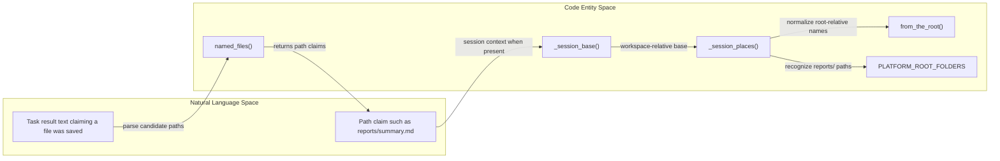
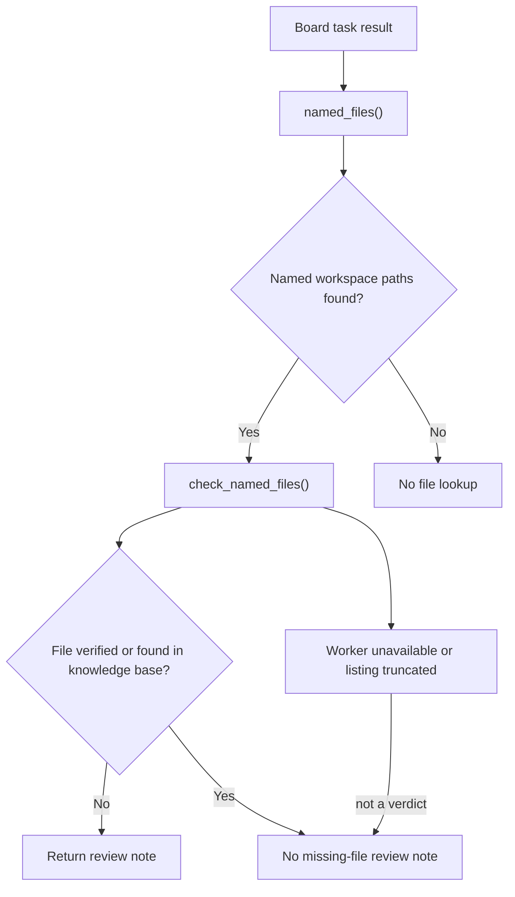
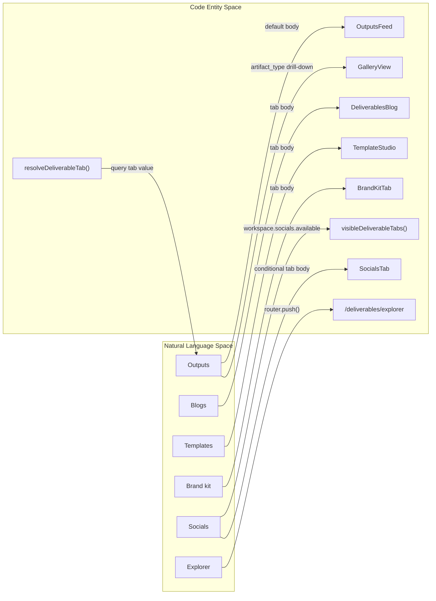

# Deliverables & Reports

Relevant source files

The following files were used as context for generating this wiki page:

- [frontend/app/deliverables/__tests__/deliverables-route.test.tsx](frontend/app/deliverables/__tests__/deliverables-route.test.tsx)
- [frontend/app/deliverables/page.tsx](frontend/app/deliverables/page.tsx)
- [frontend/components/__tests__/prd244-w3-style-tone.test.ts](frontend/components/__tests__/prd244-w3-style-tone.test.ts)
- [frontend/components/__tests__/studio-honest-chrome.test.ts](frontend/components/__tests__/studio-honest-chrome.test.ts)
- [frontend/components/deliverables/socials/__tests__/socials-shells.test.tsx](frontend/components/deliverables/socials/__tests__/socials-shells.test.tsx)
- [frontend/components/deliverables/studio/__tests__/deliverables-studio.test.tsx](frontend/components/deliverables/studio/__tests__/deliverables-studio.test.tsx)
- [frontend/components/deliverables/studio/deliverables-studio.tsx](frontend/components/deliverables/studio/deliverables-studio.tsx)
- [frontend/components/ui/__tests__/theme-toggle.test.tsx](frontend/components/ui/__tests__/theme-toggle.test.tsx)
- [frontend/hooks/use-studio-theme.ts](frontend/hooks/use-studio-theme.ts)
- [frontend/lib/__tests__/studio-menu-consistency.test.ts](frontend/lib/__tests__/studio-menu-consistency.test.ts)
- [frontend/lib/deliverables/tabs.ts](frontend/lib/deliverables/tabs.ts)
- [frontend/lib/studio-menu.ts](frontend/lib/studio-menu.ts)
- [orchestrator/modules/tools/execution/subject_targets.py](orchestrator/modules/tools/execution/subject_targets.py)
- [orchestrator/services/host_paths.py](orchestrator/services/host_paths.py)
- [orchestrator/services/result_files.py](orchestrator/services/result_files.py)
- [orchestrator/services/task_reconciler.py](orchestrator/services/task_reconciler.py)
- [orchestrator/tests/test_818_a_windows_hosts_session_paths_map_into_the_workspace.py](orchestrator/tests/test_818_a_windows_hosts_session_paths_map_into_the_workspace.py)
- [orchestrator/tests/test_839_a_subfolder_relative_name_is_found_by_suffix.py](orchestrator/tests/test_839_a_subfolder_relative_name_is_found_by_suffix.py)
- [orchestrator/tests/test_f014_result_names_missing_file.py](orchestrator/tests/test_f014_result_names_missing_file.py)
- [orchestrator/tests/test_f091_card_names_what_it_acts_on.py](orchestrator/tests/test_f091_card_names_what_it_acts_on.py)
- [orchestrator/tests/test_f093_skipped_only_result_is_not_done.py](orchestrator/tests/test_f093_skipped_only_result_is_not_done.py)
- [orchestrator/tests/test_f114_a_run_waiting_on_a_session_survives.py](orchestrator/tests/test_f114_a_run_waiting_on_a_session_survives.py)
- [orchestrator/tests/test_f161_a_session_file_named_from_the_root_is_found.py](orchestrator/tests/test_f161_a_session_file_named_from_the_root_is_found.py)
- [orchestrator/tests/test_f175_a_stalled_task_is_failed_not_done.py](orchestrator/tests/test_f175_a_stalled_task_is_failed_not_done.py)
- [orchestrator/tests/test_f297_a_a_file_named_from_the_workspace_folder_is_found.py](orchestrator/tests/test_f297_a_a_file_named_from_the_workspace_folder_is_found.py)
- [orchestrator/tests/test_f365_b_a_sessions_report_is_found_where_the_platform_wrote_it.py](orchestrator/tests/test_f365_b_a_sessions_report_is_found_where_the_platform_wrote_it.py)
- [orchestrator/tests/test_prd171_execution_spine.py](orchestrator/tests/test_prd171_execution_spine.py)
- [orchestrator/tests/test_prd234_s1a_board_lane.py](orchestrator/tests/test_prd234_s1a_board_lane.py)
- [orchestrator/tests/test_prd238_w1_honest_window.py](orchestrator/tests/test_prd238_w1_honest_window.py)

## Purpose and Scope

This page documents the deliverables surfaces and the file-existence check used when a board task completes. The supplied code establishes the frontend route and tab behavior, and shows how `result_files` checks paths named in a task result. The implementation of `DeliverableService`, the deliverables table and API, `GalleryView` and Explorer internals, `DeliverablePreview`, and `ReportService` grading is not included in the supplied file excerpts; those details are therefore not inferred here.

Sources: [frontend/app/deliverables/page.tsx:47-185](), [orchestrator/services/result_files.py:1-15]()

---

## 1. Deliverables Hub and Result File Verification

The `/deliverables` route is the frontend entry point for the workspace’s outputs. In Classic mode it renders tabs for outputs, blogs, templates, brand kit, and—when available—socials. Selecting Explorer navigates to `/deliverables/explorer`. In Studio mode, the route renders `DeliverablesStudio` instead of the Classic page body. [frontend/app/deliverables/page.tsx:47-63](), [frontend/app/deliverables/page.tsx:81-105](), [frontend/app/deliverables/page.tsx:107-180]()

The supplied backend implementation concerns task completion claims, not deliverable CRUD. `named_files()` extracts a bounded list of plausible workspace paths from result text. It accepts path-like backtick spans, Markdown links, or prose paths, and filters out URLs, home-directory paths, bare filenames without a folder, and paths with unsupported extensions. [orchestrator/services/result_files.py:30-33](), [orchestrator/services/result_files.py:50-63](), [orchestrator/services/result_files.py:76-92]()

A result’s named file is checked against workspace-worker paths. Session runs can derive a workspace-relative base from their runtime reference; session paths may also be resolved from the workspace root. The implementation bounds directory walking by directory count, concurrency, and a separate walk timeout, and skips dependency and build folders. [orchestrator/services/result_files.py:34-48](), [orchestrator/services/result_files.py:95-129]()

### Natural-language result to code entities

This diagram maps an agent’s completion claim to the path-parsing and session-path helpers shown in `result_files.py`. It does not imply that the named path is automatically registered as a deliverable. [orchestrator/services/result_files.py:64-73](), [orchestrator/services/result_files.py:76-92](), [orchestrator/services/result_files.py:95-129]()

**Diagram: Result text mapped to path-resolution functions**

Sources: [orchestrator/services/result_files.py:64-73](), [orchestrator/services/result_files.py:76-92](), [orchestrator/services/result_files.py:95-129]()

### Completion check and review behavior

`check_named_files()` is the entry point referenced by the supplied tests. Those tests establish that a result naming an existing workspace file passes without a review note, while a missing named file produces a note directing the task to review instead of done. A result with no named file does not trigger a worker directory listing. [orchestrator/tests/test_f014_result_names_missing_file.py:79-87](), [orchestrator/tests/test_f014_result_names_missing_file.py:105-118]()

The check is deliberately conservative: a worker that is unreachable or returns a truncated listing is not treated as evidence that a file is missing. The tests also cover a knowledge-base document with the claimed name; it is recognized as saved to the knowledge base rather than treated as a missing workspace file. [orchestrator/tests/test_f014_result_names_missing_file.py:89-103](), [orchestrator/tests/test_f014_result_names_missing_file.py:111-129]()

For session runs, a path not found by the exact lookup can be checked by walking the session folder for a unique matching suffix. Matching respects path-component boundaries; ambiguous matches remain unresolved. The walk has its own timeout and skips dependency/build directories. [orchestrator/services/result_files.py:34-48](), [orchestrator/tests/test_839_a_subfolder_relative_name_is_found_by_suffix.py:1-21](), [orchestrator/tests/test_839_a_subfolder_relative_name_is_found_by_suffix.py:78-115](), [orchestrator/tests/test_839_a_subfolder_relative_name_is_found_by_suffix.py:118-144]()

**Diagram: Workspace file verification and task outcome**

Sources: [orchestrator/tests/test_f014_result_names_missing_file.py:79-87](), [orchestrator/tests/test_f014_result_names_missing_file.py:105-129]()

---

## 2. Deliverables Frontend Route and Navigation

`frontend/app/deliverables/page.tsx` reads the workspace, query parameters, and UI style before rendering the deliverables surface. If Studio mode is active, the route renders `DeliverablesStudio` inside a full-bleed `MainLayout`. Otherwise, it shows a loading state until the workspace is available, then renders the Classic tabs. [frontend/app/deliverables/page.tsx:47-63](), [frontend/app/deliverables/page.tsx:96-120]()

The Classic outputs tab normally renders `OutputsFeed`. When a valid `artifact_type` query parameter is present, it instead derives a label and filters, then renders `GalleryView` for the current workspace. The page provides a back action that returns to the outputs feed. [frontend/app/deliverables/page.tsx:64-79](), [frontend/app/deliverables/page.tsx:92-94](), [frontend/app/deliverables/page.tsx:126-153]()

The remaining tab bodies are delegated to `DeliverablesBlog`, `TemplateStudio`, `BrandKitTab`, and conditionally `SocialsTab`. Socials visibility is controlled by `workspace.socials.available`; the socials tab also receives the optional `post` query parameter. [frontend/app/deliverables/page.tsx:54-63](), [frontend/app/deliverables/page.tsx:155-179]()

### Natural-language surface names to code entities

The user-facing labels map to named route components and navigation behavior. `Explorer` is a route transition rather than an in-page content panel; the other listed tabs update the `tab` query parameter. [frontend/app/deliverables/page.tsx:38-45](), [frontend/app/deliverables/page.tsx:81-89](), [frontend/app/deliverables/page.tsx:126-179]()

**Diagram: Deliverables labels mapped to frontend code**

Sources: [frontend/app/deliverables/page.tsx:38-45](), [frontend/app/deliverables/page.tsx:54-63](), [frontend/app/deliverables/page.tsx:81-89](), [frontend/app/deliverables/page.tsx:126-179]()

### Studio navigation integration

The Studio menu declares Deliverables as the `deliv` primary item at `/deliverables`. `resolveActiveMenuId()` maps paths beginning with `/deliverables` to that menu item, including nested deliverables routes. [frontend/lib/studio-menu.ts:68-85](), [frontend/lib/studio-menu.ts:92-115]()

Sources: [frontend/lib/studio-menu.ts:68-85](), [frontend/lib/studio-menu.ts:92-115]()

---

## 3. Deliverables Page Tests and Verified Behavior

The Studio page tests verify that outputs render by default, the page reads `?tab=`, tab clicks update the query string, and Explorer navigates to `/deliverables/explorer`. They also verify the `artifact_type=report` drill-down displays a gallery and provides a back-to-feed action, and that a loading spinner is shown while the workspace loads. [frontend/components/deliverables/studio/__tests__/deliverables-studio.test.tsx:25-57]()

The supplied route implementation and tests do not establish the internal CRUD contract, database schema, report viewer behavior, grading API, or `DeliverablePreview` fetch/render path. Those implementation details require the corresponding service, model, API, and component source files. [frontend/app/deliverables/page.tsx:1-36](), [frontend/components/deliverables/studio/__tests__/deliverables-studio.test.tsx:1-20]()

Sources: [frontend/components/deliverables/studio/__tests__/deliverables-studio.test.tsx:25-57](), [frontend/app/deliverables/page.tsx:1-36]()

---