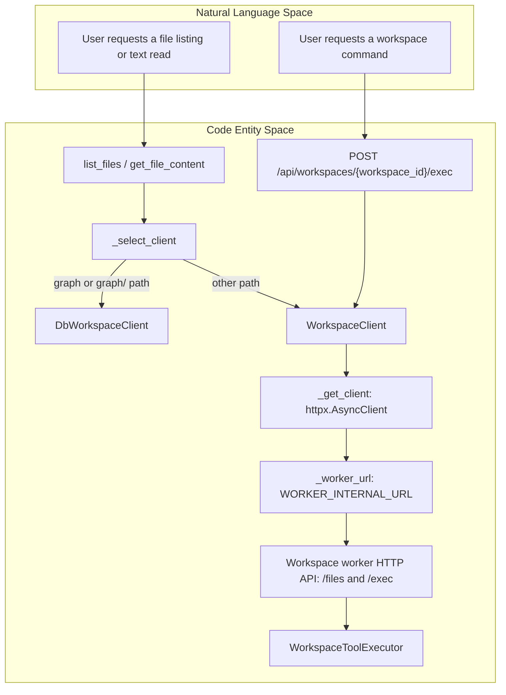
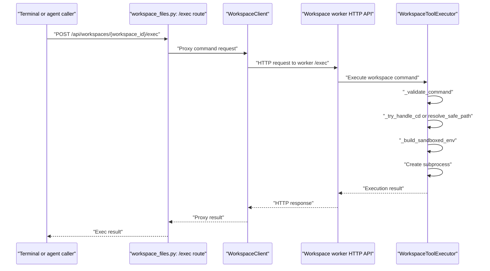
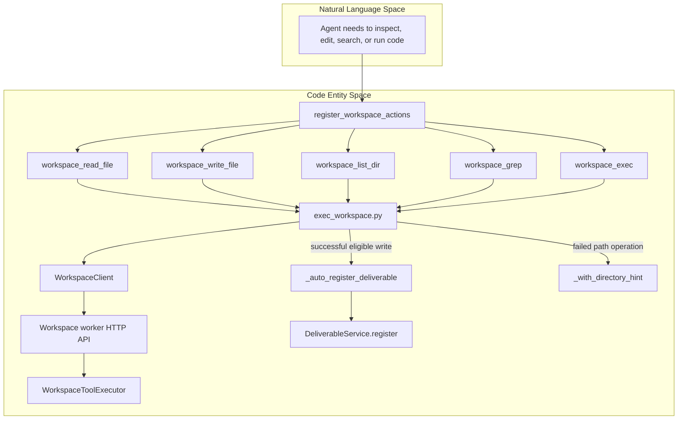

# File Operations & Command Execution

Relevant source files

The following files were used as context for generating this wiki page:

- [docs/workspace-execution/_index.md](docs/workspace-execution/_index.md)
- [docs/workspace-execution/file-operations.md](docs/workspace-execution/file-operations.md)
- [frontend/components/widgets/TerminalWidget/InteractiveTerminal.tsx](frontend/components/widgets/TerminalWidget/InteractiveTerminal.tsx)
- [frontend/components/widgets/TerminalWidget/index.tsx](frontend/components/widgets/TerminalWidget/index.tsx)
- [orchestrator/alembic/versions/f156_harness_task_ledger.py](orchestrator/alembic/versions/f156_harness_task_ledger.py)
- [orchestrator/alembic/versions/prd185_s1b_toollog_user_nullable.py](orchestrator/alembic/versions/prd185_s1b_toollog_user_nullable.py)
- [orchestrator/api/socials_campaigns.py](orchestrator/api/socials_campaigns.py)
- [orchestrator/api/workspace_files.py](orchestrator/api/workspace_files.py)
- [orchestrator/api/workspace_github.py](orchestrator/api/workspace_github.py)
- [orchestrator/core/seeds/utterances/notifications.yaml](orchestrator/core/seeds/utterances/notifications.yaml)
- [orchestrator/core/utils/slug.py](orchestrator/core/utils/slug.py)
- [orchestrator/core/workspace_client.py](orchestrator/core/workspace_client.py)
- [orchestrator/modules/socials/workspace_copies.py](orchestrator/modules/socials/workspace_copies.py)
- [orchestrator/modules/tools/discovery/canvas_git.py](orchestrator/modules/tools/discovery/canvas_git.py)
- [orchestrator/modules/tools/discovery/workspace_actions.py](orchestrator/modules/tools/discovery/workspace_actions.py)
- [orchestrator/modules/tools/execution/exec_file_ops.py](orchestrator/modules/tools/execution/exec_file_ops.py)
- [orchestrator/modules/tools/execution/exec_workspace.py](orchestrator/modules/tools/execution/exec_workspace.py)
- [orchestrator/modules/tools/execution/telemetry.py](orchestrator/modules/tools/execution/telemetry.py)
- [orchestrator/modules/tools/execution/tool_grants.py](orchestrator/modules/tools/execution/tool_grants.py)
- [orchestrator/services/owner_knowledge.py](orchestrator/services/owner_knowledge.py)
- [orchestrator/tests/helpers_workspace_worker.py](orchestrator/tests/helpers_workspace_worker.py)
- [orchestrator/tests/test_board_run_file_is_its_cards_deliverable.py](orchestrator/tests/test_board_run_file_is_its_cards_deliverable.py)
- [orchestrator/tests/test_f173_a_new_workspace_can_save_a_file.py](orchestrator/tests/test_f173_a_new_workspace_can_save_a_file.py)
- [orchestrator/tests/test_f178_b_a_rendered_page_loads_no_protected_file.py](orchestrator/tests/test_f178_b_a_rendered_page_loads_no_protected_file.py)
- [orchestrator/tests/test_f178_the_worker_never_serves_a_deploy_key.py](orchestrator/tests/test_f178_the_worker_never_serves_a_deploy_key.py)
- [orchestrator/tests/test_f179a_only_an_image_is_made_public.py](orchestrator/tests/test_f179a_only_an_image_is_made_public.py)
- [orchestrator/tests/test_f179b_one_approval_is_one_publish.py](orchestrator/tests/test_f179b_one_approval_is_one_publish.py)
- [orchestrator/tests/test_f179b_publishing_an_image_asks_first.py](orchestrator/tests/test_f179b_publishing_an_image_asks_first.py)
- [orchestrator/tests/test_f193_a_destructive_yes_that_did_nothing_is_given_back.py](orchestrator/tests/test_f193_a_destructive_yes_that_did_nothing_is_given_back.py)
- [orchestrator/tests/test_p2w0_telemetry_user_id.py](orchestrator/tests/test_p2w0_telemetry_user_id.py)
- [orchestrator/tests/test_p2w2_tasks_lane_deleted.py](orchestrator/tests/test_p2w2_tasks_lane_deleted.py)
- [orchestrator/tests/test_p2w2_tool_grant_consume.py](orchestrator/tests/test_p2w2_tool_grant_consume.py)
- [orchestrator/tests/test_p2w2_tool_grant_issue.py](orchestrator/tests/test_p2w2_tool_grant_issue.py)
- [orchestrator/tests/test_prd139_telemetry.py](orchestrator/tests/test_prd139_telemetry.py)
- [orchestrator/tests/test_prd143_full_surface_positive.py](orchestrator/tests/test_prd143_full_surface_positive.py)
- [orchestrator/tests/test_prd143_selection_metric.py](orchestrator/tests/test_prd143_selection_metric.py)
- [orchestrator/tests/test_prd170_canvas_git.py](orchestrator/tests/test_prd170_canvas_git.py)
- [orchestrator/tests/test_prd177_composio_telemetry.py](orchestrator/tests/test_prd177_composio_telemetry.py)
- [orchestrator/tests/test_slugify.py](orchestrator/tests/test_slugify.py)
- [orchestrator/tests/test_socials_worker_binary_pieces.py](orchestrator/tests/test_socials_worker_binary_pieces.py)
- [orchestrator/tests/test_socials_workspace_copies.py](orchestrator/tests/test_socials_workspace_copies.py)
- [orchestrator/tests/test_telemetry_session_ownership.py](orchestrator/tests/test_telemetry_session_ownership.py)
- [services/workspace-worker/canvas_session_service.py](services/workspace-worker/canvas_session_service.py)
- [services/workspace-worker/executor.py](services/workspace-worker/executor.py)
- [services/workspace-worker/main.py](services/workspace-worker/main.py)
- [services/workspace-worker/workspace_manager.py](services/workspace-worker/workspace_manager.py)

## Purpose & Scope

This page describes how workspace file and command requests move between the orchestrator and the workspace worker, how agent workspace actions use that path, and which safety controls are visible in the implementation. `WorkspaceClient` provides the orchestrator-side HTTP proxy; the worker’s `WorkspaceToolExecutor` is the execution boundary for commands and file operations. [orchestrator/core/workspace_client.py:1-14](), [services/workspace-worker/executor.py:1-15]()

Sources: [orchestrator/core/workspace_client.py:1-14](), [services/workspace-worker/executor.py:1-15]()

## WorkspaceClient HTTP Proxy & API Routing

`WorkspaceClient` is a stateless, workspace-scoped wrapper around a process-wide `httpx.AsyncClient`. The shared client attaches `X-Internal-Token` when `WORKER_INTERNAL_TOKEN` is configured and uses a long read timeout for worker calls. Worker URLs are built from `WORKER_INTERNAL_URL`, the workspace identifier, and the requested endpoint. [orchestrator/core/workspace_client.py:41-61](), [orchestrator/core/workspace_client.py:80-94]()

The FastAPI router in `orchestrator/api/workspace_files.py` exposes workspace file endpoints under `/api/workspaces/{workspace_id}`. For directory listings and text reads, it checks that the request context’s workspace matches the path workspace ID, selects a storage client, and raises an HTTP error when the client returns an unsuccessful result. Paths under `graph` are routed to `DbWorkspaceClient`; other paths use `WorkspaceClient`. Raw-file reads use `WorkspaceClient` directly. [orchestrator/api/workspace_files.py:44-73](), [orchestrator/api/workspace_files.py:79-119](), [orchestrator/api/workspace_files.py:125-147]()

The worker’s HTTP API is documented as providing `/files` and `/exec` endpoints. Calls that cannot reach the worker are represented by `WorkspaceClient` as unsuccessful results with status code 503; workspace API routes can turn those failures into HTTP 503 responses. [orchestrator/api/workspace_files.py:6-17](), [orchestrator/core/workspace_client.py:31-38](), [orchestrator/core/workspace_client.py:64-77]()

### Diagram: Natural Language Space to Code Entity Space — File and Execution Proxy

Sources: [orchestrator/api/workspace_files.py:6-17](), [orchestrator/api/workspace_files.py:44-73](), [orchestrator/api/workspace_files.py:79-119](), [orchestrator/core/workspace_client.py:41-61](), [services/workspace-worker/executor.py:111-120]()

## File Listing, Content, and Raw Downloads

The visible `WorkspaceClient` file methods use the worker’s `/files` endpoints:

| Operation | `WorkspaceClient` method | Worker request | Behavior |
|---|---|---|---|
| Read text | `read_file(path)` | `GET /files/content` | Sends `path` as a query parameter; returns parsed JSON with `success: True` on HTTP 200. |
| Write content | `write_file(path, content)` | `POST /files/write` | Sends `path` and `content` as JSON; returns parsed JSON with `success: True` on HTTP 200. |
| Write binary data | `write_binary(path, pieces)` | Repeated writes through `write_file` | Writes pieces to a `.part` path and supplies `rename_to` on the final piece. |
| List directory | `list_dir(path)` | `GET /files` | Sends `path` as a query parameter. |
| Download raw file | API route uses `download_file(path)` | Worker download endpoint | Returns bytes through an inline response with a filename and content type. |

[orchestrator/core/workspace_client.py:96-147](), [orchestrator/core/workspace_client.py:149-154](), [orchestrator/api/workspace_files.py:125-147]()

For binary writes, `BINARY_PIECE_BYTES` is 600 KiB. `write_binary` accumulates incoming byte pieces, splits oversized buffers into requests, and writes to `<path>.part`; the final request includes `rename_to` so the worker can place the completed file at the requested path. The client’s comments state that the piece size is chosen to keep base64-encoded requests under the worker’s 1 MiB body limit. [orchestrator/core/workspace_client.py:26-29](), [orchestrator/core/workspace_client.py:126-147]()

The API’s `/files/raw` route returns the worker-provided bytes and content type, falling back to `application/octet-stream`, and sets an inline `Content-Disposition` filename. [orchestrator/api/workspace_files.py:125-147]()

Sources: [orchestrator/core/workspace_client.py:26-29](), [orchestrator/core/workspace_client.py:96-147](), [orchestrator/core/workspace_client.py:149-154](), [orchestrator/api/workspace_files.py:125-147]()

## Command Execution & Security Boundaries

The worker’s `WorkspaceToolExecutor.execute_command` validates a command before proceeding. It handles `cd` separately because it is a shell builtin, resolves the working directory using `WorkspaceManager.resolve_safe_path` when a `cwd` is provided, and rejects a working directory that does not exist. It then builds a sandboxed environment and executes the command. [services/workspace-worker/executor.py:125-169]()

The executor permits only binaries in `ALLOWED_COMMANDS`. The list includes shells and common development tools such as `git`, Python and Node.js tools, compilers, file utilities, and `docker-compose`. `BLOCKED_PATTERNS` rejects selected risky command patterns even when a command uses an allowed binary. [services/workspace-worker/executor.py:34-101]()

| Control | Implementation detail |
|---|---|
| Command allowlist | `ALLOWED_COMMANDS` identifies the permitted command names. |
| Pattern blocking | `_BLOCKED_RE` compiles `BLOCKED_PATTERNS` for validation. |
| Working-directory containment | A supplied `cwd` is resolved through `self.ws.resolve_safe_path(cwd)`. |
| Sandboxed environment | `_build_sandboxed_env` is called before execution. |
| Output limits | Maximums are defined as 100,000 bytes for stdout and 50,000 bytes for stderr. |
| Default timeout | `DEFAULT_TIMEOUT` is 120 seconds. |
| Shell operators | The executor uses shell mode for commands containing operators such as pipes, `&&`, `||`, semicolons, or redirection; the implementation comments require prior validation. |

[services/workspace-worker/executor.py:38-108](), [services/workspace-worker/executor.py:143-186]()

### Diagram: Command Execution Flow

Sources: [orchestrator/api/workspace_files.py:6-12](), [orchestrator/core/workspace_client.py:1-14](), [services/workspace-worker/executor.py:125-186]()

## Path Safety Validation & Storage Quotas

`WorkspaceManager` owns a workspace’s filesystem root and documents safe path resolution, quota enforcement, task-directory lifecycle, and credential injection as its responsibilities. The workspace root is constructed as the configured volume root joined with the workspace ID. The worker configuration description identifies `WORKSPACE_VOLUME_PATH` as the mount-root setting, with `/workspaces` as its documented default. [services/workspace-worker/workspace_manager.py:67-85](), [services/workspace-worker/main.py:13-20]()

`WorkspaceManager` defines a default quota from `WORKSPACE_DEFAULT_QUOTA_GB`, defaulting to 5 GB. `get_usage_bytes()` walks files beneath the workspace root and sums their sizes. `check_quota()` compares that usage with `quota_bytes`, updates the cached usage through the measurement call, and logs a warning when usage is not below the quota. These methods expose the measurement and check; the cited implementation does not establish which file-operation routes call `check_quota`. [services/workspace-worker/workspace_manager.py:39-40](), [services/workspace-worker/workspace_manager.py:132-155]()

File-serving routes also need to keep internal workspace state out of user-visible listings and reads. The manager defines `SENSITIVE_NAMES` for names including `.ssh`, `.gitconfig`, cloud credential directories, `.workspace_meta.json`, and `.canvas`; it also blocks names beginning with `.task_env_`. `is_sensitive_name` performs a case-insensitive check. [services/workspace-worker/workspace_manager.py:42-55]()

Workspace IDs are validated by `is_workspace_id`, which accepts only a string whose UUID parse-and-serialize result exactly matches the input. The manager’s comments identify this as protection against noncanonical identifiers being used to escape the volume root or map multiple identifier forms to directories. [services/workspace-worker/workspace_manager.py:57-64]()

### Workspace layout

`ensure_workspace_exists()` creates the configured default subdirectories and initializes `.workspace_meta.json` if it is absent. The listed directories include `repos`, `reports`, `content`, `artifacts`, `analytics`, `graph`, `tasks`, `socials/images`, `socials/videos`, and `documents`. [services/workspace-worker/workspace_manager.py:91-126]()

| Path | Stated role |
|---|---|
| `repos/` | Cloned repositories |
| `reports/` | Agent reports |
| `content/` | Long-form content |
| `artifacts/` | Test reports and build outputs |
| `analytics/` | Analytics exports and KPI snapshots |
| `graph/` | Knowledge graph exports |
| `tasks/` | Ephemeral task execution directories |
| `.ssh/`, `.gitconfig` | Workspace credentials and Git identity; sensitive names are not served or listed |
| `socials/`, `documents/` | Directories included in the default subdirectory list |

[services/workspace-worker/workspace_manager.py:10-21](), [services/workspace-worker/workspace_manager.py:42-46](), [services/workspace-worker/workspace_manager.py:91-105]()

Sources: [services/workspace-worker/main.py:13-20](), [services/workspace-worker/workspace_manager.py:39-64](), [services/workspace-worker/workspace_manager.py:67-85](), [services/workspace-worker/workspace_manager.py:91-155]()

## Workspace Tool Execution (`exec_workspace`)

Workspace actions are defined in `workspace_actions.py` and registered with an `ActionRegistry`. The definitions give agents workspace file and command tools, including parameter schemas, permission levels, descriptions, and examples. [orchestrator/modules/tools/discovery/workspace_actions.py:1-16]()

| Action | Purpose and permission level |
|---|---|
| `workspace_read_file` | Read a workspace file; marked `read`. |
| `workspace_write_file` | Create or overwrite a workspace file; marked `write`. |
| `workspace_list_dir` | List a directory; marked `read`. |
| `workspace_grep` | Search files using a regex pattern; marked `read`. |
| `workspace_exec` | Run a sandboxed shell command; the definition describes whitelist-based execution. |

[orchestrator/modules/tools/discovery/workspace_actions.py:18-51](), [orchestrator/modules/tools/discovery/workspace_actions.py:53-90](), [orchestrator/modules/tools/discovery/workspace_actions.py:92-121](), [orchestrator/modules/tools/discovery/workspace_actions.py:123-161](), [orchestrator/modules/tools/discovery/workspace_actions.py:163-175]()

`exec_workspace.py` contains the workspace tool executor’s proxy-side support code. It derives a source attribution from `caller_context`: an explicit `source_type` takes precedence; otherwise it checks heartbeat, mission, task, playbook, trigger, and board-task identifiers, falling back to `chat`. [orchestrator/modules/tools/execution/exec_workspace.py:17-47]()

### Deliverable auto-registration

After a file write, `_auto_register_deliverable` attempts to register eligible files through `DeliverableService`. It infers the artifact type and skips types that are not agent-registerable. It uses a size value from the worker response when available, resolves the agent name when an `agent_id` is present, derives source attribution from `caller_context`, and calls `DeliverableService.register` with `storage_type="workspace"`. Exceptions are caught and logged so registration failure does not break the write flow. [orchestrator/modules/tools/execution/exec_workspace.py:50-63](), [orchestrator/modules/tools/execution/exec_workspace.py:64-125]()

### Path hints and public-image checks

`_with_directory_hint` can augment a failed file-operation result with the names found in a nearby listable parent directory. It tries up to four parent levels and limits the displayed entries to 25. Exceptions while building the hint are swallowed so they do not replace the original error. [orchestrator/modules/tools/execution/exec_workspace.py:129-168]()

The visible source also documents a public-file safety rule: only raster images are intended to be made public, recognized by their first bytes rather than by their filename; other file types are refused. The provided excerpt ends at the comment introducing this behavior, so it does not expose the implementation details of the signature check. [orchestrator/modules/tools/execution/exec_workspace.py:171-172]()

### Diagram: Natural Language Space to Code Entity Space — Agent Workspace Actions

Sources: [orchestrator/modules/tools/discovery/workspace_actions.py:15-175](), [orchestrator/modules/tools/execution/exec_workspace.py:50-63](), [orchestrator/modules/tools/execution/exec_workspace.py:64-125](), [orchestrator/modules/tools/execution/exec_workspace.py:129-168](), [orchestrator/core/workspace_client.py:1-14](), [services/workspace-worker/executor.py:111-120]()

## Failure Handling

`WorkspaceClient` converts connection failures and timeouts into a result with `success: False` and status code 503. A non-connect timeout is described as a worker timeout; other connection failures use the worker-unavailable message, with a local-edition hint explaining how to start the worker. [orchestrator/core/workspace_client.py:31-38](), [orchestrator/core/workspace_client.py:64-77]()

The file API routes check unsuccessful client results and raise `HTTPException` using the result’s status code, defaulting to 503 when no status is provided. A missing or unreachable worker is therefore surfaced as an API error instead of being treated as a successful empty file result. [orchestrator/api/workspace_files.py:58-66](), [orchestrator/api/workspace_files.py:89-96](), [orchestrator/api/workspace_files.py:112-119]()

Sources: [orchestrator/core/workspace_client.py:31-38](), [orchestrator/core/workspace_client.py:64-77](), [orchestrator/api/workspace_files.py:58-66](), [orchestrator/api/workspace_files.py:89-119]()

---