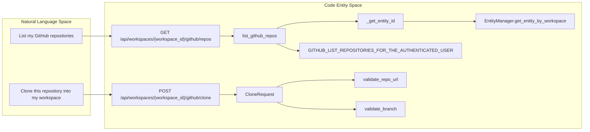
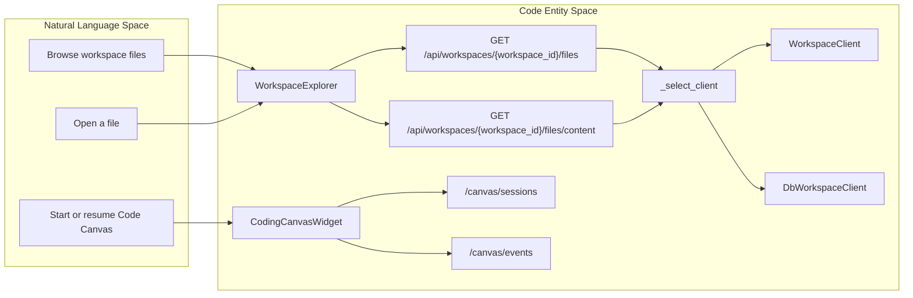
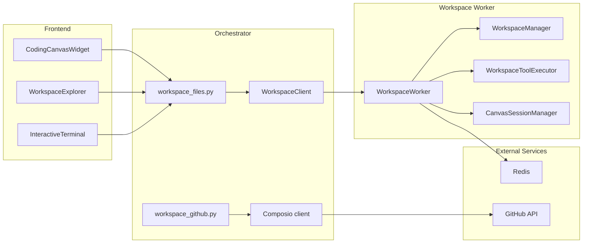

# GitHub & Code Canvas Integration

Relevant source files

The following files were used as context for generating this wiki page:

- [docs/workspace-execution/_index.md](docs/workspace-execution/_index.md)
- [docs/workspace-execution/file-operations.md](docs/workspace-execution/file-operations.md)
- [frontend/components/widgets/TerminalWidget/InteractiveTerminal.tsx](frontend/components/widgets/TerminalWidget/InteractiveTerminal.tsx)
- [frontend/components/widgets/TerminalWidget/index.tsx](frontend/components/widgets/TerminalWidget/index.tsx)
- [orchestrator/api/socials_campaigns.py](orchestrator/api/socials_campaigns.py)
- [orchestrator/api/workspace_files.py](orchestrator/api/workspace_files.py)
- [orchestrator/api/workspace_github.py](orchestrator/api/workspace_github.py)
- [orchestrator/core/utils/slug.py](orchestrator/core/utils/slug.py)
- [orchestrator/core/workspace_client.py](orchestrator/core/workspace_client.py)
- [orchestrator/modules/socials/workspace_copies.py](orchestrator/modules/socials/workspace_copies.py)
- [orchestrator/modules/tools/discovery/canvas_git.py](orchestrator/modules/tools/discovery/canvas_git.py)
- [orchestrator/services/owner_knowledge.py](orchestrator/services/owner_knowledge.py)
- [orchestrator/tests/helpers_workspace_worker.py](orchestrator/tests/helpers_workspace_worker.py)
- [orchestrator/tests/test_f173_a_new_workspace_can_save_a_file.py](orchestrator/tests/test_f173_a_new_workspace_can_save_a_file.py)
- [orchestrator/tests/test_f178_b_a_rendered_page_loads_no_protected_file.py](orchestrator/tests/test_f178_b_a_rendered_page_loads_no_protected_file.py)
- [orchestrator/tests/test_f178_the_worker_never_serves_a_deploy_key.py](orchestrator/tests/test_f178_the_worker_never_serves_a_deploy_key.py)
- [orchestrator/tests/test_p2w2_tasks_lane_deleted.py](orchestrator/tests/test_p2w2_tasks_lane_deleted.py)
- [orchestrator/tests/test_prd170_canvas_git.py](orchestrator/tests/test_prd170_canvas_git.py)
- [orchestrator/tests/test_slugify.py](orchestrator/tests/test_slugify.py)
- [orchestrator/tests/test_socials_worker_binary_pieces.py](orchestrator/tests/test_socials_worker_binary_pieces.py)
- [orchestrator/tests/test_socials_workspace_copies.py](orchestrator/tests/test_socials_workspace_copies.py)
- [services/workspace-worker/canvas_session_service.py](services/workspace-worker/canvas_session_service.py)
- [services/workspace-worker/executor.py](services/workspace-worker/executor.py)
- [services/workspace-worker/main.py](services/workspace-worker/main.py)
- [services/workspace-worker/workspace_manager.py](services/workspace-worker/workspace_manager.py)

## Purpose & Scope

This page describes the GitHub repository API, workspace file proxy, worker-side filesystem and command execution, and the Code Canvas session service. It distinguishes the GitHub API’s Composio-backed repository listing and clone-request validation from workspace operations handled by the worker. Frontend details for `CodingCanvasWidget`, `WorkspaceExplorer`, and `canvas_git` are limited to the symbols and paths identified in the supplied material; their implementation details are not available here. [orchestrator/api/workspace_github.py:1-8](), [orchestrator/api/workspace_files.py:1-20](), [services/workspace-worker/canvas_session_service.py:1-29]()

Sources: [orchestrator/api/workspace_github.py:1-8](), [orchestrator/api/workspace_files.py:1-20](), [services/workspace-worker/canvas_session_service.py:1-29]()

---

## 1. GitHub Repository Management & API

`orchestrator/api/workspace_github.py` defines a router under `/api/workspaces/{workspace_id}/github`. Its documented API surface includes repository listing and repository cloning. Repository listing executes a Composio action; clone requests are validated by a Pydantic model. The supplied contents show the listing implementation and clone request validation, but do not include the clone endpoint’s implementation body. [orchestrator/api/workspace_github.py:1-8](), [orchestrator/api/workspace_github.py:32-35](), [orchestrator/api/workspace_github.py:82-109]()

### GitHub Repository Listing

`list_github_repos` handles `GET /api/workspaces/{workspace_id}/github/repos`. It checks that the workspace in the request matches `ctx.workspace_id`, obtains the Composio client, resolves the workspace’s Composio entity ID through `_get_entity_id`, and runs `GITHUB_LIST_REPOSITORIES_FOR_THE_AUTHENTICATED_USER` via `asyncio.to_thread`. The action receives the requested `page` and `per_page` values. [orchestrator/api/workspace_github.py:114-139]()

The endpoint handles failed Composio results as either a missing GitHub connection (`424`) or a GitHub API failure (`502`). It then normalizes the potentially nested Composio response, extracts repository records, and returns a list containing repository name, full name, clone or HTML URL, description, default branch, privacy flag, language, and update time, alongside pagination values. [orchestrator/api/workspace_github.py:141-180]()

`_get_entity_id` converts the workspace identifier to a UUID, uses `EntityManager.get_entity_by_workspace`, and returns the entity’s `composio_entity_id`. If there is no entity or no Composio ID, it raises `424` with a message directing the user to connect GitHub for the workspace. [_get_entity_id: orchestrator/api/workspace_github.py:55-63]()

### Repository Cloning and Request Validation

The API module documents `POST /api/workspaces/{workspace_id}/github/clone` as the repository-clone route. Its request model, `CloneRequest`, contains `repo_url` and an optional `branch`. The supplied source defines validation for those fields but does not show the route’s implementation or the downstream cloning mechanism. [orchestrator/api/workspace_github.py:1-8](), [orchestrator/api/workspace_github.py:82-109]()

`validate_repo_url` accepts HTTPS URLs only, restricts the hostname to `github.com`, `gitlab.com`, or `bitbucket.org`, and rejects URLs with embedded usernames or passwords. `validate_branch` strips surrounding whitespace, treats an empty branch as unspecified, and rejects names containing `..` or `@{` or failing `_BRANCH_RE`. The regex permits letters, digits, dots, underscores, slashes, and hyphens. [orchestrator/api/workspace_github.py:37-42](), [orchestrator/api/workspace_github.py:82-109]()

| Concern | Implementation | Result |
|---|---|---|
| Workspace authorization | Compare `ctx.workspace_id` with the path parameter | Mismatch returns `403`. [orchestrator/api/workspace_github.py:114-124]() |
| GitHub connection | Resolve workspace entity through `EntityManager` | Missing Composio entity ID returns `424`. [orchestrator/api/workspace_github.py:48-63]() |
| Repository listing | Execute `GITHUB_LIST_REPOSITORIES_FOR_THE_AUTHENTICATED_USER` | Return normalized repository fields and pagination. [orchestrator/api/workspace_github.py:126-180]() |
| Clone URL | HTTPS and allowlisted host; no embedded credentials | Invalid input fails Pydantic validation. [orchestrator/api/workspace_github.py:37-42](), [orchestrator/api/workspace_github.py:82-96]() |
| Branch | Safe-character regex plus `..` and `@{` rejection | Empty branch is normalized to `None`. [orchestrator/api/workspace_github.py:40-42](), [orchestrator/api/workspace_github.py:98-109]() |

### Diagram: Natural Language Repository Discovery to Code Entities

Sources: [orchestrator/api/workspace_github.py:32-42](), [orchestrator/api/workspace_github.py:55-63](), [orchestrator/api/workspace_github.py:82-109](), [orchestrator/api/workspace_github.py:114-180]()

---

## 2. Code Canvas Frontend & Workspace Explorer

The page’s frontend integration points are `CodingCanvasWidget` and `WorkspaceExplorer`. Their file paths appear in the prior page content, but their source contents were not included in the supplied files. Accordingly, this section does not assert component internals, editor behavior, or the frontend’s specific API calls. The supplied backend sources do document workspace file routes and Canvas session routes that a frontend can use. [orchestrator/api/workspace_files.py:1-20]()

### Frontend Integration Points

`CodingCanvasWidget` is identified as the Code Canvas frontend entry point, and `WorkspaceExplorer` as the workspace exploration surface. The available evidence does not establish their component hierarchy or behavior; refer to those files directly when documenting frontend implementation details. [frontend/components/widgets/CodingCanvasWidget/index.tsx:1-11](), [frontend/components/workspace/WorkspaceExplorer.tsx:1-14]()

On the backend, `workspace_files.py` documents directory listing, file content, command execution, and Canvas session endpoints under `/api/workspaces/{workspace_id}`. It also documents Canvas event streaming, edit decisions, auto-accept control, prompt messages, commit preview, and commit operations. The endpoint listing establishes the API surface, but not the frontend wiring. [orchestrator/api/workspace_files.py:1-20]()

### Workspace File API and Storage Selection

`workspace_files.py` uses `_select_client(workspace_id, path)` to choose a storage backend. Paths equal to `graph` or beginning with `graph/` use `DbWorkspaceClient`; other paths use `WorkspaceClient`. The shown `list_files` and `get_file_content` routes verify workspace identity, call the selected client, and convert unsuccessful results to HTTP errors. [orchestrator/api/workspace_files.py:50-74](), [orchestrator/api/workspace_files.py:79-119]()

The raw-file route uses `WorkspaceClient.download_file` and returns a response with the supplied content type, falling back to `application/octet-stream`. The file-writing request model requires a non-empty relative path with a maximum length of 1024 and a content value; the supplied excerpt does not include the write route implementation. [orchestrator/api/workspace_files.py:122-156]()

### Diagram: Natural Language File Interaction to Code Entities

Sources: [orchestrator/api/workspace_files.py:1-20](), [orchestrator/api/workspace_files.py:50-74](), [orchestrator/api/workspace_files.py:79-119](), [frontend/components/widgets/CodingCanvasWidget/index.tsx:1-11](), [frontend/components/workspace/WorkspaceExplorer.tsx:1-14]()

---

## 3. Tool Routing & Widget System Integration

The prior page identifies `frontend/components/widgets/router.ts` as a tool-to-widget routing location, but its contents were not included in the supplied material. Specific tool names, widget mappings, and routing behavior therefore cannot be verified from the available sources. [frontend/components/widgets/router.ts]()

The supplied backend sources do establish workspace command execution and Canvas session APIs. The interactive terminal component, where provided, submits commands to `/api/workspaces/${workspaceId}/exec`; the backend API module documents the corresponding `/exec` route. The provided frontend terminal excerpt shows local handling of `clear`, request submission, output history, and updating the current working directory after successful `cd`. [frontend/components/widgets/TerminalWidget/InteractiveTerminal.tsx:67-129](), [orchestrator/api/workspace_files.py:1-20]()

Sources: [frontend/components/widgets/router.ts](), [frontend/components/widgets/TerminalWidget/InteractiveTerminal.tsx:67-129](), [orchestrator/api/workspace_files.py:1-20]()

---

## 4. Workspace Worker and Canvas Git

The workspace worker consumes tasks from Redis priority queues and runs work within workspace directories on a persistent volume. `WorkspaceWorker` defines queue names for critical, high, normal, and low priority tasks, and its constructor configures concurrency and tracks active tasks. The worker source also documents an assumption of one worker process per workspace volume for shared deploy-key and Git identity bookkeeping. [services/workspace-worker/main.py:46-90]()

`WorkspaceManager` assigns each workspace a directory under the configured workspace volume. Its documented layout includes persistent `repos`, `artifacts`, and other directories, plus an ephemeral `tasks` directory and sensitive `.ssh`, `.gitconfig`, and `.workspace_meta.json` entries. The manager provisions default subdirectories and tracks storage usage against a quota. [services/workspace-worker/workspace_manager.py:10-21](), [services/workspace-worker/workspace_manager.py:39-46](), [services/workspace-worker/workspace_manager.py:67-85](), [services/workspace-worker/workspace_manager.py:91-126](), [services/workspace-worker/workspace_manager.py:132-155]()

### Canvas Git and Session Management

The supplied executor source identifies `git` as an allowed command. `WorkspaceToolExecutor.execute_command` validates commands before execution, resolves a requested working directory through `WorkspaceManager.resolve_safe_path`, and builds a sandboxed environment before launching the command. This establishes a worker-side path for Git commands submitted through command execution; it does not, by itself, document the separate `canvas_git` module’s behavior. [services/workspace-worker/executor.py:34-76](), [services/workspace-worker/executor.py:111-120](), [services/workspace-worker/executor.py:125-168]()

The `canvas_git` tool module is listed among additional files, but its contents were not supplied. Its specific functions, request flow, and relationship to `CodingCanvasWidget` cannot be described reliably here. [orchestrator/modules/tools/discovery/canvas_git.py]()

`CanvasSessionManager` manages a headless Claude Agent SDK session per workspace. Session state and SDK transcript data are persisted under `.canvas/` on the workspace volume so a later session can resume using the saved SDK session ID. Its tool gate applies workspace confinement before human approval for mutating actions; the session service also tracks approval state and session-scoped edit auto-accept. [services/workspace-worker/canvas_session_service.py:4-23](), [services/workspace-worker/canvas_session_service.py:82-112](), [services/workspace-worker/canvas_session_service.py:138-179]()

### File Operations and `WorkspaceClient`

`WorkspaceClient` is an asynchronous HTTP proxy to the worker API. It builds worker URLs, reuses a singleton `httpx.AsyncClient`, and adds `X-Internal-Token` when configured. Its methods return worker responses or structured errors for connection and timeout failures. [orchestrator/core/workspace_client.py:2-14](), [orchestrator/core/workspace_client.py:31-77](), [orchestrator/core/workspace_client.py:80-110]()

`workspace_files.py` is the frontend-facing API layer for file browsing and command execution. Its file routes select either `DbWorkspaceClient` or `WorkspaceClient`; the latter proxies workspace operations to the worker. The worker’s executor and manager then enforce command and filesystem constraints. [orchestrator/api/workspace_files.py:1-8](), [orchestrator/api/workspace_files.py:50-74](), [orchestrator/core/workspace_client.py:2-14](), [services/workspace-worker/executor.py:111-168]()

### Diagram: Workspace Worker and Canvas Git Architecture

Sources: [services/workspace-worker/main.py:46-90](), [services/workspace-worker/workspace_manager.py:10-21](), [services/workspace-worker/executor.py:34-76](), [services/workspace-worker/canvas_session_service.py:4-23](), [orchestrator/api/workspace_files.py:1-20](), [orchestrator/api/workspace_github.py:1-8](), [orchestrator/core/workspace_client.py:2-14](), [frontend/components/widgets/TerminalWidget/InteractiveTerminal.tsx:67-90]()

---

## 5. Security, Sandboxing & Queue Isolation

### GitHub API Validation and Workspace Authorization

The repository-list endpoint rejects a request when the authenticated request context’s workspace ID does not match the path’s `workspace_id`. The clone request model restricts URLs to HTTPS and a short host allowlist, forbids embedded credentials, and validates optional branch names. The repository-list handler maps missing GitHub connections to `424` and other Composio/GitHub failures to `502`. [orchestrator/api/workspace_github.py:82-109](), [orchestrator/api/workspace_github.py:114-145]()

### Command Whitelisting and Filesystem Boundaries

`WorkspaceToolExecutor` defines `ALLOWED_COMMANDS`, including `git`, and a separate set of blocked patterns. Before executing a command, `execute_command` calls `_validate_command`; for a requested working directory, it resolves the path through `WorkspaceManager`. The executor’s module documentation identifies command whitelisting, path containment, output limits, timeout enforcement, and a stripped `PATH` as security controls. [services/workspace-worker/executor.py:6-14](), [services/workspace-worker/executor.py:34-101](), [services/workspace-worker/executor.py:125-168]()

`WorkspaceManager` defines sensitive names that file routes must not serve or list, including `.ssh`, `.gitconfig`, cloud credential directories, `.workspace_meta.json`, and `.canvas`. It also treats task environment files with the `.task_env_` prefix as sensitive. [services/workspace-worker/workspace_manager.py:42-55]()

### Canvas Confinement and Approval

The Canvas session service documents a `can_use_tool` callback that routes tool calls through `evaluate_tool_confinement`. Its approval gate applies confinement first, then requests human approval for confined mutating operations. Read-only tools and session-configured auto-accepted edits are handled separately; the service documents that edit auto-accept does not apply to bash. [services/workspace-worker/canvas_session_service.py:19-23](), [services/workspace-worker/canvas_session_service.py:98-112](), [services/workspace-worker/canvas_session_service.py:165-179]()

### Worker Availability and Error Propagation

`WorkspaceClient` maps worker connection and timeout failures to structured unsuccessful results with status code `503`. `workspace_files.py` turns unsuccessful file-operation results into HTTP errors; `_raise_if_worker_unavailable` specifically preserves a worker-unavailable result as a `503` rather than interpreting it as missing data. [orchestrator/core/workspace_client.py:31-38](), [orchestrator/core/workspace_client.py:64-77](), [orchestrator/api/workspace_files.py:58-66](), [orchestrator/api/workspace_files.py:89-96]()

Sources: [orchestrator/api/workspace_github.py:82-109](), [orchestrator/api/workspace_github.py:114-145](), [services/workspace-worker/executor.py:6-14](), [services/workspace-worker/executor.py:34-101](), [services/workspace-worker/workspace_manager.py:42-55](), [services/workspace-worker/canvas_session_service.py:19-23](), [services/workspace-worker/canvas_session_service.py:165-179](), [orchestrator/core/workspace_client.py:31-77](), [orchestrator/api/workspace_files.py:58-66]()

---