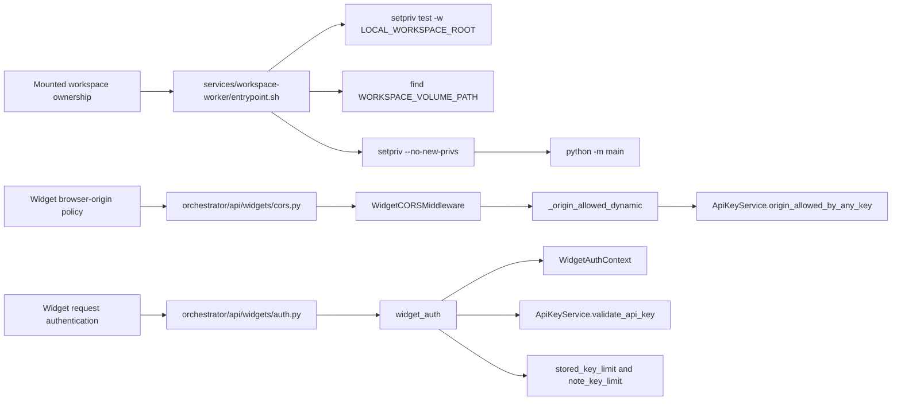

# Security & Sandboxing

<details>
<summary>Relevant source files</summary>

The following files were used as context for generating this wiki page:

- [.github/workflows/images.yml](.github/workflows/images.yml)
- [.github/workflows/test.yml](.github/workflows/test.yml)
- [QUICKSTART.md](QUICKSTART.md)
- [SETUP.md](SETUP.md)
- [charts/automatos/README.md](charts/automatos/README.md)
- [charts/automatos/templates/worker.yaml](charts/automatos/templates/worker.yaml)
- [docs/agents/llm-provider-management.md](docs/agents/llm-provider-management.md)
- [docs/getting-started/self-hosting.md](docs/getting-started/self-hosting.md)
- [docs/workspace-execution/security-sandboxing.md](docs/workspace-execution/security-sandboxing.md)
- [frontend/components/marketplace/__tests__/github-import-modal.test.tsx](frontend/components/marketplace/__tests__/github-import-modal.test.tsx)
- [frontend/components/marketplace/__tests__/marketplace-admin-gate.test.ts](frontend/components/marketplace/__tests__/marketplace-admin-gate.test.ts)
- [frontend/lib/baseline-skills.ts](frontend/lib/baseline-skills.ts)
- [frontend/lib/tooltips.json](frontend/lib/tooltips.json)
- [orchestrator/api/api_keys.py](orchestrator/api/api_keys.py)
- [orchestrator/api/widgets/auth.py](orchestrator/api/widgets/auth.py)
- [orchestrator/api/widgets/config.py](orchestrator/api/widgets/config.py)
- [orchestrator/api/widgets/cors.py](orchestrator/api/widgets/cors.py)
- [orchestrator/api/widgets/session.py](orchestrator/api/widgets/session.py)
- [orchestrator/core/database/migrations/043_team_based_document_scoping.sql](orchestrator/core/database/migrations/043_team_based_document_scoping.sql)
- [orchestrator/core/models/sdk_api_keys.py](orchestrator/core/models/sdk_api_keys.py)
- [orchestrator/core/services/api_key_service.py](orchestrator/core/services/api_key_service.py)
- [orchestrator/tests/security/test_prd172_tenant_isolation.py](orchestrator/tests/security/test_prd172_tenant_isolation.py)
- [orchestrator/tests/test_818_every_make_target_has_its_commands_in_the_guide.py](orchestrator/tests/test_818_every_make_target_has_its_commands_in_the_guide.py)
- [orchestrator/tests/test_compose_published_images.py](orchestrator/tests/test_compose_published_images.py)
- [orchestrator/tests/test_f155_widget_key_limits.py](orchestrator/tests/test_f155_widget_key_limits.py)
- [orchestrator/tests/test_f452_worker_cannot_regain_privileges.py](orchestrator/tests/test_f452_worker_cannot_regain_privileges.py)
- [orchestrator/tests/test_p2w2_cors_boot_guard.py](orchestrator/tests/test_p2w2_cors_boot_guard.py)
- [orchestrator/tests/test_p2w2_widget_fail_closed.py](orchestrator/tests/test_p2w2_widget_fail_closed.py)
- [orchestrator/tests/test_prd008a_cors_coverage.py](orchestrator/tests/test_prd008a_cors_coverage.py)
- [orchestrator/tests/test_prd008a_widget_config_resolver.py](orchestrator/tests/test_prd008a_widget_config_resolver.py)
- [orchestrator/tests/test_prd186_s3_hardening.py](orchestrator/tests/test_prd186_s3_hardening.py)
- [orchestrator/tests/test_prd262_core_stack.py](orchestrator/tests/test_prd262_core_stack.py)
- [orchestrator/tests/test_prd262_dependabot.py](orchestrator/tests/test_prd262_dependabot.py)
- [orchestrator/tests/test_prd262_worker_boot.py](orchestrator/tests/test_prd262_worker_boot.py)
- [orchestrator/tests/test_prd262_worker_diet.py](orchestrator/tests/test_prd262_worker_diet.py)
- [orchestrator/tests/test_setup_runbook.py](orchestrator/tests/test_setup_runbook.py)
- [scripts/ci/image_worker_toolchain.py](scripts/ci/image_worker_toolchain.py)
- [scripts/ci/smoke-core-stack.sh](scripts/ci/smoke-core-stack.sh)
- [services/workspace-worker/Dockerfile](services/workspace-worker/Dockerfile)
- [services/workspace-worker/entrypoint.sh](services/workspace-worker/entrypoint.sh)

</details>


## Purpose and scope

This page describes the workspace-worker and embedded-widget security boundaries covered here: workspace path safety, worker filesystem ownership and privilege reduction, resource limits, widget authentication and rate limiting, and CORS behavior. The available code excerpts document the worker entrypoint and widget CORS/authentication paths; they do not include the workspace path-validation implementation, quota enforcement, rate-limiter implementation, or CORS boot-guard implementation. [docs/workspace-execution/security-sandboxing.md:29-30](), [services/workspace-worker/entrypoint.sh:1-93](), [orchestrator/api/widgets/cors.py:1-38](), [orchestrator/api/widgets/auth.py:100-117]()

Sources: [docs/workspace-execution/security-sandboxing.md:29-30](), [services/workspace-worker/entrypoint.sh:1-93](), [orchestrator/api/widgets/cors.py:1-38](), [orchestrator/api/widgets/auth.py:100-117]()

---

## Workspace Isolation & Path Traversal Prevention

The worker entrypoint treats the mounted workspace as a filesystem boundary: it adjusts ownership only where needed, avoids traversing designated mounted folders during its ownership walk, and starts the application as the `worker` user. The available excerpts identify path traversal prevention as part of the workspace security scope, but do not show the implementation that validates file-operation paths or command working directories. [docs/workspace-execution/security-sandboxing.md:29-30](), [services/workspace-worker/entrypoint.sh:54-79]()

### Path containment

Path traversal prevention is part of the workspace-execution security design. The implementation details—such as the path-resolution function, symlink policy for file requests, and the file-operation call sites—are not present in the supplied excerpts, so this page does not attribute specific validation behavior to a function or class. [docs/workspace-execution/security-sandboxing.md:29-30]()

Sources: [docs/workspace-execution/security-sandboxing.md:29-30]()

### Mounted workspace ownership boundary

The entrypoint checks whether the worker can write to `LOCAL_WORKSPACE_ROOT`. If it cannot, it reads the folder owner’s UID and GID and may remap the `worker` account to that owner, subject to checks that prevent taking root’s UID/GID or IDs already assigned to other image accounts. It does not change ownership of the user’s deliverables folder. [services/workspace-worker/entrypoint.sh:13-19](), [services/workspace-worker/entrypoint.sh:21-52](), [services/workspace-worker/entrypoint.sh:54-64]()

For the broader volume ownership repair, the entrypoint prunes `*/projects` and `LOCAL_WORKSPACE_ROOT` from the `find` walk, skips files already owned by `worker`, and uses `chown -h` so a symlink itself is changed rather than its target. A failed walk is logged rather than silently ignored. [services/workspace-worker/entrypoint.sh:66-79]()

### Data flow: workspace ownership and process start

**Diagram 1: From mounted workspace to worker process**

```mermaid
flowchart TD
    Compose["AUTOMATOS_WORKSPACE_DIR mounted as LOCAL_WORKSPACE_ROOT"] --> Entrypoint["services/workspace-worker/entrypoint.sh"]
    Entrypoint --> Probe["setpriv test -w LOCAL_WORKSPACE_ROOT"]
    Probe -->|["Writable"]| VolumeWalk["WORKSPACE_VOLUME_PATH ownership walk"]
    Probe -->|["Not writable"]| OwnerStat["stat -c '%u %g'"]
    OwnerStat -->|["Safe owner IDs"]| Remap["run_as_folder_owner"]
    OwnerStat -->|["Root or ID already taken"]| KeepWorker["Keep worker identity and log"]
    Remap --> VolumeWalk
    KeepWorker --> VolumeWalk
    VolumeWalk -->|["Prune projects and LOCAL_WORKSPACE_ROOT"]| Drop["setpriv --reuid=worker --regid=worker"]
    Drop --> NoNewPrivs["--no-new-privs"]
    NoNewPrivs --> Main["python -m main"]
```

Sources: [services/workspace-worker/entrypoint.sh:21-52](), [services/workspace-worker/entrypoint.sh:54-64](), [services/workspace-worker/entrypoint.sh:66-79](), [services/workspace-worker/entrypoint.sh:82-93]()

---

## Worker Entrypoint Privilege Drop & Security Hardening

`services/workspace-worker/entrypoint.sh` performs ownership preparation before replacing the entrypoint process with the worker application. The final `setpriv` invocation sets the worker UID/GID and supplementary groups, sets `HOME=/home/worker`, and enables `--no-new-privs`. [services/workspace-worker/entrypoint.sh:82-93]()

### UID/GID alignment and privilege dropping

- **Owner adaptation:** When `LOCAL_WORKSPACE_ROOT` exists and is not writable by the worker, the entrypoint obtains the folder owner’s UID and GID in one `stat` call. It will not adopt UID 0, an ID already assigned to another account in the image, or GID 0; in those cases it keeps the worker identity and logs why. [services/workspace-worker/entrypoint.sh:21-52](), [services/workspace-worker/entrypoint.sh:54-64]()
- **Ownership repair:** For the worker volume, the `find` command skips the mounted projects and local workspace paths, excludes files already owned by `worker`, and uses `chown -h` to avoid following symlinks. [services/workspace-worker/entrypoint.sh:66-79]()
- **Privilege drop:** The final `exec setpriv` runs `python -m main` with the `worker` UID/GID, initialized supplementary groups, and a worker-owned home directory. [services/workspace-worker/entrypoint.sh:82-93]()
- **No new privileges:** `--no-new-privs` prevents executed programs from gaining additional privilege through setuid/setgid behavior. The entrypoint comments also state that the image removes setuid/setgid files and that the worker does not require them after the drop. [services/workspace-worker/entrypoint.sh:86-93]()

Sources: [services/workspace-worker/entrypoint.sh:21-52](), [services/workspace-worker/entrypoint.sh:54-79](), [services/workspace-worker/entrypoint.sh:82-93]()

---

## Storage Quotas & Resource Limits

Storage quotas are within this page’s scope, but the supplied excerpts do not show the quota implementation, its configuration key, or the enforcement call sites. Accordingly, this page does not state a quota value or claim how usage is measured. [docs/workspace-execution/security-sandboxing.md:29-30]()

The worker image includes Node.js and development tools for workspace tasks, but the supplied Dockerfile excerpt does not establish runtime storage, process-output, command-timeout, or concurrency limits. Those controls should be documented from their implementation rather than inferred from the container image. [services/workspace-worker/Dockerfile:85-100]()

Sources: [docs/workspace-execution/security-sandboxing.md:29-30](), [services/workspace-worker/Dockerfile:85-100]()

---

## Tenant Isolation & S3 Hardening

Workspace isolation is part of the wider security scope, but the supplied excerpts do not include the tenant-isolation tests or S3 storage implementation. This section therefore does not claim specific database, vector-store, or object-storage enforcement behavior. [docs/workspace-execution/security-sandboxing.md:29-30]()

Sources: [docs/workspace-execution/security-sandboxing.md:29-30]()

---

## Widget Security, CORS Policy & Rate Limiting

Widget security uses separate layers for browser-origin handling and request authentication. `WidgetCORSMiddleware` handles CORS for `/api/widgets` and `/api/sites`; the `widget_auth` dependency authenticates widget requests and produces a `WidgetAuthContext`. [orchestrator/api/widgets/cors.py:49-58](), [orchestrator/api/widgets/cors.py:139-161](), [orchestrator/api/widgets/auth.py:46-56](), [orchestrator/api/widgets/auth.py:100-117]()

### Widget CORS policy (`WidgetCORSMiddleware`)

`WidgetCORSMiddleware` is pure ASGI middleware, chosen so streaming responses and SSE are not buffered. It covers `/api/widgets` and `/api/sites`; other paths pass through to the application. [orchestrator/api/widgets/cors.py:5-8](), [orchestrator/api/widgets/cors.py:49-55](), [orchestrator/api/widgets/cors.py:139-153]()

The middleware has two origin classes:

- **Platform origins:** `_origin_is_platform` checks origins against the parsed `config.CORS_ALLOW_ORIGINS` set. [orchestrator/api/widgets/cors.py:60-73]()
- **Merchant origins:** Only `/api/widgets` may use the key-scoped lookup. `_origin_allowed_dynamic` checks whether the origin is allowed by an active public API key through `ApiKeyService.origin_allowed_by_any_key`. The lookup is cached per origin for 60 seconds, with a maximum of 512 entries. Lookup exceptions fail closed and are not cached. [orchestrator/api/widgets/cors.py:75-103](), [orchestrator/api/widgets/cors.py:105-132]()

Preflight `OPTIONS` requests do not carry the eventual request’s authorization header. The middleware therefore checks whether an origin is allowed by any active public key, rather than selecting a particular key at preflight time. `/api/sites` is treated as a first-party surface and does not consult merchant keys. [orchestrator/api/widgets/cors.py:35-37](), [orchestrator/api/widgets/cors.py:105-116]()

The supplied excerpts describe these runtime checks but do not show a CORS boot guard or its startup behavior. [orchestrator/api/widgets/cors.py:1-38]()

### Widget authentication and key limits

`widget_auth` accepts a Bearer token, tries to decode it as a JWT session token, and falls back to raw API-key validation when JWT decoding does not succeed. It checks that any workspace header agrees with a valid JWT’s workspace, then populates `request.state` and returns a `WidgetAuthContext`. [orchestrator/api/widgets/auth.py:62-93](), [orchestrator/api/widgets/auth.py:100-117](), [orchestrator/api/widgets/auth.py:121-171](), [orchestrator/api/widgets/auth.py:173-184]()

For the JWT path, `widget_auth` calls `stored_key_limit` and `note_key_limit` using the API key ID. The supplied excerpts do not include the rate-limit module, so they do not establish its storage backend, windowing algorithm, thresholds, or failure policy. [orchestrator/api/widgets/auth.py:157-160]()

API keys are stored as SHA-256 hashes; the raw key is returned at creation and is not persisted by `ApiKeyService`. Key creation accepts request and token rate-limit fields, and public keys must supply a non-empty `allowed_domains` list. [orchestrator/core/services/api_key_service.py:1-7](), [orchestrator/core/services/api_key_service.py:23-26](), [orchestrator/core/services/api_key_service.py:48-105](), [orchestrator/api/api_keys.py:63-73](), [orchestrator/api/api_keys.py:143-153]()

### Data flow: browser origin and authenticated widget request

**Diagram 2: Widget CORS and authentication code path**

```mermaid
flowchart LR
    Browser["Storefront browser"] --> Preflight["OPTIONS /api/widgets"]
    Preflight --> CORS["WidgetCORSMiddleware"]
    CORS --> OriginCheck["_origin_allowed_dynamic"]
    OriginCheck --> PlatformCheck["_origin_is_platform"]
    OriginCheck --> KeyLookup["_origin_allowed_by_key_sync"]
    KeyLookup --> ApiKeyService["ApiKeyService.origin_allowed_by_any_key"]
    CORS -->|["Preflight response"]| Browser

    Browser --> Request["Widget request with Bearer token"]
    Request --> CORS
    CORS --> WidgetAuth["widget_auth"]
    WidgetAuth --> Jwt["_try_jwt"]
    Jwt -->|["JWT accepted"]| Context["WidgetAuthContext"]
    Jwt -->|["No valid JWT"]| Validate["ApiKeyService.validate_api_key"]
    Validate --> Context
    Context --> KeyLimit["stored_key_limit and note_key_limit"]
```

Sources: [orchestrator/api/widgets/cors.py:92-132](), [orchestrator/api/widgets/cors.py:139-161](), [orchestrator/api/widgets/auth.py:73-93](), [orchestrator/api/widgets/auth.py:100-117](), [orchestrator/api/widgets/auth.py:137-171](), [orchestrator/api/widgets/auth.py:173-184](), [orchestrator/api/widgets/auth.py:157-160](), [orchestrator/core/services/api_key_service.py:110-138]()

---

## Natural Language to Code Entity Map

The terms used in this page map to the implementation symbols below. The map is limited to entities visible in the supplied excerpts. [services/workspace-worker/entrypoint.sh:21-93](), [orchestrator/api/widgets/cors.py:49-161](), [orchestrator/api/widgets/auth.py:46-56]()

**Diagram 3: Security concepts mapped to code entities**



Sources: [services/workspace-worker/entrypoint.sh:21-93](), [orchestrator/api/widgets/cors.py:49-161](), [orchestrator/api/widgets/auth.py:46-56](), [orchestrator/api/widgets/auth.py:100-117](), [orchestrator/api/widgets/auth.py:157-160](), [orchestrator/core/services/api_key_service.py:110-138]()

---