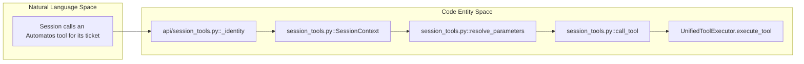
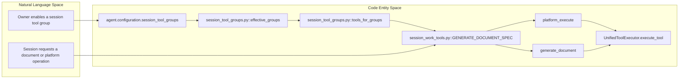
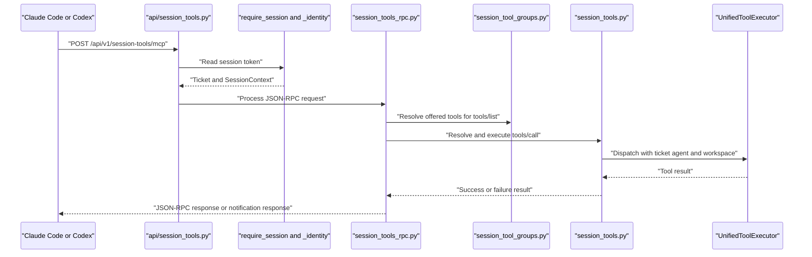

# Session Tools Bridge

Relevant source files

The following files were used as context for generating this wiki page:

- [orchestrator/api/session_tools.py](orchestrator/api/session_tools.py)
- [orchestrator/core/seeds/utterances/documents.yaml](orchestrator/core/seeds/utterances/documents.yaml)
- [orchestrator/core/seeds/utterances/tasks.yaml](orchestrator/core/seeds/utterances/tasks.yaml)
- [orchestrator/modules/documents/template_validation.py](orchestrator/modules/documents/template_validation.py)
- [orchestrator/modules/tools/discovery/actions_templates.py](orchestrator/modules/tools/discovery/actions_templates.py)
- [orchestrator/modules/tools/discovery/handlers_template_writes.py](orchestrator/modules/tools/discovery/handlers_template_writes.py)
- [orchestrator/modules/tools/discovery/session_ticket.py](orchestrator/modules/tools/discovery/session_ticket.py)
- [orchestrator/modules/tools/execution/params_text.py](orchestrator/modules/tools/execution/params_text.py)
- [orchestrator/services/session_denials.py](orchestrator/services/session_denials.py)
- [orchestrator/services/session_tool_groups.py](orchestrator/services/session_tool_groups.py)
- [orchestrator/services/session_tool_slots.py](orchestrator/services/session_tool_slots.py)
- [orchestrator/services/session_tools.py](orchestrator/services/session_tools.py)
- [orchestrator/services/session_tools_rpc.py](orchestrator/services/session_tools_rpc.py)
- [orchestrator/services/session_work_tools.py](orchestrator/services/session_work_tools.py)
- [orchestrator/tests/test_942_a_each_group_tool_runs_its_action_in_the_tickets_workspace.py](orchestrator/tests/test_942_a_each_group_tool_runs_its_action_in_the_tickets_workspace.py)
- [orchestrator/tests/test_942_b_an_agents_sessions_are_offered_its_own_groups_every_time.py](orchestrator/tests/test_942_b_an_agents_sessions_are_offered_its_own_groups_every_time.py)
- [orchestrator/tests/test_942_c_a_tool_outside_the_agents_groups_is_refused_in_words.py](orchestrator/tests/test_942_c_a_tool_outside_the_agents_groups_is_refused_in_words.py)
- [orchestrator/tests/test_f321_b_params_sent_as_json_text_run_as_the_object.py](orchestrator/tests/test_f321_b_params_sent_as_json_text_run_as_the_object.py)
- [orchestrator/tests/test_f329_a_a_session_is_offered_the_database_and_the_graph.py](orchestrator/tests/test_f329_a_a_session_is_offered_the_database_and_the_graph.py)
- [orchestrator/tests/test_f330_a_a_burst_of_session_tool_calls_neither_drains_the_pool_nor_stops_the_loop.py](orchestrator/tests/test_f330_a_a_burst_of_session_tool_calls_neither_drains_the_pool_nor_stops_the_loop.py)
- [orchestrator/tests/test_f369_c_params_sent_as_a_python_dict_run_as_that_dict.py](orchestrator/tests/test_f369_c_params_sent_as_a_python_dict_run_as_that_dict.py)
- [orchestrator/tests/test_prd239_session_mode_settings.py](orchestrator/tests/test_prd239_session_mode_settings.py)
- [orchestrator/tests/test_prd245_review_semantics.py](orchestrator/tests/test_prd245_review_semantics.py)
- [orchestrator/tests/test_prd245_session_composio.py](orchestrator/tests/test_prd245_session_composio.py)
- [orchestrator/tests/test_prd245_session_token_realdb.py](orchestrator/tests/test_prd245_session_token_realdb.py)
- [orchestrator/tests/test_prd245_session_tools.py](orchestrator/tests/test_prd245_session_tools.py)

## Purpose and Scope

The Session Tools Bridge (PRD-245) lets a `runtime: cli` agent session call a stable, scoped set of Automatos tools through an HTTP JSON-RPC endpoint. The bridge resolves the session’s identity from a per-ticket token, applies ticket and workspace scope on the server, and dispatches tool calls through the same `UnifiedToolExecutor` used by API agents. [orchestrator/services/session_tools.py:1-24]() [orchestrator/api/session_tools.py:1-26]()

This page covers the session tool catalog, per-agent tool groups, the MCP wire protocol, parameter-text normalization, and the available evidence about session plans and ticket creation. Session plan implementation details are not included in the provided source excerpts; the ticket-lane test excerpt does establish the `cli_ticket_lane.open_session_ticket` entry point. [orchestrator/services/session_tools.py:1-24]() [orchestrator/services/session_tool_groups.py:1-15]() [orchestrator/tests/test_prd239_session_mode_settings.py:145-152]()

Sources: [orchestrator/services/session_tools.py:1-24]() [orchestrator/api/session_tools.py:1-26]() [orchestrator/services/session_tool_groups.py:1-15]() [orchestrator/tests/test_prd239_session_mode_settings.py:145-152]()

---

## 1. Core Architecture & Fixed Tool Catalog

`services/session_tools.py` is the canonical definition point for the tools a ticket session may call. The catalog is fixed and stable so that sessions for the same agent advertise the same tool text across turns. Per-ticket scope is applied when resolving each call rather than by changing the advertised list. [orchestrator/services/session_tools.py:1-24]() The test suite pins the ordered tool names and checks that each definition has a non-empty description and an object input schema. [orchestrator/tests/test_prd245_session_tools.py:45-74]()

### Key Components

| Component | Role |
|---|---|
| `SessionTool` | Describes a tool’s name, action or tool-name target, model-facing description, input schema, scope resolver, dispatch type, read/write classification, optional runner, output projection, and alternate action names. [orchestrator/services/session_tools.py:97-124]() |
| `SessionContext` | Carries session identity and scope: ticket ID, agent ID and name, workspace ID, and—when relevant—the mission field ID. The API constructs it from the resolved ticket, not from tool-call arguments. [orchestrator/services/session_tools.py:126-133]() [orchestrator/api/session_tools.py:103-124]() |
| `resolve_parameters` | Resolves input parameters against a tool’s scope and context. Tests verify that report linkage is forced to the current ticket and that a ticket-update note does not accept a caller-supplied status. [orchestrator/tests/test_prd245_session_tools.py:103-133]() |
| `call_tool` | Dispatches calls using the session’s resolved context. Group-tool tests verify that the ticket’s agent and workspace are passed to the executor and that supplied foreign scope fields do not reach the action. [orchestrator/tests/test_942_a_each_group_tool_runs_its_action_in_the_tickets_workspace.py:60-83]() |
| `PLATFORM_DISPATCHER` | Names the `platform_execute` dispatch path used for platform actions. `composio_execute` and `generate_document` are dispatched by tool name instead. [orchestrator/services/session_tools.py:38-49]() [orchestrator/tests/test_prd245_session_tools.py:77-92]() |

A session cannot close or move its ticket by calling `update_ticket`: the allowed status tuple is `("in_progress",)`. The host owns the end-of-session result and ticket transition. A session that is stuck uses `ask_human` rather than parking its ticket mid-turn. [orchestrator/services/session_tools.py:53-68]() The tool-list tests also pin `submit_report` linkage to the current ticket, even if the call supplies other linked task IDs. [orchestrator/tests/test_prd245_session_tools.py:103-109]()

### Natural Language to Code Entity Mapping: Session Tool Calls

This diagram maps the session-facing idea of “call a tool for this ticket” to the code entities that define identity, scope, and execution. [orchestrator/services/session_tools.py:97-133]() [orchestrator/api/session_tools.py:103-124]() [orchestrator/tests/test_942_a_each_group_tool_runs_its_action_in_the_tickets_workspace.py:60-83]()

Sources: [orchestrator/services/session_tools.py:97-133]() [orchestrator/api/session_tools.py:103-124]() [orchestrator/tests/test_942_a_each_group_tool_runs_its_action_in_the_tickets_workspace.py:60-83]()

---

## 2. Tool Groups & Agent Customization

An agent may configure `agent.configuration["session_tool_groups"]` to select which optional groups its sessions receive. If the setting is absent or null, `DEFAULT_SESSION_TOOL_GROUPS` applies; an explicit empty list leaves only core tools. Group selection is fixed per agent, while ticket scope remains per call. [orchestrator/services/session_tool_groups.py:1-15]() [orchestrator/services/session_tool_groups.py:68-72]()

| Group | Tools | Purpose |
|---|---|---|
| `data` | `query_database` | Read-only queries against the workspace’s connected database. [orchestrator/services/session_tool_groups.py:38-41]() |
| `graph` | `query_graph` | Read-only queries of the workspace knowledge graph. [orchestrator/services/session_tool_groups.py:42-44]() |
| `documents` | `generate_document`, `list_templates`, `get_template_schema`, `render_preview`, `create_template`, `update_template`, `get_brand_kit`, `propose_brand_kit`, `save_approved_brand_kit` | Document generation and template/brand-kit operations. [orchestrator/services/session_tool_groups.py:45-51]() |
| `playbooks` | `list_playbooks`, `get_playbook`, `run_playbook` | Read workspace playbooks and start a run. [orchestrator/services/session_tool_groups.py:52-54]() |
| `reports` | `get_latest_report` | Read another agent’s latest report. [orchestrator/services/session_tool_groups.py:55-57]() |
| `missions` | `list_missions`, `get_mission`, `search_mission_findings` | Read missions and search their shared findings. [orchestrator/services/session_tool_groups.py:58-60]() |
| `socials` | `create_social_post`, `update_social_post`, `submit_social_post`, `get_social_post`, `list_social_posts` | Draft, update, read, and submit posts for approval; the group description excludes approval, scheduling, and publishing. [orchestrator/services/session_tool_groups.py:61-66]() |

`parse_groups` validates group IDs and returns them in catalog order. `effective_groups` applies the default or the agent’s saved selection. `tools_for_groups` puts core tools first, followed by selected group tools in catalog order. `agent_tool_names` supplies that list for the agent’s sessions; `offered_definitions` filters the stable definitions for MCP `tools/list`. [orchestrator/services/session_tool_groups.py:79-91]() [orchestrator/services/session_tool_groups.py:105-147]()

The group-tool execution contract is deliberately shared with API agents: the executor receives the ticket’s workspace and agent, while the tool’s declared schema controls forwarded parameters. [orchestrator/services/session_work_tools.py:1-8]() Tests verify this for both dispatcher-based actions and the by-name `generate_document` path. [orchestrator/tests/test_942_a_each_group_tool_runs_its_action_in_the_tickets_workspace.py:75-92]()

### Natural Language to Code Entity Mapping: Groups to Execution

This diagram connects the user-facing choice of “give this agent document tools” to the group catalog and executor dispatch. [orchestrator/services/session_tool_groups.py:27-36]() [orchestrator/services/session_tool_groups.py:110-147]() [orchestrator/services/session_work_tools.py:70-95]() [orchestrator/tests/test_942_a_each_group_tool_runs_its_action_in_the_tickets_workspace.py:75-92]()

Sources: [orchestrator/services/session_tool_groups.py:27-36]() [orchestrator/services/session_tool_groups.py:79-147]() [orchestrator/services/session_work_tools.py:70-95]() [orchestrator/tests/test_942_a_each_group_tool_runs_its_action_in_the_tickets_workspace.py:75-92]()

---

## 3. MCP Wire Protocol & Loopback Endpoint

The session endpoint is documented as `/api/v1/session-tools/mcp`; it is guarded by `CLI_RUNTIME_ENABLED`, with the route unavailable when the flag is off. The endpoint module owns authentication, per-ticket call allowance, concurrency slots, and HTTP transport. Protocol handling is delegated to `services/session_tools_rpc.py`, while execution is delegated to `services/session_tools.py`. [orchestrator/api/session_tools.py:1-26]() [orchestrator/api/session_tools.py:48-64]()

### Endpoint & Auth Architecture

- **Authentication:** `bearer_token` accepts either `Authorization: Bearer ...` or `X-Session-Token`. `require_session` resolves the token and returns a ticket plus `SessionContext`; an invalid or expired token returns HTTP 401. [orchestrator/api/session_tools.py:67-100]()
- **Identity lookup:** `_identity` calls `cli_host_service.resolve_session_token`, builds context from the task and assigned agent, reads mission-field context, and obtains the offered tool names from the agent’s configured groups. It releases a read-only database transaction before returning. [orchestrator/api/session_tools.py:103-124]()
- **Mission scope:** `mission_field_id` derives the field from the ticket’s orchestration run, rather than accepting a field ID from the tool call. [orchestrator/api/session_tools.py:136-151]()
- **Resource bounds:** The route documents a per-ticket maximum call allowance and a process-wide concurrency bound. It uses a slot so bursts wait for a tool-call slot rather than holding a database pool connection while waiting. [orchestrator/api/session_tools.py:9-18]()
- **Protocol behavior:** The RPC module handles the MCP handshake, notifications, tool listing and calls, and ping. A refused or failed tool call is returned as tool output with `isError: true`; malformed requests use JSON-RPC errors. [orchestrator/services/session_tools_rpc.py:16-29]() [orchestrator/services/session_tools_rpc.py:92-109]()

### MCP Loopback Request Lifecycle

The diagram follows the documented request path from HTTP authentication through MCP handling to tool execution. [orchestrator/api/session_tools.py:1-26]() [orchestrator/api/session_tools.py:67-124]() [orchestrator/services/session_tools_rpc.py:1-29]()

Sources: [orchestrator/api/session_tools.py:1-26]() [orchestrator/api/session_tools.py:67-124]() [orchestrator/services/session_tools_rpc.py:1-29]() [orchestrator/services/session_tool_groups.py:121-147]()

---

## 4. Parameter Decoding and Safety (`params_text.py`)

Some model/tool-call paths send a dispatcher’s nested `params` as text instead of a JSON object. The normalization is located at the shared executor boundary so it applies to callers beyond chat, including playbooks, missions, and heartbeats. [orchestrator/modules/tools/execution/params_text.py:1-20]()

| Function or constant | Behavior |
|---|---|
| `NESTED_PARAMS_TOOLS` | Limits nested parameter decoding to `platform_execute` and `composio_execute`. [orchestrator/modules/tools/execution/params_text.py:34-40]() |
| `_python_dict` | Uses `ast.literal_eval`, then a JSON round-trip, to accept Python-literal dictionaries that are representable as JSON. It rejects oversized text and non-dictionaries. [orchestrator/modules/tools/execution/params_text.py:43-57]() |
| `params_object` | Attempts up to two JSON decoding layers, accepts literal newlines in JSON strings, and falls back to `_python_dict` when JSON parsing fails. If the result is not a dictionary, it returns the original input. [orchestrator/modules/tools/execution/params_text.py:60-77]() |
| `nested_params_decoded` | Copies the dispatcher arguments with a decoded `params` value only when the tool is one of the supported dispatchers and the decoded value is an object. [orchestrator/modules/tools/execution/params_text.py:93-101]() |
| `decodes_nested_params` | Wraps `UnifiedToolExecutor.execute_tool`, normalizes nested parameters before schema reading, and refuses malformed text for `composio_execute` rather than silently dropping the action parameters. [orchestrator/modules/tools/execution/params_text.py:132-150]() |

For invalid nested parameters, `params_refusal_text` explains that the action’s `params` must be an object and that nothing ran. The Composio refusal path returns a failed tool result with that explanation. [orchestrator/modules/tools/execution/params_text.py:103-129]() [orchestrator/modules/tools/execution/params_text.py:145-149]()

Sources: [orchestrator/modules/tools/execution/params_text.py:1-20]() [orchestrator/modules/tools/execution/params_text.py:34-40]() [orchestrator/modules/tools/execution/params_text.py:43-77]() [orchestrator/modules/tools/execution/params_text.py:93-101]() [orchestrator/modules/tools/execution/params_text.py:103-150]()

---

## 5. Session Plans and Ticket Lane

The available excerpts establish the ticket-lane entry point `cli_ticket_lane.open_session_ticket`. The session-mode test exercises opening a session ticket for an agent configured with `runtime: cli`, a workspace, a chat ID, a host, and an actor. It also patches board-consent and board-event side effects for that test. [orchestrator/tests/test_prd239_session_mode_settings.py:145-152]()

The provided material does not include the `session_plans.py` implementation, plan event handling, verdict states, or plan-resumption behavior. Those details therefore cannot be documented here without additional source evidence. The test excerpt also ends at the `open_session_ticket` call, so it does not establish the function’s returned ticket state or subsequent lifecycle. [orchestrator/tests/test_prd239_session_mode_settings.py:145-152]()

Sources: [orchestrator/tests/test_prd239_session_mode_settings.py:145-152]()

---