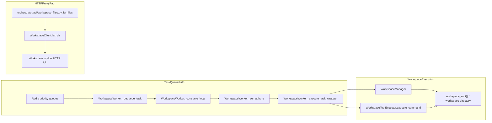
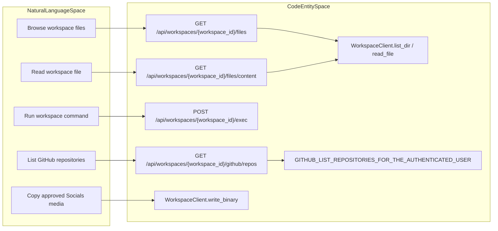

# Workspace Worker Architecture

<details>
<summary>Relevant source files</summary>

The following files were used as context for generating this wiki page:

- [docs/workspace-execution/_index.md](docs/workspace-execution/_index.md)
- [docs/workspace-execution/file-operations.md](docs/workspace-execution/file-operations.md)
- [frontend/components/widgets/TerminalWidget/InteractiveTerminal.tsx](frontend/components/widgets/TerminalWidget/InteractiveTerminal.tsx)
- [frontend/components/widgets/TerminalWidget/index.tsx](frontend/components/widgets/TerminalWidget/index.tsx)
- [orchestrator/api/socials_campaigns.py](orchestrator/api/socials_campaigns.py)
- [orchestrator/api/workspace_files.py](orchestrator/api/workspace_files.py)
- [orchestrator/api/workspace_github.py](orchestrator/api/workspace_github.py)
- [orchestrator/core/utils/slug.py](orchestrator/core/utils/slug.py)
- [orchestrator/core/workspace_client.py](orchestrator/core/workspace_client.py)
- [orchestrator/modules/socials/workspace_copies.py](orchestrator/modules/socials/workspace_copies.py)
- [orchestrator/modules/tools/discovery/canvas_git.py](orchestrator/modules/tools/discovery/canvas_git.py)
- [orchestrator/services/owner_knowledge.py](orchestrator/services/owner_knowledge.py)
- [orchestrator/tests/helpers_workspace_worker.py](orchestrator/tests/helpers_workspace_worker.py)
- [orchestrator/tests/test_f173_a_new_workspace_can_save_a_file.py](orchestrator/tests/test_f173_a_new_workspace_can_save_a_file.py)
- [orchestrator/tests/test_f178_b_a_rendered_page_loads_no_protected_file.py](orchestrator/tests/test_f178_b_a_rendered_page_loads_no_protected_file.py)
- [orchestrator/tests/test_f178_the_worker_never_serves_a_deploy_key.py](orchestrator/tests/test_f178_the_worker_never_serves_a_deploy_key.py)
- [orchestrator/tests/test_p2w2_tasks_lane_deleted.py](orchestrator/tests/test_p2w2_tasks_lane_deleted.py)
- [orchestrator/tests/test_prd170_canvas_git.py](orchestrator/tests/test_prd170_canvas_git.py)
- [orchestrator/tests/test_slugify.py](orchestrator/tests/test_slugify.py)
- [orchestrator/tests/test_socials_worker_binary_pieces.py](orchestrator/tests/test_socials_worker_binary_pieces.py)
- [orchestrator/tests/test_socials_workspace_copies.py](orchestrator/tests/test_socials_workspace_copies.py)
- [services/workspace-worker/canvas_session_service.py](services/workspace-worker/canvas_session_service.py)
- [services/workspace-worker/executor.py](services/workspace-worker/executor.py)
- [services/workspace-worker/main.py](services/workspace-worker/main.py)
- [services/workspace-worker/workspace_manager.py](services/workspace-worker/workspace_manager.py)

</details>


## Purpose and Scope

The **Workspace Worker** is a separate service that consumes workspace tasks from Redis priority queues and runs them against workspace directories on a persistent volume. This page covers the worker’s queue-consumer architecture, priority and concurrency controls, lifecycle and health reporting, filesystem and command-execution boundary, Canvas SDK session service, and the Orchestrator’s HTTP proxy relationship to the worker. [services/workspace-worker/main.py:1-20](), [services/workspace-worker/executor.py:1-14](), [services/workspace-worker/canvas_session_service.py:1-23](), [orchestrator/core/workspace_client.py:1-14]()

Sources: [services/workspace-worker/main.py:1-20](), [services/workspace-worker/executor.py:1-14](), [services/workspace-worker/canvas_session_service.py:1-23](), [orchestrator/core/workspace_client.py:1-14]()

---

## Architecture Overview

The subsystem has two principal paths. In the **task path**, the worker connects to Redis, polls task queues, and runs accepted work under a concurrency limit. In the **HTTP path**, the Orchestrator uses `WorkspaceClient` to proxy workspace operations to the worker’s HTTP API; `workspace_files.py` exposes selected file operations as workspace-scoped API routes. [services/workspace-worker/main.py:92-179](), [orchestrator/core/workspace_client.py:1-14](), [orchestrator/api/workspace_files.py:1-20]()

The worker’s filesystem is rooted at `workspace_root()`. `WorkspaceManager` provisions a directory tree per workspace, including persistent directories such as `repos`, `reports`, and `artifacts`, and an ephemeral `tasks` directory. The worker uses `WorkspaceToolExecutor` to validate commands and resolve working directories before executing workspace commands. [services/workspace-worker/main.py:92-97](), [services/workspace-worker/workspace_manager.py:6-21](), [services/workspace-worker/workspace_manager.py:67-85](), [services/workspace-worker/executor.py:111-164]()

### Key Components

| Component | Role | Implementation |
|---|---|---|
| `WorkspaceWorker` | Redis queue consumer. Owns the consumer loop, task semaphore, active-task tracking, worker identity, and shutdown flag. | [services/workspace-worker/main.py:62-90]() |
| `_consume_loop` | Polls queues while the worker is running, checks concurrency availability, dequeues work, and starts task execution. | [services/workspace-worker/main.py:155-179]() |
| `WorkspaceManager` | Manages one workspace’s directory root, provisioning, storage quota, and task-directory lifecycle. | [services/workspace-worker/workspace_manager.py:67-85](), [services/workspace-worker/workspace_manager.py:107-126](), [services/workspace-worker/workspace_manager.py:146-155]() |
| `WorkspaceToolExecutor` | Validates and executes shell commands within a workspace, including working-directory resolution and a sandboxed environment. | [services/workspace-worker/executor.py:111-120](), [services/workspace-worker/executor.py:125-186]() |
| `CanvasSessionManager` | Manages headless SDK sessions, their persisted state, and in-memory live-session handles. | [services/workspace-worker/canvas_session_service.py:82-112](), [services/workspace-worker/canvas_session_service.py:138-154]() |
| `WorkspaceClient` | Async HTTP proxy scoped to a `workspace_id`; builds worker URLs and maps connection or timeout errors into failure results. | [orchestrator/core/workspace_client.py:59-94]() |

Sources: [services/workspace-worker/main.py:62-90](), [services/workspace-worker/main.py:155-179](), [services/workspace-worker/workspace_manager.py:67-85](), [services/workspace-worker/workspace_manager.py:107-126](), [services/workspace-worker/workspace_manager.py:146-155](), [services/workspace-worker/executor.py:111-120](), [services/workspace-worker/executor.py:125-186](), [services/workspace-worker/canvas_session_service.py:82-112](), [services/workspace-worker/canvas_session_service.py:138-154](), [orchestrator/core/workspace_client.py:59-94]()

### Task and HTTP Data Flow

The diagram distinguishes the Redis task-consumer path from the Orchestrator-to-worker HTTP path. The worker entry point shown here is `WorkspaceWorker`; the specific worker HTTP route implementation is not included in the supplied source excerpts. [services/workspace-worker/main.py:62-90](), [services/workspace-worker/main.py:155-179](), [orchestrator/core/workspace_client.py:59-94](), [orchestrator/api/workspace_files.py:79-96]()

**Diagram: Redis task consumption and workspace HTTP proxy**



Sources: [services/workspace-worker/main.py:46-56](), [services/workspace-worker/main.py:155-179](), [services/workspace-worker/workspace_manager.py:67-85](), [services/workspace-worker/executor.py:111-164](), [orchestrator/api/workspace_files.py:79-96](), [orchestrator/core/workspace_client.py:149-164]()

---

## Queue Management & Priority

The worker declares four Redis list names in `QUEUE_NAMES`: `workspace:tasks:critical`, `workspace:tasks:high`, `workspace:tasks:normal`, and `workspace:tasks:low`. The worker class documents its polling order as `critical > high > normal > low`. The queue names are explicitly marked as patterns that must match `queued.py`. [services/workspace-worker/main.py:46-56](), [services/workspace-worker/main.py:62-71]()

The worker reads `WORKER_CONCURRENCY` from the environment, defaulting to `3`, and initializes `_semaphore` with that capacity. In `_consume_loop`, it waits while the semaphore’s current value is zero; after dequeueing a task payload, it acquires a semaphore slot and creates an asynchronous task for `_execute_task_wrapper`. When no payload is available, it sleeps for the configured idle poll interval of 0.5 seconds. [services/workspace-worker/main.py:73-90](), [services/workspace-worker/main.py:155-179]()

| Redis queue | Priority |
|---|---:|
| `workspace:tasks:critical` | Highest |
| `workspace:tasks:high` | High |
| `workspace:tasks:normal` | Normal |
| `workspace:tasks:low` | Lowest |

The worker also defines Redis key patterns for per-task status and results, a per-task events channel, and a per-workspace active-task set. The supplied excerpt establishes the key names, but does not show the code that writes to or reads from each key. [services/workspace-worker/main.py:46-60]()

**Diagram: Priority polling and concurrency gate**

```mermaid
flowchart TD
  Start["_consume_loop"]
  Capacity{"_semaphore._value > 0"}
  Wait["asyncio.sleep(0.5)"]
  Poll["_dequeue_task"]
  Found{"task_payload is not None"}
  Acquire["_semaphore.acquire()"]
  Create["asyncio.create_task(_execute_task_wrapper)"]
  Critical["workspace:tasks:critical"]
  High["workspace:tasks:high"]
  Normal["workspace:tasks:normal"]
  Low["workspace:tasks:low"]

  Start --> Capacity
  Capacity -->| "No" | Wait --> Start
  Capacity -->| "Yes" | Poll
  Poll --> Found
  Found -->| "No" | Wait
  Found -->| "Yes" | Acquire --> Create --> Start
  Poll -. "priority order" .-> Critical
  Poll -. "then" .-> High
  Poll -. "then" .-> Normal
  Poll -. "then" .-> Low
```

Sources: [services/workspace-worker/main.py:46-56](), [services/workspace-worker/main.py:62-71](), [services/workspace-worker/main.py:73-90](), [services/workspace-worker/main.py:155-179]()

---

## Workspace Isolation & Security

Workspace storage is rooted at `workspace_root()`, with a directory per workspace. `WorkspaceManager` describes the filesystem layout and provisions standard subdirectories on first use. Its default quota is derived from `WORKSPACE_DEFAULT_QUOTA_GB`, which defaults to 5 GB; `check_quota` calculates disk usage and compares it with the workspace quota. [services/workspace-worker/workspace_manager.py:6-21](), [services/workspace-worker/workspace_manager.py:35-40](), [services/workspace-worker/workspace_manager.py:67-85](), [services/workspace-worker/workspace_manager.py:91-126](), [services/workspace-worker/workspace_manager.py:132-155]()

### Command Validation

`WorkspaceToolExecutor` is documented as the security boundary for agent code execution. Its `ALLOWED_COMMANDS` set limits executable command names; `BLOCKED_PATTERNS` rejects selected command forms even if their binary is otherwise allowed. `execute_command` invokes `_validate_command` before resolving the working directory and building the command environment. The excerpt shows that commands containing shell operators use `create_subprocess_shell`; the surrounding validation is performed before that branch. [services/workspace-worker/executor.py:1-15](), [services/workspace-worker/executor.py:34-101](), [services/workspace-worker/executor.py:125-186]()

### Workspace Paths and Sensitive Names

`WorkspaceManager` identifies sensitive names that file routes must not list or serve, including `.ssh`, `.gitconfig`, cloud credential directories, `.workspace_meta.json`, and `.canvas`; it also treats names beginning with `.task_env_` as sensitive. `is_workspace_id` accepts only a canonical lowercase UUID string. The manager’s documentation identifies safe path resolution as one of its responsibilities, and `WorkspaceToolExecutor` uses `resolve_safe_path` when a command specifies a working directory. [services/workspace-worker/workspace_manager.py:42-64](), [services/workspace-worker/workspace_manager.py:67-85](), [services/workspace-worker/executor.py:156-164]()

### Security Entity Mapping

This mapping connects workspace-security concepts to the code entities that implement or reference them. [services/workspace-worker/executor.py:34-101](), [services/workspace-worker/executor.py:143-166](), [services/workspace-worker/workspace_manager.py:42-64](), [services/workspace-worker/workspace_manager.py:67-85](), [services/workspace-worker/workspace_manager.py:132-155]()

**Diagram: Workspace security concepts to code entities**

```mermaid
flowchart LR
  subgraph "NaturalLanguageSpace"
    Command["Allowed command"]
    DangerousPattern["Blocked command pattern"]
    WorkingDirectory["Command working directory"]
    SensitiveFile["Protected file name"]
    WorkspaceIdentity["Workspace identifier"]
    DiskUsage["Workspace disk usage"]
  end

  subgraph "CodeEntitySpace"
    Allowlist["ALLOWED_COMMANDS"]
    Blocklist["_BLOCKED_RE"]
    PathResolver["WorkspaceManager.resolve_safe_path"]
    SensitiveCheck["is_sensitive_name"]
    UUIDCheck["is_workspace_id"]
    QuotaCheck["WorkspaceManager.check_quota"]
  end

  Command -->| "validated against" | Allowlist
  DangerousPattern -->| "matched by" | Blocklist
  WorkingDirectory -->| "resolved through" | PathResolver
  SensitiveFile -->| "checked by" | SensitiveCheck
  WorkspaceIdentity -->| "validated by" | UUIDCheck
  DiskUsage -->| "compared by" | QuotaCheck
```

Sources: [services/workspace-worker/executor.py:34-101](), [services/workspace-worker/executor.py:143-166](), [services/workspace-worker/workspace_manager.py:42-64](), [services/workspace-worker/workspace_manager.py:67-85](), [services/workspace-worker/workspace_manager.py:132-155]()

---

## Code Canvas & SDK Sessions

`CanvasSessionManager` manages one headless Claude Agent SDK session per workspace. Session state is stored under `.canvas/session.json`, with the SDK configuration and transcript directory under `.canvas/claude/`. A later session start can use the persisted `sdk_session_id` as the SDK resume identifier. The worker’s filesystem sensitive-name rules include `.canvas`. [services/workspace-worker/canvas_session_service.py:1-28](), [services/workspace-worker/canvas_session_service.py:66-76](), [services/workspace-worker/canvas_session_service.py:82-96](), [services/workspace-worker/workspace_manager.py:42-47]()

The session service defines `CanvasSessionState` for persisted state and `_LiveSession` for in-memory state, including the SDK client, message-pump task, approval bridge, and session-scoped `auto_accept_edits` flag. The service accepts an optional event sink; sink failures are logged and swallowed so a dropped UI event does not terminate the message pump. [services/workspace-worker/canvas_session_service.py:82-112](), [services/workspace-worker/canvas_session_service.py:138-163]()

Tool access is gated by `_make_tool_gate`. Its documented order is confinement first, then human approval for confined mutating operations. The session service imports `evaluate_tool_confinement`, and describes the confinement check as rebinding and validating agent-supplied paths against the workspace root. [services/workspace-worker/canvas_session_service.py:19-23](), [services/workspace-worker/canvas_session_service.py:44-50](), [services/workspace-worker/canvas_session_service.py:165-180]()

**Diagram: Canvas session state and tool gate**

```mermaid
flowchart TD
  Start["CanvasSessionManager"]
  State["CanvasSessionState"]
  Live["_LiveSession"]
  Persist[".canvas/session.json"]
  Transcript[".canvas/claude/"]
  ToolCall["SDK tool call"]
  Confinement["evaluate_tool_confinement"]
  Approval["PendingApprovals / human decision"]
  EventSink["_emit(event)"]

  Start --> State
  Start --> Live
  State --> Persist
  Live --> Transcript
  ToolCall --> Confinement
  Confinement -->| "confined mutating operation" | Approval
  Confinement -->| "escape denied" | EventSink
  Approval --> EventSink
```

Sources: [services/workspace-worker/canvas_session_service.py:1-28](), [services/workspace-worker/canvas_session_service.py:44-55](), [services/workspace-worker/canvas_session_service.py:61-76](), [services/workspace-worker/canvas_session_service.py:82-112](), [services/workspace-worker/canvas_session_service.py:138-180]()

---

## Lifecycle & Heartbeat

`WorkspaceWorker.start` creates an async Redis client, then retries `ping()` up to 15 times, sleeping two seconds between retryable startup failures. Once Redis is ready, it registers handlers for `SIGTERM` and `SIGINT`, launches the health-server and heartbeat-loop tasks, and enters `_consume_loop`. The supplied source shows these background tasks being started, but does not include the implementations of `_health_server` or `_heartbeat_loop`; details of their response format and reporting cadence are therefore not specified here. [services/workspace-worker/main.py:92-132]()

On shutdown, `_handle_shutdown` sets `_running` to `False`. The `start` cleanup path waits for active tasks with `asyncio.gather(..., return_exceptions=True)`, cancels the health and heartbeat tasks, closes the Redis client, and logs completion. The worker reads `WORKER_HEALTH_PORT` with a default of `8081`; the header documents `DATABASE_URL` as required, but the shown startup excerpt does not show database connection initialization. [services/workspace-worker/main.py:13-20](), [services/workspace-worker/main.py:73-80](), [services/workspace-worker/main.py:119-152]()

The worker tracks active tasks in `_active_tasks`. It also maintains `_running_in_workspace`, a process-local map of tasks by workspace. The source comments explain that this accounting assumes one worker process per shared workspace volume: with multiple replicas, one process could clear a shared deploy key while another still uses it. [services/workspace-worker/main.py:77-90]()

**Diagram: Worker startup and graceful shutdown**

```mermaid
stateDiagram-v2
  [*] --> RedisConnect: "WorkspaceWorker.start"
  RedisConnect --> RedisRetry: "ping fails"
  RedisRetry --> RedisConnect: "retry up to 15 attempts"
  RedisConnect --> Running: "Redis ready"
  Running --> Running: "_consume_loop"
  Running --> StopRequested: "SIGTERM or SIGINT"
  StopRequested --> Drain: "_running = False"
  Drain --> Cleanup: "await active tasks"
  Cleanup --> Closed: "cancel health and heartbeat; close Redis"
  Closed --> [*]
```



Sources: [services/workspace-worker/main.py:92-148](), [services/workspace-worker/main.py:150-179]()

---

## Git Integration & Workspace Files

The Orchestrator exposes workspace file operations beneath `/api/workspaces/{workspace_id}`. In `workspace_files.py`, `list_files` verifies that the request context’s workspace matches the route’s `workspace_id`, selects a storage client based on the path, and calls `list_dir`. Paths under `graph` are directed to `DbWorkspaceClient`; other paths use `WorkspaceClient`. [orchestrator/api/workspace_files.py:44-73](), [orchestrator/api/workspace_files.py:79-96]()

`WorkspaceClient` builds worker URLs using `WORKER_INTERNAL_URL` and scopes requests to a workspace ID. It uses a shared async `httpx.AsyncClient`, optionally adds `X-Internal-Token`, and returns structured failure results for connection and timeout errors. The files API also declares routes for file content, raw downloads, and writes; the shown route excerpts establish the content and raw-download proxy behavior. [orchestrator/core/workspace_client.py:31-77](), [orchestrator/core/workspace_client.py:80-94](), [orchestrator/core/workspace_client.py:98-124](), [orchestrator/api/workspace_files.py:9-20](), [orchestrator/api/workspace_files.py:99-147]()

The GitHub integration API is mounted at `/api/workspaces/{workspace_id}/github`. Its shown repository-list route checks workspace access, resolves a Composio entity for the workspace, and invokes the GitHub repository-list action. `CloneRequest` validates HTTPS clone URLs against an allowlist of `github.com`, `gitlab.com`, and `bitbucket.org`, and validates optional branch names. The supplied excerpt does not include the clone route implementation, so this page does not describe its worker-side execution behavior. [orchestrator/api/workspace_github.py:32-42](), [orchestrator/api/workspace_github.py:55-63](), [orchestrator/api/workspace_github.py:82-108](), [orchestrator/api/workspace_github.py:114-145]()

Approved Socials media can also be copied into workspace paths under `socials/images/` or `socials/videos/`. `copy_files` streams stored media through `WorkspaceClient.write_binary`; the copy is described as a convenience and does not block or undo the post approval. [orchestrator/modules/socials/workspace_copies.py:1-22](), [orchestrator/modules/socials/workspace_copies.py:45-53](), [orchestrator/modules/socials/workspace_copies.py:90-105](), [orchestrator/modules/socials/workspace_copies.py:119-130]()

### Workspace Operations Entity Mapping

This mapping associates user-facing operations with the API routes and client methods present in the supplied code. [orchestrator/api/workspace_files.py:9-20](), [orchestrator/api/workspace_files.py:44-73](), [orchestrator/api/workspace_files.py:79-119](), [orchestrator/core/workspace_client.py:59-77](), [orchestrator/core/workspace_client.py:80-124](), [orchestrator/api/workspace_github.py:32-42](), [orchestrator/api/workspace_github.py:114-145]()

**Diagram: Workspace operations to API and client entities**



Sources: [orchestrator/api/workspace_files.py:9-20](), [orchestrator/api/workspace_files.py:79-119](), [orchestrator/core/workspace_client.py:80-124](), [orchestrator/api/workspace_github.py:32-42](), [orchestrator/api/workspace_github.py:114-145](), [orchestrator/modules/socials/workspace_copies.py:90-105]()

### Interactive Terminal

`InteractiveTerminal` sends commands to `POST /api/workspaces/${workspaceId}/exec`, includes the current working directory when it is not the workspace root, and sets a 120-second timeout. After a successful `cd`, it consumes the worker-returned relative path as the terminal’s next working directory rather than displaying that path as command output. [frontend/components/widgets/TerminalWidget/InteractiveTerminal.tsx:67-90](), [frontend/components/widgets/TerminalWidget/InteractiveTerminal.tsx:92-115]()

Sources: [frontend/components/widgets/TerminalWidget/InteractiveTerminal.tsx:67-90](), [frontend/components/widgets/TerminalWidget/InteractiveTerminal.tsx:92-115]()

---